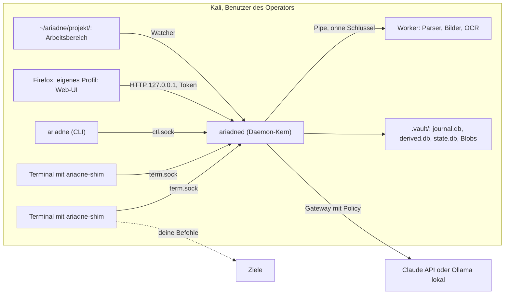

# Ariadne: Lösungsarchitektur

> Entwurf v1, Stand 2026-10-08. Erarbeitet mit KI-Unterstützung (Claude): sechs Teilsystem-Entwürfe, geprüft auf Konsistenz, Sicherheit und technische Fakten. Grundlage sind die [Vision](../VISION.md) und das [Entscheidungsprotokoll](entscheide.md). Wo etwas noch nicht gesichert ist, steht «zu verifizieren». Die Liste dieser Punkte steht in [Abschnitt 13](#13-zu-verifizieren).
>
> **Nachgeführt am 2026-10-15** nach den Entscheiden E22, E23, E26, E28, E42, E45, E72, E95 und E96 und dem Bau «v0.1-Bedienung»: Erfassung (3.4 bis 3.7, 3.9), Zeitstempel (3.7), Ereignisse (5.2, 5.3), Pipeline (5.4), Drei-Spuren-Regel (5.7), Abfragen der CLI (5.12), Lebenszyklus (8.3), eigene Secrets (8.5), Daemon-Befehle und CLI (8.10). Wo der Code vom Text abweicht, steht es in [Entwicklung](entwicklung.md), Abschnitt «Offene Abweichungen».
>
> **Nachgeführt am 2026-10-17** nach dem Bau «v0.1-Server» (E89 bis E104, E115): Web-Server und Sicherheitsmodell (7.1, 7.2), API v2 und Ereignisstrom (7.3), Präsentationsmodus (7.8), Daemon-Betrieb (8.6), Sicherung (8.9, vorgezogen), Daemon-Befehle und CLI (8.10), Fernzugriff (8.11).

## Inhalt

1. [Überblick](#1-überblick)
2. [Begriffe](#2-begriffe)
3. [Terminal-Erfassung](#3-terminal-erfassung)
4. [Weitere Quellen](#4-weitere-quellen)
5. [Daten und Auswertung](#5-daten-und-auswertung)
6. [KI und Denkanstösse](#6-ki-und-denkanstösse)
7. [Web-Oberfläche und Karte](#7-web-oberfläche-und-karte)
8. [Projekte, Speicher und Betrieb](#8-projekte-speicher-und-betrieb)
9. [Sicherheitsarchitektur](#9-sicherheitsarchitektur)
10. [Repo und Qualität](#10-repo-und-qualität)
11. [Roadmap](#11-roadmap)
12. [Risiken](#12-risiken)
13. [Zu verifizieren](#13-zu-verifizieren)
14. [Offene Fragen](#14-offene-fragen)

## 1 Überblick



**Prozesse**

| Prozess | Aufgabe | Technik |
|---|---|---|
| `ariadne-shim` | einer pro Terminal; reicht Ein- und Ausgabe durch, nimmt den Output auf, erkennt den Hotkey | Python, nur Standardbibliothek |
| `ariadned` | Kern: Aufnahme-Zustand pro Terminal, Vorlauf im RAM, Journal, Ingest, Projektion, Regeln, KI-Gateway, HTTP-API; hält als einziger Prozess die Schlüssel | Python, asyncio, FastAPI auf uvicorn |
| Worker | parsen feindliche Daten (Tool-Outputs, Dateien, Bilder, PCAPs) ohne Schlüssel, ohne Netz, ohne Home | Subprozesse des Daemons |
| `ariadne` | CLI für Start und Stop, Pause, Projekte, Kontext, Import, Export, Setup | Python |
| Web-UI | Cockpit: Aufnahme-Zustand und Pause pro Terminal, Terminals, Inbox, Karte, Belege | Svelte 5, TypeScript, Cytoscape.js |

**Datenfluss in einem Satz:** Shim und Quellen liefern Rohereignisse mit der Zeit des Shims, der Daemon hängt sie ungeschwärzt an das verschlüsselte Journal, zerlegt sie in Einheiten, lässt Worker sie parsen, berechnet daraus Behauptungen und Entitäten, setzt Sicheres als «auto» auf die Karte und legt nur das in die Inbox, was du entscheiden musst. Deine Entscheide gehen als eigene Ereignisse zurück ins Journal. Eigene Secrets ersetzt der Redaktor erst an den Ausgängen (CLI, KI, Export, Bericht).

## 2 Begriffe

Diese Begriffe gelten verbindlich in Code, UI und Doku.

| Begriff | Bedeutung |
|---|---|
| Rohereignis | unveränderlicher Eintrag in Schicht 1 des Journals, z. B. ein Output-Chunk oder eine beobachtete Datei |
| Entscheid | Eintrag in Schicht 3: etwas, das der Nutzer festgelegt hat (bestätigen, Kontext setzen, Status, Notiz). Übersteht jeden Reparse |
| Einheit | was ein Parser auf einmal liest: ein lokaler Befehl, ein Remote-Segment, eine Datei, ein Bild |
| Segment | Abschnitt eines Remote-Kontexts ohne verlässliche Befehlsgrenzen |
| Beobachtung | Aussage eines Parsers mit Fundstelle, z. B. «10.10.10.5 Port 21 Produkt vsftpd» |
| Mention | erkannter Wert ohne Aussagekraft für die Karte (z. B. eine IP in einem Log), durchsuchbar und per Klick übernehmbar |
| Claim | aggregierte Behauptung über eine Kennung, mit Konfidenz, Zustand und allen Belegen |
| Kennung | konkrete Adresse oder Name: `ip:default/10.10.10.5`, `mac:...`, `fqdn:...`, `sshkey:...` |
| Entität | Host, Service, Identität, Secret usw., zusammengesetzt aus Kennungen |
| Kontextspanne | Abschnitt eines Terminal-Stroms, der einem Host und Benutzer zugeordnet ist |
| Inbox | Liste dessen, was auf eine Entscheidung wartet: KI- und OCR-Werte, Widersprüche, unklarer Kontext, Massenfunde, verdächtige Quellen (Spur «entscheiden») |
| Spur | Einstufung eines Claims: `auto` (direkt auf die Karte), `quiet` (still, nur Nebel und Zähler), `decide` (Inbox), `user` (Entscheid des Nutzers) |
| Evidenzgruppe | alle Belege aus einem Befehl (`cmd_id`), samt seinen Begleitdateien; zählt für die Konfidenz einmal |
| Vorlauf | die letzten Minuten jedes Terminals ohne aktives Projekt, nur im RAM des Daemons; `ariadne start` kann sie übernehmen |
| Pause | Aufnahme eines Terminals für eine Weile aus (`F12 r`, `ariadne pause`), läuft von selbst ab |
| Hinweis | verdichteter Fund mit Schwere, z. B. ein Privesc-Kandidat aus linpeas |
| Finding | bewertete Schwachstelle mit betroffenen Assets, Belegen und Massnahme; entsteht nur durch den Nutzer |
| Loot | vom Ziel geholte Datei, mit Herkunftshost und Hash |
| Artefakt | Spur auf einem Ziel, die beim Cleanup entfernt werden muss (hochgeladene Datei, angelegter Benutzer) |
| Schlüsselschritt | vom Nutzer markierter Moment: foothold, privesc, pivot, loot |
| Faden | Folge der Schlüsselschritte, auf der Karte als Linie |
| Prüfziel | was an einem Dienst geprüft werden sollte, unabhängig vom Tool (z. B. anonymer Zugriff) |
| Lagebild | kompakte, deterministisch erzeugte Textzusammenfassung des Projektstands für die KI |

## 3 Terminal-Erfassung

Vier Invarianten gelten für den Shim:

1. Die Shell geht nie kaputt. Jeder Fehler endet in der nackten Shell oder in einem Relay ohne Aufnahme.
2. Der Shim schreibt nie in die Eingabe des inneren Programms, ausser den Tasten des Nutzers und Fenstergrössen.
3. Gespeichert werden der Output-Strom und alles Getippte, was ans Programm im PTY geht, auch Passwörter ohne Echo (E26). Nie gespeichert werden Präfix und Taste eines Hotkeys und Eingaben im Mini-Prompt.
4. Befehle, Segmente und Kontextzuordnung sind abgeleitet und jederzeit neu berechenbar.

### 3.1 Start und Fallback

`ariadne setup` schreibt eine Zeile zwischen Markern (`# >>> ariadne >>>`) ganz oben in `.zshrc` bzw. `.bashrc`. Sie liest `~/.local/share/ariadne/shell/init.<shell>` nur, wenn die Datei existiert.

Die Init-Datei startet den Shim nur, wenn alles zutrifft: interaktive Shell, stdin und stdout sind ein TTY, `TERM` ist nicht `dumb`, weder `ARIADNE_DISABLE` noch `~/.config/ariadne/disable` existiert, und der Shim läuft noch nicht für dieses TTY. Dann folgt `exec` auf einen `/bin/sh`-Launcher.

- **zsh hat kein `execfail`.** Ein gescheitertes `exec` in der `.zshrc` beendet die Shell. `init.zsh` prüft deshalb vor dem `exec`, ob der Launcher ausführbar ist. bash setzt zusätzlich `shopt -s execfail`.
- Der Launcher prüft, ob der Python-Interpreter des pipx-venv existiert. Ein Kali-Update kann ihn entfernen. Fehlt er, startet die Shell mit `ARIADNE_SHIM_FAILED=interpreter`, und der Fenstertitel zeigt `[ariadne inaktiv]`.
- Der Shim startet mit `python3 -I -S`. Der Launcher übergibt den Pfad zu `site-packages/ariadne/_shim/`, und der Shim setzt ihn explizit in `sys.path`. Startzeit nach dieser Änderung neu messen (Ziel unter 50 ms).
- **Doppel-Wrapping:** Der Shim nennt sich per `prctl(PR_SET_NAME)` `ariadne-shim` und prüft die Vorfahren über `/proc`. Liegt bereits ein Shim in der Kette und kein Multiplexer (`tmux`, `screen`, `zellij`, `dtach`) dazwischen, startet er ohne Aufnahme. tmux-Panes bekommen also eigene Shims, `sudo -i` und Unter-Shells nicht.

### 3.2 PTY-Relay

- `os.openpty()`, termios und Fenstergrösse auf den Slave kopieren, `fork`. Im Kind `os.login_tty()` (ab Python 3.11) und alle Signale auf `SIG_DFL`, vor allem `SIGPIPE` und `SIGXFSZ`, die Python sonst ignoriert vererbt.
- Äusseres Terminal im Raw-Mode, Wiederherstellung bei jedem Ausstieg.
- Eine `selectors`-Schleife ohne Threads. Kommt das Terminal nicht nach, liest der Shim den Master nicht weiter, stdin aber schon, damit Ctrl-C sofort durchgeht.
- `SIGWINCH` wird an den Master weitergegeben und als `term.resize` mit Offset vermerkt.
- Fehler im Aufnahmecode schalten nur die Aufnahme ab, das Relay läuft weiter.
- Der Elternprozess setzt `RLIMIT_CORE=0` und `PR_SET_DUMPABLE 0` (nicht für die Shell).
- Ziele: unter 1 ms Zusatzlatenz pro Taste, mindestens 50 MB/s Durchsatz (zu messen). Sonst später ein nativer Relay-Kern mit gleichem Protokoll.

### 3.3 Shell-Integration und Marker

Die Hooks senden die Standard-Marker `OSC 133` (A: Prompt, B: Eingabe, C: Befehl startet, D: Befehl endet mit Exit-Code) ans Terminal. Zusätzlich senden sie einen privaten Marker:

```
ESC ] 7701 ; ariadne ; v1 ; <nonce> ; <zähler> ; <typ> ; <felder> BEL
```

Die Felder sind percent-kodiert: Befehl (getippt und alias-expandiert), `cwd`, Exit-Code, `pipestatus`, Shell-PID, `SHLVL`, Benutzer. Der Shim entfernt alle `OSC 7701`-Sequenzen aus dem Anzeige-Strom und reicht gültige als Ereignis `term.mark` weiter.

**Fälschungsschutz.** Jedes Ziel kann beliebige Bytes ausgeben, auch einen `OSC 133;D`, und so eine Rückkehr nach Kali vortäuschen. Darum gilt:

- Nur Marker mit gültiger Nonce zählen. Die Nonce (128 Bit) wird bei jedem Shell-Start neu erzeugt, ein Zähler verhindert Wiederholungen.
- `D`- und `A`-Marker zählen zusätzlich nur, wenn `tcgetpgrp(master)` gerade die Prozessgruppe der Shell meldet. Solange ssh oder nc im Vordergrund läuft, ist das nie der Fall, auch wenn die Nonce geleakt ist.
- Ungültige Marker speichert Ariadne als `term.marker_forged`. Das ist ein starkes Indiz für ein Ziel, das Pentester-Tools angreift.
- Fremde `OSC 133`-Marker im Strom sind nie Befehlsgrenzen.

**Shell-Details**

- **zsh:** `add-zsh-hook preexec` und `precmd`. zsh stellt `$?` und `pipestatus` vor jedem Hook wieder her, die Reihenfolge der Hooks ist daher egal. `$3` in preexec ist nur alias-expandiert, Variablen bleiben wörtlich (`ssh user@$IP`). Der Hook löst einfache Referenzen `$NAME` und `${NAME}` ohne `eval` auf und schickt die Werte mit. `$(...)` wird nie ausgeführt.
- **bash:** `PS0` für C, `PROMPT_COMMAND` an erster Stelle für D und A, kein DEBUG-Trap. Ab bash 5.3 holt `${ builtin history 1; }` den Befehlstext ohne Fork. Bei bash 4.4 bis 5.2 kommt der Text erst mit dem D-Marker. Ob ein Befehl in der History landet, hängt an `HISTCONTROL`, fehlt er, heisst der Text «unbekannt».
- **fish (v0.2):** fish ab 4.0 sendet `OSC 133` selbst. `init.fish` sendet nur den Nonce-Marker.
- **Andere Shells:** Aufnahme ohne Befehlsgrenzen.

Der Bereich zwischen A und C (Prompt und Eingabe-Echo) wird gespeichert, geht aber nie an Parser, KI oder die Standardsuche. Unter Kali zeigt `zsh-autosuggestions` dort Einträge aus der History.

### 3.4 Hotkey und Mini-Prompt

Präfix `F12` (Sequenz `ESC [ 2 4 ~`), dann eine Taste. Zweimal `F12` sendet `F12` selbst durch. F12 ist auf jedem Layout, auch dem Schweizer, mit einem Finger erreichbar, wird von Shells und gängigen Remote-Programmen kaum genutzt und kommt in allen verbreiteten Terminals als dieselbe Sequenz an. Der Präfix ist konfigurierbar (`f12`, `ctrl-space`, `ctrl-]`, `ctrl-_`), `ariadne hotkey test` zeigt, was ankommt. Auf Laptops kann `Fn` nötig sein.

| Taste | Wirkung | Version |
|---|---|---|
| `r` | dieses Terminal 10 Minuten pausieren, ein zweites `r` hebt die Pause auf | v0.1 |
| `h` | Host für die oberste Stufe setzen oder neue Stufe darüber, mit Tab-Ergänzung | v0.1 |
| `b` | oberste Stufe schliessen | v0.1 |
| `k` | Schlüsselschritt markieren (foothold, privesc, pivot, loot), optional mit Screenshot | v0.1 |
| `s` | Screenshot anfordern | v0.1 |
| `?` | Hilfe | v0.1 |
| `u` | Benutzerwechsel als neue Stufe auf demselben Host | v0.2 |
| `y` | Kontext-Vorschlag annehmen | v0.2 |

**Schutz des Eingabekanals.** Auf stdin kommen nicht nur Tastendrücke an, sondern auch eingefügter Text und Antworten des Terminal-Emulators. Ein Ziel kann den Emulator dazu bringen, Bytes zurückzuspiegeln (Titel-Report, OSC-52-Abfrage). Deshalb:

- Ein Hotkey zählt nur, wenn Präfix und Taste jeweils allein in einem eigenen `read()` ankommen. Bursts reicht der Shim unverändert durch.
- Antwortsequenzen (`ESC P ... ST`, `ESC ] ... BEL`, `CSI ... R/c/t/y`) werden vollständig erkannt, darin wertet der Shim nie Hotkeys aus.
- Der Shim verfolgt Bracketed Paste selbst und sperrt Hotkeys kurz nach jedem Paste-Ende.
- Eine Pause per Hotkey ist im Titel sichtbar und wird als `term.pause {source: hotkey}` vermerkt; beim Fortsetzen schreibt der Shim die Lücke (`term.gap` mit Grund `pause`).

**Mini-Prompt.** Im normalen Bildschirm schreibt der Shim wie ssh `~C` eine eigene Zeile `ariadne>`. Im Alternate Screen (vim, less, htop) gibt es in v0.1 nur eine Rückmeldung im Titel. Ariadne fragt im Terminal **nie** nach Passphrasen oder Secrets, der Mini-Prompt verlangt nur Host, Benutzer und Tastenwahl. Ein Ziel könnte sonst eine gefälschte Ariadne-Zeile ausgeben und das Passwort abgreifen.

### 3.5 Kontext-Stapel

Pro Terminal (`terminal_id`, UUIDv7) gibt es einen Stapel, unten immer Kali. Eine Stufe hat `kind` (local, su, ssh, winrm, revshell, msf, meterpreter, db, unknown), die eingegebene Host-Kennung oder leer, `user`, Start-Offset, Zustand (aktiv, angehalten) und Herkunft (auto, hotkey, webui, suggestion).

Die Regeln liegen in einem reinen Modul `ariadne.ctxrules` (nur Standardbibliothek), das Shim und Daemon gemeinsam nutzen:

| Ereignis | Wirkung |
|---|---|
| C-Marker mit Session-Starter laut argv-Regel (`ssh` ohne `-N`, `evil-winrm`, `nc -l`, `pwncat-cs`, `msfconsole`, interaktive impacket-Tools wie `psexec`, `wmiexec`, `mssqlclient`, `mysql` ohne `-e`, `smbclient` ohne `-L`) | Stufe `unknown` mit Typ und Kandidat aus argv |
| C-Marker `sudo -i`, `su` | Stufe `su` auf Kali |
| D-Marker mit Exit-Code 148 (Ctrl-Z) | Stufen über Kali angehalten |
| C-Marker `fg`, `%n` (z. B. nach `stty raw -echo`) | jüngste angehaltene Stufe wieder aktiv |
| jeder andere gültige D-Marker | Stufen darüber schliessen, Kontext Kali |
| Hotkey, Web-UI | Nutzerentscheid `d.ctx.*` |
| genau ein erster Callback auf eine Listener-Stufe, IP im Scope, nicht Loopback, keine eigene Adresse (Auswertung, E23) | Host der Stufe mit Herkunft `auto`, Titel `10.10.10.3 revshell (auto)`; nur im Live-Stapel, nie im Journal; `F12 h` geht vor |
| Heuristik (ab v0.2) | nur Vorschlag `ctx.suggest`, im Titel mit `?` |

Die argv-Regeln sind pro Tool definiert und golden-getestet, denn viele impacket-Skripte sind nicht interaktiv (`secretsdump`, `GetNPUsers`). Entscheide speichern die eingegebene Kennung (`ip:default/10.10.10.5`, `name:web01`), nie eine Host-UUID. Aufgelöst wird erst in der Projektion. Beginnt die Aufnahme eines Terminals (Start des Projekts, Ende einer Pause, Übernahme des Vorlaufs, Rückkehr nach einem Projektwechsel), schreibt der Daemon `term.ctx_snapshot`, damit der Kontext auch stimmt, wenn die Aufnahme mitten in einer Session beginnt. Massgeblich ist der Stapel des Shims, der alle Marker sieht.

Der automatische Host aus dem Callback ist wie der Claim-Zustand `auto` ein Ergebnis der Projektion: Die Auswertung meldet ihn nach jedem Durchgang (`IngestUpdate.auto_contexts`), der Daemon setzt ihn im Live-Stapel (`ContextStack.set_auto_host`) und nimmt ihn wieder weg, wenn die Auswertung ihn nicht mehr meldet. Wer einen Stapel ins Journal schreibt, nimmt `journal_snapshot()` ohne Auto-Hosts. Pivots, NAT und Port-Forwards über 127.0.0.1 bleiben manuell.

### 3.6 Daueraufnahme, Pause, Projektbindung und Anzeige

Es gibt keinen REC-Schalter mehr (E22). Solange ein Projekt aktiv ist, nehmen alle Terminals auf, auch parallele und schon offene. Der Daemon berechnet den Zustand pro Terminal in dieser Reihenfolge:

| Zustand | Bedingung | Titel | Gespeichert wird |
|---|---|---|---|
| `paused` | Pause läuft (`pause_until_ns` in der Zukunft) | `[PAUSE 9 min lame]` | nichts; beim Fortsetzen `term.gap` mit Grund `pause` |
| `held` | an ein anderes als das aktive Projekt gebunden (Remote-Sitzung beim alten Projekt, E28) | `[Remote lame: nicht gespeichert]` | nichts, bis die lokale Kali-Shell zurück ist |
| `on` | Projekt offen | `[REC lame] web01 root \| <innerer Titel>` | alles, ins Journal |
| `locked` | aktives Projekt laut `active.json`, Tresor gesperrt (z. B. nach einem Neustart) | `[gesperrt: ariadne start]` | Vorlauf im RAM |
| `preroll` | kein aktives Projekt | `[kein Projekt (Vorlauf 15 min)]` | Vorlauf im RAM |
| `off` | kein Projekt, Vorlauf abgeschaltet | `[kein Projekt]` | nichts |

Vor dem Zustand stehen nur der Multiplexer (`[Multiplexer: Panes nehmen auf]`, 3.9) und der Verbindungszustand (`[ariadne offline]`, `[ariadne ...]`, `[ariadne fehler]`). Der Shim fängt `OSC 0/2` ab, auch vom Ziel, und setzt den Titel selbst zusammen. Ein Ziel kann den Zustand so nicht fälschen. Alle Strings im Titel laufen durch `term_safe()` (Abschnitt 9.2), Emojis gibt es keine. Während einer Pause erneuert der Shim den Titel mindestens einmal pro Minute.

**Aktives Projekt.** `ariadne start <slug>` entsperrt bei Bedarf, öffnet oder legt das Projekt an und schreibt `~/.local/state/ariadne/active.json` (0600, atomar, nur vom Daemon, ohne Secrets: Slug, ID, `stopped`, seit wann). `ariadne start` ohne Slug nimmt das zuletzt aktive, nicht gestoppte Projekt. `lock` und ein Neustart des Daemons lassen das Projekt aktiv (Zustand `locked`), `stop` beendet es. Ein Projekt endet mit `ariadne stop`, nach `idle_end_hours` (Standard 12) ohne Ausgabe oder Eingabe in irgendeinem Terminal, beim Wechsel durch `start <anderes>` und mit dem Daemon. Vor dem Checkpoint `close` steht `system.project_end` mit dem Grund (`stop`, `idle`, `switch`, `lock`, `shutdown`). `stop` und das Leerlauf-Ende sperren auch den Tresor.

**Pause.** `F12 r` pausiert dieses Terminal für `pause_minutes` (Standard 10), ein zweites `F12 r` hebt die Pause auf; `ariadne pause [--minutes N] [--terminal ID | --all]` und `ariadne resume` tun dasselbe von aussen. Die Pause läuft im Daemon und im Shim über die Wanduhr ab. Der Shim meldet eine laufende Pause im `HELLO`, damit sie einen Neustart des Daemons übersteht. Während der Pause sendet der Shim nichts, die Lücke schreibt er beim Fortsetzen. Getrennt davon bleibt die Pause für Schlüsselmaterial (`pause_terminal`, Grund `sensitive_output`, bis zum nächsten Prompt): Die CLI meldet ihr Terminal damit vor jeder Passphrase-Abfrage an, die Abfrage selbst endet vor der Anmeldung. Sie gilt in allen Zuständen und auch für Eingaben.

**Projektbindung und Wechsel (E28).** Beginnt ein Terminal in einem Projekt aufzunehmen, bindet Ariadne es daran (`term.bind`). Nur ein Projekt ist offen. Beim Wechsel oder Stopp gehen gebundene Terminals in `held`. Steht der Shim am Prompt der lokalen Shell (letzter gültiger A- oder D-Marker mit Vordergrund-Shell, Stapel nur `local` oder `su`), löst er die Bindung sofort mit `req.rebind`, sonst beim nächsten solchen A-Marker. Danach nimmt das Terminal im neuen Projekt auf. Eine laufende Remote-Sitzung bleibt so beim alten Projekt und wird nicht gespeichert, solange dieses zu ist. Puffer tragen die Bindung vom Zeitpunkt der Annahme. So landet der Output einer evil-winrm-Session zu Projekt A nie in Projekt B.

**Vorlauf ohne Projekt (E95).** In `preroll` und `locked` bestätigt der Daemon Rahmen und Events sofort und hält sie pro Terminal nur im RAM, nie auf der Platte und nie in Logs: höchstens `preroll_minutes` (15), `preroll_terminal_mib` (8 MiB) pro Terminal und `preroll_total_mib` (64 MiB) gesamt. Verdrängt wird immer das Älteste, verworfene Puffer werden überschrieben. Dazu hält er den Kontext-Stapel am Anfang des Fensters. Der Vorlauf lebt im Daemon, weil dieser auch gesperrt läuft und alle Terminals sieht; der Ausfallpuffer des Shims (3.7) bleibt davon getrennt. `ariadne start` fragt «Die letzten N Minuten aus K Terminals übernehmen? [j/N]». Bei Ja schreibt der Daemon pro Terminal `term.open`, `term.bind`, `term.ctx_snapshot` (Fensteranfang), `term.preroll` und dann die gehaltenen Events mit `origin = preroll` und den Original-Zeiten. Begleitdateien und `ip route get` laufen dabei wie live. Übernommen wird nur, was an kein oder genau dieses Projekt gebunden war. Bei Nein, bei `project new/open` und nach Ablauf wird verworfen. Ein Absturz des Daemons verliert den Vorlauf.

**Konfiguration** in `~/.config/ariadne/config.toml`, Tabelle `[recording]`: `idle_end_hours` (12, 0 = nie, höchstens 168), `pause_minutes` (10, 1 bis 240), `preroll_minutes` (15, 0 = aus, höchstens 60), `preroll_terminal_mib` (8), `preroll_total_mib` (64). Ungültige Werte ergeben die Standardwerte und eine Warnung ohne Inhalt.

### 3.7 Transport, Zeit und Eingaben

Unix-Socket `$XDG_RUNTIME_DIR/ariadne/term.sock`, Ordner 0700. Fehlt `XDG_RUNTIME_DIR`, gilt `~/.local/state/ariadne/run/` nach Prüfung von Eigentümer, Rechten und Symlinks; nie `/tmp`. Beide Seiten prüfen per `SO_PEERCRED` die UID der Gegenseite.

Rahmen: `u32 Länge | u8 Typ | Nutzlast`, höchstens 1 MiB. Protokoll Version 2 (`_shim/protocol.py`, der Docstring ist die Referenz); Version 1 nimmt der Daemon weiter an.

- Shim an Daemon: `HELLO` (Protokollversion, `terminal_id`, TTY, Shell, Grösse, `TMUX_PANE`, `WINDOWID`, Display-Umgebung, Stapel, Bindung, laufende Pause, Multiplexer), `OUTX` (Sequenz, Offset, Wand- und monotone Zeit, Zeitindex, Bytes; gebündelt bis 64 KiB, 50 ms oder 1024 Indexeinträge), `INPUT` (Eingaben, siehe unten), `EVENT` (JSON: jedes `term.*` mit Shim-Zeit, dazu die Anfragen `req.pause`, `req.rebind`, `req.status`, `req.ctx.*`, `req.keystep`, `req.shot`), `BYE`. Version 1 schickt `OUT` ohne Zeitindex.
- Daemon an Shim: `STATE` (Zustand aus 3.6, Projekt, Profil, Stapel mit `ctx_version`, Ende der Pause, Vorlauf-Minuten, gebundenes Projekt, Daemon-ID), `ACK`. Rahmen im Vorlauf bestätigt der Daemon sofort.

Fällt der Daemon aus, puffert der Shim im RAM (Ringpuffer, `mmap` mit `MADV_DONTDUMP`, Grösse konfigurierbar) und verbindet sich jede Sekunde neu. Nie auf die Platte. Überlauf verwirft die ältesten Bytes und erzeugt `term.gap`. Ist das Projekt nur gesperrt, hält der Daemon die Rahmen im Vorlauf (3.6).

**Zeit (E96).** Massgeblich ist die Zeit, die der Shim beim Lesen misst: direkt nach jedem `read()` von Master und stdin die Wanduhr (`CLOCK_REALTIME`) und die monotone Uhr (`CLOCK_MONOTONIC`) in ns. Jeder `OUTX`- und `INPUT`-Rahmen trägt einen Zeitindex `tix` (Liste von `[rel_off, dt_us]`, ein neuer Eintrag frühestens 1 ms nach dem letzten), jedes `term.*`-Event `t_shim_ns` und `mono_ns`. Der Writer fasst aufeinanderfolgende Rahmen eines Terminals innerhalb eines Commits zusammen (höchstens 256 KiB und 4096 Indexeinträge, nie über ein anderes Event des Terminals hinweg) und verschiebt dabei den Zeitindex, ohne Genauigkeit zu verlieren (`events.body_time` liefert die Zeit jedes Bytes). Weicht die Shim-Zeit mehr als 5 s von der Empfangszeit ab oder läuft die monotone Uhr rückwärts, setzt der Daemon `time_suspect`. Die Empfangszeit (`ts_utc_ns`) bleibt nur Kontrollfeld. Die Auswertung sortiert nach (Systemstart, monotone Uhr, Terminal, Offset) und zeigt die Wanduhr. So stimmt die Reihenfolge über alle Terminals, auch wenn die Wanduhr springt (NTP, Pause der VM). Genauigkeit in der VM etwa 1 ms; gemessen wird, wann die Bytes am Terminal ankommen, nicht wann das Ziel etwas tat.

**Eingaben (E26).** Der Shim zeichnet genau auf, was ans Kind im PTY geht, lokal und in Remote-Shells, auch Passwörter ohne Echo und Antworten des Terminals (Cursorposition, Farben). Er bündelt bis Enter, Ctrl-C, Ctrl-D, 4 KiB oder 1 s; ein Bracketed Paste ist genau ein Rahmen mit Paste-Flag. Jeder `INPUT` nennt das aktuelle Ende des Output-Stroms (`out_end`) als Bezug. Hotkey-Präfix und -Taste und der Mini-Prompt fehlen. Eingaben werden nur aufgenommen, wenn auch die Ausgabe aufgenommen wird. Der Daemon schreibt sie als `term.input`, nie in Logs, an Terminal-Senken nur über `term_safe`. Bestätigte Remote-Befehle folgen in v0.2 (5.13).

**Eingaben ohne Echo (E104).** Gespeichert wird immer alles, angezeigt werden Eingaben ohne Echo nur verdeckt (`••••••••`), aufgedeckt nur ausdrücklich und einzeln. Lokal prüft der Shim beim Aufzeichnen den Terminalmodus des Kindes (`tcgetattr` auf dem Master): `ECHO` aus und `ICANON` an ist das `getpass`-Muster von sudo, ssh, su und mysql; dann setzt er Flag-Bit 1 am `INPUT`, und `term.input` trägt `no_echo`. Zeileneditoren (ZLE, readline) schalten beides aus und echoen selbst; das ist kein Passwort. In Remote-Shells (lokal Raw-Modus) hilft nur der Echo-Vergleich der Auswertung (`ingest/inputs.py`): Erscheinen die getippten druckbaren Zeichen in der Ausgabe ab dem ersten getippten Byte bis kurz nach dem Enter nicht wieder, oder fehlt diese Ausgabe, gilt die Eingabe als ohne Echo. Kurze Wörter zählen nur, wenn sie eine angezeigte Zeile beenden oder direkt vor dem Cursor stehen, als die Zeile endete (rechter Prompt, Vorschläge von zsh-autosuggestions); ein Tab ist ein Platzhalter für ein vervollständigtes Wort. Der Vergleich ist linear und ohne reguläre Ausdrücke, weil die Ausgabe vom Ziel kommt. Lieber zu viel als zu wenig verdecken. CLI: `ariadne show inputs [--reveal NR]`; Web-API: `GET /p/{pid}/inputs`, `POST /p/{pid}/secrets/reveal`.

### 3.8 Ausgabefilter im Shim

Der Shim reicht den Output unverändert durch, mit wenigen Ausnahmen:

- `OSC 52` (Zwischenablage schreiben) wird standardmässig entfernt und als `term.osc52_blocked` vermerkt. Sonst kann ein Ziel einen Befehl in die Zwischenablage legen, den der Operator später lokal einfügt. Freigabe nur pro Terminal und nur, solange Kali oben im Stapel steht.
- Anfragen, deren Antwort Ziel-Bytes zurückspiegelt, werden entfernt: `CSI 20 t`, `CSI 21 t`, `OSC 52` mit `?`, `DECRQSS`, Resize `CSI 8 t`. Harmlose Abfragen (Gerätattribute, Cursorposition, Farben) bleiben, damit vim und tmux funktionieren.
- Zustände für OSC, DCS und APC halten höchstens 8 KiB bzw. 100 ms. Danach gibt der Shim die Sequenz als normale Bytes weiter.

### 3.9 Sonderfälle

- **tmux, screen (E8):** Läuft ein Multiplexer-Client (`tmux`, `screen`, `zellij`, `dtach`) im Vordergrund, nimmt der äussere Shim weder Ausgabe noch Eingaben auf (`term.gap` mit Grund `multiplexer`), meldet den Wechsel per `req.status` und zeigt `[Multiplexer: Panes nehmen auf]`. Die Panes haben eigene Shims. Panes ohne eigenen Shim (`tmux new-window 'ssh host'`) werden dadurch nicht aufgenommen.
- **Root-Shell nach `sudo -i`:** Die Umgebung ist gelöscht, es gibt keine Marker. v0.1 zeigt einen Hinweis («`sudo nmap ...` statt Root-Shell, sonst keine Befehlsgrenzen»), `-oA`-Dateien fängt der Watcher trotzdem. Ab v0.2 trägt `ariadne setup --root` nur die Hooks in `/root/.zshrc` ein. Die Nonce liest der Hook aus der Umgebung der äusseren Shell (zu verifizieren).
- **linpeas über eine instabile Reverse Shell:** Der Shim nimmt byte-genau ab, bevor er anzeigt. Die Farben bleiben im Rohstrom. Stirbt die Shell, wird das Segment als `truncated` markiert. Die Regel-Engine schlägt vor, auf dem Ziel mit `| tee /dev/shm/lp.txt` zu schreiben, die Datei zu holen und als Artefakt zu vermerken. Ariadne holt sie nie selbst.

## 4 Weitere Quellen

Alle Quellen ausser dem Terminal sind `SourceAdapter` im Daemon. Sie schreiben nur Rohereignisse und Blobs. Fakten erzeugen nur Parser und das KI-Gateway. Automatische Erfassung speichert nur bei offenem Projekt. Ohne offenes Projekt merkt sich der Watcher nur Pfad, Grösse und Zeit als «wartend». Explizite Handlungen (`ariadne shot`, `ariadne import`, Klick) werden immer gespeichert. Begleitdateien eines Befehls aus dem Vorlauf (3.6) liest der Daemon erst bei der Übernahme.

### 4.1 Projektordner und Watcher

```
~/ariadne/<slug>/          # 0700, sichtbar, hier arbeitest du
  scans/                   # Tool-Outputs (nmap -oA, ffuf -o), überwacht
  loot/                    # vom Ziel geholte Dateien, überwacht, Klasse high
  imports/                 # Burp-XML, HAR, PCAP, überwacht, Klasse high
  screenshots/             # nur für manuell abgelegte Bilder
  exports/                 # Berichte
  .vault/                  # verschlüsselt, siehe Abschnitt 5.1
```

Der Arbeitsbereich ist im Profil lab Klartext. Für Kundenaufträge kommt in v0.3 ein verschlüsseltes Arbeitsverzeichnis (Abschnitt 8.4).

**Watcher:** `watchdog` mit einer rekursiven Watch auf den Projektordner, `.vault/` per Filter ausgeschlossen. Ausgewertet werden `FileCreatedEvent`, `FileModifiedEvent`, `FileClosedEvent` und `FileMovedEvent`, denn Dateien, die von aussen hineinverschoben werden, melden nur «created». Danach folgt immer die Settle-Logik: 1,5 s Ruhe, Grösse und `mtime` erneut prüfen. Auf Shared Folders (`vboxsf`, `9p`, `nfs`, `cifs`, `fuse.vmhgfs-fuse`, `fuse.sshfs`) läuft Polling, mit Warnung.

**Sicher öffnen.** Loot ist feindliche Eingabe, und `tar`, `git clone`, `wget -r` oder `smbclient mget` legen Symlinks mit absolutem Ziel an. Deshalb:

1. Jede Datei wird relativ zum geöffneten Verzeichnis-fd des Projekts geöffnet, per `openat2` mit `RESOLVE_BENEATH | RESOLVE_NO_SYMLINKS` (ctypes, ab Kernel 5.6) oder Komponente für Komponente mit `O_NOFOLLOW`, jeweils mit `O_NONBLOCK | O_NOCTTY`.
2. `fstat` auf dem fd: nur reguläre Dateien, `st_nlink == 1`, gleiches Dateisystem, Eigentümer Operator oder root. Sonst Warteliste mit Grund. Gelesen wird nur über dieses fd.
3. Nie importiert wird aus einer Sperrliste (`~/.ssh`, `~/.gnupg`, `~/.config`, `~/.local/share/ariadne`, Browser-Profile, Keyrings).

**Pipeline pro Datei:** Filter (Temp- und Editor-Dateien), Settle, SHA-256, Sniff (Magic-Bytes, XML-Wurzel, JSON-Schlüssel, Textmuster), Kopie in den Blob-Store bis 100 MiB (darüber nur Referenz mit Hinweis «nicht verschlüsselt»), Rohereignis `file.observed`, Einreihen in den Ingest. Bei Daemon-Start und Projektwechsel gleicht Ariadne den Ordner ab, Unbekanntes landet in der Warteliste.

Binäre Geheimnisse (NTDS.dit, SAM/SYSTEM, kdbx, lsass-Dumps) erkennt der Sniffer und speichert sie, parst sie aber nicht. Die Regel-Engine schlägt das passende Werkzeug vor (`impacket-secretsdump`, `keepass2john`). Archive zeigen nur ihre Mitgliederliste, Entpacken gibt es nur per Klick im Worker, mit `tarfile`-Filter `data` und Grenzen für Anzahl, Grösse und Kompressionsrate.

### 4.2 Datei mit Befehl verknüpfen

Es gibt genau einen Mechanismus: Parser nennen über `companions(argv, cwd)` die Dateien, die ein Befehl schreibt (`nmap -oX F`, `-oA B` ergibt `B.xml`, `B.nmap`, `B.gnmap`, `ffuf -o F`). Der Daemon ruft die Funktion beim C-Marker für die Settle-Logik und beim D-Marker zum Einlesen auf. Das gilt nur, wenn oben im Stapel Kali steht, denn in einer Remote-Shell liegt `-oA` auf dem Ziel.

Dateien ausserhalb des Projekts erscheinen nur als Vorschlag in der Warteliste, nie automatisch. Sonst zieht `nmap -oN ~/privat/notizen.txt` private Dateien ins Projekt. Unangekündigte Dateien, die erscheinen, während genau ein Befehl mit passendem `cwd` läuft, bekommen die Verknüpfung als Vorschlag. Downloads (evil-winrm `download`, Meterpreter, `scp`) erkennt ab v0.2 ein Parser `transfer.download`, der die Herkunft als Beobachtung liefert.

### 4.3 Screenshots

Aufgenommen wird immer im Daemon. Shim-Hotkey `s`, Web-Knopf und `ariadne shot` (CLI, Desktop-Kürzel) senden nur eine Anfrage. Die Display-Umgebung (`DISPLAY`, `XAUTHORITY`, `WAYLAND_DISPLAY`, `DBUS_SESSION_BUS_ADDRESS`, `XDG_RUNTIME_DIR`) kommt aus dem `HELLO` des Shims bzw. von der CLI, denn ein systemd-User-Dienst kennt sie unter Xfce nicht zuverlässig.

| Sitzung | Monitor, Fenster | Bereich | Version |
|---|---|---|---|
| Xfce/X11 (Kali-Standard) | `mss`, Fenstergeometrie per `python-xlib` | `flameshot gui --raw` oder `xfce4-screenshooter -r` | v0.1 |
| KDE/Wayland | `spectacle` im Hintergrundmodus (Flags zu verifizieren) | `spectacle -r` | v0.3 |
| GNOME/Wayland | xdg-desktop-portal `Screenshot` | Portal | v0.3 |
| wlroots | `grim` | `slurp` plus `grim` | v0.3 |

- Bilder gehen nur als Bytes in den Blob-Store, nie als Datei. Braucht ein Werkzeug einen Pfad, schreibt es nach `WorkDir` (tmpfs, 0700) und die Datei wird sofort gelöscht.
- Bilder werden im Worker dekodiert und als kanonisches PNG ohne Metadaten neu kodiert, bevor OCR, KI, UI oder Export sie sehen. Pillow nur mit Formatliste PNG, JPEG, WebP.
- Der Web-Knopf zählt 3 s herunter, sonst landet die UI selbst im Bild. Standard ist das aktive Fenster, nicht der ganze Monitor.
- Metadaten: UTC-Zeit, Auslöser, Modus, Fenstertitel und `WM_CLASS`, zuletzt aktives Terminal mit Stream-Offset, Kontextstapel, letzter Befehl, SHA-256, dHash für Beinahe-Duplikate.
- Der Stream-Offset ist der Textzwilling eines Terminal-Screenshots: Export und UI zeigen den exakten Log-Ausschnitt ohne OCR. Damit prüft eine Regel Proof-Screenshots: Fehlen `hostname`, `whoami` oder `ip a` in den sichtbaren Zeilen, kommt der Hinweis «Beleg ohne Host-Identifikation».
- `ariadne hotkeys install` trägt unter Xfce Desktop-Kürzel ein (`xfconf-query`, Kanal `xfce4-keyboard-shortcuts`), die `ariadne shot window|region|monitor` aufrufen. Ariadne greift keine globalen Tasten selbst ab. Unter GNOME und KDE kommt später das Portal `GlobalShortcuts` in Frage.

### 4.4 Webseiten-Screenshots (v0.3)

Das ist die einzige Funktion, mit der Ariadne selbst Pakete an ein Ziel schickt. Sie läuft nur auf ausdrücklichen Klick auf einen URL-Fakt.

1. **Scope-Prüfung** der URL nach WHATWG-Regeln, dazu eine strenge Prüfung (Backslash, Userinfo, Steuerzeichen ergeben `unknown`). Aufgelöst wird nur über bekannte Kennungen und `/etc/hosts`. DNS erst nach Bestätigung im Dialog und mit Eintrag im Aktivitätsprotokoll.
2. **Chromium im eigenen Netz-Namespace**, dessen einziger Ausgang ein scope-prüfender Proxy im Daemon ist (`--proxy-server`, `--proxy-bypass-list=<-loopback>`). Der Proxy prüft jede Verbindung, auch Redirect-Ziele, die Playwrights `route` nicht abfängt.
3. Immer blockiert: `0.0.0.0/8`, `::`, IPv4-mapped-Adressen, Link-Local, die Ports von Ariadne und Ollama. Loopback-Ziele nur als Paar aus Adresse und Port eines erfassten Tunnels.
4. Nur `GET` und `HEAD`. WebRTC aus (`--force-webrtc-ip-handling-policy=disable_non_proxied_udp`, zu verifizieren), WebSockets abgewiesen, Service Worker blockiert, Downloads aus.
5. Sandbox Pflicht, eigenes leeres Home in `WorkDir`. Ist der gebündelte Chromium älter als 60 Tage, verweigert Ariadne den Webshot.
6. Jeder Webshot steht im Aktivitätsprotokoll mit Quell-IP und allen Anfragen.

Kali ist für Playwright kein offiziell unterstütztes System, der Install-Test muss das klären. Für Seiten, die ohnehin offen sind, ist ein Fensterbild besser: Es erzeugt keine Anfrage.

### 4.5 Weitere Quellen (ab v0.2)

| Quelle | Version | Wichtigste Schutzmassnahme |
|---|---|---|
| Burp-XML («Save items»), HAR | v0.2 | Scope-Filter vor dem Speichern, HAR gestreamt (`ijson`), Bodies nie dekomprimiert |
| Zwischenablage (X11, XFixes) | v0.3 | nur `CLIPBOARD`, nur bei offenem Projekt, opt-in; Passwortmanager-Hinweis `x-kde-passwordManagerHint` respektieren; Besitzer-Sperrliste; Herkunft «Programm im Terminal» wird nie automatisch übernommen; eigene Kopien von Ariadne werden erkannt; 10 s Quarantäne |
| Browser-Verlauf | v0.3 | nur aus einem dem Projekt zugewiesenen Testprofil, nur Scope, nur bei offenem Projekt; Kopie read-only im Worker |
| PCAP | v0.3 | `tshark -n` im Worker ohne Netz, mit leerem Konfigurationsordner; Credentials von Clients ausserhalb des Scopes im Kundenprofil nur als Zählung |
| Metasploit-DB, Responder-Logs | v0.3 | nur Einträge, deren Host oder Hash im Projekt schon bekannt ist |

## 5 Daten und Auswertung

### 5.1 Speicherlayout

Pro Projekt liegen unter `~/ariadne/<slug>/.vault/`:

| Datei | Inhalt | Eigenschaften |
|---|---|---|
| `manifest.json` | Format, Projekt-ID, Profil, Schema-Version, Krypto-Parameter, Slot-Liste | Klartext, ohne Kundendaten; im Profil customer ist der Slug ein Codename |
| `slots/*.age` | Schlüsselslots | Abschnitt 8.4 |
| `journal.db` | Schicht 1 (Rohereignisse) und Schicht 3 (Entscheide), Hash-Kette | SQLCipher, append-only |
| `derived.db` | Schicht 2: Einheiten, Zeilen, FTS5, Beobachtungen, Claims, Entitäten, Sichten | SQLCipher, jederzeit neu berechenbar |
| `state.db` | Betriebszustand ausserhalb der Kette: Job-Queue, Budget, UI-Zustand, Wasserstände, Warteliste, Pseudonyme | SQLCipher |
| `blobs/<xx>/<uuid>.age` | Dateien, Screenshots, Payloads von KI-Aufrufen, OCR-Ergebnisse | age, zufällige Namen; der SHA-256 steht nur verschlüsselt in `journal.db` |

Alle drei Datenbanken öffnet nur `open_db()` mit demselben Schlüssel und `temp_store=MEMORY`. Ein Test öffnet jede Datei im `.vault/` mit einfachem `sqlite3` und `file` und erwartet Chiffrat, auch für WAL- und SHM-Dateien. Die API adressiert Blobs nur über ihre ID, nie über den Hash, denn ein Hash im Pfad verrät, ob eine bekannte Datei vorliegt.

### 5.2 Journal und Hash-Kette

```sql
CREATE TABLE event (
  seq         INTEGER PRIMARY KEY,
  id          TEXT NOT NULL UNIQUE,       -- UUIDv7 (eigene Funktion bis Python 3.14)
  layer       TEXT NOT NULL CHECK (layer IN ('raw','decision','system')),
  kind        TEXT NOT NULL,              -- aus events.py
  ts_utc_ns   INTEGER NOT NULL,           -- Empfangszeit im Daemon (nur Kontrolle, 3.7)
  mono_ns     INTEGER, boot_id TEXT,      -- des Daemons beim Schreiben; Shim-Zeit steht im Header
  operator_id TEXT NOT NULL,
  origin      TEXT NOT NULL,              -- shim, webui, cli, watcher, gateway
  terminal_id TEXT, stream_off INTEGER,   -- term.*, eindeutig nur für term.out
  header      TEXT NOT NULL,              -- kanonisches JSON, keine Floats
  body        BLOB,                       -- beginnt mit 16 Byte Zufalls-Salt
  body_commit BLOB,                       -- sha256(salt || body)
  prev_hash   BLOB NOT NULL,
  hash        BLOB NOT NULL,
  UNIQUE (terminal_id, stream_off)        -- Idempotenz bei Wiederholung
);
```

- `hash` läuft über eine kanonische, längenpräfixierte Serialisierung aller Spalten ausser `hash`, mit Domänentrennung `ariadne-event-v1`. So lassen sich auch Zeitstempel, Operator und Art nicht unbemerkt ändern.
- Trigger verbieten `UPDATE` und `DELETE`. Einzige Ausnahme: `ariadne redact` setzt `body` auf NULL und schreibt ein `system.redaction`-Event mit Verweis und Ersatzfassung. Der Salt verschwindet mit dem Body, damit lässt sich ein kurzer Klartext nicht aus dem Commitment zurückrechnen. Danach wird `derived.db` neu berechnet, denn FTS enthielt den Klartext, und die Datenbank wird mit `wal_checkpoint(TRUNCATE)` und `VACUUM` bereinigt.
- `ariadne verify` prüft Kette, Commitments und Blobs.
- Am Ende eines Projekts (`system.project_end`, Abschnitt 3.6) schreibt Ariadne einen Checkpoint. Ab v0.3 signiert der Operator Checkpoints mit `ssh-keygen -Y sign` und legt den Kettenkopf ausserhalb ab (Export, Mail an den Kunden). Ohne externen Anker belegt die Kette nur Unversehrtheit gegenüber Dritten, nicht gegenüber dem Operator selbst. Das steht so auch in der Doku.
- Beim Öffnen eines Projekts schreibt Ariadne `clock.check` mit dem Status aus `timedatectl` inklusive NTP-Quelle. Liegt die NTP-Quelle im Zielnetz oder wechselt sie, warnt Ariadne. Weichen Wanduhr und Monotonic-Zeit im selben Boot um mehr als 2 s voneinander ab, entsteht `system.clock_jump`. Ein typischer Fall: `ntpdate` auf den DC wegen Kerberos. Besser ist `faketime` pro Befehl.

### 5.3 Event- und Entscheid-Katalog

Vor dem ersten Code entsteht `ariadne/events.py` (Pydantic-Modelle, Version pro Art) als einzige Quelle. Doku und JSON-Schema werden daraus erzeugt.

**Regeln:**

- Schicht 1 enthält nur, was sich nicht neu berechnen lässt.
- Befehle (`cmd_block`), Segmente und automatische Kontextspannen sind ausschliesslich Schicht 2.
- `command.started` und `command.finished` sind flüchtige Bus-Ereignisse, die der Segmenter aus `term.mark` ableitet. Sie gehen nie ins Journal.
- Überall genau ein Bezeichner `terminal_id`.
- Die Operator-ID setzt der Daemon, nicht der Shim.

| Präfix | Rohereignisse (Schicht 1) |
|---|---|
| `term.` | `open`, `bind`, `out`, `input`, `pause`, `preroll`, `mark`, `resize`, `ctx_snapshot`, `gap`, `close`, `osc52_blocked`, `marker_forged` |
| `rec.` | `set` (nur noch in alten Journalen, seit E22 nicht mehr geschrieben) |
| `file.` | `observed` |
| `shot.` | `captured` |
| `net.` | `route` (Ergebnis von `ip route get`), `local_addrs` (eigene Adressen aus `/proc`) |
| `clock.` | `check` |
| `ai.` | `call` (Metadaten im Header, Payload und Antwort als Blob) |
| `system.` | `project_created`, `checkpoint`, `redaction`, `clock_jump`, `migration`, `project_end` |

| Entscheide (Schicht 3, Präfix `d.`) |
|---|
| `d.claim.confirm`, `d.claim.reject`, `d.claim.edit` |
| `d.entity.merge`, `d.entity.split` |
| `d.ctx.set`, `d.ctx.push`, `d.ctx.pop`, `d.ctx.accept` |
| `d.keystep.mark` |
| `d.status.work`, `d.status.access` |
| `d.note.set`, `d.tag.add`, `d.tag.remove` |
| `d.finding.*`, `d.artifact.*`, `d.hypothesis.*`, `d.goal.status` |
| `d.suggestion.done`, `d.suggestion.dismiss` |
| `d.scope.update` (vollständiger TOML-Snapshot) |
| `d.automode.set` (`enabled`, `parsers`, `auto_ctx`; seit E42 nur im Profil customer wirksam) |
| `d.unit.distrust` (`cmd_id`, `reason`): Werte eines Befehls verwerfen (`ariadne undo`) |
| `d.lab.not_customer`, `d.conflict.resolve`, `d.terminal.label`, `d.revoke` |

Entscheide verweisen nie auf Zeilen-IDs in `derived.db`, sondern nur auf natürliche Schlüssel (`claim_key`, Kennungen, `cmd_id`). `cmd_id` ist deterministisch: `<terminal_id>@<stream_off des C-Markers>`. Die CLI zeigt die Kurzform `<letzte 8 Zeichen der terminal_id>@<Offset>` (wie `ariadne status`; der Anfang einer UUIDv7 ist die Startzeit und bei gleichzeitig geöffneten Terminals gleich).

**Neue Rohereignisse (2026-10-15):**

| Art | Pflichtfelder | Schreiber |
|---|---|---|
| `term.input` (Body = Bytes) | `terminal_id`, `stream_off`, `out_end`, `length`, `t_shim_ns`; dazu `mono_ns`, `tix`, `paste` | Daemon aus `INPUT` (E26) |
| `term.pause` | `terminal_id`, `stream_off`, `until_ns`, `source` (`hotkey`, `cli`, `webui`) | Daemon, wenn eine Pause eines aufnehmenden Terminals beginnt |
| `term.preroll` | `terminal_id`, `from_off`, `to_off`, `frames`; dazu `t_first_ns`, `t_last_ns`, `dropped_bytes` | Daemon bei der Übernahme des Vorlaufs, einmal pro Terminal |
| `net.local_addrs` | `addrs` (höchstens 256, kanonisch, sortiert), `source = proc` | Daemon beim Öffnen und bei jeder Änderung der Menge (`/proc/net/fib_trie`, `/proc/net/if_inet6`, ohne Befehl) |
| `system.project_end` | `reason` (`stop`, `idle`, `switch`, `lock`, `shutdown`); dazu `idle_s` | Daemon vor dem Checkpoint `close` |
| `term.gap` | neue Gründe `pause` (immer, auch mit 0 Bytes) und `no_project` | Shim bzw. Daemon |

**Zeitfelder (E96)** an allen `term.*`-Events: `t_shim_ns` (Wanduhr beim `read()` im Shim), `mono_ns` (monotone Uhr beim selben `read()`), bei `term.out` und `term.input` der Zeitindex `tix` (`[rel_off, dt_us]`, höchstens 4096 Einträge) und `time_suspect` (nur `true` oder fehlend). Hilfen: `events.shim_time(header, fallback)` und `events.body_time(header, rel)`. Übernommener Vorlauf hat `origin = preroll` und die originale Empfangszeit. Ein Kontext mit Herkunft `auto` (E23) ist kein Ereignis, sondern ein Ergebnis der Projektion.

### 5.4 Ingest-Pipeline

```
Quellen ─► Writer (1 Task, ohne Schwärzen) ─► journal.db
        ─► Segmenter ─► Normalizer ─► unit / unit_line / FTS5      (derived.db)
        ─► Worker-Pool (Parser, ohne Schlüssel) ─► Beobachtung / Mention
        ─► Projektion (inkrementell pro Einheit) ─► Claims, Entitäten, Inbox
        ─► projection.updated ─► Regel-Engine, SSE an die Web-UI
```

- Der Writer bündelt Commits alle 200 ms oder 256 KiB und fasst dabei Rahmen eines Terminals mit ihrem Zeitindex zusammen (3.7). Er schwärzt nichts mehr (E72): Eigene Secrets ersetzt der Redaktor erst an den Ausgängen (8.5).
- Der Segmenter bildet lokal Befehle (C bis D) und remote Segmente zwischen zwei Kontextwechseln. Befehlsgrenzen entstehen ausschliesslich aus gültigen `term.mark`-Events. Flags: `partial` (Aufnahme begann mitten im Befehl), `truncated`, `altscreen`, `gap`. Lücken mit Grund `pause` oder `no_project` beenden einen laufenden Befehl wie andere Lücken mit verlorenen Bytes.
- Zeiten von Einheiten, Befehlen, Zeilen und Aktivitätsprotokoll kommen aus der Shim-Zeit (`events.shim_time`, `events.body_time`), Rückfall ist die Empfangszeit. Jede Einheit trägt `mono_ns` und `boot_id`; die Tabelle `boot` ordnet die Systemstarts nach ihrem ersten Vorkommen.
- Eine Einheit ist mit dem D-Marker fertig. Offene Befehle werden nach 10 min Stille vorläufig geparst. Offene Listener-Stufen (`nc -l`, `msf`, `meterpreter`) ohne Host parst die Pipeline sofort vorläufig (bis 200 Zeilen), damit der Kontext aus dem ersten Callback schon während der Sitzung wirkt.
- Eigene Adressen: Die Pipeline sammelt alle `net.local_addrs` und `net.route.src_ip` des Projekts in der Tabelle `own_addr` (nie verfallend). `term.input`, `term.pause`, `term.preroll` und `system.project_end` stören Segmenter und Projektion nicht.
- Worker bekommen die Daten über eine Pipe, nie einen Schlüssel. Werkzeuge, die einen Pfad brauchen, lesen aus `WorkDir`.
- Ergebnisse von (Einheit, Parser, Version) ersetzen frühere in einer Transaktion. Stürzt ein Parser ab, entsteht ein sichtbarer `parse_failure`.

### 5.5 Normalizer und Provenienz

Es gibt genau einen Normalizer, zeilenbasiert, mit einer Offset-Karte von jeder Textzeile zurück auf die Roh-Bytes.

- UTF-8 wird inkrementell dekodiert, mit Zuordnung zu den Bytes.
- SGR-Farben werden zuerst als Spannen pro Zeile ausgewertet und dann entfernt. Die roten und gelben Zeilen von linpeas sind Signal.
- `\r` überschreibt ab Spalte 0 (`\r\n` ist ein Zeilenende), dazu `\b`, `ESC[K` und horizontale Cursorbewegungen.
- Abschnitte im Alternate Screen gehen an `pyte` und liefern nur ein Schlussbild, das nicht geparst wird.
- Der Bereich A bis C wird als `prompt_echo` markiert und geht nie an Parser, KI oder die Standardsuche.
- **Mensch und Maschine sehen dasselbe:** Verdeckter Text (SGR 8, gleiche Vorder- und Hintergrundfarbe) und überschriebener Text werden als `concealed` bzw. `overwritten` markiert. Parser und KI bekommen ihn nur markiert, und jeder Wert daraus erzeugt einen Injection-Verdacht.

**Provenienz** eines Fakts ist einer dieser Zeiger:

```json
{"t": "stream", "terminal": "...", "off": [a, b], "unit": "...", "lines": [l1, l2]}
{"t": "file",   "blob": "...", "lines": [l1, l2], "path": "/nmaprun/host[3]"}
{"t": "image",  "blob": "...", "bbox": [x, y, w, h]}
{"t": "ai",     "call": "...", "quote_in": {"t": "stream", ...}}
{"t": "user",   "decision": "..."}
```

Golden-Tests mit echten Bytes sind für den Normalizer Pflicht (CR-Fortschrittsbalken, CRLF von winPEAS, zerhacktes UTF-8), dazu metamorphe Tests mit zufälligen Chunk-Grenzen.

### 5.6 Parser-Schnittstelle

```python
# ariadne/parsers/api.py
Trust = Literal["structured", "tool_text", "heuristic", "ai", "ocr"]

@dataclass(frozen=True)
class Span:
    line_start: int
    line_end: int
    col_start: int | None = None
    col_end: int | None = None
    path: str | None = None            # XPath oder JSONPath bei Dateien

@dataclass(frozen=True)
class Obs:
    subject: Ref                       # Ref.ip("10.10.10.5"), Ref.ctx_host(), Ref.service(h, "tcp", 445)
    predicate: str                     # aus der Ontologie, z. B. "service.product"
    value: str | int | bool | Ref
    span: Span
    confidence: float | None = None    # None = Basiswert der Vertrauensklasse
    attrs: Mapping[str, str] = field(default_factory=dict)

class Parser(Protocol):
    id: ClassVar[str]                  # "nmap.xml"
    version: ClassVar[str]             # Änderung -> Reparse-Angebot
    trust: ClassVar[Trust]
    auto_eligible: ClassVar[bool]      # zählt für die Spur auto (Drei-Spuren-Regel, 5.7)
    def match(self, unit: UnitView) -> int: ...                  # 0 = nein, billig
    def parse(self, unit: UnitView) -> Iterator[Obs | Mention]: ...
    def companions(self, argv: list[str], cwd: str) -> list[str]: ...
```

- `UnitView` ist nur lesbar: Art, argv, Exit-Code, Zeilen mit Farbspannen und Markierungen, `open_bytes()`, MIME, Kontext, Zeiten. Parser greifen nie auf die Datenbank zu und lösen keine Identitäten auf.
- XML nur über `safe_xml_parse()` (defusedxml mit `forbid_dtd`, `forbid_entities`, `forbid_external`). Ein Import-Hook verbietet `xml.etree`, `xml.dom` und `lxml` in Parsern. Ob Burp-XML mit `forbid_dtd` lesbar ist, ist zu verifizieren.
- Regex nur über `google-re2`, Zeilen über 16 KiB nur gekürzt.
- Registriert über die Entry-Point-Gruppe `ariadne.parsers`, aber nur aus einer Allowlist in der Konfiguration (Name, Version, Hash des Wheels). Plugins laufen im selben Worker-Profil wie eingebaute Parser.

**Erste Parser:**

| Version | Parser |
|---|---|
| v0.1 | `nmap.xml` (Hosts, MAC, Namen, OS, Ports, Service mit `conf`, CPE, NSE `ssh-hostkey`, `smb-os-discovery`, `ssl-cert`), `nmap.text`, `regex.net`, `listener.callback` |
| v0.2 | `shell.context` (whoami, id, hostname, ip a), `hydra`, `ffuf.json`, `gobuster`/`feroxbuster`, `nxc` (inklusive Fehlschläge, `Pwn3d!`, `--pass-pol`), `smbclient`/`smbmap`, `enum4linux-ng` (JSON), `passwd`/`shadow`, `john --show`/Potfile, `secretsdump`, `linpeas`/`winpeas`, `transfer.download`, `llm.extract` |
| v0.3 | nuclei-JSONL, Config-Dateien, Burp/HAR, PCAP, Metasploit-DB, BloodHound CE (Kernfakten) |

`listener.callback` erzeugt eine Foothold-Kante nur aus dem ersten Treffer nach dem Start eines lokalen Listener-Befehls (`nc -l`, `exploit/multi/handler`). Spätere Treffer sind nur Hinweise, denn ein Ziel kann «Meterpreter session 2 opened» auch selbst ausgeben.

**Regex-Netz:** IPv4/IPv6 (validiert), CIDR, URL, E-Mail, CVE, `$krb5asrep$`, `$krb5tgs$`, NetNTLMv2, crypt (`$1$ $5$ $6$ $y$`), 32 Hex-Zeichen (als «hash32»), Private-Key-Blöcke, JWT, AWS-Keys. Das Netz liefert Mentions. Kandidat wird ein Wert nur über Regeln: IP im Scope, Secret-artiger Wert oder CVE zu einem bekannten Service.

### 5.7 Claims, Konfidenz, Konflikte, Inbox

- `claim_key = sha256(kanon([kennung, prädikat, normalisierter_wert]))`. Für Secrets und alles, was aus Geheimnissen abgeleitet ist, gilt stattdessen `HMAC-SHA256(projektschlüssel, art || wert)`, denn ein ungesalzener Hash eines schwachen Passworts ist in Sekunden umkehrbar.
- Das Subjekt ist die beobachtete Kennung, nicht die Host-UUID. Merges und Splits lassen Claims und Entscheide deshalb unverändert.
- Basiskonfidenz je Vertrauensklasse: `user` 1.0, `structured` 0.95, `tool_text` 0.85, `ai` und `ocr` 0.5, `heuristic` 0.4. Parser dürfen senken (nmap `method="table"` auf 0.3). Die UI zeigt drei Stufen.
- **Evidenzgruppen (A3).** Belege desselben Befehls sind ein Zeuge, nicht mehrere. Gruppenschlüssel ist die `cmd_id` der Einheit; Dateien mit `file.observed.produced_by_cmd` (Begleitdateien wie `-oA`) gehören zur Gruppe dieses Befehls, sonst ist die Einheit ihre eigene Gruppe. Innerhalb einer Gruppe zählt das Maximum, noisy-OR nur zwischen Gruppen, höchstens 0.99 (nmap-Text und -XML eines Laufs: 0.95 statt 0.99). Hat eine Gruppe eine `structured`-Quelle desselben Subjekts und Prädikats, sind ihre `tool_text`-Werte Nebenbeleg (`claim_source.side`): Sie erzeugen keine eigenen Widersprüche.
- **Zustände:** `candidate`, `auto` (Ergebnis der Drei-Spuren-Regel), `confirmed`, `rejected`. Dazu die Spur `lane` (`auto`, `quiet`, `decide`, `user`) mit Grund `lane_reason`.
- **Arten von Prädikaten (E45, `Predicate.nature`):** `fact` (zwei Werte sind ein Widerspruch), `state` (der neueste Wert nach Shim-Zeit gilt, ältere sind Verlauf), `version` (der spezifischere Wert gewinnt, wenn er im Bereich des allgemeineren liegt: «3.X - 4.X» und «3.0.20-Debian», «Apache httpd» und «Apache httpd 2.2.8»; «vsftpd» gegen «ProFTPD» oder «2.3.4» gegen «2.3.5» bleiben Widersprüche), `set` (nie Widerspruch). Abgelöste Werte bleiben als Verlauf sichtbar (`history = 1`).
- **Konflikte:** zwei nicht verworfene Werte bei einem Prädikat mit Kardinalität `one` nach diesen Arten, oder zwei starke Kennungen derselben Art an einem Host. Ariadne löst nie selbst auf. `d.conflict.resolve` speichert die Wahl oder «bewusst offen». Widersprüche sind oft selbst wertvoll: anderer vHost, Reverse Proxy oder Backport-Patch. «Apache 2.4.29» auf Debian oder Ubuntu kann gepatcht sein.

**Drei-Spuren-Regel (E42, Profil lab).** Jeder Claim bekommt genau eine Spur. Ein Entscheid des Nutzers (`d.claim.*`, `d.unit.distrust`) geht immer vor (Spur `user`).

| Spur | Wann | Wo sichtbar |
|---|---|---|
| `auto` (Zustand `auto`) | alles gilt: (1) mindestens eine Quelle, nicht nur die erste, stammt von einem Parser mit `auto_eligible` und Vertrauensklasse `structured` oder `tool_text` und nicht aus einer misstrauten Gruppe; (2) das Subjekt hat das Scope-Urteil `in`, bei Konto, Secret und Hinweis zählt die Host-Kennung, auf der beobachtet wurde, Einschluss wird nie vererbt; (3) der Wert macht keine Kennung ausserhalb des Scopes und keine eigene Adresse zum Ziel; (4) kein offener Widerspruch; (5) keine verdächtige Quelle (`concealed`, `overwritten`, `marker_forged`) und kein Massenfund (ab 256 neuen Hosts pro Einheit) | sofort auf Karte und in Tabellen, markiert als «auto»; in der Zeitachse «nmap 14:02: 21 Werte übernommen (ariadne undo 9f3c1a7e@1234)» |
| `decide` (Zustand `candidate`) | KI- und OCR-Werte, Teil eines echten Widerspruchs, unklarer Kontext (ein Eintrag pro Kontext), vom Ziel angebotene Credentials, heuristische Werte bei wichtigen Prädikaten (`important`: `identity.secret`, `secret.kind`, `access.shell`), Merges mit unterschiedlichem Scope, Massenfunde (ein Eintrag pro Einheit), verdächtige Quellen | Inbox, ein Eintrag `decide_value` pro Wert mit Grund (`ai`, `ocr`, `important_heuristic`, `offered`, `suspect`) bzw. ein Eintrag pro Konflikt, Kontext, Massenfund oder Merge |
| `quiet` (Zustand `candidate`) | alles andere: heuristische Werte, Werte ausserhalb des Scopes, Mentions, eigene Adressen, Systemkonten, Verlauf, Nebenbelege | als Nebel (im Scope, E43) und als Zähler («+27 Systemkonten», «3 Werte ausserhalb des Scopes»); nie zum Klären |

`auto` ist ein Ergebnis der Projektion, kein Entscheid: Gleiches Journal, gleicher Scope und gleiche Parser ergeben beim Reparse dieselben Spuren. Die Regel ersetzt den Schalter `inbox` pro Prädikat und den Automodus; `d.automode.set` wirkt im Profil lab nicht mehr. Im Profil customer bleibt alles wie bisher: Kandidaten gehen nach `Predicate.inbox` gruppiert pro Einheit in die Inbox, der Automodus (`d.automode.set {enabled, parsers, auto_ctx}`) macht einen Claim `auto`, wenn seine erste Beobachtung in eine Automodus-Phase fällt. Vertrauenswürdig ist immer nur das Parsing, nicht der Inhalt: Ein Honeypot lügt auch in sauberem XML, dagegen helfen Herkunft, das Kennzeichen «vom Ziel» und `ariadne undo`. Gemessen mit den Golden-Fällen: Metasploitable2 (Text und XML) 86 Inbox-Einträge vorher, 0 nachher, 141 von 143 Claims `auto`, kein Scheinhost für Kali; Lame 23 vorher, 0 nachher.

- **Eigene Adressen (A5):** Jede Adresse aus `net.local_addrs` und `net.route.src_ip` (Tabelle `own_addr`) wird nie Host-Entität, nie Teil eines Merges, nie `auto` und nie bestätigt; eine Bestätigung darauf wird ein verwaister Entscheid «eigene Adresse». Mentions eigener Adressen erzeugen keine Quelle. So wird Kali aus «ftp-syst: Connected to 192.168.56.102» kein Zielhost.
- **Rückgängig pro Befehl (A2):** `d.unit.distrust {cmd_id, reason}` (CLI `ariadne undo <ref>`) verwirft alle Claims, deren Quellen nur aus dieser Evidenzgruppe stammen, und nimmt anderen die Quellen dieser Gruppe für Konfidenz und Spur. Das Ergebnis steht in der Tabelle `unit_distrust` und übersteht Reparse; `d.revoke` hebt es auf, zwischen `confirm` und `undo` gilt der spätere Entscheid.
- **Inbox:** nur die Spur `decide` (Profil customer: wie bisher, gruppiert nach auslösender Einheit). Darüber die Summe der stillen Werte. Ab 256 neuen Hosts pro Einheit entsteht ein Eintrag «Massenfund» mit dem Hinweis «möglicher Honeypot oder Tarpit».
- **Sammelbestätigung (E88):** `ariadne confirm <gruppe>` nimmt nur Claims im Scope, ohne KI-, OCR- oder verdächtige Quelle, mit Konfidenz ab 0.5, ohne eigene Adressen, ohne offene Konflikte, Kontext-Platzhalter und Merges. Was ausgeschlossen bleibt, meldet die Antwort pro Grund («Nicht übernommen: 1 eigene Adresse (Kali), 3 ausserhalb des Scopes; einzeln: ariadne confirm <claim>»). Konflikte, Merges und Kontexte nur einzeln.
- **Kontext aus dem Callback (A7, E23):** Gibt es auf einer Listener-Stufe ohne Host des Nutzers genau einen ersten Callback (`access.callback`), liegt seine IP im Scope und ist sie weder Loopback noch eine eigene Adresse, ist sie der Host aller Einheiten der Stufe (Tabelle `ctx_auto`); die Inbox meldet dafür kein «Kontext klären». Nur im Profil lab, customer schlägt nur vor. Der Daemon zeigt den Host im Titel als `(auto)` (3.5).
- **Nebel:** stille Werte im Scope aus `structured`- und `tool_text`-Parsern erscheinen grau und gepunktet auf der Karte. Bestätigen färbt ein.

### 5.8 Identität und Scope

Kennungen werden per Union-Find zu Entitäten zusammengefasst.

- **Automatisch verbunden** werden nur gleiche starke Kennungen: IP im selben Adressraum, MAC, SSH-Hostkey, Maschinen-SID. Und das nur, wenn alle beteiligten Kennungen dasselbe Scope-Urteil haben. Sonst entsteht ein Merge-Vorschlag mit Begründung, z. B. «gleicher SSH-Hostkey auf 10.10.10.5 (in) und 192.168.1.9 (out)». Ein Honeypot kann jeden dieser Werte fälschen.
- Gleiche FQDNs verbinden zwei Hosts nie automatisch (Round-Robin, Load Balancer).
- Beobachtungen in einer Kontextspanne gehören zu deren Host. Ist der Kontext «unbekannt», landen sie bei einem Platzhalter `ctx:<spanne>`, und die Inbox meldet «Kontext klären».
- Ein Adressraum ist ab Tag 1 Teil der Kennung, v0.1 kennt nur `default`. Überlappende Netze hinter Pivots kommen in v0.3.

**Scope gehört zur Kennung, nicht zur Entität.** Befehle, Webshots, Vorschläge und Lockout-Zählung verwenden immer die konkrete Kennung mit eigenem Urteil. Einschluss wird nie vererbt, Ausschluss darf konservativ auf die ganze Entität wirken. Namen aus PTR, TLS-Zertifikaten und NetBIOS verleihen nie Scope.

`ScopeMatcher.check(kennung, zeit) -> {verdict: in|out|excluded|outside_window|unknown, rule, scope_version}` ist die einzige Scope-Funktion im System. Davor normalisiert `ariadne.scope.normalize`:

- Hostnamen: Kleinschreibung, Punkt am Ende entfernen, IDNA zu A-Labels. Gemischte Schriften ergeben `unknown` mit Warnung. Wildcards gelten nur an Label-Grenzen (`*.lame.htb` trifft nicht `xlame.htb`).
- IPv4 auch in Kurz-, Dezimal-, Hex- und Oktalform (`10.1`, `167772165`), das strengste Ergebnis gilt. IPv4-mapped IPv6 wird auf IPv4 abgebildet. `0.0.0.0/8`, `::`, Loopback und Link-Local sind nie implizit `in`.
- URLs nach WHATWG-Regeln (Bibliothek zu wählen, z. B. `ada-url`) plus strenge Prüfung.

Ariadne löst Zielnamen nie per DNS auf. Bekannt ist nur, was Kennungen, `/etc/hosts` und Tool-Outputs liefern.

### 5.9 Statusmodell

Drei unabhängige Achsen pro Host:

| Achse | Werte | Herkunft |
|---|---|---|
| `knowledge` | entdeckt, gescannt, Versionen bekannt | abgeleitet |
| `access` | keiner, user, admin/root | abgeleitet aus Foothold-Kanten und gültigen CredentialTests, per `d.status.access` übersteuerbar |
| `work` | offen, in Arbeit, Sackgasse (mit Grund), erledigt, out of scope | nur durch den Nutzer |

`progress` (0 bis 5) ist eine reine Funktion aus `knowledge` und `access` und wird nie direkt überschrieben. Die Füllfarbe auf der Karte kommt aus `progress`, Rand und Symbol aus `work`. Sackgassen werden wieder vorgeschlagen, sobald neue Credentials oder Benutzer auftauchen. Prüfziele (Testabdeckung) sind eigene Objekte, kein Host-Status.

### 5.10 Projektion, Reparse, Änderungsfeed

- Im Normalbetrieb wird pro Einheit inkrementell geparst und in einer Transaktion in `derived.db` projiziert. Jede Projektion schreibt eine `generation` und eine Tabelle `projection_delta(generation, entity_key, change)`.
- `ariadne reparse [--parser id]` baut eine neue `derived.db`: neu segmentieren, alle Einheiten parsen (dabei `ai.call` wiederverwenden, nie das Modell neu fragen), projizieren, Entscheide in Reihenfolge anwenden, Datei atomar tauschen. Danach zeigt ein Diff neue, fehlende und geänderte Claims sowie **verwaiste Entscheide**. Verwaiste Entscheide landen in der Inbox, nie verschwinden sie still.
- Regel-Engine und KI-Auslöser hängen an `projection.updated`. Die Web-UI holt `/changes?since=<generation>`. Nach einem Reparse sendet SSE `reset`.

### 5.11 Grosse Outputs: alles relevant, Karte lesbar

1. **Rohstrom mit FTS5:** Jede Zeile ist gespeichert, durchsuchbar und verlinkbar.
2. **Mentions:** Jeder erkannte Wert mit Fundstelle ist abfragbar («wo kam `svc_backup` vor?») und speist Regeln und KI.
3. **Hinweise:** Spezialparser verdichten Markierungen zu Hinweisen mit Schwere. Auf der Karte erscheint ein Badge «12 Hinweise (3 hoch)».
4. **Karte:** nur Prädikate mit Kartenebene im Zustand `auto` oder `confirmed`, dazu der Nebel.

Einheiten über 500 Zeilen bekommen in der Zeitachse einen Digest: Abschnittstitel, markierte Zeilen und optional eine KI-Zusammenfassung mit Zeilenbelegen.

### 5.12 Abfragen

**Stand v0.1:** Die CLI-Ansichten nutzen feste Abfragen in `ariadne.ingest.queries` (Hosts und Services mit `auto` und Zählern der stillen Spur pro Host, Inbox mit `quiet_summary`, Zeitachse nach Shim-Zeit mit `cmd_ref`, `adopted` und `distrusted`, Volltextsuche, `resolve_confirm` für die Sammelbestätigung, `resolve_distrust` für `ariadne undo`). Jede Antwort geht im Daemon durch `Redactor.redact_json` (8.5). Die DSL unten kommt mit der Web-API.

Ein Modul `ariadne.query` mit einer DSL (`from`, `where`, `select`, `order`, `limit`), einem Compiler zu parametrisiertem SQL und einem Executor. Die Web-UI nutzt es für die Filterleiste, die KI erzeugt nur DSL-JSON. Ausführbar ist nur die DSL, «SQL anzeigen» ist rein informativ.

Der Executor öffnet eine Verbindung mit `mode=ro` und `PRAGMA query_only=ON`. Ein `set_authorizer` erlaubt nur `SELECT`, Lesen aus den freigegebenen Sichten (`v_host`, `v_service`, `v_endpoint`, `v_identity`, `v_credential` maskiert, `v_cred_test`, `v_hint`, `v_activity`, `v_mention`, `v_finding`, `v_goal`) und Funktionen aus einer Allowlist. `ATTACH` und `PRAGMA` sind gesperrt, ein Zeitlimit läuft über `set_progress_handler`. Ob `sqlcipher3` beides wie `sqlite3` unterstützt, ist zu verifizieren.

Beispiel Credential-Matrix:

```sql
WITH last AS (
  SELECT t.*, ROW_NUMBER() OVER w AS rn, COUNT(*) OVER w AS n
  FROM v_cred_test t WHERE t.state <> 'rejected'
  WINDOW w AS (PARTITION BY identity_id, secret_id, service_id ORDER BY ts_utc_ns DESC))
SELECT c.identity, c.secret_kind, c.secret_masked, s.host, s.proto, s.port,
       COALESCE(l.result, 'untested') AS result, l.n, l.evidence
FROM v_credential c CROSS JOIN v_service s
LEFT JOIN last l ON l.identity_id = c.identity_id AND l.secret_id = c.secret_id
                AND l.service_id = s.id AND l.rn = 1
WHERE s.auth_capable AND s.scope = 'in';
```

### 5.13 Aktivitätsprotokoll

Eine Zeile pro Befehl oder Segment: Zeit aus dem Shim (sortiert nach monotoner Uhr, 3.7), Operator, Kontext-Host und -Benutzer, Tool, Ziele aus argv, Quell-IP, Exit-Code, Beleg. Ziele werden gegen Kennungen und `/etc/hosts` aufgelöst, nie per DNS. Die Quell-IP liefert `ip route get <ziel>` beim C-Marker; die Abfrage sendet kein Paket.

Drei Herkunftsstufen, im Export gekennzeichnet:

| Stufe | Bedeutung |
|---|---|
| lokal | Befehl mit gültigem Marker |
| remote, bestätigt | ab v0.2: Die Eingaben stehen seit E26 vollständig als `term.input` im Journal, mit Bezug zum Output-Offset. Der Vergleich der getippten druckbaren Zeichen (nach Backspace und Ctrl-U) bei Enter mit der Echo-Zeile im Output markiert bestätigte Befehle und schneidet Einheiten `remote_cmd`. Antworten des Terminals (Cursorposition) müssen dafür vorher herausgefiltert werden. Bei Passworteingaben ohne Echo passt nichts, es entsteht kein bestätigter Befehl |
| remote, rekonstruiert | nur aus Prompt-Mustern im Ziel-Output. Wird nie als «ausgeführt» formuliert |

Der Grund für die Stufen: Ein Ziel kann jederzeit `root@db01:~# rm -rf /var/lib/mysql` samt Prompt ausgeben. Ohne Unterscheidung stünde im Protokoll ein Befehl, den der Pentester nie getippt hat. Prompt-artige Zeilen ohne vorausgehende Eingabe zählt Ariadne als `prompt.unsolicited` und zeigt sie als Indiz für Manipulation.

## 6 KI und Denkanstösse

Vorschläge kommen aus zwei Quellen: der Regel-Engine (immer aktiv, offline, erklärbar) und dem LLM-Gateway (optional, durch Policy gesteuert). Beide erzeugen nur Vorschläge, nie bestätigte Fakten. Kein Modellaufruf bekommt Werkzeuge. Ein Modell kann nichts auslösen, es liefert nur strukturierte Daten, die Ariadne prüft. Ohne Netz und ohne Budget bleibt Ariadne voll nutzbar.

### 6.1 Regel-Engine, Prüfziele, Befehlsbibliothek

- **Prüfziele** beschreiben, was geprüft werden sollte, unabhängig vom Tool: `PZ-AUTH-ANON`, `PZ-VULN-RECHERCHE`, `PZ-CRED-REUSE`, `PZ-WEB-INHALT`. Erkenner (Befehls- und Output-Muster) schlagen vor, ein Prüfziel als abgedeckt zu markieren. Status: offen, abgedeckt mit positivem oder negativem Ergebnis, bewusst ausgelassen. Das ergibt die Testabdeckung für den Bericht.
- **Regeln:** eine Bedingung über den Graphen führt zu einem Prüfziel oder einer Hypothese. In v0.1 rund 10 Regeln als Python-Funktionen mit Golden-Tests. Ab v0.2 ein YAML-Format mit kleiner Bedingungssprache (feste Operatoren, kein `eval`), geladen nur per `yaml.safe_load` und geprüft per JSON-Schema.
- **Befehlsbibliothek:** Vorlagen pro Prüfziel und Dienstklasse, nur zum Anzeigen und Kopieren. Tool-Wissen steckt nur hier und in den Erkennern, nie in Regeln.

Ein Vorschlag ist über `regel_id` plus sortierte natürliche Schlüssel eindeutig. Verworfen bleibt verworfen, auch nach Reparse und Merge.

**Befehlsvorlagen sind die gefährlichste Senke im ganzen System.** Ihre Platzhalter werden aus Zieldaten gefüllt, und der Operator kopiert das Ergebnis in die Shell. Ein Honeypot liefert zum Beispiel einen Share-Namen `'; !sh -c '...'`. Deshalb:

1. Platzhalter sind typisiert und werden validiert: `ip` über `ipaddress`, `port` als Ganzzahl, `hostname` nach IDNA nur `[A-Za-z0-9.-]{1,253}`, `cidr`, `url` (nur http(s), neu serialisiert).
2. Freie Strings (Benutzer, Share, Pfad, Domäne) nur mit einem in der Vorlage deklarierten Kontext-Encoder (`{share|sh}`, `{user|ps}`, `{cmd|msf}`). Enthält der Wert Steuerzeichen, Zeilenumbrüche, Nicht-ASCII oder Shell-Metazeichen, rendert Ariadne den Befehl nicht. Die UI zeigt «Wert enthält Sonderzeichen» und ein separates Kopierfeld nur für den Wert.
3. Dateipfade immer absolut oder hinter `--`.
4. Ein Lint beim Laden prüft jede Vorlage. Golden-Tests mit feindlichem Korpus (`'`, `$( )`, LF, ESC, U+202E, Homoglyphen) prüfen, dass `shlex.split` exakt die erwarteten argv ergibt.
5. Platzhalter wie `{host.ip}` wählen nur Adressen mit Scope-Urteil `in`.
6. Die UI markiert die Anteile aus Zieldaten im Befehl, und beim Kopieren wird nie ein Zeilenumbruch angehängt. `ariadne doctor` prüft, ob Bracketed Paste in zsh und bash aktiv ist.

Beispiel einer Regel (Format ab v0.2):

```yaml
- id: R-ANON-ZUGRIFF
  pruefziel: PZ-AUTH-ANON
  wenn: [{bind: s, typ: service, klasse: {in: [datei, verzeichnis, datenbank]}, scope: in}]
  nicht_abgedeckt: [PZ-AUTH-ANON, s]
  vorschlag:
    titel: "Unauthentisierten Zugriff auf {s.host.label}:{s.port} prüfen"
    stufen:
      - "Welche Daten gibt dieser Dienst ohne Anmeldung preis?"
      - "Viele {s.produkt}-Installationen erlauben Gast- oder anonyme Logins."
```

### 6.2 LLM-Gateway

Das Modul `ariadne.ai` im Daemon ist der einzige Modellzugang. Ablauf pro Aufruf:

```
Policy ─► Secret-Scan ─► (Pseudonymisierung) ─► Budget ─► Datenhüllen und Prompt
       ─► Provider ─► ai.call ins Journal ─► stop_reason prüfen ─► Schema prüfen ─► Vorschläge
```

Aufrufe sind Jobs in einer persistenten Queue (`state.db`). Manuelle Jobs gehen vor automatischen. Ist ein Provider nicht erreichbar, wartet der Job.

**Provider**

- `ClaudeProvider`: Python-SDK `anthropic`, Default-Modell `claude-opus-5-5`. Ein günstigeres Modell (`claude-sonnet-5-5`, `claude-haiku-5-5`) nur, wenn der Nutzer es pro Funktion wählt. Adaptive Thinking (`thinking={"type": "adaptive"}`), Effort pro Funktion explizit gesetzt (Extraktion und Zusammenfassung `low`, Vision und Fragen `medium`, Denkanstösse `high`), denn der Default bei Opus 5.5 ist `medium`. Strukturierte Ausgaben über `output_config.format`, ohne Tools und ohne Prefill. Die Schemas bleiben in der unterstützten JSON-Schema-Teilmenge (`additionalProperties: false` überall, keine `minimum`, `maxLength` usw.). Grenzen prüft die eigene Validierung.
- Das SDK bekommt einen eigenen `http_client` (`DefaultHttpxClient`), der die Proxy-Variablen der Umgebung nicht übernimmt. Sonst laufen API-Key und Payloads durch Burp, falls `HTTPS_PROXY` in der Shell gesetzt ist. Den genauen Parameter prüfen (zu verifizieren).
- `OllamaProvider`: `POST /api/chat` mit `format` (JSON-Schema), `images` und `stream: false`. Als «lokal» gelten nur `127.0.0.1` und `::1`. Ein Ollama auf einem anderen Rechner nur über SSH-Tunnel, als eigene Policy-Klasse «eigenes Netz». Ollama-Antworten sind nicht vertrauenswürdig, der Modell-Digest wird mitprotokolliert.

**Policy pro Profil**

| | lab | customer (v0.3) |
|---|---|---|
| Cloud | an, mit Leitplanken (Abschnitt 8.1) | aus; nur mit Freigabe-Entscheid pro Projekt und Funktion |
| vor Cloud-Aufrufen | Secret-Scan | Secret-Scan und Pseudonymisierung, Payload-Vorschau |
| Bilder in die Cloud | nur Fenster- oder Bereichsbilder, nie der ganze Bildschirm | nie |
| automatische Aufrufe | nur für Segmente mit Remote-Kontext oder Scope-Ziel in argv, im Budget | nur lokal |

Rein lokale Segmente (`cat ~/.ssh/config`, `env`) gehen nur per Klick und mit Payload-Vorschau hinaus.

**Ablehnungen.** Jeder Claude-Aufruf läuft mit `betas=["server-side-fallback-2026-07-01"]` und `fallbacks="default"`. Pentest-Inhalte können den Cyber-Klassifikator auslösen. `stop_reason` wird vor `content` geprüft. Bei `refusal` wird Teil-Output verworfen und `stop_details.category` geloggt. Ist ein lokales Modell da, geht der Job dorthin, gekennzeichnet. Ariadne fordert nie Exploit-Code oder Payloads an und formuliert abgelehnte Anfragen nicht um, bis sie durchgehen. Für die spätere professionelle Nutzung kommt Anthropics Cyber Verification Program in Frage.

**Kosten.** Preistabelle in der Konfiguration, nicht im Code. Reservierung gegen Monats- und Projektbudget vor dem Aufruf. Bei 80 % Warnung, bei 100 % stoppen automatische Jobs, manuelle fragen nach. Obergrenze pro Aufruf (Default 150k Eingabe-Tokens), damit nie versehentlich ein ganzes Rohlog hinausgeht.

**Prompt-Caching.** Eingefrorener System-Prompt pro Funktion und Version, dann stabiler Projektkontext mit `cache_control: {"type": "ephemeral"}`, danach die volatilen Teile. Keine Zeitstempel im Präfix. Ob der Cache greift, zeigt `usage.cache_read_input_tokens`.

### 6.3 Funktionen

**Extraktion (v0.2).** Für Segmente ohne Parser-Treffer und auf Klick. Das Gateway journalisiert nur die Rohantwort als `ai.call`. Die Prüfung macht ein Pseudo-Parser `llm.extract@<prompt-version>` im Worker-Pool: Das Zitat muss wörtlich in der aktuellen Einheit stehen, jeder Wert wörtlich im Zitat, dazu Typprüfung. Weil die Prüfung im Parser-Pfad liegt, übersteht sie jeden Reparse. Schlussfolgerungen («vermutlich Windows») sind verboten, sie gehören zu den Hypothesen.

**Screenshot-Verständnis.** Stufe 1 (v0.2): lokale OCR mit Tesseract (TSV mit Wortboxen), darauf Regex-Netz und Parser. Stufe 2 (v0.3): Vision-Modell mit Bild und OCR-Text. Fakt-Kandidat wird nur, was im OCR-Text steht, alles andere bleibt eine gekennzeichnete Bildbeschreibung. OCR-Wörter mit sehr kleiner Schrift oder geringem Kontrast gelten als «schwer sichtbar» und kommen nur mit Hinweis in die Inbox. Lokale Vision-Kandidaten über Ollama (zu verifizieren, je nach Hardware): `qwen3-vl` in kleinen Grössen, `qwen2.5vl:7b`, `gemma3:12b`, `minicpm-v`.

**Denkanstösse (v0.1, auf Knopfdruck).** Das Modell sieht keinen Rohtext, sondern ein deterministisch erzeugtes Lagebild (Ziel unter 8k Tokens bei 10 Hosts):

```
SCOPE in: 10.10.10.0/24  out: 10.10.10.1
H1 [10.10.10.5] access=user work=offen os=linux
  S3 21/tcp ftp vsftpd 2.3.4   PZ-AUTH-ANON=offen PZ-VULN-RECHERCHE=offen
  S4 80/tcp http Apache 2.2.8  PZ-WEB-INHALT=abgedeckt
C2 user=msfadmin typ=passwort wert=*** gueltig_auf=S5
HYP1 «H1 nutzt Standard-Credentials» offen
T41 2026-10-08T10:02Z nmap -sV 10.10.10.5 -> 12 Fakten   (letzte 15 Einträge)
OFFENE REGELVORSCHLÄGE: R-ANON-ZUGRIFF(S3), R-VERSION-RECHERCHE(S3)
```

- Zielstrings sind typisiert kodiert: Produkt und Version nur als `[A-Za-z0-9 ._+-]{1,40}`, alles andere als `<gekürzt>`. Credential-Werte immer maskiert.
- Ausgabe: höchstens vier Anstösse mit Art (Frage, Hypothese, Prüfziel, Hinweis), kurzer Begründung, Belegen (IDs aus dem Lagebild), Kriterien für «bestätigt» und «widerlegt» und bis zu drei Stufen.
- Jede ID muss existieren, jedes Prüfziel im Katalog stehen, jeder betroffene Host im Scope liegen. Freitext darf keine URLs, keine IPs oder Hostnamen ausser denen aus dem Lagebild und keine Folgen von Shell-Metazeichen enthalten. Verstösse werden verworfen und als Injection-Verdacht gezählt.
- **Lernmodus** (im Lab Standard): Stufe 1 ist eine Frage, Stufe 2 eine Richtung, Stufe 3 die passenden Einträge der Befehlsbibliothek, jeweils erst auf Klick. Das Modell erzeugt keine freien Befehle. Immer mehrere Alternativen, nie «die nächste Aktion». Das Ergebnis trägt der Nutzer als Prüfziel-Status ein.

**Fragen an die Karte (v0.2).** Das Modell sieht nur Frage und Schema, keine Daten, und liefert DSL-JSON. Die UI zeigt die Abfrage an und führt sie erst nach Klick aus.

**Zusammenfassen (v0.2).** Für grosse Outputs abschnittsweise, jeder Punkt mit Zeilenbereich und Zitat, das in diesen Zeilen stehen muss. Die Zusammenfassung ist ein Index in den Rohtext, kein Ersatz.

### 6.4 Prompt-Injection

Zieldaten gelten als feindlich, auch nach der Verarbeitung.

1. Keine Werkzeuge, keine Ausführung. Im schlimmsten Fall entstehen falsche Vorschläge, nie Aktionen.
2. Anweisungen stehen nur im System-Prompt und in Mid-Conversation-System-Messages. Zieldaten stehen nur im User-Content, in Hüllen `<daten id="D1" quelle="terminal" grenze="NONCE">` mit Zufalls-Nonce pro Aufruf. Hüllen-Tags im Text werden escaped.
3. Unicode-Tag-Zeichen, Bidi- und Zero-Width-Zeichen werden entfernt und markiert.
4. Strikte Schemas mit Enums, Belegprüfung nur für wörtlich vorhandene Werte.
5. Zweistufig: Rohdaten sehen nur Extraktion, Zusammenfassung und Vision. Denkanstösse sehen nur das Lagebild.
6. Die UI rendert KI-Text als Klartext ohne externe Ressourcen.
7. Jedes Schema hat ein Feld `injection_verdacht`. Belegte Treffer werden Finding-Kandidaten, denn eine Injection in Kundendaten ist selbst ein Befund.
8. Credential-Kandidaten aus Bannern, HTML-Kommentaren und KI-Extraktion tragen die Herkunft «vom Ziel angeboten». Regeln, die Login-Versuche nahelegen, verlangen dafür eine Bestätigung und zeigen den Lockout-Zähler.
9. Ein Golden-Korpus mit präparierten Bannern, HTML-Kommentaren, Lagebildern und Bildern läuft als Regressionstest.

### 6.5 Gateway-Skizze

```python
# ariadne/ai/claude.py (Skizze, Parameter laut claude-api-Referenz)
import anthropic

class ClaudeProvider:
    cloud = True

    def __init__(self, api_key: str, modell: str = "claude-opus-5-5"):
        self.client = anthropic.Anthropic(
            api_key=api_key,  # aus dem Operator-Tresor
            http_client=anthropic.DefaultHttpxClient(),  # ohne Umgebungs-Proxy, zu verifizieren
        )
        self.modell = modell

    def ausfuehren(self, system: str, messages: list, schema: dict,
                   effort: str, max_tokens: int) -> "Antwort":
        r = self.client.beta.messages.create(
            model=self.modell,
            max_tokens=max_tokens,
            system=[{"type": "text", "text": system,
                     "cache_control": {"type": "ephemeral"}}],
            messages=messages,
            thinking={"type": "adaptive"},
            output_config={"effort": effort,
                           "format": {"type": "json_schema", "schema": schema}},
            betas=["server-side-fallback-2026-07-01"],
            fallbacks="default",
        )
        if r.stop_reason == "refusal":          # immer vor content prüfen
            kat = r.stop_details.category if r.stop_details else None
            return Antwort("abgelehnt", None, r.model, kat, r.usage)
        if r.stop_reason == "max_tokens":
            return Antwort("gekuerzt", None, r.model, None, r.usage)
        text = "".join(b.text for b in r.content if b.type == "text")
        return Antwort("ok", text, r.model, None, r.usage)
```

Lange Antworten laufen über `.stream()` mit `get_final_message()`. Ohne Streaming bleibt `max_tokens` bei etwa 16k.

## 7 Web-Oberfläche und Karte

Die Web-UI ist das Cockpit: Aufnahme-Zustand und Pause pro Terminal, Kontext pro Terminal, Inbox, Karte und Belege an einem Ort. Sie liest über die API, schreibt nur Entscheide und sendet nie selbst etwas an Ziele.

### 7.1 Technik

| Thema | Entscheid | Grund |
|---|---|---|
| HTTP | FastAPI auf uvicorn im asyncio-Loop von `ariadned` (gebaut, `web/server.py`): eigener Socket nur auf `127.0.0.1` oder `::1`, `getsockname` vor und nach dem Start, eine eigene h11-Protokollklasse, die kein Byte liest, bevor der Peer feststeht; uvicorn als Unterklasse ohne Signal-Handler, mit `lifespan="off"`, ohne Access-Log, Proxy-Header und WebSocket | asyncio wie Socket und Watcher; ein Fehler beim Start lässt die Aufnahme laufen (fail-closed) |
| Typen | Pydantic, OpenAPI, `openapi-typescript`, `openapi-fetch` | keine doppelt gepflegten Typen. Stand v0.1-Server: Pydantic beschreibt die Anfragen (`extra="forbid"`, strict); Antwortmodelle für das Schema folgen mit der neuen Oberfläche |
| Live | SSE nur als Invalidierung, Daten per REST | Secrets laufen nie über den Strom |
| Frontend | Svelte 5 mit TypeScript und Vite als SPA | kleine Laufzeit, Node nur beim Build |
| Graph | Cytoscape.js mit `cytoscape-fcose`, ab v0.2 `cytoscape-dagre` | Canvas-Rendering, Labels werden nie als HTML interpretiert |
| Schreibweg | `POST /api/v1/p/{pid}/decisions`, dazu Kontext (`/terminals/{tid}/context`), Pause pro Terminal und Präsentationsmodus | jede UI-Aktion ist ein Entscheid mit Operator und UTC oder eine ctl-Operation mit `source = webui` |
| Auslieferung | Vite-Build nach `src/ariadne/web/static/`, im Wheel; `web/static.py` liefert ihn aus (nur `GET`/`HEAD`, kein Traversal, feste Content-Types, SPA-Fallback für Routen ohne Endung) | offline lauffähig. Der heutige Build ist noch der Entwurf aus `webui/` (API v1); die Oberfläche nach Design v0.1 folgt |

### 7.2 Sicherheitsmodell

«Nur 127.0.0.1» ist keine Authentisierung: Jeder lokale Prozess erreicht den Port, und Tunnel-Server wie `chisel server` ohne `--authfile` öffnen Loopback für das Ziel.

Gebaut im Bau v0.1-Server (`src/ariadne/web/`, Regeln R1 bis R14 aus dem [Konzept Fernzugriff](konzept-fernzugriff.md), Tests T1 bis T16). Verbindlich im Detail ist [web-api.md](web-api.md) 1.1 und 3.

1. **Bindung (R1, E89).** `[ui] bind` nimmt nur `127.0.0.1` oder `::1`, `[ui] port` 1024 bis 65535 (Standard 7330, `0` nur für Tests), `[ui] session_hours` 1 bis 12, `[ui] enabled` (`web/config.py`). Jeder andere Wert ist ein Fehler: Der Web-Server bleibt aus, die Aufnahme läuft weiter, `ui.status` nennt den Grund. `web/server.py` legt den Socket selbst an und prüft `getsockname()` vor und nach dem Start. `ariadne ui` prüft vor dem Öffnen, dass der lauschende Socket dem Daemon gehört (Inode aus `ui.status` gegen `/proc/net/tcp`).
2. **Peer (R2).** Eine eigene h11-Protokollklasse liest kein Byte, bevor der Peer feststeht. `web/peer.py` sucht in einem eigenen Thread-Pool den Client-Socket in `/proc/net/tcp(6)` (IPv4-mapped beachtet), seine UID und die Prozesse, die ihn halten (`/proc/<pid>/fd`). Fremde UID oder kein Eintrag: Verbindung zu, ohne Antwort.
3. **Anmeldung ohne Cookies (R5).** Codes entstehen nur im Daemon (ctl `ui.code`, nur derselbe Benutzer über `ctl.sock`): lang 128 Bit für die Startdatei (60 s), Tippcode 10 Zeichen Crockford-Base32 (50 Bit, 120 s, Anzeige `ABCDE-FGHJK`). Jeder Code gilt einmal, höchstens 16 sind offen. 5 echte Fehlversuche in 60 s machen alle offenen Codes ungültig (429 bis zum nächsten `ui.code`); Anfragen, die an der Middleware scheitern, zählen nicht. `ariadne ui` schreibt eine Startdatei (0600, `O_EXCL`) nach `$XDG_RUNTIME_DIR/ariadne/`, die auf `http://127.0.0.1:PORT/#c=<code>` weiterleitet, öffnet sie mit `xdg-open` und löscht sie nach 10 s in einem abgekoppelten Prozess. Der Code steht nur im Fragment, nie in argv, Log oder auf dem Terminal. `ariadne ui --code` zeigt einen Tippcode (Terminal vorher mit `pause_terminal` angemeldet). Die SPA tauscht den Code gegen ein Token (256 Bit) in `sessionStorage`; jeder Aufruf trägt `Authorization: Bearer`. Ohne Cookies gibt es kein CSRF.
4. **Sitzungen (R6, R7, E92).** `web/sessions.py` speichert nur den SHA-256 des Tokens im Speicher (Vergleich mit `hmac.compare_digest`). Jedes Token ist an einen Prozess gebunden: **lokal** an den lesbaren Prozess hinter der Verbindung beim Tausch (PID, Startzeit, `comm`), **über sshd** an den sshd-Prozess der SSH-Verbindung, die mit `ariadne remote serve code` den Code geholt hat und zugleich den Tunnel trägt (`core.ctl_peer_pid()` und höchstens 4 Stufen Vorfahren, dazwischen nur Shells und Python). Dieser sshd-Prozess ist für den Benutzer nicht lesbar (nach dem Rechtewechsel nicht «dumpable»); darum muss eine Verbindung mit lesbarem Prozess genau der gebundene sein, eine ohne lesbaren Prozess wird nur bei einer sshd-Sitzung angenommen. Eine Sitzung endet nach höchstens 12 h (Wanduhr oder Bootzeit, was zuerst abläuft), bei `lock`, `stop`, `project close`, Leerlauf-Ende, Daemon-Ende, `ariadne ui --revoke` bzw. `ssh kali-sl revoke`, `DELETE /session` (mit `Clear-Site-Data: "cache", "storage"`) und wenn der gebundene Prozess endet (Prüfung bei jeder Anfrage und alle 2 s). Offene SSE-Ströme schliessen dabei sofort. Ein Projektwechsel beendet nichts (die UI verwirft ihre Daten beim Ereignis `project`). `ariadne ui --sessions` zeigt Herkunft, Prozess, Beginn, letzte Nutzung und Ablauf, nie das Token.
5. **Middleware vor jeder Route** (`web/security.py`, äusserste Schicht, Reihenfolge verbindlich): Peer, `Host` exakt `127.0.0.1:PORT`, `localhost:PORT` oder `[::1]:PORT` (sonst 421, gegen DNS-Rebinding und öffentliche Tunnel), `Sec-Fetch-Site` nur `same-origin` oder `none` (sonst 403, auch für Assets), `OPTIONS` 405 (kein CORS), `Origin` bei schreibenden Methoden Pflicht und gleich `http://<Host>`, Anfragen über 1 MiB 413, unter `/api/` Bearer (ein Token in der URL wird nie gelesen). **Einzige Ausnahme (E115):** Die Startdatei liegt unter `file://`; der Browser meldet die Navigation zur Shell darum als `cross-site`. Ein `GET` der SPA-Shell als Navigation (`Sec-Fetch-Mode: navigate`, `Sec-Fetch-Dest: document`) geht deshalb auch von fremder Herkunft durch; liefert die App dafür etwas anderes als die Shell, wird daraus 403. Alles, was die Shell danach lädt, ist `same-origin`.
6. **Header auf jeder Antwort**, auch auf Fehlern von h11, 413, 429, 500 und SSE: Shell-CSP `default-src 'none'; script-src 'self'; style-src 'self'; img-src 'self' blob:; connect-src 'self'; base-uri 'none'; form-action 'none'; frame-ancestors 'none'`, alle anderen Antworten `default-src 'none'; frame-ancestors 'none'; sandbox`, dazu `X-Frame-Options: DENY`, `nosniff`, `no-referrer`, CORP und COOP `same-origin`, `Cache-Control: no-store`. Keine Fremdressourcen. Ausnahmen erreichen den Browser nie (500 mit festem Text), ins Log kommt nur ihre Klasse. Ob Svelte 5 und Cytoscape ohne `'unsafe-inline'` für Styles auskommen, ist zu verifizieren (Inline-`style`-Attribute blockiert die Shell-CSP, CSSOM geht). Eine Lockerung gälte nur für Styles, nie für Skripte.
7. **Browser (E93).** Auf dem Mac wie in der Kali der normale Browser; das früher geplante Insel-Profil mit `user.js` entfällt. Schutz bleibt in der UI: strenge CSP, keine Fremdressourcen, Präsentationsmodus, verdeckte Secrets (E99). Restrisiko: Erweiterungen mit Zugriff auf alle Seiten können das Dashboard lesen.
8. **Keine Passphrasen in der Web-UI.** Entsperrt wird nur per CLI (`ariadne unlock`, `ariadne start`, vom Mac `ssh -t kali-sl unlock`). Die UI zeigt «im Terminal `ariadne start` oder `ariadne unlock`». Ein fremder Prozess auf dem Port könnte sonst eine Phishing-Seite zeigen.
9. **Kritische Operationen** (Klartext-Export, Purge, Scope-Erweiterung, «kein Kundenauftrag», Cloud-Freigabe, Pause länger als 30 Minuten, Schlüssel anzeigen) verlangen eine Bestätigung über einen Kanal, den ein Hintergrundprozess nicht bedienen kann. In v0.1 antwortet die API darauf 403 `policy` mit Verweis aufs Terminal; ein zweiter Kanal (Dialog auf dem Kali-Desktop mit Anzeige des anfragenden Prozesses) ist offen.

### 7.3 API und Live-Aktualisierung

Alle Pfade liegen unter `/api/v1` (`status.api_version = 2`), projektbezogene unter `/p/{pid}`. Verbindlich ist die API v2 in [web-api.md](web-api.md) (Stand 2026-10-17, mit den Präzisierungen in Abschnitt 17). Gebaut sind:

| Pfad | Zweck |
|---|---|
| `POST`, `GET`, `DELETE /session` | Code gegen Token tauschen, eigene Sitzung mit Herkunft («lokal» oder «über sshd»), Abmelden mit `Clear-Site-Data` (Server) |
| `GET /status`, `POST /terminals/{tid}/pause`, `…/resume`, `PUT /presentation` | Version, Projekt, Profil, Sperre, Aufnahme-Zustand pro Terminal mit Pause und `held`, Leerlauf-Uhr, Vorlauf und Ausfallpuffer, Herkunft der Sitzung, KI-Budget, Präsentationsmodus; Pause höchstens 30 Minuten (ctl `term.pause`/`term.resume` mit `source = webui`), länger nur im Terminal |
| `GET /terminals`, `POST /terminals/{tid}/context` | Terminals mit Kontext-Stapel; Kontext setzen, pushen, poppen, Vorschlag übernehmen (schreibt intern `d.ctx.*`), mit Scope-Warnung ohne DNS |
| `GET /p/{pid}/project`, `/graph?layers=`, `/changes?since=`, `GET`/`PUT /p/{pid}/ui/positions` | Projekt und Scope, Karte (Hosts, Segmente, Faden, Out-of-Scope-Zusammenfassung, Wissen, Zugriff, Arbeitsstand, `auto`), Änderungen seit einer Generation, Kartenpositionen in `state.db` |
| `GET /p/{pid}/hosts`, `/hosts/{host_id}`, `/services`, `/next` | Hosts, Host-Detail, Services mit Verlauf, «Als Nächstes» nach der Drei-Spuren-Regel mit stiller Summe |
| `GET /p/{pid}/timeline`, `/inputs` | Zeitachse (Befehle mit «N Werte übernommen» und `cmd_ref`, Lücken, Kontext, Entscheide, Scope-Warnungen, mit `types=input` die Eingaben nach E104), Eingaben verdeckt |
| `GET /p/{pid}/facts/{claim_key}/sources`, `/units/{unit_id}`, `…/lines`, `…/log.txt` | Belege bis zur Zeile, Logzeilen bereinigt mit Farbspannen und Masken, ganzes Log als Text mit sichtbaren Escapes |
| `POST /p/{pid}/decisions`, `…/decisions/confirm-group` | einziger allgemeiner Schreibweg (alle oder keiner, idempotent über `client_ref`), auch `d.unit.distrust` (allein) und `d.revoke`; Sammelbestätigung |
| `GET /p/{pid}/search`, `/files/pending`, `POST /p/{pid}/secrets/reveal` | Volltextsuche, Warteliste, einen Secret-Wert aufdecken (nur Profil lab, nie im Präsentationsmodus; eigene Secrets nie) |
| `GET /events` | SSE, ein globaler Strom pro Tab (höchstens 8 pro Sitzung) |
| `credentials`, `cred-matrix`, `findings`, `suggestions`, `ai/*`, `exports`, `screenshots`, `blobs`, `query` | spezifiziert, antworten in v0.1 mit 501 `not_implemented` |

SSE-Ereignisse: `changes`, `terminal`, `inbox`, `suggestion`, `progress`, `presentation`, `project`, `reset`, Herzschlag alle 15 s. Der Bus (`web/sse.py`) fasst gleichartige Ereignisse in 250-ms-Fenstern zusammen, hält einen Ring von 1000 Ereignissen für `Last-Event-ID` und schickt `reset` mit `buffer` oder `restart`, wenn der Ring nicht reicht. Ereignisse tragen nie Zieldaten. Weil `EventSource` keine Header setzen kann, liest ein eigener `fetch`-Client den Strom. Bei `project` verwirft der Client alle Stores, damit sich Projekte im Browser nie mischen.

**Aufbau der API.** Die Routen liegen in `src/ariadne/web/api/`; `web/app.py` hängt sie mit `register(app, ctx)` genau einmal ein (Server: `/session`, `/events`, Statik, Middleware). Module: `status` (Status, Pause, Präsentation), `terminals` (Terminals, Kontext), `project` (Projekt, Änderungen, Positionen), `graph`, `hosts`, `next`, `timeline` (Zeitachse, Eingaben), `evidence` (Belege, Logzeilen, `log.txt`), `decisions`, `search` (Suche, Warteliste), `secrets` (Aufdecken), `later` (501), `events` (Ereignisquellen). Gemeinsam: `common.Api` ist der einzige Zugang zum Daemon (nur die erlaubten ctl-Operationen, nach jedem `await` prüft er, ob noch dasselbe Projekt offen ist: sonst 409), `errors` (Fehlerformat, eigene Routen-Klasse, feste Texte pro Code, 422 ohne Werte), `text` (sichtbare Steuerzeichen, `ctrl`, `render_line`), `views` und `models` (Anfragen mit `extra="forbid"`). Lesemodelle laufen im Thread der Auswertung (`ingest.query`, `query_journal`); jede Antwort geht in einem eigenen Thread durch `Redactor.redact_json` und eine zweite Schicht, die jeden String sichtbar macht (Prinzip 9.2.2). Alle Handler sind `async`, nichts Langsames läuft im Loop des Daemons.

### 7.4 Ansichten

- **Kopfzeile:** Projekt mit Profilfarbe, Aufnahme-Anzeige mit aktivem Projekt, Leerlauf-Uhr und pausierten Terminals (zeigt den Zustand erst nach Bestätigung per SSE), Sperrzustand, LLM-Modus, Lagebild-Streifen (Hosts entdeckt, gescannt, mit Zugriff, ungetestete Credential-Kombinationen, Inbox, Denkanstösse). Befehlspalette mit `Ctrl+K`.
- **Leerer Zustand** für Erstnutzer: Checkliste «`ariadne start`, nmap mit `-oA`, Foothold mit `F12` `k` markieren».
- **Terminals:** Name, Status, letzter Befehl, Quell-IP, Kontextstapel als Brotkrumen. Die Stufe «unbekannt» ist auffällig markiert und lässt sich direkt setzen.
- **Inbox:** nur die Spur «entscheiden» (5.7), Tastatur-Triage (`j`/`k`, `a`, `x`, `e`), Sammelbestätigung für sichere Werte, Zähler der stillen Spur, Scope-Urteil und KI-Kennzeichen pro Wert.
- **Karte** mit Detail-Schublade rechts (Abschnitt 7.5).
- **Tabellen** für Hosts, Services (gruppierbar, z. B. «alle SMB») und Credentials; ab v0.2 die Credential-Matrix.
- **Host-Detail:** Adressen, drei Status-Achsen, Tags, Services, Credentials, Fakten mit Quelle und Konflikten, Notizen, Screenshots, Befehle in diesem Kontext.
- **Zeitachse:** Befehle mit «N Werte übernommen» und Rückgängig, Pausen, übernommener Vorlauf, Kontextwechsel, Screenshots und Entscheide, filterbar, Lokalzeit mit UTC im Tooltip, sortiert nach Shim-Zeit.
- **Denkanstösse:** Karten mit Begründung, verlinkten Belegen, Herkunft (Regel oder KI mit Modell), Stufen und Kopieren. Es gibt keinen Ausführen-Knopf.
- **Findings:** Titel, Schweregrad, betroffene Assets, Belege, Massnahme, optional MITRE-ATT&CK-ID.
- **Export:** Abschnitt 8.7.

### 7.5 Karte: das Bild ausmalen

Der Scope zeichnet die Umrisse, die Funde liefern die Farbe. Die leere Karte zeigt einen Knoten «Kali» als Eingang des Labyrinths und die Scope-Segmente als graue, gestrichelte Flächen.

| Darstellung | Bedeutung |
|---|---|
| grau, gepunktet | Nebel: Kandidat, noch nicht bestätigt |
| grau | entdeckt |
| entsättigt | gescannt, Services bekannt |
| Farbe mit Symbol | Zugriff; user und admin/root verschieden gefärbt und mit Symbol, nie nur über Farbe |
| Rand und Symbol | Arbeitsstand (in Arbeit, Sackgasse, erledigt) |
| kräftige rote Linie | der Faden: nummerierte Schlüsselschritte von Kali aus |
| Warnbadge | Konflikt |
| Kennzeichen «KI» | Wert aus dem Sprachmodell |
| schraffierter Randbereich, zu einer Zahl zusammengefasst | Out-of-Scope; ausgeschlossene Ziele zusätzlich mit Schloss |

Neue Elemente blenden ein und pulsieren einmal. Ein Klick auf «+3 Hosts, +1 Credential seit 14:02» hebt sie hervor.

Ebenen: Topologie (Basis, Hosts in Segment-Compounds), Services, Faden, Out-of-Scope und Vorschau in v0.1; Credentials, Tunnel und Web-Baum in v0.2; AD in v0.3. Zwei Linsen: **Karte** (fcose) und ab v0.2 **Faden** (dagre, chronologisch von links nach rechts).

| Grösse | Darstellung |
|---|---|
| 1 Host | Host im Zentrum, Services als Satelliten, Credentials als Schlüssel an den Diensten, bei denen sie gelten |
| 10 Hosts | Segmente als Compounds, Services als Zählbadges, Ausklappen per Klick. Positionen pro Projekt und Linse gespeichert (nach der stärksten Kennung). fcose mit `fixedNodeConstraint` für bestehende Knoten, höchstens alle 2 s, nie während einer Interaktion |
| 500 Hosts (v0.4) | semantischer Zoom mit Aggregation: Segmente mit Kuchenfüllung, darin Cluster nach Port-Profil. Hosts mit Zugriff, auf dem Faden, mit Finding oder Konflikt bleiben einzeln sichtbar. Ab 200 Knoten ohne Aggregation schaltet die Karte auf Tabelle |

### 7.6 Belegansicht

Ein Klick auf die Quelle eines Fakts öffnet die Belegansicht:

- **Terminal:** Befehl, Terminal, Kontextstapel, Zeit, Exit-Code, Quell-IP und die bereinigten Zeilen mit markiertem Bereich, bei langen Outputs als virtuelle Liste. Verdeckte und überschriebene Teile lassen sich ein- und ausblenden.
- **Datei:** Pfad, SHA-256, Zeilen.
- **Bild:** Region als SVG-Rahmen, dazu der vergrösserte, kontrastverstärkte Ausschnitt.

Aktionen: «Als Beleg kopieren» (Markdown-Block), «Zu Finding hinzufügen», «Ganzes Log». «Ganzes Log» liefert eine `.txt` mit sichtbar gemachten Escapes (wie `cat -v`). Rohbytes gibt es nur als `.raw` mit Warnung.

### 7.7 Zieldaten in der UI

- Svelte escapt automatisch. `{@html}`, `innerHTML` und `insertAdjacentHTML` sind per ESLint verboten, ebenso Bibliotheksoptionen wie `allowHTML` oder `html:` in Tooltips. Einzige Ausnahme ist `SafeMarkdown.svelte` für Notizen: `markdown-it` mit `html: false`, danach DOMPurify, Bilder nur aus `blob:`.
- `displaySafe()` macht Steuer-, Bidi- und Zero-Width-Zeichen sichtbar und kürzt Labels. Hostnamen mit Nicht-ASCII zeigt die UI zusätzlich in Punycode.
- Terminalausgabe kommt vom Server bereinigt als Zeilen mit Farbspannen. OSC-Sequenzen werden nie interpretiert.
- `/blobs` liefert nur PNG, JPEG und WebP aus, alles andere als `application/octet-stream` mit `Content-Disposition: attachment`.
- Ziel-URLs sind nicht direkt klickbar. «Öffnen» übergibt die URL nach Scope-Prüfung an den konfigurierten Testbrowser, nie an das UI-Profil.

### 7.8 Präsentationsmodus

Ein globales Flag im Daemon (`Daemon.presentation`, ctl `presentation`, `PUT /api/v1/presentation`), sichtbar als Banner in allen Tabs; das SSE-Ereignis `presentation` erreicht jeden offenen Strom (gebaut im Bau v0.1-Server). Maskiert wird auf dem Server: Credentials und bekannte Secret-Bereiche in Logzeilen werden zu `••••••••` mit Typhinweis, ohne Längenangabe. Rohlog und Screenshots bleiben eingeklappt bzw. unscharf, bis man sie einzeln aufdeckt. «Kopieren ohne Anzeigen» läuft über den Daemon (`xclip` mit `x-kde-passwordManagerHint=secret`), und die Zwischenablage wird nach 30 s geleert (kommt mit den Credentials in v0.2, bis dahin 501). Im Präsentationsmodus verweigert der Server jedes Aufdecken (403 `policy`) und verdeckt zusätzlich jeden von einem Parser gemeldeten Secret-Bereich in Logzeilen. Im Profil customer sind Secrets immer maskiert.

## 8 Projekte, Speicher und Betrieb

### 8.1 Profile und Leitplanken

| | lab | customer (ab v0.3) |
|---|---|---|
| Entsperren | Operator-Tresor, einmal pro Login | eigene Projekt-Passphrase und Recovery-Code |
| Pflicht vor dem Start | Name und Ziel (IP, CIDR oder Name) | Scope, Zeitfenster, Notfallkontakt, LLM-Entscheid |
| LLM | Cloud erlaubt, mit Leitplanken | aus oder lokal; Cloud nur mit Freigabe und Pseudonymisierung |
| Scope-Verletzung | Warnung | Bestätigung nötig |
| Arbeitsbereich | Klartext | verschlüsselt |
| Klartext-Export | im Projektordner | nur RAM oder `.age` |
| Auto-Ende | nach 12 h ohne Ausgabe in irgendeinem Terminal: Projekt schliessen und sperren (`idle_end_hours`) | 60 min ohne Aufnahme und ohne Bedienung |
| Neue Werte | Drei-Spuren-Regel (5.7) | Vorschlag in die Inbox, Automodus pro Projekt |

**Leitplanken für lab.** Das grösste Risiko ist ein echter Auftrag in einem lab-Projekt: Cloud-LLM an, Klartext-Exporte, keine Auto-Sperre. Deshalb muss der Scope eines lab-Projekts in einer Lab-Allowlist liegen. Standard: RFC1918, die HTB-Netze `10.10.0.0/16` und `10.129.0.0/16`, die TLDs `.htb`, `.local`, `.lab`. Die Liste ist konfigurierbar. Stehen öffentliche Adressen oder Domains im Scope, sperrt Ariadne Cloud-Funktionen und Klartext-Exporte, bis der Operator «Das ist kein Kundenauftrag» bestätigt. Die Bestätigung kommt als Entscheid ins Journal. Tauchen in Zieldaten öffentliche Adressen oder Firmen-Domains auf, erscheint der Hinweis «Kundenauftrag? customer-Projekt anlegen». Ab v0.3 wandelt `ariadne project convert --to customer` ein lab-Projekt um, nur in diese Richtung. Bis v0.3 sagen Doku und Anlage-Dialog klar: nicht für Kundendaten.

### 8.2 Projektdatei

Die Einstellungen liegen als TOML-Snapshot im Journal (`d.scope.update` bzw. Einstellungs-Entscheide), die Ansicht ist eine Projektion davon. Bearbeiten per Web-UI oder `ariadne project edit`. Der Editor läuft nur mit Härtungsflags (`vim -n -i NONE --cmd 'set noundofile nobackup nowritebackup'`), sonst über die Web-UI.

```toml
schema = "ariadne.project/1"

[project]
name = "HTB Lame"
profile = "lab"                 # lab | customer, nach new unveränderlich (ausser convert)

[scope]
include = ["10.10.10.3", "lame.htb", "*.lame.htb"]
exclude = []
windows = []                    # ab v0.3 ausgewertet

[[contacts]]                    # Pflicht im Profil customer
role = "Notfall Kunde"
name = ""
phone = ""

[secrets]
use_global = true               # Liste im Operator-Tresor

[llm]
mode = "cloud"                  # off | local | cloud
monthly_budget_usd = 20

[automode]                      # nur Profil customer; lab nutzt die Drei-Spuren-Regel (5.7)
enabled = false
parsers = ["nmap.xml"]
auto_ctx = false
```

Einstellungen des Daemons, die kein Projekt betreffen, stehen in `~/.config/ariadne/config.toml` (Tabelle `[recording]`, 3.6).

### 8.3 Lebenszyklus

- `ariadne start <slug> --target <ziel>` (E74, TW 3) vereint Entsperren, Anlegen oder Öffnen und Aufnahme: Passphrase einmal (getpass oder `--passphrase-fd`, nie als Argument, nie in der Web-UI), Daemon starten falls nötig, Projekt öffnen oder neu anlegen, Vorlauf übernehmen (Frage), `active.json` schreiben, `net.local_addrs` und `clock.check`. Ohne Slug: das zuletzt aktive, nicht gestoppte Projekt. Ein anderes offenes Projekt endet mit Grund `switch`.
- `ariadne project new <slug> --target <ziel>` legt Ordner, Schlüssel und Schema an und öffnet (verwirft den Vorlauf).
- Öffnen: `flock`, Migrationen mit Backup davor, Kettenkopf prüfen, `clock.check`. Genau ein offenes Projekt pro Daemon; ist es offen, nehmen alle Terminals auf.
- `ariadne stop`: `system.project_end`, Flush, Checkpoint, `wal_checkpoint(TRUNCATE)`, Schlüssel verwerfen, Tresor sperren, `stopped: true`, Kettenkopf ausgeben. Dasselbe nach 12 h Leerlauf.
- `ariadne lock` (E103): schliessen und sperren, das Projekt bleibt aber aktiv (`locked`, Vorlauf im RAM); weiter mit `ariadne start` oder `ariadne unlock`. `project close` beendet wie `stop`, ohne zu sperren.
- `ariadne unlock` (E101): entsperrt und öffnet ein aktives, nicht gestopptes Projekt wie `ariadne start` ohne Slug; die Aufnahme läuft sofort. Vom Mac aus `ssh -t kali-sl unlock`. Den Ausfallpuffer nach einem Absturz oder Neustart des Daemons bei aktivem Projekt übernehmen `start` und `unlock` ohne Rückfrage (E102); gefragt wird nur nach dem Vorlauf ohne Projekt (E95) und nach der gesperrten Zeit nach `lock`.
- Beim Schliessen schreibt das Projekt den Kettenkopf nach `.vault/head.json` (Klartext, nur der Hash); Sicherung und Wiederherstellung (8.9) vergleichen ihn, ohne zu entsperren.
- `archive` und `restore` (v0.3): Abschluss-Event, `VACUUM`, danach nur lesend, optional als Einzeldatei.
- `purge` (einfach in v0.1, vollständig in v0.3): Slug eintippen, Inventar, Slots überschreiben und löschen, Ordner und bekannte Backups löschen, Löschnachweis als Markdown und JSON. Der Nachweis nennt seine Grenzen (SSD-Restblöcke, fremde Backups, bereits an Cloud-Anbieter gesendete Daten) und listet gefundene Klartext-Orte ausserhalb (`~/.zsh_history`, `~/.msf4`, `~/.nxc`).

### 8.4 Verschlüsselung und Schlüssel

Keine eigene Kryptografie. Beide Formate lassen sich im Notfall mit den Kali-Paketen `sqlcipher` und `age` auch ohne Ariadne öffnen.

- **Datenbanken:** `sqlcipher3>=0.6.2` (eigenständige Wheels mit FTS5; nicht das ähnlich benannte `sqlcipher3-binary`). Zufälliger 256-Bit-Schlüssel als Raw Key, dazu `journal_mode=WAL`, `secure_delete=ON`, `temp_store=MEMORY`. Nur der Daemon öffnet die Datenbanken.
- **Dateien:** `pyrage` (`encrypt_io`/`decrypt_io` für Streams), eine age-X25519-Identität pro Projekt, Blobs atomar geschrieben.
- **Slots:** Nutzlast `{project_id, db_key, age_identity}`, je Slot eine age-Datei. `operator` (an den Operator-Recipient) für lab. `passphrase` und `recovery` (age-scrypt) für customer, nie `operator`, damit Kundendaten nicht mit dem Alltagsschlüssel aufgehen.
- **Operator-Tresor:** gleiches Prinzip. Enthält Operator-ID, Operator-Identität, globale Secret-Liste und API-Keys. Entsperrt einmal pro Daemon-Lauf mit `ariadne start` (oder `ariadne unlock`). Recovery-Code beim Setup. Wer Passphrase und Code verliert, verliert die Daten. Das sagt das Setup deutlich.
- **Laufender Daemon:** Schlüssel nur im Speicher (in Python nur nach bestem Bemühen löschbar). `PR_SET_DUMPABLE 0`, `LimitCORE=0`, `UMask=0077`. `ariadne doctor` prüft `kernel.yama.ptrace_scope`, Festplattenverschlüsselung, verschlüsselten Swap oder zram, ausgeschalteten Ruhezustand und Vorschaubilder für den Projektpfad.
- **Arbeitsbereich (v0.3):** Pro Projekt ein verschlüsseltes Verzeichnis, Schlüssel aus dem Projekt-Slot abgeleitet, über `gocryptfs` (FUSE) oder `fscrypt` (Wahl zu verifizieren). `open` hängt es ein, `close` aus. Damit greift das Crypto-Shredding auch für `scans/`, `loot/` und `imports/`. Im Profil customer setzt die Shell-Integration `HISTFILE` auf eine Datei darin.
- **Gesperrtes aktives Projekt:** In v0.1 hält der Daemon die Rahmen im Vorlauf im RAM (3.6), der Titel zeigt `[gesperrt: ariadne start]`. Ab v0.3 kann er verschlüsselt an den öffentlichen age-Recipient spoolen, ohne privaten Schlüssel im Speicher.

### 8.5 Eigene Secrets

Seit E72 speichert das Journal alles ungeschwärzt, nur verschlüsselt (E71): Output, Eingaben, Marker, Begleitdateien und Importe (`file.observed.redactions` bleibt leer). Es gibt genau einen Redaktor, `ariadne.secrets.redactor`. Er ersetzt eigene Secrets erst an den Ausgängen, mit der Ausgangs-API:

- `Redactor.redact_for_exit(text | bytes) -> (gleicher Typ, labels)` und `Redactor.redact_json(obj) -> (kopie, labels)`. Nur exakte Treffer der eigenen Liste (Operator-Tresor, dazu zur Laufzeit `ariadne:passphrase` und `ariadne:recovery`), längenerhaltend in Bytes. Die Instanz ist `Daemon.redactor`.
- Wer sie benutzen muss: jede ctl-Antwort mit Zieldaten (`status`, `show`, `search`, `claim.*`, `unit.distrust`, `reparse`), künftig KI-Gateway, Export und Bericht (Hinweis in `ai/__init__.py` und `export/__init__.py`). Jeder neue Ausgang muss sie nutzen; ein vergessener Ausgang ist das grösste Risiko dieser Regel (12).
- Zerlegtes Echo (Cursorbewegungen, `\r`-Neuzeichnen durch `zsh-syntax-highlighting`) trifft der Redaktor nicht.
- `[REDACTED:own:<label>]` erscheint nur in Anzeige und Export. `ariadne redact` schwärzt einen Event-Body gezielt und dauerhaft (2026-10-15 unverändert).

Generische Muster (Private Keys, `sk-ant-`, `AKIA`) lösen nur Warnungen vor Exporten und KI-Aufrufen aus (`scan_outgoing`). Secrets vom Ziel sind Funde und dürfen nicht weggefiltert werden. Passwörter, die du am Ziel ohne Echo tippst, stehen seit E26 als `term.input` im verschlüsselten Journal.

CLI-Befehle, die Schlüsselmaterial abfragen oder zeigen (`init`, `unlock`, `start`, `secrets add`, Recovery-Code), melden ihr Terminal vor der Abfrage mit `pause_terminal` an. Der Daemon verwirft dann Ausgaben und Eingaben dieses Terminals bis zum nächsten Prompt (`term.gap` mit Grund `sensitive_output`), auch im Vorlauf; die Abfrage endet vor der Anmeldung (`SECRET_PROMPT_S`). So landet Ariadnes eigene Passphrase weder im Journal noch im Vorlauf. Secrets nimmt die CLI nur per `getpass` oder Dateideskriptor an, nie als Argument.

### 8.6 Daemon-Betrieb

- `ariadne setup` ist der einzige Installer: Launcher, `init.zsh` und `init.bash` (fish ab v0.2), RC-Zeile zwischen Markern, systemd-User-Units. `ariadne setup --remove` baut alles zurück.
- Zwei Sockets mit klaren Rollen: `term.sock` (Binärrahmen für Shims) und `ctl.sock` (JSON für CLI und Einmalcodes). Ein Service `ariadned.service` mit `Type=notify`, `Restart=on-failure`, `UMask=0077`, `LimitCORE=0`, `NoNewPrivileges=yes`. Ohne systemd startet die CLI den Daemon mit `--detach` und `flock`.
- Shim-Verbindungen nimmt der Daemon nur von Prozessen an, deren `/proc/<pid>/exe` der Interpreter des Ariadne-venv ist und deren `comm` `ariadne-shim` lautet.
- Logs enthalten nur Metadaten, nie Inhalte. uvicorn läuft mit `access_log=False`; die Middleware loggt auf Stufe debug nur Methode, Art der Anfrage, Status und Dauer, nie Pfade, Query, Codes oder Tokens. Ausnahmen kommen nur mit ihrer Klasse ins Log.
- Der Web-Server ist eine Erweiterung des Daemons (`daemon/extensions.py`, `web/integration.py`): Er startet nach den Sockets, meldet die ctl-Operationen `ui.code`, `ui.sessions`, `ui.revoke`, `ui.status` an (auch ohne laufenden Server), hört auf die Ereignisse des Daemons (`locked`, `stopping`, `project` mit `closed`) und prüft alle 2 s die gebundenen Prozesse. Ein Fehler beim Start lässt die Aufnahme laufen. `ARIADNE_WEB=0` schaltet ihn ab (Tests).
- Nach einem Absturz startet der Daemon gesperrt neu; das aktive Projekt bleibt aktiv (`active.json`), die Terminals zeigen `[gesperrt: ariadne start]`, und ihr Output landet bis zum Start im Vorlauf. Was der Shim noch nicht bestätigt bekam, sendet er aus seinem RAM-Puffer erneut.
- Speicher-Wächter: Unter 2 GiB freiem Platz schaltet der Daemon auf «nur Metadaten», schreibt Gaps und warnt deutlich. Grosse Output-Chunks werden vor der Verschlüsselung komprimiert (zstd).

### 8.7 Export

Ein Exporter `ariadne.export`, ausgelöst per Web-UI oder `ariadne export`. Ziel ist immer `<projekt>/exports/<UTC>/`. Einen Export in einen Obsidian-Vault gibt es nicht.

```
00 Übersicht.md           # Scope, Zeitraum, Statistik, offene Prüfziele
01 Angriffspfad.md        # der Faden: Schritte mit Befehl, Ergebnis, Beleg
02 Writeup.md             # Gerüst nach Vorlage (siehe unten)
Hosts/<kurz-uuid>-<slug>.md
Credentials.md            # maskiert; Klartext nur im Profil lab und auf Wunsch
Zeitachse.md
Belege/<event-id>.md      # Befehl, Ausschnitt, UTC, Kontext, Hash; Bilder in Belege/img/
_ariadne/manifest.json    # Exportzeit, Kettenkopf, Hashes aller Dateien
```

**Vorlagen für das Writeup**

- `cys`: Schema aus dem Modul Cybersecurity mit den Phasen Reconnaissance, Scanning/Enumeration, Exploitation, Post-Exploitation und Reporting. Jede Phase mit Ziel, Tools, ausgeführten Befehlen, Erkenntnissen und Belegen. Findings mit Schweregrad (Critical, High, Medium, Low, Informational), MITRE-ATT&CK-ID und Massnahme. Die Zuordnung von Befehlen zu Phasen schlagen Regeln vor (nmap zu Scanning, Listener und Exploit zu Exploitation, linpeas zu Post-Exploitation), der Nutzer korrigiert per Entscheid.
- `htb`: Enumeration, Foothold, Privilege Escalation, Pivot, Loot, Lessons Learned.

**Sicherheit des Exports.** Markdown-Viewer rendern nicht passiv: Viele laden externe Bilder (Tracking beim Öffnen), lösen Embeds auf, und manche Plugins führen Inline-JavaScript aus (z. B. Dataview in Obsidian). Der Export ist deshalb so gebaut, dass er in jedem Viewer harmlos bleibt:

1. Dateinamen entstehen nie aus Zieldaten, sondern als `<kurz-uuid>-<slug>` mit Slug aus `[a-z0-9-]{1,40}`. Geschrieben wird per `openat` relativ zum Export-Verzeichnis mit `O_NOFOLLOW | O_EXCL`.
2. Ein zentraler Encoder `md_text()` escaped alle Steuerzeichen von CommonMark und Obsidian (`[`, `]`, `!`, `(`, `)`, Backtick, `$`, `%%`, `==`, `^`, `#`, `<`, `>`, `|`). Zieldaten stehen nie in Inline-Code, sondern nur in Codeblöcken mit Info-String `text` und einer Fence, die länger ist als jede Backtick- oder Tilde-Folge im Inhalt.
3. Keine externen URLs als Bild oder Link. Bilder nur als lokale Assets mit Hash-Namen.
4. Mermaid nur mit Knoten-IDs aus UUIDs und Labels aus einer Allowlist, nie mit `click`, `%%{init}%%`, `style` oder `classDef`.
5. C0- und C1-Zeichen, Bidi- und Zero-Width-Zeichen werden sichtbar ersetzt (`<ESC>`, `<U+202E>`).
6. KI-Texte gelten im Export wie Zieldaten.
7. Ein Golden-Test exportiert ein feindliches Fixture-Projekt und prüft, dass kein HTML-Element, kein externes Bild, kein Embed, kein `$=`-Inline-Code und kein Pfad ausserhalb des Exports entsteht.
8. Liegt der Projektordner in einem Sync-Ordner (`.obsidian`, Nextcloud, Dropbox oberhalb), warnt Ariadne.

### 8.8 Installation und Lieferkette

- **Online:** `sudo apt install pipx` (bringt `python3-venv` mit), dann `pipx install` aus dem Wheel oder per `git+ssh` mit festem Commit-Hash, solange das Repo privat ist. Kali blockiert `pip install` systemweit (PEP 668), daher pipx. Danach `ariadne setup`.
- **Paketname:** `ariadne` ist auf PyPI belegt, geplant ist `ariadne-recon`, Befehl `ariadne`. Bevor irgendeine Anleitung `pipx install ariadne-recon` nennt, wird der Name auf PyPI reserviert, sonst kann ihn jemand anderes belegen.
- **Abhängigkeiten** mit `uv pip compile --generate-hashes` gepinnt und mit `--require-hashes` installiert, auch im Offline-Bundle.
- **Offline-Bundle (v0.2):** `ariadne-recon-<ver>-x86_64.tar.gz` mit Wheels (inklusive gebauter Web-UI) für CPython 3.11 bis 3.14, `install.sh` und signierten `SHA256SUMS` (`ssh-keygen -Y sign`). Install-Test im Container `kalilinux/kali-rolling` mit `--network none`. Das Bundle hat ein Ablaufdatum: `ariadne doctor` warnt ab 30 Tagen, Webshot und PCAP-Analyse verweigern ab 90 Tagen.
- **Web-UI-Build:** `npm ci --ignore-scripts` in einem isolierten Build-Container, wenige Abhängigkeiten (svelte, vite, cytoscape, cytoscape-fcose, cytoscape-dagre, markdown-it, dompurify, openapi-fetch). Ein CI-Check prüft, ob das Wheel die Assets enthält.
- **Updates:** `pipx upgrade`, Migrationen nur vorwärts mit Backup davor. `ariadne doctor` erkennt einen pipx-venv, den ein Python-Upgrade von Kali beschädigt hat, und prüft, ob Launcher- und Paketversion zusammenpassen.

### 8.9 Sicherung (v0.1, vorgezogen, E91)

Gebaut im Bau v0.1-Server (`src/ariadne/backup/`, Konzept Fernzugriff 6, Test T16).

- **Strom.** `ariadne backup` schreibt einen age-Strom (`pyrage`, nur X25519-Empfänger aus `[backup] recipients` in `config.toml` und aus `~/.config/ariadne/backup-recipients.txt`). Ein ungültiger Empfänger, eine für Gruppe oder andere beschreibbare Empfängerdatei oder ein Symlink brechen ab; ohne Empfänger gibt es nie Klartext (`no_recipients`). Ein Terminal als Ausgabe wird verweigert; `--to-file PFAD` schreibt neu (0600, `O_EXCL`, nie überschreiben), `--project SLUG` (mehrfach) wählt aus.
- **Inhalt.** Innen ein Tar-Strom (PAX), Stück für Stück erzeugt und verschlüsselt, nie ganz im Speicher. Zuerst das Manifest `ariadne-backup.json` (Format `ariadne.backup/1`: Ariadne-Version, Zeit, öffentlicher Operator-Recipient, Projekte mit Kettenkopf aus `.vault/head.json`, alle Dateien mit Grösse, SHA-256, Modus, mtime), dann `operator/` (der Operator-Tresor, immer), `config/` (ohne Sockets und Links) und `projects/<slug>/` (ganzer Ordner; in `.vault/` ohne `derived*`, `*-shm` und `.lock`, mit `*-wal`). Links, FIFOs und Geräte werden nie gefolgt, nur gezählt. Im Notfall reicht `age -d … | tar -t`.
- **Konsistenz.** Gesichert werden nur geschlossene Projekte: Die Sicherung hält den `flock` auf `.vault/.lock` jedes Projekts bis zum Ende; ist ein Projekt offen, endet sie mit `project_open` («zuerst `ariadne lock` oder `ariadne stop`»). Datenbanken öffnet sie nie. Jede Datei wird zweimal gelesen (erst hashen, dann schreiben); ändert sie sich dazwischen, bricht der Strom vor dem letzten age-Block ab und lässt sich nie entschlüsseln. Es entsteht also nie eine gültige, aber unvollständige Sicherung. Danach ein Eintrag in die Registry (`state_dir/registry.json`, 0600, atomar, höchstens 500 Einträge), Grundlage für den Hinweis nach `stop` und später für `purge`.
- **Wiederherstellen.** `ariadne restore` liest den entschlüsselten inneren Strom (stdin oder `--from-file`; mit `--identity DATEI` bzw. `--identity -` entschlüsselt es in der VM, der Recovery-Schlüssel wird dann verdeckt eingetippt und berührt nie die Platte). Es geht nur in eine Installation ohne Operator-Tresor und ohne gleichnamiges Projekt (vor dem ersten Lesen geprüft). Geprüft werden Manifest, Format und Version (neuer als die installierte Ariadne: abgelehnt), jeder Pfad (relativ, ohne `..`, nur die drei Präfixe), jeder Eintrag (nur Dateien und Ordner), Grösse und SHA-256 jeder Datei, Vollständigkeit und Daten nach dem Ende, dazu `vault.json`, `manifest.json` und `head.json` gegen das Manifest. Geschrieben wird zuerst in temporäre Ordner im selben Dateisystem (Ordner 0700, Dateien 0600, ausführbare 0700); erst nach allen Prüfungen kommen Projekte, fehlende Konfiguration und zuletzt der Tresor an ihren Platz, bei einem Fehler wird zurückgerollt. Mit Terminal (oder `--passphrase-fd`) prüft `restore` danach jede Kette über ctl (`unlock` ohne Öffnen, je Projekt `project.open`, `verify`, `project.close`, am Ende `lock`); ohne Terminal (`ssh kali-sl restore`) oder mit `--no-verify` nennt es den Weg (`ariadne unlock`, `ariadne project open SLUG`, `ariadne verify`) und den Kettenkopf zum Vergleich.
- **Hinweis nach `stop`.** `backup.reminder.after_stop_lines` vergleicht die jüngste Sicherung des Projekts mit dem Beginn der Session (`since_utc` aus `stop`): «Sicherung: ariadne backup» oder eine Erinnerung, dazu fehlende Empfänger; wirft nie.
- **Später (v0.2):** einzelnes Projekt in eine bestehende Installation zurückspielen, inkrementelle Sicherung der Blobs, `purge` über die Registry, Kettenprüfung ohne Verwerfen des Vorlaufs. Die frühere Planung mit `sqlcipher_export()` pro Projekt entfällt.

### 8.10 Daemon-Befehle und CLI (Stand v0.1)

`ctl.sock` spricht zeilenweises JSON `{"op", "args"}` -> `{"ok", "result" | "error": {"code", "message"}}`. Die Operationen der Erfassung liegen in `daemon/core.py`, die der Auswertung in `daemon/ops_eval.py`.

| op | Wirkung |
|---|---|
| `start` | `passphrase?`, `slug?`, `targets?`, `name?`, `not_customer?`, `adopt_preroll?`: entsperren, Projekt öffnen oder anlegen, Wechsel, Vorlauf übernehmen oder verwerfen; Fehler `locked`, `wrong_passphrase`, `project_not_found`, `no_active_project` |
| `stop` | Projekt beenden und sperren (`stopped: true`), Kettenkopf |
| `preroll.info` | Terminals, Sekunden und Bytes im Vorlauf; geht auch gesperrt |
| `term.pause`, `term.resume` | `terminal_id` oder `all`, `minutes` (Standard 10) |
| `status`, `terminals` | Daemon, Tresor, Projekt, aktives Projekt, Leerlauf-Uhr, Vorlauf, Zustand pro Terminal (3.6) |
| `pause_terminal`, `resume_terminal` | Pause für Schlüsselmaterial bis zum nächsten Prompt, auch vor dem ersten `HELLO`; `seconds` höchstens 3600 |
| `unlock` | entsperrt und öffnet das aktive Projekt wie `start` (E101); `adopt_preroll`, `open_active`; Ergebnis `reopened` oder `reopen_error` |
| `init`, `lock`, `project.new/open/close/list`, `ctx.show/set/push/pop`, `keystep.mark`, `import`, `verify`, `redact`, `secrets.add/list/remove`, `shutdown` | wie bisher; `ctx.*` und `term.pause`/`term.resume` nehmen `source = webui`, `ctx.set` auch `from_off` (rückwirkend) |
| `presentation` | Präsentationsmodus setzen oder abfragen (7.8) |
| `input.reveal` | eine Eingabe ohne Echo aufdecken (E104), nur Profil lab, nicht im Präsentationsmodus |
| `rec.on`, `rec.status` | nur Kompatibilität (`state` = `on` bei offenem Projekt) |
| `rec.off`, `rec.toggle` | Fehler `removed`: «REC gibt es nicht mehr: ariadne pause oder ariadne stop» |
| `show` | `what` = `hosts`, `services`, `inbox`, `timeline`, `keysteps`, `pending`, `inputs` (E104, verdeckt); Inbox mit Summe `quiet` |
| `search`, `claim.confirm`, `claim.reject`, `reparse` | Suche, Bestätigen (Sammelbestätigung mit `excluded` pro Grund), Verwerfen, Neubau |
| `unit.distrust` | `ref` (volle `cmd_id` oder Kurzform), `reason?`: schreibt `d.unit.distrust`, Ergebnis `rejected`, `weakened` und `decision_id` (zum Aufheben); Befehl ohne Werte: Fehler `conflict` |
| `stop` (Ergänzung) | Ergebnis zusätzlich `since_utc`, der Beginn der beendeten Session (Hinweis auf die Sicherung) |
| Erweiterungen | `Daemon(extensions=…)`, `add_listener`/`remove_listener` (Ereignisse `terminal`, `project`, `unlocked`, `locked`, `presentation`, `stopping`, `job`; `locked` kommt bei jedem `lock` und immer, wenn ein entsperrter Tresor gesperrt wird, auch bei `stop`, Leerlauf-Ende und gescheitertem `start`), `add_ops`, `core.ctl_peer_pid()` für ctl-Operationen des Web-Servers |
| `ui.code` | `typed` (Tippcode statt langem Code), `via` (`local` oder `sshd`); Ergebnis `code`, `display` (Tippcode als `ABCDE-FGHJK`), `expires_in`, `url` (nur beim langen Code), `port`, `via`; Fehler `ui_off` (mit Grund), `not_sshd`, `invalid`. Wartet bis 5 s auf einen Web-Server, der gerade startet |
| `ui.sessions`, `ui.revoke`, `ui.status` | Sitzungen mit Herkunft, Prozess und Zeiten (nie das Token); widerrufen (`session_id?`, ohne: alle; gezählt werden nur noch gültige); Zustand (`running`, `host`, `port`, `error`, `sessions`, `inode`, `pid`) |

Alle Antworten mit Zieldaten gehen durch `redact_json` (8.5).

| CLI | Wirkung |
|---|---|
| `ariadne start [SLUG] [--target T]... [--name N] [--not-customer] [--passphrase-fd N] [--preroll ask\|yes\|no]` | wie op `start`; fragt bei `ask` im Terminal «Die letzten N Minuten aus K Terminals übernehmen? [j/N]» |
| `ariadne stop` | «Projekt lame beendet und gesperrt. Kettenkopf: ...» |
| `ariadne pause [--minutes N] [--terminal ID \| --all]`, `ariadne resume` | Standard: dieses Terminal (`ARIADNE_TERMINAL_ID`); Kurz-IDs wie in `status` |
| `ariadne status` | Daemon, Tresor, Projekt, Leerlauf-Uhr, Vorlauf, pro Terminal Kurz-ID, TTY, Zustand («nimmt auf», «Pause bis 14:35», «Remote-Sitzung bei lame (nicht gespeichert)», «Vorlauf 3 min», «gesperrt», «Multiplexer»), Kontext |
| `ariadne show hosts\|services\|inbox\|timeline\|keysteps\|pending` | Textansichten, alle Werte über `term_safe`, `auto` und Zähler der stillen Spur |
| `ariadne confirm REF`, `reject REF`, `undo REF [--reason TEXT]`, `search TEXT`, `reparse` | Entscheide und Abfragen der Auswertung |
| `ariadne rec ...` | nur noch ein Hinweis auf `start`, `pause` und `stop`, Exit 1 |
| `ariadne unlock [--preroll ask\|yes\|no]` | entsperren und das aktive Projekt öffnen (E101, E102) |
| `ariadne show inputs [--terminal ID] [--reveal NR]` | Eingaben, ohne Echo verdeckt (E104); `--reveal` meldet das Terminal vorher an |
| `ariadne ui [--code \| --sessions \| --revoke [ID]] [--no-open]` | startet keinen Daemon; prüft den Inode des lauschenden Sockets, holt einen Code, Startdatei 0600 im Runtime-Ordner, öffnet sie mit `xdg-open`, löscht sie nach 10 s; `--code` Tippcode, `--sessions` Sitzungen mit Herkunft, `--revoke` widerrufen (7.2) |
| `ariadne backup [--to-file PFAD] [--project SLUG]...`, `ariadne restore [--from-file PFAD] [--identity DATEI\|-] [--passphrase-fd N] [--no-verify]` | Sicherung und Wiederherstellung (8.9); Exit 0 gut, 1 Fehler, 2 verweigert (Terminal, Tresor vorhanden) |
| `ariadne remote check [--full]`, `ariadne remote serve` | Systemprüfung und Forced Command für den Mac-Schlüssel (8.11) |
| `ariadne init`, `lock`, `project`, `ctx`, `mark`, `import`, `verify`, `redact`, `secrets`, `setup`, `doctor`, `daemon`, `hotkey test` | wie bisher |

### 8.11 Fernzugriff (Bau v0.1-Server, Weg B)

Gebaut nach dem [Konzept Fernzugriff](konzept-fernzugriff.md) (E89, E90, E93, E94, E100, Regeln R1 bis R14); die Anleitung für den Nutzer steht in [anleitung-fernzugriff.md](anleitung-fernzugriff.md).

- **`ariadne remote serve`** (`remote/serve.py`) ist der Forced Command des Mac-Schlüssels: `restrict,pty,port-forwarding,permitopen="127.0.0.1:7330",command=".../ariadne remote serve"`. `SSH_ORIGINAL_COMMAND` muss genau eines der Wörter `code`, `unlock`, `lock`, `revoke`, `backup`, `restore`, `check` sein; alles andere (Shell, `id`, `code; id`, `scp`, `sftp`) endet mit «Abgelehnt» und Exit 2, ohne dass etwas läuft. Keine Shell, kein `exec` eines Client-Werts, keine Variable des Clients wird ausgewertet. Exit-Codes: 0 gut, 1 Fehler, 2 abgelehnt, 3 nicht bereit.
  - `code` prüft zuerst `remote.check.quick_ok` (Bindung, Hostkey-Marker, `authorized_keys`; sonst Exit 3 mit den Gründen), startet den Daemon wie die CLI, holt `ui.code` mit `via = sshd` (Tippcode nur mit Terminal), schreibt ohne Terminal genau eine Zeile auf stdout und **hält** dann die Verbindung, die auch den Tunnel trägt, bis die Eltern-sshd endet oder SIGHUP, SIGTERM, SIGINT, SIGPIPE kommt. Code und Tunnel sind eine SSH-Verbindung; endet sie, endet die Anmeldung.
  - `unlock` nur mit Terminal (`ssh -t`), wie `ariadne unlock` (E101, E102). `lock`, `revoke` über ctl. `backup` nur, wenn stdout kein Terminal ist; `restore` nur ohne Operator-Tresor (vor dem Lesen von stdin geprüft) und nur aus einer Pipe. `check` wie `ariadne remote check`.
  - `cli/remote.py` setzt `XDG_RUNTIME_DIR=/run/user/<uid>`, wenn die Variable in der SSH-Sitzung fehlt und der Ordner sicher ist (eigener Besitz, 0700); sonst meldet `serve` es klar.
- **`ariadne remote check [--full]`** (`remote/check.py`, Parser in `remote/parse.py`) prüft ohne root: Bindung des `[ui]`-Ports nur auf Loopback, Hostkey-Marker gegen den Fingerprint, `authorized_keys` (genau ein eingeschränkter Schlüssel mit `restrict`, `permitopen="127.0.0.1:PORT"`, `command=".../ariadne remote serve"`, `authorized_keys2` leer), Drop-in vorhanden, eingebunden und nicht überstimmt, Port 22 gegen den Filter, `Requires=`, `ssh.socket`, OpenSSH-Version (unter 9.8 nur Warnung), Tailscale (keine Routen, kein Exit-Node, kein Tailscale SSH, kein Serve/Funnel), Swap, open-vm-tools, Python, Runtime-Ordner und linger. `--full` fragt einmal per `sudo` und prüft zusätzlich `sshd -T -C` (`passwordauthentication`, `allowtcpforwarding`, `permitopen`, `listenaddress` …) und `nft`. Ausgabe wie `doctor` (`[ok]`, `[--]`, `[!!]`), Exit 1 bei einem `fail`. Alle Programme laufen über einen austauschbaren Runner, alle Dateien unter einer Wurzel (`System`), Tests nur mit Fixtures.
- **`packaging/smartlearn/kali-setup.sh`** (POSIX sh, `set -eu`, bewusst mit `sudo` gestartet): Hostkeys neu mit Marker `/etc/ssh/ariadne-hostkeys.marker`, Drop-in `/etc/ssh/sshd_config.d/10-ariadne.conf` (nur Schlüssel, kein root, `AllowTcpForwarding local`, `PermitOpen 127.0.0.1:PORT`, Weg B `AllowUsers USER@100.64.0.0/10`), Filter für Port 22 (Weg B nur über `tailscale0`) mit `Requires=` an `ssh.service` (fail-closed), die `authorized_keys`-Zeile, Empfänger der Sicherung (0600), linger und für Weg C die Unit des Rückwärts-Tunnels. Jede Änderung erscheint vorher als Diff und braucht ein «j»; `--yes`, `--dry-run`, idempotent, Benutzerdateien als der Benutzer, Symlinks abgelehnt. Weg B hat bewusst keine `ListenAddress` der Tailscale-Adresse: sshd startet beim Booten, bevor tailscaled die Adresse hat, und Debians `ssh.service` würde danach nicht neu starten; stattdessen zwei Schichten (Filter auf `tailscale0` und `AllowUsers` aus dem Tailnet).
- **`packaging/mac/ariadne-mac`** (zsh): `check`, `start`, `stop [--no-backup]`, `unlock`, `backup`, `restore DATEI`. ssh immer mit `-F ~/.ssh/ariadne.conf -o ControlMaster=no -o ControlPath=none`, nie `-g`. `start` prüft (R13: FileVault, Schlüssel mit Passphrase, Hostkey bekannt, `StrictHostKeyChecking yes`, kein `ForwardAgent`, Port frei), öffnet **eine** Verbindung `ssh -n -o ExitOnForwardFailure=yes -L 127.0.0.1:7330:127.0.0.1:7330 kali-sl code`, liest den Code (Datei 0600, sofort gelöscht), prüft mit `lsof`, dass der Port jetzt diesem `ssh` gehört, schreibt die Startdatei (0600 in einem 0700-Ordner unter `$TMPDIR`), öffnet sie mit `open` im normalen Standardbrowser (E93) und löscht sie nach 10 s. `stop`: `revoke`, `lock`, `backup` nach `~/Ariadne-Backups/kali-sl-DATUM.age` (nicht in iCloud, Schreibtisch, Dokumente oder CloudStorage, 0600, Kopfzeile geprüft), Tunnel zu. `ARIADNE_MAC_PORT` folgt `[ui] port` der Kali. Die macOS-Befehle (`open`, `fdesetup`, `lsof`, `sleep`) sind gekapselt, Tests ersetzen sie über `ARIADNE_MAC_SHIM_DIR`. Zustand in `~/Library/Application Support/ariadne-mac`.

## 9 Sicherheitsarchitektur

### 9.1 Bedrohungsmodell

**Schutzgüter:** Kundendaten und Loot (Credentials, Hashes, Dumps, PCAPs, Screenshots), der Kali-Rechner selbst, Schlüssel und eigene Secrets, die Integrität von Rohlog, Aktivitätsprotokoll und Belegen, die Rechtssicherheit (Scope) und die Verfügbarkeit der Aufnahme im entscheidenden Moment.

**Angreifer**

| | Angreifer | Möglichkeiten |
|---|---|---|
| A1 | feindliches Ziel (Honeypot, Blue Team, kompromittiertes System) | kontrolliert jedes Byte im Terminal-Output, Banner, Hostnamen, PTR, Zertifikate, Dateien, Webseiten, Bilder, PCAP-Inhalte; per OSC 52 die Zwischenablage; über Tunnel-Server Loopback-Dienste auf Kali |
| A2 | feindliche Webinhalte | im Test- und im Webshot-Browser |
| A3 | andere lokale Benutzer, Container mit Host-Netz | erreichen Loopback-Ports |
| A4 | Code mit der UID des Operators | präparierte PoCs von GitHub, Tools mit Hintertür, bösartige Plugins, Lieferkette |
| A5 | Verlust, Diebstahl, Backups, Sync, Swap, Logs, Coredumps | Klartext ausserhalb der Verschlüsselung |
| A6 | Cloud-Anbieter und Netzwege | Proxy, Kundennetz |
| A7 | Streitfall | Kunde oder Operator stellen Beweise in Frage |

**Vertrauensgrenzen:** PTY-Output zum Shim, Dateien, Bilder und PCAPs zu den Parsern, Zieldaten zum Sprachmodell, Browser zur lokalen API, lokale Prozesse zu Sockets und Port, Daemon zur Cloud und zur Platte, Ariadne zurück zum Operator.

**Kernerkenntnis.** Die grösste neue Angriffsfläche sind nicht die Parser, sondern die **Rückkanäle**. Ariadne nimmt Zieldaten auf und gibt sie aufbereitet und mit Vertrauensvorschuss genau dort zurück, wo der Operator ausführt: kopierte Befehle, Zwischenablage, Terminal-Titel und Mini-Prompt, CLI-Ausgaben, Obsidian-Exporte. Die zweite Erkenntnis: Ein Prozess, der alle Schlüssel hält, darf nicht gleichzeitig feindliche Daten parsen.

### 9.2 Sicherheitsprinzipien

1. **Zieldaten bleiben feindlich, bis sie den Bildschirm verlassen.** Auch nach Parsing, Bestätigung und Speicherung, und auch als KI-Text darüber.
2. **Jede Senke hat genau einen Encoder, Allowlist vor Blocklist.** Terminal (`term_safe()`), Shell-Befehl (typisierte Platzhalter), Dateiname (UUID-Slug), Markdown (`md_text()`), Mermaid, HTML (Svelte, `displaySafe()`), SQL (nur DSL), Benachrichtigungen. Was sich nicht sicher kodieren lässt, wird nicht gerendert. `term_safe()` lässt nur druckbare Zeichen durch, ersetzt C0, C1, DEL, Bidi- und Zero-Width-Zeichen sichtbar und begrenzt die Länge. Ein Lint erzwingt seine Nutzung in Shim und CLI.
3. **Der Eingabekanal des Operators ist unantastbar.** Nur echte, einzeln ankommende Tastendrücke sind Hotkeys. Reflektierende Sequenzen filtert der Shim. Ariadne fragt im Terminal nie nach Secrets.
4. **Wer Schlüssel hält, parst nicht.** Parser, OCR, `tshark`, Bilddekodierung, Plugins und Chromium laufen in Worker-Prozessen ohne Netz, ohne Home, ohne Socket und ohne Schlüssel.
5. **Ariadne handelt nie, auch nicht indirekt.** Keine DNS-Auflösung von Zielnamen, keine eigenen Requests und keine Befehle gegen Ziele (E10, seit 2026-10-15 ohne Ausnahme). Einzige benannte Ausnahme bei der Namensauflösung: Der Browser-Recorder (ab v0.2) löst die Namen auf, die der Testbrowser selbst anfragt, und leitet nur weiter (E49).
6. **Scope gehört zur Kennung, nicht zur Entität.** Einschluss wird nie vererbt, `unknown` ist nie `in`.
7. **Ein Projekt, ein Schlüssel, eine Bindung.** Terminals, Puffer, Watcher und Zwischenablage sind fest an ein Projekt gebunden. Klartext nur in tmpfs, keine Inhalte in Logs, keine Coredumps.
8. **Lokal heisst nicht vertrauenswürdig.** Token auf jeder Route, Prüfung von Peer-UID und Port-Eigentum, keine Codes in argv, kritische Operationen mit erneuter Bestätigung.
9. **Beweise ehrlich machen.** Hash über alle Felder mit gesalzenen Commitments, externer Anker, dokumentierte Zeitbasis, drei Herkunftsstufen im Aktivitätsprotokoll.
10. **KI ist ein Vorschlagsgenerator mit Belegpflicht und minimalem Datenbedarf.** Keine Tools, Datenhüllen auch im Lagebild, validierte Freitexte, Policy vor Payload.
11. **Sichere Voreinstellungen statt Disziplin.** lab mit Leitplanken gegen Kundendaten, customer ohne Cloud und ohne Klartext-Export, bei Unklarheit fail-closed.
12. **Lieferkette, Alterung und Tests gehören zum Bedrohungsmodell.** Gepinnte Hashes, signierte Bundles, Plugins nur per Allowlist, Ablaufdatum für gebündelte Browser, feindliches Golden-Korpus, Fuzzing und ein Canary-Test über alle Senken.

### 9.3 Worker-Isolation nach Version

| Version | Isolation |
|---|---|
| v0.1 | Subprozesse mit leerem Environment, ohne geerbte fds ausser Eingabe und Ergebnis-Pipe, ohne Schlüssel, mit `rlimit` (Speicher, CPU, Dateigrösse), `RLIMIT_CORE=0`, `PR_SET_NO_NEW_PRIVS`. Ergebnisse als JSON-Lines mit Grössenlimit, im Kern gegen das Schema validiert |
| v0.2 | zusätzlich seccomp-Filter (kein `socket`, `connect`, `ptrace`, `execve` ausser für genau einen Helfer), Landlock (nur Lesen der Bibliothekspfade), wo verfügbar `bwrap --unshare-all --die-with-parent` ohne Home (auf Kali zu verifizieren) |
| v0.2 | Fuzzing (`atheris` oder `hypothesis`) für Normalizer, Marker-Parser, Escape-Scanner und jeden Parser; Absturzfälle werden Golden-Fälle |

## 10 Repo und Qualität

### 10.1 Layout

```
pyproject.toml            # hatchling, Paket ariadne-recon, Befehl ariadne
src/ariadne/
  events.py               # Event- und Entscheid-Katalog (einzige Quelle)
  ontology.py             # Entitäten, Prädikate, Kardinalität, Kartenebenen
  cli/  daemon/  shim/  shell/      # shell: init.zsh, init.bash, init.fish
  ctxrules.py  scope/  secrets/  crypto/  project/
  store/  ingest/  parsers/  query/
  sources/  ai/  rules/  export/
  web/                    # FastAPI-App, static/ nur im Wheel
webui/                    # Svelte + Vite + TypeScript, package-lock.json
tests/
  unit/  golden/<parser>/<fall>/  e2e/  hostile/  projects/
packaging/                # systemd/, offline/install.sh
tools/                    # record-fixture, scrub-fixture, build-bundle
docs/
  adr/                    # Architekturentscheide
```

### 10.2 Teststrategie

- **Golden-Tests** mit einem Format für Parser, Normalizer und Regeln: `input.*` (auch rohe PTY-Bytes), `meta.toml` (Tool, Version, Befehl, Quelle), optional `unit.json`, `expected.jsonl` (kanonisch sortiert). `pytest --update-golden` zeigt den Diff vor dem Schreiben. Fixtures nur aus eigenen Labs, zuerst Metasploitable2. Nie aus aktiven HTB-Boxen oder Kundenaufträgen. Parser mit Formatänderungen haben Fälle für mindestens zwei Tool-Versionen.
- **Metamorphe Tests** mit `hypothesis`: Farben an oder aus, CRLF und zufällige Chunk-Grenzen ergeben dieselben Fakten.
- **PTY-E2E** mit `pexpect`: zsh mit Kali-Plugins, bash, später fish, in isolierten `XDG_*`-Ordnern. Fallback bei kaputtem venv, Doppel-Wrapping (tmux, `sudo -i`, Unter-Shell), `yes | head`, Resize, Ctrl-Z mit `stty raw` und `fg`, Secret über Chunk-Grenze, 50 MB `cat`, vim.
- **Feindliches Ziel** (`tests/hostile/`): ein Testprogramm, das gefälschte Marker, Titel-Reports, OSC 52, verdeckten Text, Prompt-Fälschungen, XSS-Hostnamen und Bidi-Dateinamen ausgibt. Geprüft wird in Shim, Datenmodell, Web-UI (Playwright: kein Dialog, keine Navigation, keine `securitypolicyviolation`) und Export.
- **Canary-Test:** markierte Testwerte, einer davon als eigenes Secret eingetragen. Nach `close` steht keiner im Klartext in `$HOME`, `$XDG_RUNTIME_DIR`, `/tmp`, `/var/tmp`, `~/.cache`, `~/.viminfo`, im User- und System-Journal, in `/var/lib/systemd/coredump`, in Clipboard-Manager-Dateien oder im Firefox-Profil der UI.
- **Sicherheits-Middleware:** pytest für falschen Host, fremden Origin, `Sec-Fetch-Site: cross-site`, fehlendes Token, `OPTIONS`.
- **Install und Migration:** Offline-Install im Kali-Container ohne Netz, Upgrade mit Fixture-Projekten jeder früheren Version.

## 11 Roadmap

Die Schätzungen sind grob. Mit KI-Unterstützung sinkt vor allem die Schreibarbeit am Code. Review, Tests, Lab-Erprobung und Entscheide bleiben Handarbeit.

### v0.1: Flugschreiber mit erster Karte

**Ziel:** Eine Metasploitable2- oder einfache HTB-Session läuft nach einem `ariadne start` vollständig mit. Nach dem ersten nmap stehen Hosts und Services als «auto» auf der Karte, Foothold und root färben sie ein. Am Ende entsteht ein Writeup mit Belegen. **Grobe Schätzung:** 150 bis 250 Stunden, bei 20 Stunden pro Woche also etwa zwei bis drei Monate.

| Block | Inhalt |
|---|---|
| Fundament | `events.py` mit Event- und Entscheid-Katalog, Ontologie v1 mit drei Status-Achsen, Glossar, ADRs zu Speicherlayout, Schwärzung und Segmentierung |
| Flugschreiber | Shim für zsh und bash (Launcher mit Fallback, Doppel-Wrapping-Schutz, PTY-Relay, Marker mit Nonce und `tcgetpgrp`-Prüfung), Ausgabefilter (OSC 52, reflektierende Anfragen, Grenzen), Hotkeys `r h b k s ?` mit Burst-Schutz, Mini-Prompt im normalen Bildschirm, Kontext-Stapel mit `ariadne.ctxrules` und argv-Regeln, Daueraufnahme mit `ariadne start`/`stop`, Pause pro Terminal, Vorlauf im RAM, Projektbindung mit Rebind, Multiplexer-Pause, Shim-Zeit mit Zeitindex, Eingaben, Titel über `term_safe()`, Transport mit RAM-Puffer und Gaps (gebaut, Stand 2026-10-15) |
| Speicher | drei SQLCipher-Datenbanken, age-Blobs mit Zufallsnamen, Operator-Tresor mit Passphrase und Recovery-Code, Entsperren nur per CLI, Hash-Kette v1 mit `ariadne verify`, Projektordner mit Arbeitsbereich und `.vault/`, Profil lab mit Leitplanken, Redaktor an den Ausgängen (E72), `ariadne redact` |
| Auswertung | Segmenter (nur gültige Marker), Normalizer mit Offset-Karte, `prompt_echo` und Verdeckt-Markierung, FTS5, Worker-Prozesse ohne Schlüssel, Parser `nmap.xml`, `nmap.text`, `regex.net`, `listener.callback` mit Golden-Tests, `companions()`, Claims mit Konflikten, Union-Find mit Scope-Regel, Drei-Spuren-Regel mit Evidenzgruppen, Prädikat-Arten, eigenen Adressen und `ariadne undo`, Kontext aus dem Callback, Inbox nur für Entscheide, Sammelbestätigung für sichere Werte, `ariadne reparse` (gebaut, Stand 2026-10-15) |
| Scope und Protokoll | Pflichtfeld Ziel, `ScopeMatcher` mit Normalisierung, Scope-Warnung nach dem Befehlsstart (Titel und Web-UI), Aktivitätsprotokoll mit Quell-IP |
| Quellen | Watcher mit sicherem Öffnen, `ariadne import`, Screenshots unter Xfce/X11 (Fenster, Monitor, Bereich) per Hotkey, Web-Knopf und Desktop-Kürzel, mit Terminal-Offset |
| Web-UI | Sicherheitsmodell komplett, Kopfzeile mit Aufnahme-Zustand, Pausen und Sperrzustand, Terminals, Inbox, Host-Tabelle, Host-Detail mit Belegansicht, Zeitachse als Liste, Notizen, Tags, Arbeitsstand, leerer Zustand mit Checkliste |
| Karte | fcose, Topologie mit Service-Badges, Nebel, Farbe aus `progress`, Faden aus `k`-Markierungen, Einblenden neuer Elemente, gespeicherte Positionen |
| Denkanstösse | rund 10 Regeln als Python-Funktionen, rund 15 Befehlsvorlagen mit typisierten Platzhaltern, KI-Denkanstoss auf Knopfdruck über Claude (nur lab), Lagebild mit Validierung, `ai.call` im Journal, Budget, Ablehnungsbehandlung, HTTP-Client ohne Umgebungs-Proxy |
| Export | ein Exporter mit Übersicht, Angriffspfad, Writeup nach Vorlage `cys` und `htb`, Hosts, Belegen, Manifest mit Kettenkopf; `md_text()` und sichere Dateinamen |
| Betrieb und Tests | `pipx install` aus Wheel oder Git mit Commit-Hash, gepinnte Abhängigkeiten, `ariadne setup`, minimaler `ariadne doctor`, systemd-Units, Logs ohne Inhalte, Coredumps aus; PTY-E2E, Golden-Runner, feindliches Ziel, Canary-Test |

**Bewusst nicht in v0.1:** Profil customer, KI-Extraktion, Ollama, OCR, Vision, Zwischenablage, Burp, PCAP, fish, Import alter Aufnahmen, Credential-Matrix, Fragen in normaler Sprache, Offline-Bundle, Webshots. Sicherung und Wiederherstellung (E91) sowie der ganze Fernzugriff (E100) sind vorgezogen und gebaut (Stand 2026-10-17: Web-Server mit Sicherheitsmodell, API v2, `backup`/`restore`, `remote check`/`serve`, Einrichtungsskript, Mac-Helfer; die Oberfläche nach Design v0.1 folgt).

### v0.2: Bild ausmalen und verstehen

- Parser: `shell.context`, `hydra`, `ffuf.json`, `gobuster`/`feroxbuster`, `nxc` (mit Fehlschlägen und `--pass-pol`), `smbclient`/`smbmap`, `enum4linux-ng`, `passwd`/`shadow`, `john --show`/Potfile, `secretsdump`, `transfer.download`
- linpeas- und winPEAS-Parser mit Farb-Hinweisen, Digest für grosse Einheiten, KI-Zusammenfassung auf Klick
- KI-Extraktion als Pseudo-Parser `llm.extract`, Ollama-Provider (Text), lokale Ausweichroute nach Ablehnung
- Erfassung: Kontext-Heuristiken als Vorschlag, Hotkeys `u` und `y`, Mini-Prompt im Alternate Screen, Echo-Vergleich der Eingaben und Einheiten `remote_cmd` (E26), Hooks für Root-Shells, fish
- Import alter Aufnahmen (`script` mit Timing, asciinema, tmux-Logs)
- CredentialTest, Credential-Matrix und Credential-Ebene, Lockout-Zählung pro Identität mit Realm (`ad:<domain>` domänenweit, `local:<host>` pro Host), Warnung bei Schwelle minus zwei
- Tunnel und Segmente (ssh -L/-R/-D, chisel, ligolo-ng), Faden-Linse, Web-Baum; Regel-Hinweis bei `chisel server` ohne `--authfile`
- `ariadne.query` mit Filterleiste und Fragen in normaler Sprache
- Prüfziel-Katalog, Testabdeckung, Hypothesen, YAML-Regeln, Lernmodus in drei Stufen, ausgebaute Befehlsbibliothek
- OCR mit Tesseract und Bildregion-Provenienz
- Scope-Wächter vor dem Ausführen als zle-Widget um `accept-line` (Warnung mit zweitem Enter)
- Burp-XML und HAR mit Scope-Vorfilter
- Worker-Sandbox mit seccomp und Landlock, Fuzzing
- Offline-Bundle für x86_64, vollständiger `doctor`, Backup und Restore

### v0.3: bereit für Kunden

- Profil customer: Projekt-Passphrase, Recovery-Code, Pflichtfelder, Auto-Sperre, Zeitfenster, Bestätigung bei Scope-Verletzung, verschlüsselter Arbeitsbereich, `project convert`
- Cloud-LLM nur mit Freigabe pro Projekt und Funktion, Pseudonymisierung mit Rückabbildung, Payload-Vorschau, Bilder nie in die Cloud
- Export des Aktivitätsprotokolls, Artefakt-Liste für das Cleanup, Notfallkontakte, Stopp-Knopf mit Zugangsinventar, Incident-Export pro Host und Zeitraum, Findings mit CVSS, Reportvorlage für Kunden
- `purge` mit vollständigem Löschnachweis, `archive` und `restore`, Exporte nur in den RAM oder als `.age`
- Spool an den age-Recipient bei gesperrtem Projekt
- signierte Checkpoints und externer Anker für den Kettenkopf
- Vision (lab über Claude, customer nur lokal) und Webseiten-Screenshots über den Scope-Proxy
- Zwischenablage, Browser-Verlauf, PCAP, Metasploit-DB, Responder-Logs
- Wayland-Backends für Screenshots
- Adressräume für überlappende Netze, AD über BloodHound-CE-Import und AD-Regelpaket, msfconsole- und Meterpreter-Sessions

### v0.4 und später

- semantischer Zoom für 500+ Hosts, Zeitreise-Regler, Terminal-Replay mit xterm.js (ohne Links, Bilder, Clipboard)
- Burp-Erweiterung über die Montoya-API, Firefox-Erweiterung für Tab-Screenshots ohne Zusatzanfrage
- Massen-Nachauswertung über die Batches API, Eval-Harness für Prompts, Modus «Erst du» mit sokratischem Feedback
- Regel- und Parser-Pakete als Plugins, Export nach SysReptor, Export von Fakten als BloodHound-OpenGraph
- Teamfunktionen über die vorhandene Operator-ID, Headless-Betrieb auf einer Jumpbox, nativer Relay-Kern falls nötig

## 12 Risiken

| Risiko | Auswirkung | Gegenmassnahme |
|---|---|---|
| Der Umfang wächst schneller als die Nutzung | v0.1 wird nie fertig | Roadmap ist verbindlich, «bewusst nicht in v0.1» wird eingehalten, ab v0.1 Eigennutzung und Backlog aus echten Ärgernissen |
| Falsche Kontextzuordnung in Remote-Sessions | Ziel-Daten landen bei Kali, Karte falsch | Standard «unbekannt», nur gültige Marker setzen Kali, Heuristik nur als Vorschlag, rückwirkende Korrektur, Inbox-Pflicht für unbekannte Hosts |
| Normalizer ordnet Offsets falsch zu | Provenienz verliert Vertrauen | Golden-Tests mit echten Bytes, metamorphe Tests, Rohstrom bleibt die Wahrheit |
| Feindliche Zieldaten erreichen eine Senke | Codeausführung auf Kali, Lecks | ein Encoder pro Senke, Worker ohne Schlüssel, feindliches Test-Ziel im CI |
| Cyber-Klassifikator lehnt KI-Aufrufe ab | Denkanstösse unzuverlässig | Regeln zuerst, Fallbacks, lokale Ausweichroute, Ablehnungsquote messen |
| Lokale Modelle zu schwach oder zu langsam (VM mit knapper Leistung) | Offline-KI und lokale Vision kaum nutzbar | Claude über die API als Standard, lokale Modelle nur optional, Ariadne funktioniert ohne KI |
| Kali-Rolling-Updates zerstören den pipx-venv | keine Aufnahme | Launcher-Fallback, sichtbarer Titel, `doctor` |
| Ein Ausgang vergisst den Redaktor (E72) | eigene Secrets im Klartext in KI-Aufruf, Export oder Bericht | eine Ausgangs-API (`redact_for_exit`, `redact_json`), Hinweis in `ai/` und `export/`, Canary-Test über alle Ausgänge |
| Ariadnes eigene Passphrase in den Eingaben (E26) | Passphrase im Journal oder Vorlauf | `pause_terminal` vor jeder Abfrage, Abfrage endet vor der Anmeldung, Test über die CLI-Reihenfolge und E2E mit `ariadne start` im aufgezeichneten Terminal |
| Honeypot liefert sauberes XML (Drei-Spuren-Regel) | falsche Werte als «auto» auf der Karte | Herkunft, Kennzeichen «vom Ziel», `ariadne undo` pro Befehl, Massenfund ab 256 Hosts |
| `sqlcipher3` mit einem Maintainer | Wheels fehlen nach Python-Upgrade | Version pinnen, CI-Matrix, Notfallzugriff über `sqlcipher`-CLI |
| UI frisst die Zeit | Animationen statt Belege | Tabellen und Belegansicht vor dem Graph, Reihenfolge einhalten |
| Klartext ausserhalb von Ariadne (Tool-Speicher, History) | Löschnachweis irreführend | ehrlicher Löschnachweis mit Liste, verschlüsselter Arbeitsbereich ab v0.3 |
| Wayland-Fragmentierung | Screenshots und Zwischenablage eingeschränkt | Backend-Abstraktion ab v0.1, Xfce/X11 als Referenz |

## 13 Zu verifizieren

Diese Punkte sind vor oder während der Umsetzung als kurze Spikes zu prüfen:

- Startzeit des Shims mit explizitem `sys.path` (Ziel unter 50 ms), Latenz und Durchsatz des Python-Relays
- QTerminal: Verhalten bei Titel-Reports, OSC 52, Bracketed Paste, ob `F12` als `ESC [ 2 4 ~` ankommt und nicht vom Terminal belegt ist, `WINDOWID`
- Nonce-Weitergabe in Root-Shells über `/proc/<pid>/environ` der äusseren Shell
- `tcgetpgrp`-Prüfung für C-Marker (Wettlauf mit `fork`) per PTY-Test
- `sqlcipher3`: `set_authorizer`, `set_progress_handler`, FTS5 an der gepinnten Version, `sqlcipher_export()` bei gleichzeitigem Schreiben
- Svelte 5 und Cytoscape unter `style-src 'self'` ohne `'unsafe-inline'`
- Fernzugriff auf der echten Kali und dem Mac (Bau v0.1-Server): `Sec-Fetch-Site` der Startdatei in Firefox ESR, Safari und Chrome (E115); ob Firefox alle Anfragen aus demselben Prozess stellt (Bindung lokal); dass `sshd-session` nicht lesbar ist und `remote serve` über höchstens zwei Shells von ihm abstammt; `ssh -t kali-sl unlock` und `ssh -t … code` mit dem root-sshd; linger und `/run/user/UID` in SmartLearn; `ariadne remote check --full` gegen die echte Ausgabe von `sshd -T`; `open`, `lsof -t`, `ps`, `mktemp` und `ssh -G` unter macOS
- Anthropic-SDK: `http_client=DefaultHttpxClient(...)` ohne Übernahme der Umgebungs-Proxys
- `defusedxml` mit `forbid_dtd` gegen Burp-XML
- Playwright auf Kali, `--force-webrtc-ip-handling-policy`, Netz-Namespace per `bwrap` oder `unshare` ohne root
- `gocryptfs` oder `fscrypt` auf Kali für den verschlüsselten Arbeitsbereich
- seccomp, Landlock und unprivilegierte User-Namespaces auf Kali
- Screenshot-Backends unter KDE und GNOME (Flags von `spectacle`, Portal-Verhalten)
- lokale Vision-Modelle auf der vorhandenen Hardware
- `tshark` ohne Lua und mit leerem Konfigurationsordner
- systemd-coredump respektiert `RLIMIT_CORE=0`
- Standardwert von `kernel.yama.ptrace_scope` auf Kali
- `xfce4-clipman` auf Kali vorinstalliert, und wo speichert es seinen Verlauf

## 14 Offene Fragen

Alle blockierenden Fragen sind beantwortet (Stand 2026-10-09):

| Frage | Antwort |
|---|---|
| Diplomarbeit | nein, privates Projekt, Start sofort |
| Hotkey | andere Taste als `Ctrl-]`: Standard ist `F12`, konfigurierbar |
| Umgebung | Kali in einer VM, eher knappe Leistung |
| Claude-Budget | kein festes Limit gewünscht; ein konfigurierbares Monatslimit (Standard 20 USD) bleibt als Schutz gegen Fehlbedienung |
| Obsidian | kein Export in einen Vault |
| Testmaterial | keins vorhanden; Tests mit nachgestellten Outputs der wichtigsten Tools, nmap zuerst |

Noch offen, aber nicht blockierend: Sprache der UI (Standard Deutsch mit englischen Fachbegriffen, Texte über i18n-Schlüssel) und der Passwortmanager unter Kali (relevant ab v0.3).
