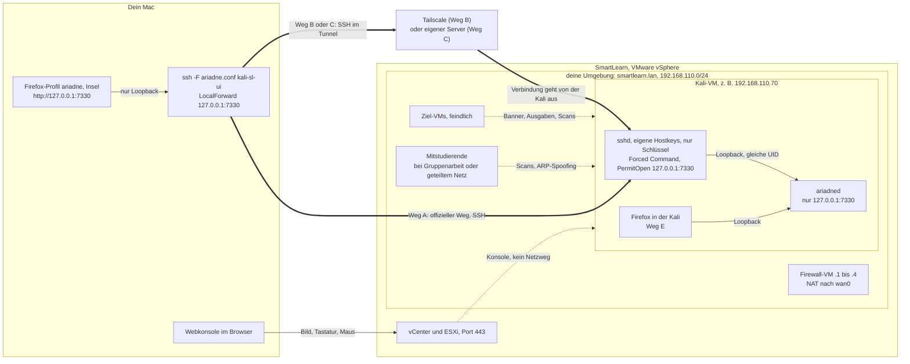
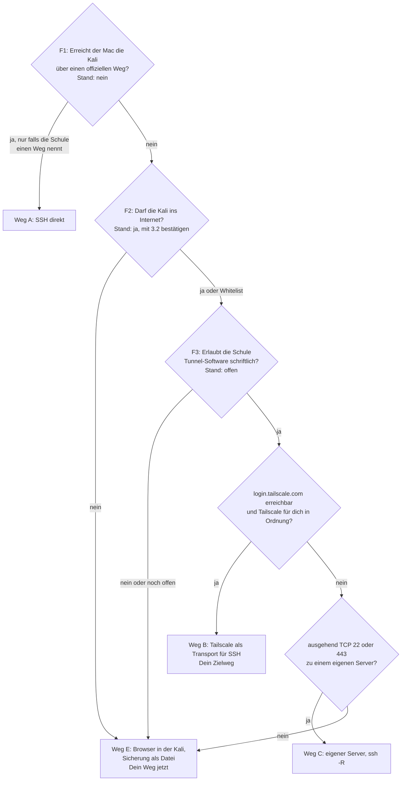

# Konzept: Ariadne vom Mac aus, Kali in SmartLearn

## Auf einen Blick

Deine Kali läuft in SmartLearn, du bedienst sie über die Webkonsole im Browser. Dein Mac kommt nicht an die Kali heran, die Kali aber ins Internet.

**Dein Weg jetzt: Weg E.** Ariadne läuft in der Kali, das Dashboard öffnest du im Firefox der Kali. Das geht sofort und ohne Erlaubnis. Den Webserver dafür bringt v0.1; bis dahin nutzt du die Kommandozeile.

**Dein Zielweg: Weg B, erst wenn die Schule schriftlich zustimmt.** Tailscale baut von der Kali aus ein privates, verschlüsseltes Netz zum Mac und ist nur die Leitung. Darin trägt SSH (verschlüsselte Fernanmeldung) `http://127.0.0.1:7330` vom Mac-Browser zur Kali. Ariadne lauscht weiter nur auf `127.0.0.1`, also nur für Programme der Kali.

**Was du als Nächstes tust**

1. Webkonsole in Chrome oder Safari öffnen, in einem eigenen Profil ohne Erweiterungen (Firefox tippt dort doppelt).
2. In der Kali `passwd`, dann die Prüfliste 3.2. Sie bestätigt das Internet und zeigt bei `issuer`, ob die Schule HTTPS mitliest.
3. Auf dem Mac `fdesetup status`. Erwartet: `FileVault is On.` (Plattenverschlüsselung).
4. Ticket an die Schule (3.5), vor allem: Ist Tailscale aus der Lab-VM erlaubt?
5. Sicherung einrichten (6.3), dann nach jeder Session sichern (6.4).

**Sicherheitsregeln**

- Im Lab-Netz lauscht nur, was du für eine Übung startest. Ariadne bleibt auf `127.0.0.1`, SSH bleibt aus, kein Übungs-Webserver im Home-Ordner. Prüfen mit `sudo ss -tulpn`.
- Kein Tunnel und keine Tunnel-Probe ohne schriftliches Ja der Schule.
- Die Schule kann Bildschirm, Tastatur und Speicher der VM sehen. Darum nur Lab-Daten.
- Passphrase nie unter Firefox oder mit Browser-Erweiterungen in die Webkonsole tippen. Ab Weg B entsperrst du vom Mac aus: `ssh -t kali-sl unlock`.
- Sicherung ausserhalb der VM, mit age verschlüsselt (Werkzeug für Dateiverschlüsselung). Die Schule kann die VM jederzeit zurücksetzen.
- Vor jeder Pause `ariadne lock`. Das soll auch die Anmeldung im Dashboard beenden; sonst läuft sie nach 12 Stunden ab.

**Was Ariadne zuerst bauen muss**

Für Weg E (v0.1): den Webserver, der nur auf `127.0.0.1` startet und fremde Anfragen abweist, ablaufende Anmeldungen, `ariadne backup` und `restore`, die Selbstprüfung `ariadne remote check`. Für Weg B (v0.2): `ariadne remote serve` (der Mac-Schlüssel öffnet nur das Dashboard), Einrichtungsskript für die Kali, Mac-Helfer `ariadne-mac`.

**Offene Fragen mit Empfehlung** (Abschnitt 9)

1. F3, erlaubt die Schule Tailscale? Per Ticket fragen, Antwort schriftlich.
2. Welcher Tunnel? Tailscale.
3. Mac-Browser für Weg B? Firefox nur für Ariadne, Profil erreicht nur `127.0.0.1`.
4. Wie lange gilt eine Anmeldung? Höchstens 12 Stunden, Ende auch mit dem Tunnel.
5. Was darf der Mac-Schlüssel? Nur Ariadne, keine Shell.
6. Wann sichern? Nach jeder Session.
7. Was kommt in v0.1? Sicherung und Schutz des Webservers, Fernzugriff erst in v0.2.

> Stand 2026-10-14, Vorschlag, nach einer Red-Team-Prüfung überarbeitet. Antwort auf deine Nachrichten vom 2026-10-14 («ich würde es cool finden wenn ich von remote (extern) auf da ariadne dashboard zugreifen kann ...» und «die kali läuft nicht auf der vm auf meinem mac sonder auf einer entfernten vm im smartlearn netz der schule»). Grundlage sind zwei Rechercheberichte (Umgebung SmartLearn, Zugangswege), eine Red-Team-Prüfung (Angriffe aus Lab-Netz, Schule, Internet, vom Mac und über Zielseiten), [VISION](../VISION.md), die [Lösungsarchitektur](architektur.md) (7.1 bis 7.3, 8, 9), die [HTTP-API](web-api.md) (1.1, 3, 12), das [Entscheidungsprotokoll](entscheide.md), das [Konzept Terminal und Web](konzept-terminal-und-web.md) und der Code unter `src/ariadne/daemon` und `src/ariadne/web`. Entschieden ist davon nichts, bis du die Fragen in Abschnitt 9 beantwortet hast. Nachgetragen am 2026-10-14: deine Antworten (Bedienung über die Webkonsole, F1 nein, F2 ja) und die Seite «Auf einen Blick».
>
> Kennzeichnung: **gebaut** heisst im v0.1-Backend vorhanden. **geplant** heisst in Architektur oder API beschrieben, aber noch nicht gebaut. **Vorschlag** heisst neu in diesem Dokument. Wichtig vorab: Den HTTP-Teil des Daemons gibt es noch nicht (`ariadne ui` gibt nur einen Hinweis aus, die UI läuft im Mock-Modus). Prüfliste, Ticket und Sicherung kannst du trotzdem schon jetzt machen.

## Inhalt

1. [Kurzfassung](#1-kurzfassung)
2. [Bild der Lösung](#2-bild-der-lösung)
3. [Erst prüfen und fragen](#3-erst-prüfen-und-fragen)
4. [Empfohlener Weg je Ergebnis](#4-empfohlener-weg-je-ergebnis)
5. [Sicherheitskonzept](#5-sicherheitskonzept)
6. [Datensicherung und Wiederherstellung](#6-datensicherung-und-wiederherstellung)
7. [Was Ariadne dafür bauen muss](#7-was-ariadne-dafür-bauen-muss)
8. [Welche Entscheide sich ändern](#8-welche-entscheide-sich-ändern)
9. [Fragen an dich](#9-fragen-an-dich)
10. [Quellen](#10-quellen)

## 1 Kurzfassung

Deine Kali läuft als VM in SmartLearn auf VMware vSphere, und du bedienst sie über die Webkonsole im Browser. Diese Konsole läuft über den Hypervisor, nicht über das Netz. Dein Mac erreicht die Kali nicht direkt (F1 nein), die Kali kommt aber ins Internet (F2 ja); beides hast du bestätigt. Die Lösung ist für alle Fälle dieselbe: Ariadne bleibt auf `127.0.0.1:7330`, und der Mac holt sich die Oberfläche über eine SSH-Portweiterleitung auf seinen eigenen `127.0.0.1:7330`. Token, Host- und Origin-Prüfung, CSP und «Entsperren nur per CLI» gelten damit unverändert. Verschieden ist nur die Zufahrt zum SSH-Dienst der Kali: ein offizieller Weg der Schule (Weg A), Tailscale (Weg B) oder ein eigener kleiner Server (Weg C). B und C sind ausgehende Tunnel und kommen nur mit schriftlicher Erlaubnis in Frage. Bis es einen erlaubten Weg gibt, bleibt der Browser in der Kali (Weg E); das ist die sichere Grundlinie, die heute schon geht. Ausgeschlossen sind ein eigener Netzport von Ariadne und öffentliche Tunnel-Dienste wie ngrok oder Cloudflare.

Vier Regeln tragen die Sicherheit des Fernzugriffs (A bis C), alle aus der Red-Team-Prüfung:

1. **Eigene Hostkeys.** Kalis aus demselben Masterset haben vielleicht dieselben SSH-Hostkeys. Dann beweist der Fingerprint nichts, und ein Mitstudierender könnte sich als deine Kali ausgeben und beim Wiederherstellen deine entschlüsselte Sicherung empfangen. Du erzeugst die Hostkeys deshalb selbst neu, und SSH bricht bei jedem unbekannten Hostkey ab.
2. **Ein Schlüssel, der nur Ariadne kann.** Der Mac-Schlüssel öffnet keine Shell, nur die Weiterleitung zu Ariadne und eine feste Befehlsliste (Code holen, entsperren, sperren, sichern). Schadsoftware auf dem Mac bekommt damit höchstens das Dashboard, nie die Kali.
3. **Der Mac-Browser ist eine Insel.** Das Ariadne-Profil erreicht nur `127.0.0.1`, hat keine Erweiterungen und speichert nichts. Selbst eine Lücke in der Oberfläche kann keine Daten ins Internet schicken.
4. **Sitzungen sterben mit dem Tunnel.** Ein Token gilt nur über die SSH-Verbindung, über die du dich angemeldet hast, und endet mit ihr, mit `ariadne lock` und mit `project close`.

Sicherung, Lab-Daten und die nächsten Schritte stehen in «Auf einen Blick». Alles Weitere richten später zwei Skripte ein (Abschnitt 7).

## 2 Bild der Lösung



So liest du das Bild:

- **Konsole ist kein Netzweg.** Was du in der Webkonsole siehst, kommt über vCenter und den ESXi-Host (Port 443). Darum siehst du die Kali, obwohl dein Mac sie über das Netz nicht erreicht.
- **Ariadne lauscht nur auf Loopback.** `127.0.0.1` ist die Adresse «dieser Rechner selbst». Was dort lauscht, erreichen nur Prozesse auf derselben Maschine. Ziel-VMs und Mitstudierende sehen Port 7330 nie.
- **Der dicke Pfeil ist immer SSH.** Eine SSH-Portweiterleitung (`ssh -L`) öffnet auf dem Mac einen Port `127.0.0.1:7330`. Was dort ankommt, trägt SSH verschlüsselt zur Kali, und dort verbindet sich der sshd-Prozess deines Benutzers mit `127.0.0.1:7330`. Für Ariadne sieht das aus wie ein lokaler Browser.
- **Weg A, B und C unterscheiden sich nur in der Zufahrt zu sshd.** Das Sicherheitsmodell der Web-UI bleibt in allen drei Fällen gleich.

**Warum SSH und kein eigener Ariadne-Port.** SSH bringt Verschlüsselung, Anmeldung per Schlüssel und Prüfung des Servers über den Hostkey fertig mit, und Ariadne muss dafür wenig ändern: Der Browser auf dem Mac schickt `Host: 127.0.0.1:7330` und `Origin: http://127.0.0.1:7330`, genau wie heute verlangt (web-api.md 1.1). Ein eigener TLS-Port im Lab-Netz würde dagegen zwei Schutzschichten abbauen (Loopback-Bindung und Peer-Prüfung), die Anmeldung vor allen Teilnehmenden im Netz öffnen und ein selbstsigniertes Zertifikat einführen, dessen Warnung man nach dem dritten Mal wegklickt. Im Lab gehört ARP-Spoofing zum Übungsstoff. Am besten schützt hier ein Dienst, den es gar nicht gibt.

**Begriffe in einem Satz**

| Begriff | Bedeutung hier |
|---|---|
| Portweiterleitung (`ssh -L`) | ein Port auf dem Mac, dessen Verkehr SSH zu einem Port auf der Kali trägt |
| Hostkey-Fingerprint | Kennzeichen des sshd der Kali; stimmt er, sprichst du mit deiner Kali und nicht mit jemandem dazwischen. Das gilt nur, wenn der Hostkey nur auf deiner Kali liegt |
| Forced Command | Eintrag in `authorized_keys`, der einem Schlüssel genau ein Programm erlaubt; was der Client als Befehl schickt, bekommt dieses Programm nur als Text zur Prüfung |
| Insel-Profil | Browserprofil, das ausser `127.0.0.1` nichts erreicht, weil alle anderen Anfragen an einen toten Proxy gehen |
| ausgehender Tunnel | die Kali baut selbst eine Verbindung nach draussen auf, über die du zurück zu ihr kommst (Tailscale oder `ssh -R`) |
| age | Werkzeug zum Verschlüsseln von Dateien an öffentliche Schlüssel; Ariadne nutzt es schon für den Tresor (E71) |

## 3 Erst prüfen und fragen

Drei Fragen wählen im Entscheidungsbaum (Abschnitt 4) den Weg. Zwei hast du am 2026-10-14 beantwortet:

- **F1:** Erreicht der Mac die Kali direkt über einen Weg, den die Schule vorsieht? **Nein.** Vom Mac kommst du nicht per SSH an die Kali.
- **F2:** Darf die Kali ins Internet, und wohin? **Ja, laut dir.** Bestätige es einmal mit Block 2 in 3.2: Die `curl`-Codes zeigen, ob alles offen ist oder nur eine Whitelist, die Zeile `issuer`, ob die Schule HTTPS aufbricht.
- **F3:** Erlauben die Schulregeln Tunnel-Software (Tailscale, `ssh -R`)? **Offen.** Das lässt sich nicht messen, das fragst du (3.5).

Drei Regeln für die Prüfung: Scanne nichts (kein nmap, kein Ping-Sweep ins Lab-Netz). Starte sshd nicht, solange das Standardpasswort gilt. Tippe Passphrasen und Codes nie in die Webkonsole unter Firefox, denn sie gibt dort Eingaben doppelt weiter.

### 3.1 Vorbereitung (etwa 2 Minuten)

1. Öffne die Webkonsole in Chrome oder Safari, in einem eigenen Browserprofil ohne Erweiterungen. Eine Erweiterung, die die Seite lesen darf, sieht jede Taste, die du an die Kali schickst, auch die Passphrase von `ariadne unlock`. Die VMRC (Mac App Store) wäre die Alternative ohne Browser.
2. Teste Copy/Paste: auf dem Mac `echo test` kopieren und im Kali-Terminal einfügen. Unter vSphere ist das standardmässig aus. Klappt es, sind die Zwischenablagen von Kali und Mac verbunden, und über Handoff landet alles auch auf deinem iPhone und iPad (Folge in 3.4). Klappt es nicht, tippst du die Befehle ab; sie sind bewusst kurz.

### 3.2 In der Kali (etwa 3 Minuten)

```bash
# 1 Maschine und Netz: Image, Python, Adresse, Gateway
hostname; grep PRETTY /etc/os-release; python3 --version
ip -br addr; ip route

# 2 Internet: Proxy, Webzugang, KI-API, TLS-Aufbruch
env | grep -i _proxy
curl -sm8 -o /dev/null -w '%{http_code}\n' https://www.kali.org/
curl -sm8 -o /dev/null -w '%{http_code}\n' https://api.anthropic.com/v1/models
curl -svm8 -o /dev/null https://api.anthropic.com/ 2>&1 | grep -i issuer

# 3 Was lauscht, wer ist da (nur lesen, nichts senden)
sudo ss -tulpn
ip neigh
systemctl is-active ssh open-vm-tools

# 4 Platz und Schutz der Platte
free -h; nproc; df -h ~; swapon --show; lsblk -f
```

**Tunnel-Proben erst, wenn F3 «ja» ist.** Dann prüfst du, ob die Tunnel technisch gehen: `curl -sm8 -o /dev/null -w '%{http_code}\n' https://login.tailscale.com/` (200 oder 3xx: Weg B möglich) und `nc -vz -w5 github.com 22; nc -vz -w5 github.com 443` (succeeded: Weg C möglich). Vorher nicht: Ohne Erlaubnis brauchst du die Antwort nicht, und in den Logs der Firewall sehen solche Proben wie Tunnelversuche aus.

### 3.3 Auf dem Mac (30 Sekunden)

```bash
fdesetup status                      # FileVault an?
```

Eine Netzmessung vom Mac brauchst du nicht, F1 ist beantwortet. **Nur falls die Schule im Ticket doch einen offiziellen Weg nennt** (gibb-VPN `vpn.gibb.ch`, Portfreigabe; dann Weg A), misst du über diesen Weg:

```bash
KALI=192.168.110.70                  # IP aus Schritt 1 in der Kali
ifconfig | grep 'inet '              # liegt dein eigenes Netz in 192.168.110.0/24? dann ist die Messung wertlos
nc -vz -G 5 $KALI 22                 # Timeout, refused oder succeeded?
```

**Gegenprobe, nur wenn `nc` nicht in einen Timeout läuft.** Alle SmartLearn-Umgebungen haben vermutlich denselben Adressplan. Eine Antwort von `192.168.110.70` kann also von der Kali einer anderen Person kommen oder von einem Gerät in deinem Heimnetz. Lass in der Kali `sudo timeout 30 tcpdump -n -i eth0 'tcp port 22'` laufen (Schnittstelle aus Schritt 1) und wiederhole auf dem Mac `nc -vz -G 5 $KALI 22`. Siehst du in der Kali das Paket, ist es deine. Siehst du nichts, hast du jemand anderen erreicht.

### 3.4 Was die Ergebnisse bedeuten

| Messung | Ergebnis | Bedeutung | Folge |
|---|---|---|---|
| Mac `nc` (nur Weg A) | refused oder succeeded, Gegenprobe zeigt das Paket in deiner Kali | es gibt einen Netzweg zu deiner Kali | **F1 ja**, wenn der Weg offiziell ist (VPN, Freigabe der Lehrperson) |
| Mac `nc` (nur Weg A) | refused oder succeeded, Gegenprobe zeigt nichts | fremdes Gerät mit derselben Adresse | F1 nein, und nie dorthin verbinden |
| Mac `ifconfig` (nur Weg A) | eigenes Netz in 192.168.110.0/24 | jede Messung trifft dein Heimnetz | über ein anderes Netz wiederholen |
| Mac `fdesetup status` | `FileVault is Off.` | Mac-Platte im Klartext | einschalten, bevor Lab-Daten auf den Mac kommen; der Mac-Helfer verlangt es (R13) |
| Copy/Paste (3.1) | klappt | Kali-Zwischenablage landet auf dem Mac, in Clipboard-Verläufen und per Handoff auf deinen Apple-Geräten | «Kopieren ohne Anzeigen» nur bewusst benutzen; besser die Schule fragen, ob es abschaltbar ist |
| `kali.org` | 200 oder 301 | HTTPS nach aussen offen | **F2 ja** (so erwartet) |
| `kali.org` | 000 | gesperrt oder Timeout | **F2 nein**: offline betreiben, keine Cloud-KI |
| `kali.org` | 403, Proxy-Seite, oder `*_proxy` gesetzt | Whitelist oder Filter | **F2 teilweise**: nötige Ziele freischalten lassen |
| `api.anthropic.com` | 401 | API erreichbar, Schlüssel fehlt erwartungsgemäss | Claude-API technisch möglich |
| `issuer` | öffentliche CA (z. B. Google Trust Services, Let's Encrypt) | kein TLS-Aufbruch erkennbar | keine Einschränkung |
| `issuer` | OPNsense, Firewall, gibb oder Ähnliches | TLS wird aufgebrochen, die Schule liest HTTPS-Inhalte | keine API-Keys und keine Lab-Daten über HTTPS; SSH und WireGuard bleiben verschlüsselt, die Schule sieht aber, dass du tunnelst |
| `ss -tulpn` | nur 127.0.0.1 und ::1 | nichts ist von aussen erreichbar | Zielzustand, auch später für 7330 |
| `ss -tulpn` | 0.0.0.0:22, [::]:5432 oder die Lab-IP | Ziel-VMs (und bei Gruppenarbeit die Gruppe) erreichen diesen Dienst | stoppen oder härten |
| `ssh` | active | sshd läuft schon, vielleicht mit Passwort und mit den Hostkeys des Images | sofort `passwd`, dann `sudo systemctl disable --now ssh`, später 4.2 |
| `open-vm-tools` | active | der Hypervisor kann mit Gast-Zugangsdaten Programme starten | eigenes Passwort ist Pflicht |
| `ip neigh` | nur .1 bis .4 und bekannte Ziele, MAC 00:50:56:… | nur deine Umgebung | Mitstudierende im Netz unwahrscheinlich |
| `ip neigh` | fremde Nachbarn | geteiltes Segment oder Gruppenumgebung | Verkehr als mitgelesen behandeln; die Gruppe sieht und steuert eventuell deine Kali |
| `python3 --version` | unter 3.11 | Ariadne läuft nicht (`requires-python >=3.11`) | neueres Image verlangen |
| `free -h` | etwa 4 GB | Firefox und Karte in der VM sind eng | Weg E geht, aber knapp |
| `swapon`, `lsblk -f` | kein `crypto_LUKS` | Disk und Swap liegen im Klartext auf dem Datastore der Schule | Ariadnes Verschlüsselung ist der einzige Schutz; nur Lab-Daten |

**Ergebnis festhalten** (gehört später in `ariadne remote check`, Abschnitt 7):

| Frage | Antwort | Beleg |
|---|---|---|
| F1 Mac erreicht Kali direkt, offiziell | **nein** | deine Angabe vom 2026-10-14; neu messen nur, wenn die Schule einen Weg nennt (Ticket-Frage 2) |
| F2 Kali ins Internet | **ja** laut dir; nach 3.2: ja / nur Whitelist | `curl`-Codes, Proxy, `issuer` |
| F3 Tunnel erlaubt | **offen**; später ja (schriftlich) / nein | Ticket-Antwort |
| Nebenbefunde | TLS-Aufbruch, Gruppenumgebung, Copy/Paste, FileVault, Python, RAM, offene Dienste | |

### 3.5 Was du die Schule fragst

Am besten per Ticket unter ticket.gibb.ch, damit die Antwort schriftlich vorliegt. Eine öffentliche gibb-Regel zu Tunneln habe ich nicht gefunden; vergleichbare Schweizer Hochschulen verbieten aber die Umgehung von Sicherheitskontrollen des Netzes und Fernzugänge ohne Bewilligung. Ein selbst gebauter Tunnel aus einer isolierten Lab-VM fällt sehr wahrscheinlich darunter. Ohne schriftliches Okay behandle ich ihn als verboten. Bitte die Schule im Ticket auch, das geltende Reglement zu nennen (ICT-Benutzungsreglement oder Regeln für SmartLearn).

1. Darf ich auf meiner Lab-Kali eigene Software installieren (Ariadne per pipx aus einem privaten Repo) und sshd mit Schlüsselanmeldung aktivieren?
2. Gibt es einen vorgesehenen Weg vom eigenen Gerät zur Kali (VPN, Jumphost, Portfreigabe auf der SmartLearn-Firewall, VDI)? Ist das Mobile-Access-VPN für HF-Studierende und Lab-Netze gedacht?
3. Sind ausgehende Tunnel aus der Lab-VM erlaubt, konkret Tailscale oder eine SSH-Verbindung zu einem eigenen Server?
4. Darf die Lab-VM Lab-Daten an einen Cloud-Dienst senden (Claude API)?
5. Wo dürfen Aufzeichnungen aus Labs liegen: Datei-Übertragung nach SmartLearn, gibb-OneDrive, privates Gerät (verschlüsselt)?
6. Was gilt in Prüfungen und benoteten Labs: Darf Ariadne dort laufen, und darf dabei ein Zugang vom eigenen Gerät bestehen?
7. Wie lange lebt meine Kali (Quartal, Archivierungsfrist), wird sie vor Prüfungen zurückgesetzt, und gibt es Snapshots?
8. Wer kann meine VM sehen oder steuern (Lehrperson im Beobachtungsmodus, Power-User, Hersteller-Support), arbeite ich allein oder in einer Gruppenumgebung, und haben alle Kalis eines Mastersets dieselben SSH-Hostkeys?

**Bis die Antwort da ist:** nur Weg E, sshd aus, keine Tunnel-Proben. In Prüfungen gilt, was die Schule zu Frage 6 sagt; ohne Antwort bleibt dort jeder Zugang vom Mac geschlossen (`tailscale down`, Tunnel-Dienst gestoppt).

## 4 Empfohlener Weg je Ergebnis

### 4.1 Entscheidungsbaum



| Weg | Wann | Was die Schule erlauben muss | Dritte im Spiel | sshd im Lab-Netz sichtbar | Einrichtung |
|---|---|---|---|---|---|
| **A** SSH direkt | nur falls die Schule einen offiziellen Weg nennt (F1 heute nein) | sshd auf der Kali, Nutzung des Wegs (VPN, Freigabe) | keine | ja, gehärtet, Port 22 nur aus dem Weg | 1 bis 2 h |
| **B** Tailscale + SSH | F1 nein, F2 ja, F3 ja: dein Zielweg | ausgehender Overlay-Tunnel | Tailscale (Metadaten, Inhalt Ende-zu-Ende verschlüsselt) | nein, nur im Tailnet | 1 bis 2 h |
| **C** eigener Server + SSH | wie B, wenn Tailscale blockiert oder unerwünscht | ausgehende SSH-Verbindung | dein Server (sieht nur Chiffrat) | nein, sshd nur auf 127.0.0.1 | 2 bis 4 h plus Serverpflege |
| **E** Browser in der Kali | heute; Pflicht, solange kein anderer Weg erlaubt ist | nichts | keine | nein | 10 min |

Nie, egal was die Prüfliste ergibt:

- **D: öffentliche Tunnel-Dienste** (Cloudflare Tunnel, ngrok). Beide beenden TLS bei sich und sehen Token, aufgedeckte Credentials und Logzeilen im Klartext; Cloudflare Quick Tunnels können zudem kein SSE. Ariadne lehnt fremde Hostnamen ohnehin mit 421 ab (web-api.md 1.1), und das bleibt so.
- **F: eigener TLS-Port von Ariadne auf der Lab-IP.** Angriffsfläche vor der Anmeldung für alle im Netz, MITM per ARP-Spoofing, Code-Sperre durch fremde Fehlversuche und ein nmap-Fingerabdruck «hier läuft Ariadne».

**Dein Stand.** F1 nein und F2 ja heissen: jetzt Weg E, und Weg B, sobald die Schule Tunnel schriftlich erlaubt. Weg C nur, falls Tailscale blockiert ist oder du es nicht willst. Nennt die Schule doch einen offiziellen Weg, nimm A, weil kein Dritter beteiligt ist.

Die Einrichtung ist für A, B und C gleich aufgebaut: erst die gemeinsamen Bausteine (4.2), dann der Weg (4.3 bis 4.5), erst ganz am Schluss startet sshd. Später macht das ein Skript (`kali-setup.sh`, Abschnitt 7); die Befehle hier zeigen, was es tut.

### 4.2 Gemeinsame Bausteine für A, B und C

**Kali, über die Konsole.** In SmartLearn heisst dein Benutzer eventuell nicht `kali` (die Doku nennt auch `vmuser`). Die Befehle nehmen deshalb `$USER`.

```bash
passwd                                          # Standardpasswort ersetzen, vor allem anderen
sudo apt update && sudo apt install -y openssh-server age nftables   # nur mit Internet; sonst Offline-Bundle (Abschnitt 7)
sudo systemctl disable --now ssh; sudo systemctl disable --now ssh.socket 2>/dev/null   # sshd bleibt aus, bis alles steht

# Eigene Hostkeys: Kalis aus demselben Masterset haben sonst vielleicht dieselben
sudo rm -f /etc/ssh/ssh_host_*
sudo ssh-keygen -A
ssh-keygen -lf /etc/ssh/ssh_host_ed25519_key.pub   # Fingerprint notieren (Papier oder Handy), für den ersten Login
```

sshd-Einstellungen als eigene Datei. Die Hauptdatei von Debian bindet `sshd_config.d/*.conf` ganz oben ein, und bei sshd gilt der erste Wert. Damit gewinnt diese Datei; ob sie wirklich gilt, zeigt erst `sshd -T` (4.3).

```bash
sudo tee /etc/ssh/sshd_config.d/10-ariadne.conf >/dev/null <<EOF
PermitRootLogin no
PasswordAuthentication no
KbdInteractiveAuthentication no
AuthenticationMethods publickey
AllowUsers $USER
AllowTcpForwarding local
PermitOpen 127.0.0.1:7330
PermitListen none
GatewayPorts no
X11Forwarding no
AllowAgentForwarding no
AllowStreamLocalForwarding no
PermitTunnel no
MaxAuthTries 3
LoginGraceTime 20
ClientAliveInterval 30
EOF
sudo sshd -t && echo "Konfiguration ok"
```

**Port 22 nur über den erlaubten Weg (A und B).** Ohne Filter wäre sshd auf jeder Schnittstelle erreichbar, auch auf einer, die später dazukommt: dem HTB-VPN `tun0`, einer zweiten Lab-Karte, einem neuen Netz nach einem Reset. Der Filter lässt Port 22 nur über den Weg zu, den du einträgst, für IPv4 und IPv6. Die Abhängigkeit am Ende macht ihn fail-closed: Lädt der Filter nicht, startet sshd nicht. Weg C braucht ihn nicht (sshd nur auf 127.0.0.1).

```bash
ERLAUBT='iifname "tailscale0"'      # Weg B. Weg A: Quelle des offiziellen Wegs, z. B. 'ip saddr 10.20.0.0/16'
sudo install -d /etc/ariadne
sudo tee /etc/ariadne/ssh-filter.nft >/dev/null <<EOF
table inet ariadne_ssh
delete table inet ariadne_ssh
table inet ariadne_ssh {
  chain input {
    type filter hook input priority -10; policy accept;
    iifname "lo" accept
    $ERLAUBT tcp dport 22 accept
    tcp dport 22 drop
  }
}
EOF
sudo tee /etc/systemd/system/ariadne-ssh-filter.service >/dev/null <<'EOF'
[Unit]
Description=Ariadne: Port 22 nur über den erlaubten Weg
Before=ssh.service
[Service]
Type=oneshot
RemainAfterExit=yes
ExecStart=/usr/sbin/nft -f /etc/ariadne/ssh-filter.nft
ExecStop=/usr/sbin/nft delete table inet ariadne_ssh
[Install]
WantedBy=multi-user.target
EOF
sudo install -d /etc/systemd/system/ssh.service.d
printf '[Unit]\nRequires=ariadne-ssh-filter.service\nAfter=ariadne-ssh-filter.service\n' | sudo tee /etc/systemd/system/ssh.service.d/ariadne.conf >/dev/null
sudo systemctl daemon-reload && sudo systemctl enable ariadne-ssh-filter
```

Die Policy bleibt `accept`, damit Listener für Übungen (Reverse Shells) weiter funktionieren. Gesperrt wird nur Port 22 von aussen.

**Mac, einmalig.**

```bash
ssh-keygen -t ed25519 -a 100 -f ~/.ssh/id_ed25519_kali_sl -C mac-kali-smartlearn   # mit Passphrase
ssh-keygen -lf ~/.ssh/id_ed25519_kali_sl.pub                                         # Fingerprint notieren
```

Den Schlüssel **nicht** in den macOS-Schlüsselbund legen (kein `ssh-add --apple-use-keychain`, kein `UseKeychain`). Sonst kann jedes Programm auf dem Mac `ssh` aufrufen und den Schlüssel ohne Passphrase benutzen.

**Öffentlichen Schlüssel eintragen, eingeschränkt.** Am einfachsten, weil die Kali ins Internet kommt: Schlüssel in deinem GitHub-Konto hinterlegen und in der Kali abrufen. Sonst über die Datei-Übertragung von SmartLearn, Copy/Paste (falls an) oder Abtippen.

```bash
# Kali
install -d -m 700 ~/.ssh
curl -fsS https://github.com/DEIN-NAME.keys | grep ssh-ed25519   # nur die Zeile nehmen, deren Fingerprint passt
printf 'restrict,pty %s\n' 'ssh-ed25519 AAAA... mac-kali-smartlearn' >> ~/.ssh/authorized_keys
chmod 600 ~/.ssh/authorized_keys
ssh-keygen -lf ~/.ssh/authorized_keys        # genau eine Zeile, mit dem Fingerprint vom Mac
```

`restrict` schaltet alles ab, was SSH ausser der Anmeldung kann (Weiterleitungen, Agent, X11, Terminal). Danach erlaubt man gezielt zurück. Im **Übergang**, solange der HTTP-Teil von Ariadne fehlt, gibt es nichts weiterzuleiten; `restrict,pty` erlaubt nur eine Shell, etwa für die Sicherung (6.4). Sobald `ariadne remote serve` gebaut ist, ersetzt das Einrichtungsskript die Zeile durch den **Endzustand**:

```text
restrict,pty,port-forwarding,permitopen="127.0.0.1:7330",command="/home/kali/.local/bin/ariadne remote serve" ssh-ed25519 AAAA... mac-kali-smartlearn
```

Das heisst: Weiterleitung nur zu `127.0.0.1:7330`, ein Terminal nur für die Passphrase-Abfrage, und statt einer Shell läuft immer `ariadne remote serve`. Es kennt nur `code`, `unlock`, `lock`, `revoke`, `backup`, `restore` (nur in eine Installation ohne Tresor) und `check`. Alles andere lehnt es ab (R11). Verwalten (Pakete, Konfiguration) tust du über die Konsole.

**SSH-Konfiguration auf dem Mac** in einer eigenen Datei `~/.ssh/ariadne.conf`. Der obere Block gilt nur für den Tunnel, der untere für beide Namen. `HostName` setzt du je nach Weg (4.3 bis 4.5).

```text
Host kali-sl-ui
  SessionType none
  ExitOnForwardFailure yes
  LocalForward 127.0.0.1:7330 127.0.0.1:7330

Host kali-sl kali-sl-ui
  HostName 192.168.110.70
  User kali
  IdentityFile ~/.ssh/id_ed25519_kali_sl
  IdentitiesOnly yes
  AddKeysToAgent 4h
  HostKeyAlias kali-smartlearn
  HostKeyAlgorithms ssh-ed25519
  StrictHostKeyChecking yes
  ControlMaster no
  ControlPath none
  ForwardAgent no
  ForwardX11 no
  ServerAliveInterval 15
  ServerAliveCountMax 3
```

Ganz oben in `~/.ssh/config` steht dann `Include ariadne.conf`. Bei SSH gilt der erste Wert, so kann ein späterer Block `Host *` (etwa mit `ForwardAgent yes`) nichts mehr umstellen. Der Mac-Helfer ruft SSH immer mit `ssh -F ~/.ssh/ariadne.conf` auf und liest deine übrige Konfiguration gar nicht.

- `User` ist dein Benutzer in der Kali (was `whoami` dort zeigt). `HostKeyAlias` hält die Hostkey-Prüfung gleich, auch wenn die Adresse wechselt (Tailscale, eigener Server).
- `HostKeyAlgorithms ssh-ed25519` und `StrictHostKeyChecking yes`: SSH zeigt genau den Fingerprint, den du in der Kali notiert hast, und bricht bei einem unbekannten oder geänderten Hostkey ab. Nur beim ersten Login nach Einrichtung oder Reset erlaubst du die Frage einmal ausdrücklich (4.3).
- `AddKeysToAgent 4h`: Passphrase einmal, dann höchstens 4 Stunden im Agent. `ControlMaster no`: kein Hintergrundtunnel, der nach `stop` weiterläuft.
- `ExitOnForwardFailure` bricht ab, wenn auf dem Mac schon etwas Port 7330 belegt; sonst würdest du mit einem fremden Programm reden. Nie `-g` oder `GatewayPorts`: Dann wäre Port 7330 für alle im selben WLAN offen.

**Insel-Profil für den Browser auf dem Mac.** Nimm für Ariadne einen Browser, den du sonst nicht brauchst, zum Beispiel Firefox, wenn du sonst Safari oder Chrome nutzt. Dann landet die Adresse nie aus Versehen in deinem Alltagsprofil mit Erweiterungen.

```bash
/Applications/Firefox.app/Contents/MacOS/firefox -CreateProfile ariadne
P=$(ls -d ~/Library/Application\ Support/Firefox/Profiles/*.ariadne)
cat > "$P/user.js" <<'EOF'
user_pref("browser.privatebrowsing.autostart", true);
user_pref("browser.sessionstore.privacy_level", 2);
user_pref("browser.cache.disk.enable", false);
user_pref("signon.rememberSignons", false);
user_pref("identity.fxaccounts.enabled", false);
user_pref("xpinstall.enabled", false);
user_pref("extensions.autoDisableScopes", 15);
user_pref("network.proxy.type", 1);
user_pref("network.proxy.http", "127.0.0.1");
user_pref("network.proxy.http_port", 9);
user_pref("network.proxy.ssl", "127.0.0.1");
user_pref("network.proxy.ssl_port", 9);
user_pref("network.proxy.allow_hijacking_localhost", false);
user_pref("network.trr.mode", 5);
user_pref("media.peerconnection.enabled", false);
user_pref("network.prefetch-next", false);
user_pref("network.dns.disablePrefetch", true);
user_pref("datareporting.healthreport.uploadEnabled", false);
user_pref("toolkit.telemetry.enabled", false);
user_pref("app.normandy.enabled", false);
EOF
```

- **Dauer-Privatmodus:** kein Verlauf und keine Sitzungswiederherstellung auf der Platte, `sessionStorage` (und damit das Token) verschwindet mit dem Fenster. Erweiterungen laufen in privaten Fenstern nur, wenn man sie ausdrücklich erlaubt; `xpinstall.enabled` sperrt zusätzlich das Installieren.
- **Insel:** Alle Anfragen gehen an einen Proxy auf Port 9, wo nichts lauscht, und scheitern. Nur `127.0.0.1` geht direkt, weil Firefox Loopback nie über einen Proxy schickt (`allow_hijacking_localhost` false). Ohne DoH (`trr.mode` 5) und WebRTC gibt es auch keinen Seitenweg. Selbst eine Lücke in der Oberfläche oder eine Erweiterung kann so nichts ins Internet schicken, und ein Systemproxy wie Burp sieht nichts.
- Starten mit `open -na Firefox --args -no-remote -P ariadne`. Später schreibt der Helfer die `user.js` bei jedem Start neu und prüft das Profil (R9).

### 4.3 Weg A: SSH direkt

**Kali.** Im Filter (4.2) steht als `ERLAUBT` die Quelle des offiziellen Wegs, zum Beispiel der Adressbereich des VPN. Ein solcher Bereich gehört allen VPN-Nutzern der gibb, nicht nur dir: Er grenzt ein, ersetzt aber den Schlüssel nicht. Ein eigenes Limit für Anmeldeversuche brauchst du nicht: OpenSSH ab 9.8 bremst auffällige Quellen selbst (PerSourcePenalties). Kommen alle über dieselbe NAT-Adresse, kann das auch dich sperren; dann in `journalctl -u ssh` nach «penalty» suchen.

```bash
sudo systemctl enable --now ariadne-ssh-filter ssh
sudo sshd -T -C user=$USER,host=pruefung,addr=192.0.2.1 | grep -Ei '^(passwordauthentication|kbdinteractiveauthentication|permitrootlogin|allowtcpforwarding|permitopen|permitlisten|allowagentforwarding|x11forwarding|permittunnel|gatewayports)'
```

Erwartet: `passwordauthentication no`, `kbdinteractiveauthentication no`, `permitrootlogin no`, `allowtcpforwarding local`, `permitopen 127.0.0.1:7330`, `permitlisten none`, `allowagentforwarding no`, `x11forwarding no`, `permittunnel no`, `gatewayports no`. `-C` wertet auch `Match`-Blöcke aus, die ein Image vielleicht mitbringt.

**Mac.** `HostName` auf die Adresse, die der offizielle Weg vorgibt. Erster Login, einmalig mit Rückfrage:

```bash
ssh -o StrictHostKeyChecking=ask kali-sl true
```

SSH zeigt den ed25519-Fingerprint. Nur wenn er Zeichen für Zeichen mit dem aus der Kali übereinstimmt, mit `yes` bestätigen. Weicht er ab, abbrechen: Dann sitzt jemand dazwischen oder du bist bei einer fremden Kali. (Im Endzustand meldet `remote serve` «unbekannter Befehl»; das ist richtig, der Hostkey ist trotzdem gespeichert.)

**Tunnel testen** (sobald der HTTP-Teil gebaut ist):

```bash
ssh -F ~/.ssh/ariadne.conf -f kali-sl-ui
curl -sS -o /dev/null -w '%{http_code}\n' http://127.0.0.1:7330/api/v1/status
```

401 heisst: Tunnel und Daemon sind in Ordnung, es fehlt nur das Token. 421 heisst falscher Host (du hast `localhost` oder einen anderen Port benutzt). «Connection refused» heisst: Tunnel nicht aktiv oder Backend aus. Im Browser immer `http://127.0.0.1:7330`, nie `localhost`.

**Alltag A** (mit dem Mac-Helfer aus Abschnitt 7, **Vorschlag**):

1. Mac: `ariadne-mac start` (Prüfungen R13, Tunnel auf, Code über SSH holen, Insel-Profil mit Anmeldung öffnen).
2. Am Ende: `ariadne-mac stop` (Sitzung widerrufen, Sicherung holen, Tunnel zu).

Bis der Helfer existiert, von Hand: `ssh -F ~/.ssh/ariadne.conf -f kali-sl-ui`, dann `ssh -t kali-sl code` und den kurzen Tippcode im Mac-Browser eingeben. Der Code erscheint so im Terminal des Macs, nicht auf dem Konsolenbild der Kali, und die Aufnahme sieht ihn nicht.

### 4.4 Weg B: Tailscale als Transport für SSH

Tailscale baut ein privates Netz aus WireGuard-Verbindungen (ein «Tailnet»). Die Kali verbindet sich nur ausgehend, darum klappt das durch NAT. Tailscale ist hier nur die Leitung: Darin läuft dasselbe SSH wie bei Weg A. Tailscale SSH, `serve` und `funnel` bleiben aus. Sie liessen tailscaled (root) die Verbindung zu Ariadne aufbauen oder stellten sie ins Internet.

Rahmen: Der Plan «Personal» ist kostenlos, aber nur für nicht-kommerzielle Nutzung. Fürs Studium passt das, für Kundenaufträge nicht (5.6). Der Koordinationsserver sieht Konto, Gerätenamen, öffentliche Adressen (auch die der Schule) und Online-Zeiten, aber keine Inhalte.

**Reihenfolge ist wichtig:** Ein neues Tailnet erlaubt zuerst alles. Darum Konto anlegen, beim Login-Anbieter (GitHub, Google, Apple) MFA einschalten, auf dem Mac Tailscale installieren, eingehende Verbindungen sperren («Allow incoming connections» aus, oder `tailscale set --shields-up`) und **dann zuerst die Policy ersetzen**, bevor die Kali beitritt. `100.x.y.z` ist die Tailscale-Adresse deines Macs.

```json
{
  "tagOwners": { "tag:kali-lab": ["autogroup:admin"] },
  "hosts":     { "mac": "100.x.y.z" },
  "grants": [
    { "src": ["mac"], "dst": ["tag:kali-lab"], "ip": ["tcp:22"] }
  ]
}
```

Die Kali bekommt keine Rechte; sie ist die riskante Maschine und soll den Mac nie erreichen. Die Policy hat bewusst keinen Abschnitt `nodeAttrs` (ohne das Attribut `funnel` geht kein Funnel) und keinen Abschnitt `ssh` (kein Tailscale SSH). Bietet dir die CLI je an, Funnel freizuschalten, lehnst du ab.

**Kali.** sshd zusätzlich auf Tailscale-Adressen beschränken (zweite Schicht neben Filter und Policy):

```bash
sudo sed -i "s/^AllowUsers .*/AllowUsers $USER@100.64.0.0\/10/" /etc/ssh/sshd_config.d/10-ariadne.conf
curl -fsSL https://tailscale.com/install.sh -o ts-install.sh && less ts-install.sh && sh ts-install.sh
echo 'FLAGS="--no-logs-no-support"' | sudo tee -a /etc/default/tailscaled   # keine Client-Logs an Tailscale, zu verifizieren
sudo systemctl restart tailscaled
sudo tailscale up --ssh=false --accept-dns=false --accept-routes=false --advertise-tags=tag:kali-lab --qr
sudo systemctl enable --now ariadne-ssh-filter ssh       # Filter aus 4.2 mit ERLAUBT='iifname "tailscale0"'
tailscale ip -4
```

`--qr` zeigt den Anmeldelink als QR-Code für das Handy. `--accept-dns=false` lässt die DNS-Einstellungen des Labs in Ruhe. **Nie** `--advertise-routes` oder `--advertise-exit-node`: Damit würdest du das Lab-Netz der Schule in dein Tailnet öffnen, ein klarer Regelverstoss.

**Prüfen,** dass die Regel greift: In der Kali `nc -vz -w3 100.x.y.z 7000` (dort lauscht der AirPlay-Empfänger des Macs, wenn er an ist) muss in einen Timeout laufen. `tailscale debug prefs | grep -E '"(AdvertiseRoutes|ExitNodeID|RunSSH)"'` muss `null`, `""` und `false` zeigen.

**Mac.** In `~/.ssh/ariadne.conf` `HostName` auf die `100.x`-Adresse der Kali setzen, dann der erste Login mit Fingerprint-Vergleich wie bei Weg A.

**Nach jedem VM-Reset** entsteht ein neuer Knoten. Den alten in der Admin-Konsole sofort entfernen: Getaggte Geräte laufen nicht von selbst ab, und eine archivierte Kopie der alten Disk enthält seinen Schlüssel. Dann `tailscale up` wiederholen und den neuen Hostkey prüfen. Wer will, schaltet Tailnet Lock ein (`tailscale lock init`); dann muss der Mac jeden neuen Knoten signieren, und auch ein übernommenes Konto oder Tailscale selbst kann keine fremden Geräte einschleusen.

**Alltag B:** wie Weg A (`ariadne-mac start`, am Ende `ariadne-mac stop`). Tailscale auf dem Mac muss verbunden sein.

### 4.5 Weg C: eigener Server mit `ssh -R`

Die Kali baut eine SSH-Verbindung zu einem kleinen Server von dir auf (ein VPS für ein paar Franken im Monat) und öffnet dort `127.0.0.1:2222`, das zurück zu ihrem eigenen sshd führt. Der Mac springt über diesen Server (`ProxyJump`) zur Kali. SSH läuft dabei Ende-zu-Ende zwischen Mac und Kali, der Server sieht nur Chiffrat. Vorteil: sshd auf der Kali lauscht nur auf `127.0.0.1` und ist im Lab-Netz unsichtbar, ganz ohne Filter. Nachteil: Du betreibst einen öffentlichen Server und musst ihn pflegen (nur Schlüssel, automatische Updates).

**Server:**

```bash
sudo useradd -m -s /usr/sbin/nologin tunnel
sudo install -d -m 700 -o tunnel -g tunnel /home/tunnel/.ssh
# /home/tunnel/.ssh/authorized_keys, zwei Zeilen:
# restrict,port-forwarding,permitlisten="127.0.0.1:2222" ssh-ed25519 AAAA... kali-vm
# restrict,port-forwarding,permitopen="127.0.0.1:2222" ssh-ed25519 AAAA... mac
```

Der Schlüssel der Kali darf nur `127.0.0.1:2222` öffnen, der des Macs nur dorthin springen. Eine Shell gibt es für keinen. Ist ausgehend nur 443 offen, lässt du sshd auf dem Server zusätzlich auf Port 443 lauschen.

**Kali.** sshd nur auf Loopback, dann ein eigener Schlüssel für den Rückwärts-Tunnel:

```bash
echo 'ListenAddress 127.0.0.1' | sudo tee -a /etc/ssh/sshd_config.d/10-ariadne.conf
sudo sed -i "s/^AllowUsers .*/AllowUsers $USER@127.0.0.1/" /etc/ssh/sshd_config.d/10-ariadne.conf
sudo sshd -t && sudo systemctl enable --now ssh
ssh-keygen -t ed25519 -N '' -f ~/.ssh/id_ed25519_rendezvous -C kali-vm   # ohne Passphrase, nur für den Tunnel
ssh -i ~/.ssh/id_ed25519_rendezvous tunnel@DEIN-SERVER true             # Hostkey des Servers prüfen; der Fehler wegen nologin ist richtig
```

Den Tunnel selbst hält ein systemd-User-Dienst `ariadne-revtunnel` offen, mit `loginctl enable-linger` auch ohne Anmeldung. Er startet `ssh -N -o ExitOnForwardFailure=yes -R 127.0.0.1:2222:127.0.0.1:22 tunnel@DEIN-SERVER` und nach einem Abbruch nach 20 s neu; das Einrichtungsskript legt ihn an (`--weg c`).

Der Tunnel-Schlüssel liegt ohne Passphrase in der Kali. Wer die Disk liest oder dein Home über einen Übungs-Webserver bekommt (5.3), kann sich damit beim Server als deine Kali melden, wenn sie gerade aus ist. Mehr als eine Störung wird daraus nicht, weil der Mac den Hostkey der Kali prüft.

**Mac.** Einen eigenen Schlüssel für den Server (`id_ed25519_rendezvous_mac`) und in `~/.ssh/ariadne.conf` einen Block `Host rendezvous` (Server, Benutzer `tunnel`, dieser Schlüssel, `IdentitiesOnly yes`). Im Block `kali-sl kali-sl-ui` werden `HostName 127.0.0.1`, `Port 2222` und `ProxyJump rendezvous` gesetzt; der Rest bleibt wie in 4.2. Erster Login mit Fingerprint-Vergleich wie bei Weg A. **Alltag C:** Der Tunnel steht von selbst, sobald die Kali läuft. Auf dem Mac `ariadne-mac start` und am Ende `ariadne-mac stop`.

### 4.6 Weg E: Browser in der Kali (Grundlinie)

Das ist das heutige Design der Architektur, ohne Netzweg und ohne Regelfrage. Alle Schutzschichten sind intakt, und die Karte ist live.

- Auflösung der Kali an den Mac-Bildschirm anpassen: `xrandr` zeigt Ausgänge und Modi, dann z. B. `xrandr --output Virtual1 --mode 1920x1080`.
- Webkonsole im Vollbild des Browsers, in Xfce das Terminal links und Firefox rechts, die Karte auf einem eigenen Arbeitsbereich.
- Die Webkonsole zeigt einen Bildschirm. Ob die VMRC unter macOS die VM auf zwei Monitore verteilt, ist zu verifizieren; das wäre der Zweitbildschirm ohne Netz.
- Mit 4 GB RAM wird es eng, wenn Burp, Firefox und die Karte gleichzeitig laufen. Eine kleinere Karte oder die Tabellenansicht hilft.
- Was auf der Konsole steht, sieht eine Lehrperson im Beobachtungsmodus von SmartLearn mit, also auch das Dashboard. Vor dem Unterricht den Präsentationsmodus einschalten.

**Alltag E:** In der Kali `ariadne ui` (nach dem Konzept Terminal und Web später zusammen mit `ariadne start`), Firefox rechts, Terminal links.

## 5 Sicherheitskonzept

### 5.1 Schutzziele

| Schutzziel | Was konkret |
|---|---|
| Vertraulichkeit | Loot, Credentials, Rohlog, Token, Passphrase und API-Key erreichen weder Mitstudierende noch Ziele, Tunnel-Anbieter, Erweiterungen oder Programme auf dem Mac, noch Cloud-Dienste des Macs |
| Integrität | nur du steuerst Ariadne (REC, Entscheide); keine fremde Seite und kein fremder Prozess löst Aktionen aus; die Hash-Kette bleibt prüfbar |
| Verfügbarkeit | fällt der Tunnel, nimmt die Kali weiter auf («die Shell geht nie kaputt»); die Daten überleben einen VM-Reset |
| keine neue Angriffsfläche | mit Fernzugriff ist die Kali vom Lab-Netz aus nicht angreifbarer als ohne (B und C: nichts sichtbar; A: nur gehärteter sshd aus einem Weg), und der Mac nicht von der Kali aus |
| Regelkonformität | kein Weg ohne Erlaubnis; die Erlaubnis liegt schriftlich vor |

### 5.2 Wer angreift

Die Angreiferklassen aus Architektur 9.1 gelten weiter. Für den Fernzugriff zählen diese sechs:

- **Mitstudierende und Ziele im Lab-Netz (A1).** SmartLearn isoliert laut Hersteller jede Person in einer eigenen Umgebung. Sicher im selben Netz liegen die Ziel-VMs. Mitstudierende sind es bei Gruppenarbeit, und vielleicht teilen sich Umgebungen das Netz `wan0`. Das Konzept plant so, als wären sie da und würden angreifen.
- **Schule und Plattform (A8, Vorschlag).** Wer vCenter und ESXi betreibt, sieht die Konsole samt Tastatur, kann Snapshots mit Arbeitsspeicher ziehen, die Disk lesen und über die VMware Tools Programme starten. Das ist eine Eigenschaft von vSphere, keine Aussage darüber, was die gibb tut. Dagegen hilft nur Datensparsamkeit.
- **Angreifer im Internet.** Fremde Webseiten in deinem Alltagsbrowser, Angriffe auf Tailscale-Konto oder eigenen Server.
- **Mac (A3 auf dem Mac).** Bei Weg E der Browser mit der Webkonsole, über den jede Taste an die Kali läuft. Bei den Wegen A bis C jedes Programm auf dem Mac, denn es erreicht den weitergeleiteten `127.0.0.1:7330`; dazu Erweiterungen, Zwischenablage, Bildschirmfreigabe und Sicherungen des Macs.
- **Präparierte Zielseite (A1, A2).** Zieldaten erscheinen jetzt im Browser des Macs, der ins Internet darf.
- **Kompromittierte Kali (A4).** Ein bösartiger PoC versucht, über den Fernzugriff auf den Mac zu kommen.

### 5.3 Bedrohungsmodell

«Durchgesetzt von» nennt, wer die Massnahme erzwingt (Ariadne, Mac-Helfer, Konfiguration) und welcher Test aus 7.1 sie prüft.

| Angriff und Wirkung | Gegenmassnahme | Durchgesetzt von | Rest |
|---|---|---|---|
| **Mitstudierende und Ziele im Lab-Netz** | | | |
| scannen nach Ariadne; Fehlversuche sperren alle Codes | Daemon nur auf `127.0.0.1` | Ariadne R1, T1 | keins |
| Brute-Force oder Exploit gegen sshd (Weg A) | nur Schlüssel, kein root, Port 22 nur aus dem erlaubten Weg, OpenSSH ab 9.8 | Filter mit `Requires=`, `remote check` R10, T13, T14 | Lücke in OpenSSH |
| **gleiche Hostkeys** aller Kalis eines Mastersets: ein Mitstudierender mit derselben Vorlage spielt per ARP-Spoofing deine Kali und liest Token, die `unlock`-Passphrase und beim Wiederherstellen die entschlüsselte Sicherung | Hostkeys selbst neu erzeugen, nur ed25519, Fingerprint über die Konsole vergleichen, `StrictHostKeyChecking yes` | `remote check` (Marker des Einrichtungsskripts), Helfer bricht bei unbekanntem Hostkey ab; T14, T15 | Unachtsamkeit beim ersten Login nach einem Reset |
| gleicher Adressplan: du landest bei der Kali einer anderen Person | wie oben; dein privater Schlüssel verlässt den Mac nie | wie oben | gering |
| neue Schnittstelle (HTB-VPN `tun0`, zweite Lab-Karte, neues Netz nach Reset) macht sshd dort erreichbar | Filter: Port 22 nur über den erlaubten Weg, IPv4 und IPv6 | `remote check` vergleicht `ss` mit dem Filter, T14 | keins |
| Übungs-Webserver im Home (`python3 -m http.server` in `~`) liefert `~/ariadne/*/loot`, `~/.ssh` und den Tunnel-Schlüssel von Weg C aus | Webserver nur aus einem eigenen Ordner starten | Hinweisregel: Webserver, dessen Wurzel Ariadne-Daten oder `~/.ssh` enthält (Vorschlag, v0.2) | Disziplin bis dahin |
| Gruppenmitglieder mit Recht RW bedienen deine Konsole und damit den entsperrten Daemon | allein arbeiten, `ariadne lock` bei jeder Pause | Ticket-Frage 8 | hoch bei Gruppenarbeit, deshalb nur Lab-Daten |
| präparierte Zieldaten (Hostnamen, Banner, XSS-Strings) laufen jetzt im Mac-Browser | Svelte escapt, `{@html}` verboten, CSP, `displaySafe()`; dazu Insel-Profil: selbst ein Treffer schickt nichts hinaus | ESLint, T10 | Fehler im Browser selbst |
| Zielseite im Testbrowser der Kali (über `ssh -L` auf `127.0.0.1:8080`) spricht 7330 an; anderer Port heisst für den Browser «gleiche Site» | `Sec-Fetch-Site: same-site` ergibt 403, fremder Origin 403, Token liegt nur im eigenen Origin | Ariadne R12, T3 | keins |
| feindliches Ziel öffnet per Tunnel-Server (`chisel` ohne `--authfile`) Loopback der Kali | Token Pflicht; ein gestohlenes Token gilt nur aus dem Prozess, an den es gebunden ist | Ariadne R2, R6, T6 | wie heute |
| **Schule und Plattform (A8)** | | | |
| sieht Konsole und Tastatur, im Beobachtungsmodus auch das Dashboard von Weg E | `unlock` per `ssh -t` vom Mac; Präsentationsmodus; nur Lab-Daten | | bei Weg E läuft die Passphrase über die Konsole; für Lab-Daten vertretbar |
| Snapshot mit Arbeitsspeicher, liest die Disk, startet Programme über die VMware Tools | `ariadne lock` vor Pausen; eigener API-Key mit tiefem Limit, am Semesterende widerrufen; `.vault/` bleibt Chiffrat; neutrale Projektnamen | `doctor` warnt (Swap, open-vm-tools) | für Lab-Daten akzeptiert |
| bricht TLS auf; sieht Tunnel in den Logs | Aussteller prüfen (3.2), bei Schul-CA keine Cloud-KI; Tunnel nur mit schriftlicher Erlaubnis | Prüfliste | keins mit Erlaubnis |
| **Angreifer im Internet** | | | |
| fremde Webseite im Alltagsbrowser des Macs: DNS-Rebinding, CSRF, Code raten, Code-Sperre auslösen | Host exakt, `Sec-Fetch-Site`, Origin, keine Cookies; abgewiesene Anfragen zählen nicht als Fehlversuch | Ariadne R3, R5, R12; T2 bis T4 | keins |
| Clickjacking: Dashboard unsichtbar in einem Rahmen | `frame-ancestors 'none'` und `X-Frame-Options: DENY` auf **jeder** Antwort; `frame-ancestors` erbt nicht von `default-src` | Ariadne R12, T5 | keins |
| Übernahme deines Tailscale-Kontos: neue Knoten, geänderte Policy | MFA beim Login-Anbieter, Tailnet Lock; SSH-Schlüssel und Hostkey bleiben nötig | Abnahme 5.5 | gering |
| Funnel oder Serve stellt die Kali ins Internet; eine Subnetz-Route öffnet das Lab-Netz ins Tailnet | Policy ohne `nodeAttrs`, nie `--advertise-routes` oder `--advertise-exit-node`; R3 lehnt `*.ts.net` ab | `remote check` liest `tailscale debug prefs`; T2, T14 | keins |
| eigener Server (Weg C) wird übernommen | SSH Ende-zu-Ende, Hostkey der Kali geprüft, Server gepatcht | | Ausfall, Metadaten |
| **Mac: Programme, Erweiterungen, Alltag** | | | |
| Erweiterung im Browser der Webkonsole liest jede Taste an die Kali mit, bei Weg E auch die `unlock`-Passphrase | Webkonsole nur in Chrome oder Safari, eigenes Profil ohne Erweiterungen; ab Weg B `unlock` per `ssh -t` | Prüfliste 3.1 | Disziplin; Lücke im Browser |
| Erweiterung im Ariadne-Profil liest Seite und Token | Privatmodus (Erweiterungen dort aus), Installation gesperrt | Helfer bricht ab bei Erweiterungen im Profil oder per `policies.json` erzwungenen; R9, T15 | keins |
| Lücke oder Erweiterung schickt Daten ins Internet | Insel: alles ausser `127.0.0.1` geht an einen toten Proxy, DoH und WebRTC aus | Helfer schreibt `user.js` (R9), T10 | Übergabe an andere Programme (z. B. `mailto:`) |
| Schadsoftware mit deinen Rechten benutzt deinen SSH-Schlüssel | Passphrase, nicht im Schlüsselbund, höchstens 4 h im Agent; der Schlüssel kann nur Tunnel und `remote serve`, keine Shell | Forced Command R11, T12, T13 | Dashboard bleibt erreichbar, ein Tastatur-Logger sieht die Passphrase von `unlock`; gegen einen übernommenen Mac hilft kein Konzept ganz |
| fremdes Programm hält Port 7330 auf dem Mac und zeigt eine falsche Seite, um den Code abzufangen | `ExitOnForwardFailure`; Helfer prüft vor dem Öffnen, dass 7330 seinem `ssh` gehört; Code nur im Fragment, nie getippt; Passphrase nie im Browser (E74) | Helfer R13, T15 | gering, der Code gilt 60 s und einmal |
| globale SSH-Einstellungen (`Host *` mit `ForwardAgent yes`, `ControlPersist` hält den Tunnel nach `stop` offen) | Helfer nutzt nur `ssh -F ~/.ssh/ariadne.conf` mit `ControlMaster no` | Helfer R13, T15 | keins |
| Token wird gestohlen und anderswo benutzt; vergessene Sitzung nach dem Zuklappen | Token an den sshd-Prozess des Tunnels gebunden; endet mit Tunnel, `lock`, `project close`, Neustart; der Daemon speichert nur einen Hash | Ariadne R2, R6; T6, T7 | keins |
| Zwischenablage: Copy/Paste der Konsole, Handoff, Clipboard-Verläufe nehmen Secrets mit | UI kopiert Secrets nur in die Zwischenablage der Kali (`xclip`, 30 s) und nennt das Ziel, nie per `navigator.clipboard` | Ariadne R14, T11 | ist Copy/Paste der Konsole an, landet das Secret trotzdem auf dem Mac und deinen Apple-Geräten |
| Bildschirmfreigabe im Unterricht (Teams, Beamer); Bildschirmfotos auf dem Schreibtisch, den iCloud synchronisiert | Präsentationsmodus vor jeder Freigabe, per Tastenkürzel; maskiert wird auf dem Server, in allen Tabs | Ariadne, T9 | Vergessen |
| Verlauf, Cache, Sitzungswiederherstellung, Absturzberichte | Privatmodus, `no-store`, Code nur im Fragment; Helfer startet Firefox ohne Crash-Reporter | T8 | FileVault Pflicht |
| Sicherung und Schlüssel auf dem Mac (Time Machine, iCloud, Diebstahl) | `mac.key` nur mit Passphrase, Recovery-Schlüssel nie als Datei, Sicherungen nicht in Cloud-Ordnern, FileVault an | Helfer verweigert sonst (R13), T15 | übernommener Mac mit offener Passphrase |
| **kompromittierte Kali** | | | |
| bösartiger Exploit oder PoC greift über den Fernzugriff den Mac an | nur `LocalForward` Mac zu Kali; kein Agent, kein `RemoteForward`; Tailscale ohne Rechte für die Kali, Shields-up; Schlüssel am Server mit `restrict` | T13, Abnahme 5.5 | die Kali kann dir in der UI falsche Daten zeigen, wie heute |
| **Verlust der VM** | | | |
| Reset, Archivierung, neues Masterset, Herunterfahren vor Prüfungen | nach jeder Session verschlüsselt sichern (Abschnitt 6), Recovery-Schlüssel offline, Einrichtung als Skript | | Arbeit seit der letzten Sicherung |

### 5.4 Feste Regeln

Was Ariadne selbst durchsetzen kann, setzt sie durch. Was nur der Mac kann, setzt der Mac-Helfer durch; was nur die Schule regeln kann, steht als Frage da.

| Nr. | Regel | Wie sie durchgesetzt wird | Test | Status |
|---|---|---|---|---|
| R1 | **Nur Loopback.** | `ui.bind` nimmt nur `127.0.0.1` (später `::1`). Andere Werte lehnt die Konfiguration ab, und der HTTP-Teil startet dann gar nicht. Nach dem Start prüft der Daemon die Adresse des Sockets. Es gibt keinen Schalter, der das aufhebt | T1 | Bindung geplant, Sperre Vorschlag |
| R2 | **Peer prüfen und binden.** | Jede TCP-Verbindung: Der Client-Socket muss deiner UID gehören (`/proc/net/tcp`), sonst Abbruch. Beim Tausch Code gegen Token merkt sich der Daemon den Prozess hinter der Verbindung (PID und Startzeit); das Token gilt nur aus diesem Prozess. Über den Tunnel ist das der sshd-Prozess genau dieser SSH-Verbindung | T6 | UID geplant, Bindung Vorschlag |
| R3 | **Host exakt `127.0.0.1:7330`.** | keine Ausnahmen für `localhost`, `*.ts.net`, `trycloudflare.com` oder Lab-IPs; damit scheitern öffentliche Tunnel schon am Daemon | T2 | geplant |
| R4 | **Entsperren nur per CLI.** | keine Route, kein Formular. `ssh -t kali-sl unlock` ist CLI und erwünscht, weil die Passphrase dann im SSH-Kanal statt über die Konsole läuft | | geplant (E74) |
| R5 | **Code nie sichtbar, nie in argv.** | Codes nur über `ctl.sock`. Vom Mac nur über `ariadne remote serve code`: ohne Terminal 128 Bit für den Helfer, mit Terminal (`ssh -t`) ein Tippcode. Nie im Journal, nie auf dem Konsolenbild. Fehlversuche zählen erst, wenn eine Anfrage die Middleware passiert hat | T4, T12 | Vorschlag |
| R6 | **Sitzungsende.** | Token höchstens 12 h. Ungültig auch bei `lock`, `project close`, Daemon-Neustart, `ui --revoke` und wenn der gebundene Prozess endet (Tunnel zu, Mac zugeklappt). Offene SSE-Ströme enden sofort mit. Der Daemon speichert nur den SHA-256 des Tokens | T7 | Vorschlag |
| R7 | **Widerruf und Übersicht.** | `ariadne ui --revoke` widerruft alle Tokens, `DELETE /session` das eigene und sendet `Clear-Site-Data: "cache", "storage"`. `ariadne ui --sessions` zeigt jede Sitzung mit Herkunft (lokal oder über sshd), Beginn und letzter Nutzung. Zugang ganz entziehen: Zeile aus `authorized_keys` löschen, bei B den Knoten entfernen | T7, T8 | teils geplant |
| R8 | **Nichts im Browser speichern.** | Token nur in `sessionStorage`, nie in einer URL; `Cache-Control: no-store` auf allem; kein Service Worker, kein `localStorage`, kein IndexedDB; SSE trägt nie Daten | T8 | geplant, Tests Vorschlag |
| R9 | **Insel-Profil auf dem Mac.** | Der Helfer startet nur das Profil `ariadne`, schreibt dessen `user.js` bei jedem Start neu und bricht ab, wenn das Profil Erweiterungen hat oder eine `policies.json` welche erzwingt. Die UI zeigt bei Sitzungen über sshd die Herkunft | T10, T15 | Vorschlag |
| R10 | **Systemprüfung.** | `ariadne remote check` prüft `sshd -T -C`, lauschende Ports gegen den Filter, `ssh.socket`, die Abhängigkeit des Filters, den Hostkey-Marker, `authorized_keys` (genau eine Zeile, mit `restrict`), die OpenSSH-Version und bei B `tailscale debug prefs`. Ohne root prüft es, was lesbar ist; `--full` fragt für `sshd -T` und `nft` einmal per `sudo`. `remote serve code` gibt keinen Code aus, solange die Prüfung ohne root `fail` meldet | T14 | Vorschlag |
| R11 | **Eingeschränkter Mac-Schlüssel.** | `restrict,pty,port-forwarding,permitopen="127.0.0.1:7330",command=".../ariadne remote serve"`. `remote serve` kennt nur `code`, `unlock`, `lock`, `revoke`, `backup`, `restore` (nur ohne Tresor) und `check`; alles andere, auch `scp` und `sftp`, lehnt es ab | T12, T13 | Vorschlag |
| R12 | **Fetch-Metadaten und Rahmen.** | `Sec-Fetch-Site` nur `same-origin` oder `none`, also auch `same-site` 403; `Origin` bei schreibenden Methoden Pflicht; `frame-ancestors 'none'` und `X-Frame-Options: DENY` auf jeder Antwort, nicht nur auf der SPA-Shell | T3, T5 | Middleware geplant, Rahmen auf allen Antworten Vorschlag |
| R13 | **Mac-Helfer prüft vor jedem Start.** | FileVault an; Port 7330 frei und danach im Besitz seines `ssh`; Hostkey bekannt; `mac.key` verschlüsselt; Sicherungsordner nicht unter `~/Library/Mobile Documents`, `~/Library/CloudStorage`, `~/Desktop` oder `~/Documents`; SSH nur mit `-F` und `ControlMaster no`, nie `-g` | T15 | Vorschlag |
| R14 | **Secrets nie in die Mac-Zwischenablage.** | «Kopieren ohne Anzeigen» läuft über den Daemon in die Zwischenablage **der Kali** (Architektur 7.8); die UI schreibt das Ziel dazu. ESLint verbietet `navigator.clipboard` ausser in einer geprüften Datei ohne Secrets. Präsentationsmodus per Tastenkürzel | T9, T11 | Vorschlag |

### 5.5 Abnahme: Prüfliste vor dem ersten Einsatz

Einmal nach der Einrichtung und nach jedem VM-Reset. Später erledigen `ariadne remote check` (Kali) und `ariadne-mac check` (Mac) die meisten Punkte selbst.

| Nr. | Wo | Befehl | Erwartet |
|---|---|---|---|
| P1 | Kali | `ss -tlnH` | 7330 nur auf `127.0.0.1`; 22 bei A und B auf allen Adressen (der Filter greift), bei C nur `127.0.0.1` |
| P2 | Kali, A und B | `sudo nft list table inet ariadne_ssh`; `systemctl show ssh -p Requires`; `systemctl is-active ssh.socket` | Regel mit deinem Weg; `ariadne-ssh-filter.service` steht unter Requires; `inactive` |
| P3 | Kali | `sudo sshd -T -C user=$USER,host=pruefung,addr=192.0.2.1` (4.3) | alle Werte wie in 4.3 |
| P4 | beide | Kali: `ssh-keygen -lf /etc/ssh/ssh_host_ed25519_key.pub`; Mac: `ssh-keygen -l -F kali-smartlearn` | derselbe Fingerprint, und er ist neu erzeugt (4.2) |
| P5 | Kali | `cat ~/.ssh/authorized_keys` | genau eine Zeile, beginnt mit `restrict` |
| P6 | Mac | `ssh -W 127.0.0.1:22 kali-sl` | «administratively prohibited»: keine Weiterleitung ausser zu 7330 |
| P7 | Mac | `ssh -R 127.0.0.1:9999:127.0.0.1:22 kali-sl true` | Warnung «remote port forwarding failed» |
| P8 | Mac | `ssh kali-sl id` (Endzustand) | Fehler von `remote serve`, keine Ausgabe von `id` |
| P9 | Mac | `curl -s -o /dev/null -w '%{http_code}\n' URL` mit `-H 'Host: localhost:7330'`, mit `-H 'Sec-Fetch-Site: same-site'`, ohne beides (URL `http://127.0.0.1:7330/api/v1/status`) | 421, 403, 401 |
| P10 | Mac | im Insel-Profil `about:addons` und `https://example.org` öffnen | keine Erweiterungen; die Seite lädt nicht |
| P11 | Kali, Weg B | `nc -vz -w3 100.x.y.z 7000`; `tailscale debug prefs` | Timeout; keine Routen, kein Exit-Node, `RunSSH` false |
| P12 | beide | in der Kali `ariadne lock`; später den Tunnel beenden und neu starten (`pkill -f kali-sl-ui; ssh -F ~/.ssh/ariadne.conf -f kali-sl-ui`) und den alten Tab neu laden | beide Male zeigt das Mac-Dashboard die Anmeldung: Das alte Token ist ungültig |
| P13 | Mac | `fdesetup status`; `head -c 21 ~/.config/ariadne-backup/mac.key.age` | `FileVault is On.`; `age-encryption.org/v1` |

### 5.6 Was im Kundenauftrag anders ist

Die Regeln oben sind für Lab-Daten auf einer Schul-VM gemacht. Bei einem Kundenauftrag (Profil customer, ab v0.3):

- **Keine Kundendaten auf SmartLearn.** Die Plattform ist für alles in der VM ein Mitwisser (A8). Aufträge laufen auf eigener, verschlüsselter Hardware oder einem Jumphost des Kunden.
- **Fernzugriff nur, wenn der Vertrag ihn erlaubt.** Im Profil customer ist er standardmässig aus (`remote.allowed = false`) und lässt sich nur mit einem Entscheid im Journal einschalten.
- **Kein Tailscale Personal** (nur nicht-kommerziell). Stattdessen direkt SSH, ein eigener Headscale-Server oder das VPN der Firma.
- **Strenger:** Auto-Sperre nach 60 Minuten, Token höchstens 4 h, Secrets immer maskiert, der Mac verwaltet und mit FileVault, jede Web-Anmeldung mit Herkunft im Aktivitätsprotokoll, Sicherungen in der Registry, damit `purge` sie findet. Cloud-KI nur mit Freigabe und Pseudonymisierung (Architektur 8.1).

## 6 Datensicherung und Wiederherstellung

Die Schule kann die VM jederzeit zurücksetzen, und beim Archivieren werden alle VMs gelöscht. Eine Sicherung ausserhalb der VM ist deshalb keine Kür, sondern Teil des Konzepts.

### 6.1 Was mit muss

| Pfad auf der Kali | Warum |
|---|---|
| `~/.local/share/ariadne/operator/` | Operator-Tresor. Jedes lab-Projekt ist in `slots/operator.age` an diese Identität versiegelt. Ohne Tresor sind **alle** lab-Projekte verloren |
| `~/ariadne/<slug>/` | `.vault/` (verschlüsselt) und der Arbeitsbereich (`scans/`, `loot/`, im Profil lab Klartext) |
| `~/.config/ariadne/` | Konfiguration, Lab-Allowlist, Empfänger der Sicherung |

Nicht nötig: Runtime-Ordner, tmpfs, Logs und `~/.local/share/ariadne/shell` (legt `ariadne setup` neu an).

### 6.2 Zwei Schichten Verschlüsselung

- **Aussen: age-Hülle der Sicherung.** Verschlüsselt an zwei Empfänger: einen Mac-Schlüssel (privater Teil nur auf dem Mac, selbst mit Passphrase verschlüsselt) und einen Recovery-Schlüssel (Papier oder Passwortmanager). Auf der Kali liegen nur die öffentlichen Schlüssel. Eine kompromittierte VM kann alte Sicherungen deshalb nicht lesen.
- **Innen: Ariadnes eigene Verschlüsselung.** `.vault/` und der Tresor brauchen nach der Wiederherstellung deine Passphrase oder den Recovery-Code aus `ariadne init`. Den Code bewahrst du ebenfalls ausserhalb der VM auf.

Der Klartext-Arbeitsbereich ist nur durch die äussere Hülle geschützt. Klassische X25519-Schlüssel verwenden, weil das age-Paket der Kali älter sein kann als das auf dem Mac.

### 6.3 Einrichtung, einmalig auf dem Mac

```bash
brew install age
install -d -m 700 ~/.config/ariadne-backup ~/Ariadne-Backups
age-keygen | age -p -o ~/.config/ariadne-backup/mac.key.age   # zeigt «Public key: age1…» (Zeile 1) und fragt nach einer Passphrase
age-keygen                                                      # Recovery-Schlüssel: nur anzeigen, nicht speichern
```

- Der Mac-Schlüssel liegt nur verschlüsselt auf der Platte. Time Machine oder ein Dieb finden darin nichts Brauchbares. Wer mag, nimmt stattdessen `age-plugin-se` (Secure Enclave, Touch ID).
- Die Ausgabe des zweiten Befehls (`AGE-SECRET-KEY-…` und `# public key: age1…`) ausdrucken oder in den Passwortmanager übernehmen; so entsteht nie eine Datei. Geht das über die Zwischenablage, danach `pbcopy </dev/null`, sonst trägt Handoff sie auf deine anderen Apple-Geräte.
- Die zwei öffentlichen Zeilen (`age1…`) kommen in der Kali nach `~/.config/ariadne/backup-recipients.txt` (Rechte 600), per Abtippen oder Datei-Übertragung (SSH erst ab Weg B).
- `~/Ariadne-Backups` liegt bewusst nicht im Schreibtisch oder in Dokumente (die iCloud synchronisieren kann) und nicht unter `~/Library/CloudStorage` (OneDrive, Dropbox, Google Drive). Der Helfer verweigert solche Ordner (R13). Sicherungen nie in einen synchronisierten Ordner oder einen Obsidian-Vault entpacken.

### 6.4 Sichern

**Mit Netzweg (A, B, C), vom Mac aus nach jeder Session.** Das Archiv entsteht auf der Kali, wird dort verschlüsselt und direkt in den SSH-Kanal geschrieben. Eine Zwischendatei gibt es nicht.

Im Übergang (Schlüssel `restrict,pty`, Shell erlaubt):

```bash
ssh kali-sl 'set -o pipefail; $HOME/.local/bin/ariadne daemon stop >&2; tar -C "$HOME" -czf - .local/share/ariadne/operator .config/ariadne ariadne | age -R "$HOME/.config/ariadne/backup-recipients.txt"' > ~/Ariadne-Backups/kali-sl-$(date -u +%Y%m%dT%H%M%SZ).tar.gz.age
age -d -i ~/.config/ariadne-backup/mac.key.age ~/Ariadne-Backups/DATEI.tar.gz.age | tar -tzf - | head
```

Im Endzustand (Forced Command) wird daraus `ssh kali-sl backup > ~/Ariadne-Backups/kali-sl-$(date -u +%Y%m%dT%H%M%SZ).age`, und `ariadne-mac stop` macht es selbst.

`ariadne daemon stop` schliesst das offene Projekt (Checkpoint der Datenbanken, Schlüssel verworfen, **gebaut**). Erst danach sind die SQLCipher-Dateien in einem stimmigen Zustand. Das `>&2` ist wichtig: Ohne es landet die Meldung von `daemon stop` im Datenstrom und macht die `.age`-Datei unbrauchbar. Die zweite Zeile fragt nach der Passphrase von `mac.key.age` und prüft, ob die Sicherung lesbar ist und `operator/` sowie `ariadne/<slug>/.vault` enthält.

**Ohne Netzweg (E, dein Weg heute), in der Kali.** Dieselbe Pipeline in eine Datei, die du über die Datei-Übertragung von SmartLearn (falls die Lehrperson einen Abgabeblock einrichtet) oder über OneDrive (falls freigeschaltet) holst. Lehrpersonen sehen dort nur Chiffrat, Grösse und Zeitpunkt.

```bash
set -o pipefail
ariadne daemon stop
tar -C "$HOME" -czf - .local/share/ariadne/operator .config/ariadne ariadne | age -R ~/.config/ariadne/backup-recipients.txt > ~/Abgabe/sicherung-$(date -u +%Y%m%dT%H%M%SZ).age
```

Fehlt in der VM das Paket `age`, holst du es mit `sudo apt install age`, denn die Kali kommt ins Internet. Ohne Internet hilft erst `ariadne backup` (Abschnitt 7), denn Ariadne bringt mit `pyrage` schon alles mit.

### 6.5 Wiederherstellen nach einem VM-Reset

1. Neue Kali einrichten: `passwd`, Ariadne in derselben oder einer neueren Version installieren (Migrationen gehen nur vorwärts), `ariadne setup`. **Nicht** `ariadne init` ausführen, sonst entsteht ein neuer Operator-Tresor.
2. Netzweg wieder herstellen (4.2 und dein Weg), **mit neu erzeugten Hostkeys**. Auf dem Mac `ssh-keygen -R kali-smartlearn`, dann `ssh -o StrictHostKeyChecking=ask kali-sl true` und nur bei gleichem Fingerprint wie auf der Konsole `yes`. Dieser Schritt ist der wichtigste: Im nächsten geht deine Sicherung im Klartext an den, der sich mit diesem Hostkey meldet.
3. Vom Mac zurückspielen; der Klartext existiert dabei nur in der Pipe:

```bash
# Übergang (Shell erlaubt)
age -d -i ~/.config/ariadne-backup/mac.key.age DATEI.tar.gz.age | ssh kali-sl 'tar -C "$HOME" -xpzf - && chmod -R go-rwx "$HOME/.local/share/ariadne" "$HOME/ariadne" "$HOME/.config/ariadne"'
# Endzustand: remote serve nimmt nur an, wenn noch kein Operator-Tresor existiert
age -d -i ~/.config/ariadne-backup/mac.key.age DATEI.age | ssh kali-sl restore
ssh -t kali-sl unlock
```

4. In der Kali `ariadne project open SLUG && ariadne verify`, und den Kettenkopf mit dem Wert vergleichen, den das Schliessen vor der Sicherung ausgegeben hat.

Ohne Netzweg: Datei über die Datei-Übertragung in die VM bringen. Entschlüsseln muss dann in der VM passieren, also muss ein privater Schlüssel hinein. Nimm dafür den Recovery-Schlüssel, lösche die Schlüsseldatei gleich danach, betrachte den Schlüssel als verbraucht und erzeuge einen neuen. Den Klartext über die Datei-Übertragung zu schicken, wäre schlechter, denn dann läge er bei der Plattform.

### 6.6 Rhythmus

- Nach jeder Session sichern. Mit dem Mac-Helfer passiert das bei `ariadne-mac stop` von selbst.
- Vor jedem Quartalsende und vor Prüfungswochen zusätzlich.
- Einmal pro Semester eine echte Wiederherstellung auf einer frischen VM testen. Eine Sicherung, die nie zurückgespielt wurde, ist eine Hoffnung.
- Die Einrichtung der Kali (Härtung, Netzweg, Empfänger) als Skript auf dem Mac pflegen, damit ein Reset 15 Minuten kostet und nicht einen Abend.

## 7 Was Ariadne dafür bauen muss

Grundsatz: Ariadne prüft und warnt, ändert aber keine Systemdienste. sshd, nftables und Tailscale richtet ein lesbares Skript ein, das du mit `sudo` bewusst startest. Das passt zu Architektur 8.6, wo `ariadne setup` nur Benutzerdateien anfasst. Für dich als Lernenden heisst das: Du führst zwei Skripte aus und liest, was sie tun; die Befehle in Abschnitt 4 musst du nicht abtippen.

| Baustein | Inhalt | Tests (7.1) | Version | Aufwand |
|---|---|---|---|---|
| Loopback, Peer-Prüfung und Bindung (R1 bis R3) | Konfiguration lehnt Nicht-Loopback ab, Start fail-closed, `getsockname` nach dem Start; Peer-UID für TCP über `/proc/net/tcp`; Token an PID und Startzeit des Peers gebunden | T1, T2, T6 | v0.1, mit dem HTTP-Teil | 6 bis 9 h |
| Middleware und Header (R12) | `same-site` 403, Origin Pflicht bei Schreiben, Fehlversuche erst nach der Middleware zählen, `frame-ancestors` und `X-Frame-Options` auf allen Antworten | T3 bis T5 | v0.1 | 1 bis 2 h |
| `ariadne remote serve` (R5, R11) | Forced-Command-Programm mit fester Befehlsliste; `code` mit Schnellprüfung (R10) vorher; `restore` nur ohne Tresor; Tippcode nur mit Terminal | T4, T12 | v0.1 | 6 bis 10 h |
| Sitzungen (R6, R7, R8) | Tokens als Hash, ungültig bei `lock`, `project close`, Neustart, Tunnelende; SSE schliesst sofort; `ui --sessions` mit Herkunft; `Clear-Site-Data` beim Abmelden | T7, T8 | v0.1 | 4 bis 6 h |
| UI (R9, R14) | Herkunft der Sitzung anzeigen, Ziel der Kopie anzeigen, Tastenkürzel für den Präsentationsmodus, ESLint-Regel gegen `navigator.clipboard` | T9, T11 | v0.1 | 2 bis 3 h |
| `ariadne remote check` (R10) | Bindung von 7330, `sshd -T -C`, Ports gegen Filter, `ssh.socket`, `Requires=`, Hostkey-Marker, `authorized_keys`, OpenSSH ab 9.8, Tailscale-Prefs, Swap, open-vm-tools, Python; Ausgabe wie `doctor` (ok, warn, fail) | T14 | v0.1 | 6 bis 9 h |
| `ariadne backup` und `restore` | Stream mit Manifest (Version, Kettenköpfe, Hashes), mit `pyrage` an `backup.recipients`; Ausgabe auf ein Terminal verweigert; `--to-file` für die Datei-Übertragung; Eintrag in die Registry; Restore prüft Manifest und Version, legt Ordner mit 0700 an, ruft `verify` | T16 | **v0.1, vorgezogen aus v0.2** (Architektur 8.9) | 15 bis 25 h |
| Mac-Helfer `ariadne-mac` | zsh-Skript unter `packaging/mac/`: `check`, `start` (Prüfungen R13, Tunnel, Code holen, Startdatei 0600 in `$TMPDIR`, Insel-Profil mit `MOZ_CRASHREPORTER_DISABLE=1`, Datei nach 10 s löschen), `stop` (widerrufen, sichern, Tunnel zu), `unlock`, `backup`, `restore` | T10, T15 | v0.1 | 6 bis 9 h |
| Einrichtungsskript für die Kali | `packaging/smartlearn/kali-setup.sh` mit `--weg a`, `b` oder `c`: Hostkeys neu und Marker, sshd-Datei, Filter mit `Requires=`, `authorized_keys`-Zeile, `ListenAddress` und Tunnel-Unit für C, Empfänger der Sicherung; idempotent, zeigt jede Änderung vor dem Schreiben | Lauf im Container `kalilinux/kali-rolling`, zweimal hintereinander ohne Unterschied | v0.1 | 3 bis 5 h |
| E2E über einen echten Tunnel | sshd im Container mit `10-ariadne.conf` und eingeschränktem Schlüssel, `ssh -L`, Playwright meldet sich an, SSE läuft; Tunnel weg, dann 401 und Anmeldeseite; Neuanmeldung geht | T13, Marker `remote` | v0.1 | 6 bis 10 h |
| `ariadne doctor` ausbauen | erkennt VMware (`systemd-detect-virt`), unverschlüsselten Swap, open-vm-tools, warnt bei Nicht-Loopback | Fixtures | v0.2 (Teile in `remote check` schon v0.1) | 3 bis 5 h |
| Hinweisregel Übungs-Webserver | Webserver (`http.server`, `php -S`, `updog`), dessen Wurzel Ariadne-Daten oder `~/.ssh` enthält | Regel-Fixture | v0.2 | 1 bis 2 h |
| Offline-Bundle | nur nötig, wenn F2 nein: Installation ohne Internet über die Datei-Übertragung | Install-Test mit `--network none` (geplant) | v0.2; nicht vorziehen, solange 3.2 dein F2 ja bestätigt | wie geplant |
| Profil customer: Fernzugriff | `remote.allowed`, kürzere Tokens, Anmeldungen im Aktivitätsprotokoll | Policy-Tests | v0.3 | 4 bis 6 h |
| Doku | Architektur 7.2 «Fernzugriff», 8.9, 9.1 (A8, A3 auf dem Mac); web-api.md 1.1 und 3; entwicklung.md | | v0.1 | 2 bis 3 h |

**Summe für v0.1:** etwa 55 bis 90 Stunden zusätzlich, bei 20 Stunden pro Woche also drei bis fünf Wochen. Das ist viel neben der Rest-Liste von v0.1. Wenn es eng wird, behalte `backup` und `restore`, R1 bis R3 mit Middleware und `remote check`, weil sie auch ohne Fernzugriff wichtig sind. Mac-Helfer, `remote serve` und den E2E-Tunneltest schiebst du dann auf v0.2; bis dahin bleibt es bei Weg E.

### 7.1 Tests, die Ariadne mitliefert

Jede Regel aus 5.4 hat mindestens einen automatischen Test. Die Tests laufen in CI; T13 und T16 tragen den Marker `remote`.

| Nr. | Prüft | Wie | Erwartet |
|---|---|---|---|
| T1 | Bindung (R1) | `ui.bind` = `0.0.0.0`, `::`, Lab-IP, Hostname; danach Start mit Standard | Konfigurationsfehler, HTTP-Teil startet nicht; sonst `getsockname()` = `127.0.0.1:7330` |
| T2 | Host (R3) | Host `localhost:7330`, `127.0.0.1:7331`, `[::1]:7330`, `kali.tail1234.ts.net`, `x.trycloudflare.com`, leer | jeweils 421 |
| T3 | Fetch-Metadaten (R12) | `Sec-Fetch-Site` `cross-site` und `same-site` auf `/`, `/assets/*`, `/api/*`; POST mit fremdem, `null` oder fehlendem Origin; `OPTIONS` | 403, 403, 405; nie `Access-Control-Allow-Origin` |
| T4 | Code-Sperre (R5) | 100 abgewiesene Cross-Site-POSTs auf `/session`, dann der echte Code; 5 echte Fehlversuche; Code nach 61 s; Code zweimal | Code bleibt gültig; danach alle Codes gesperrt (429); 401; 401 |
| T5 | Header (R12) | jede Antwortart: Shell, API, Asset, Blob, 401, 403, 421, 404 | `frame-ancestors 'none'`, `X-Frame-Options: DENY`, `no-store`, `nosniff`; Shell-CSP exakt wie web-api.md 1.1 |
| T6 | Bindung des Tokens (R2) | Token über Verbindung aus Prozess X; dieselbe Anfrage aus einem anderen Prozess (zweites `ssh -L`, `socat`, `curl` in der Kali); X beenden | 200; 401; 401 |
| T7 | Sitzungsende (R6, R7) | offener SSE-Strom und REST nach `lock`, `project close`, Neustart, `ui --revoke`, Ablauf | REST 401, Strom endet innerhalb 1 s; Sitzungstabelle enthält kein Token im Klartext |
| T8 | Browser-Speicher, SSE (R8) | Playwright: Anmeldung, Rundgang, Abmeldung; Token als `?token=`; Canary-Secret im Projekt, Strom 60 s mitgeschnitten | nur das Token in `sessionStorage`, danach leer; Query wird ignoriert (401); Canary nie im Strom |
| T9 | Präsentationsmodus (R14) | Tastenkürzel in Tab 1, zwei weitere Tabs offen; danach `reveal` | alle Tabs maskiert innerhalb 1 s; `reveal` 403 `policy` |
| T10 | Insel (R9) | Playwright mit der `user.js` des Helfers und dem feindlichen Fixture-Projekt (XSS-Strings in Hostnamen, Bannern, Titeln) | `127.0.0.1:7330` lädt; keine einzige Anfrage an eine andere Adresse; kein Skript aus Zieldaten läuft |
| T11 | Zwischenablage (R14) | ESLint über `webui/`; Klick auf «Kopieren» bei einem Credential | Lint schlägt bei `navigator.clipboard` ausserhalb der erlaubten Datei fehl; nur `POST …/copy`, nie die Browser-API |
| T12 | `remote serve` (R5, R11) | `SSH_ORIGINAL_COMMAND` = `id`, `code; id`, `scp -t /`, `internal-sftp`, `restore` bei vorhandenem Tresor, `code` mit und ohne Terminal | abgelehnt, abgelehnt, abgelehnt, abgelehnt, abgelehnt; 128-Bit-Code nur ohne Terminal |
| T13 | sshd mit eingeschränktem Schlüssel | Container mit `10-ariadne.conf`: `-L` auf 7330, `-L` auf 22, `-W`, `-D`, `-R`, `-A`, Shell, Passwort | nur `-L` auf 7330 geht, alles andere abgelehnt |
| T14 | `remote check` (R10) | Fixtures: `sshd -T` mit Passwort an, `permitopen any`, `allowtcpforwarding yes`; `ss` mit `0.0.0.0:7330`; 22 ohne Filter; `ssh.socket` aktiv; Hostkey ohne Marker; `authorized_keys` ohne `restrict`; Tailscale mit `AdvertiseRoutes` | jeweils `fail`; `remote serve code` verweigert bei `fail` |
| T15 | Mac-Helfer (R9, R13) | shellcheck; Lauf mit Attrappen für `fdesetup`, `lsof`, `ssh`: Port belegt, Hostkey unbekannt, FileVault aus, `mac.key` im Klartext, Erweiterung im Profil, `policies.json` mit Erweiterung, Sicherungsordner in iCloud | jeweils Abbruch mit klarer Meldung; SSH immer mit `-F` und `ControlMaster=no` |
| T16 | Sicherung | sichern, in leeres HOME zurückspielen, `verify`; Canary-Klartext; ältere Version; fehlende Empfänger | gleicher Kettenkopf; Canary nicht in der `.age`-Datei; abgelehnt; Fehler |

**Reihenfolge in der Roadmap**

| Wann | Was |
|---|---|
| jetzt, ohne Code | Prüfliste, Ticket an die Schule, Weg E nutzen, Notlösung der Sicherung (6.4) |
| v0.1 (Rest) | mit dem HTTP-Teil: R1 bis R3, R12, Sitzungen, `remote check`, `backup`/`restore`, dazu nach Frage 7 `remote serve`, Einrichtungsskript, Mac-Helfer, Doku |
| v0.2 | `doctor` ausgebaut, Hinweisregel Übungs-Webserver, Offline-Bundle (früher, falls F2 nein), Sicherung inkrementell, launchd-Agent für automatischen Neuaufbau des Tunnels |
| v0.3 | Fernzugriff im Profil customer, Anmeldungen im Aktivitätsprotokoll, Anleitung für Headscale oder Firmen-VPN |

**Zu verifizieren**

- Peer-UID und Peer-Prozess für TCP über Loopback, wenn die Verbindung aus `sshd-session` kommt; ob ein Firefox in der Kali (Weg E) stabil aus einem Prozess verbindet, sonst gilt die Bindung (R2) nur für Sitzungen über sshd.
- Insel-Profil: Firefox schickt `127.0.0.1` im Dauer-Privatmodus direkt und macht beim Start keine Anfrage nach aussen (Mitschnitt im Test T10).
- `open -na Firefox --args -no-remote -P ariadne` öffnet bei laufendem Alltagsprofil ein eigenes Fenster im richtigen Profil.
- Weiterleitung einer `file://`-Startdatei auf `http://127.0.0.1:7330/#c=` in Firefox unter macOS im Privatmodus.
- Ob die Kalis eines Mastersets dieselben Hostkeys haben und ob `ssh.socket` im Image aktiv ist (Ticket-Frage 8, `systemctl is-enabled ssh.socket`).
- Mehrere Monitore für eine VM in der VMRC unter macOS.
- `--no-logs-no-support` im Kali-Paket von Tailscale über `/etc/default/tailscaled`.
- Ob das SmartLearn-Image `age` und `openssh-server` vorinstalliert hat, welcher Benutzer gilt und welches Masterset das Modul nutzt (Kali 2025.1 mit 192.168.110.70 laut Netzplan 2025 oder ein älteres Image mit Python 3.10).

## 8 Welche Entscheide sich ändern

Alles in dieser Tabelle ist ein **Vorschlag** (Quelle «KI-Vorschlag» bzw. «Nutzer + KI»), bis du ihn bestätigst. Ins Protokoll übernehme ich erst nach deiner Antwort.

| Entscheid | heute | Vorschlag | Grund | Frage |
|---|---|---|---|---|
| E09 Zielumgebung | Kali in einer VM mit knapper Leistung | Kali als entfernte VM in SmartLearn (VMware vSphere), bedient vom Mac über die Webkonsole im Browser; kein Netzweg vom Mac zur Kali, die Kali kommt ins Internet; laut Netzplan 1 vCPU, 4 GB RAM, 32 GB Disk | deine Korrektur und Antworten vom 2026-10-14 (Nutzer) und Recherche | |
| E60 kein Zweitbildschirm-Modus | fest | bleibt fest. Ergänzung: Ein Browser auf dem Mac über SSH-Weiterleitung ist eine normale Sitzung derselben UI und braucht keinen eigenen Modus; die UI zeigt nur die Herkunft der Sitzung | dein Wunsch ist erfüllbar, ohne E60 aufzugeben | |
| E74 Entsperren nur per CLI | vorläufig | bleibt. Ergänzung: Entsperren per `ssh -t` vom Mac ist der empfohlene Weg, weil die Passphrase dann nicht über die VMware-Konsole läuft | A8 sieht Tastatureingaben der Konsole | |
| E73 Profile lab und customer | vorläufig | Ergänzung: Auf SmartLearn nur Profil lab, nie Kundendaten; customer schaltet Fernzugriff standardmässig aus | A8 | |
| E66 Claude API als Standard | fest | bleibt, in der SmartLearn-VM aber nur, wenn die Prüfliste «API erreichbar, kein TLS-Aufbruch» zeigt und die Schule Lab-Daten in der Cloud erlaubt; eigener API-Key mit tiefem Limit für diese VM | F2, Ticket-Frage 4 | |
| E84 pipx, später Offline-Bundle | fest | bleibt wie geplant, weil die Kali ins Internet kommt (F2 ja, Nutzer); nur falls 3.2 das widerlegt, Offline-Bundle nach vorne | ohne Internet keine Installation | 7 |
| Architektur 8.9 Backups (v0.2) | v0.2 | **E91:** `ariadne backup` und `restore` in v0.1, age an Empfänger ausserhalb der VM, Operator-Tresor immer mit; Sicherungsschlüssel auf dem Mac nur mit Passphrase, Recovery-Schlüssel nie als Datei | VM kann jederzeit verschwinden | 6, 7 |
| neu | | **E89:** Fernzugriff nur per SSH-Portweiterleitung auf denselben Port; der Daemon lauscht nur auf Loopback und erzwingt das (R1); kein eigener Netzport, keine öffentlichen Tunnel-Dienste, keine Host-Ausnahmen | ein Sicherheitsmodell für alle Wege | |
| neu | | **E90:** Zugangsweg nach dem Entscheidungsbaum in 4.1 (A, B, C, sonst E; heute E, Ziel B); Tunnel nur mit schriftlicher Erlaubnis der Schule; in Prüfungen nur, was die Schule erlaubt | Regelkonformität | 1, 2 |
| neu | | **E92:** Tokens als Hash gespeichert, an den Peer-Prozess gebunden; sie enden bei `lock`, `project close`, Daemon-Neustart und mit dem Tunnel; `ariadne ui --sessions` zeigt die Herkunft | vergessene und gestohlene Sitzungen | 4 |
| neu | | **E93:** Insel-Profil auf dem Mac (Dauer-Privatmodus, keine Erweiterungen, nur `127.0.0.1` erreichbar); der Mac-Helfer startet nur dieses Profil und prüft es vor jedem Start | Erweiterungen, Abfluss ins Internet, Sync, Verlauf | 3 |
| neu | | **E94:** Mac-Zugang mit einem eingeschränkten Schlüssel (Forced Command `ariadne remote serve`, Weiterleitung nur zu 7330, keine Shell) und mit selbst erzeugten Hostkeys; `StrictHostKeyChecking yes` | Schadsoftware auf dem Mac, geklonte Hostkeys | 5 |
| VISION, offener Punkt 2 «VM-Details» | Hypervisor und Ressourcen unbekannt | teilweise geklärt: vSphere/ESXi, Konsole über den Hypervisor, keine Shared Folders, Datenaustausch über Datei-Übertragung oder Netz, Ressourcen laut Netzplan; Bedienung über die Webkonsole, kein Netzweg vom Mac, Internet ja (Nutzer); offen bleiben Masterset, Gruppenumgebung, Hostkeys und Lebensdauer (Prüfliste, Ticket) | Recherche vom 2026-10-14 | |
| Architektur 9.1 | A1 bis A7 | A8 Plattformbetreiber neu; A3 gilt auch für Programme und Erweiterungen auf dem Mac | Abschnitt 5.2 | |

## 9 Fragen an dich

**Schon beantwortet (2026-10-14):** Du bedienst die Kali über die Webkonsole. F1 nein, F2 ja (mit 3.2 einmal bestätigen). Damit fällt Weg A weg, solange die Schule keinen offiziellen Weg nennt. **Offen ist vor allem F3**, und die beantwortet nur die Schule (Frage 1). Die Fragen 2 bis 5 drehen sich vor allem um Weg B.

1. **Schule fragen.** (a) Ticket unter ticket.gibb.ch mit den acht Fragen aus 3.5, Antwort schriftlich ablegen. (b) mündlich in der Lektion fragen. (c) nicht fragen und bei Weg E bleiben. **Empfehlung (a)**, weil nur eine schriftliche Erlaubnis dich bei Weg B schützt; die Antwort auf Ticket-Frage 3 ist F3. Die Fragen zu Prüfungen und zur Lebensdauer der VM zählen auch für Weg E.
2. **Welcher Tunnel, falls erlaubt.** (a) Tailscale als Transport für SSH (Weg B). (b) eigener Server mit `ssh -R` (Weg C). (c) keiner, Weg E reicht mir. **Empfehlung (a)** fürs Studium: kein eigener Server zu pflegen, Inhalte Ende-zu-Ende verschlüsselt, Plan Personal reicht. (b) ist sauberer gegenüber Dritten und wird für Kundenaufträge ohnehin das Muster.
3. **Browser auf dem Mac.** Welchen Browser nutzt du im Alltag? (a) Firefox nur für Ariadne, mit dem Insel-Profil, gestartet vom Mac-Helfer. (b) Insel-Profil in deinem Alltags-Firefox. (c) dein normaler Browser. **Empfehlung (a)**; (b) geht, wenn du sonst Firefox nutzt; (c) nie.
4. **Sitzungsdauer.** (a) Token höchstens 12 h, endet bei `lock`, `project close`, Neustart und mit dem Tunnel; nach WLAN-Wechsel oder Zuklappen meldest du dich mit `ariadne-mac start` neu an. (b) wie (a), aber das Token überlebt einen Neuaufbau des Tunnels. (c) 12 h wie bisher geplant, ohne Widerruf bei `lock`. **Empfehlung (a)**: ein Befehl mehr nach dem Zuklappen, dafür ist ein gestohlenes Token wertlos.
5. **Mac-Schlüssel.** (a) ein Schlüssel nur für Ariadne (Forced Command), Verwaltung über die Konsole. (b) zusätzlich ein zweiter Schlüssel mit Shell, ohne Agent, für Arbeit im Mac-Terminal. (c) ein Schlüssel mit voller Shell. **Empfehlung (a).** (b) ist bequem, weil Kopieren zwischen Mac und Kali dann einfach geht; dafür hat jedes Programm, das den zweiten Schlüssel nutzen kann, eine Shell auf der Kali.
6. **Sicherung.** (a) nach jeder Session: heute bei Weg E als Datei über die Datei-Übertragung, mit Weg B automatisch bei `ariadne-mac stop`. (b) von Hand, wenn du daran denkst. (c) keine. **Empfehlung (a).** Den Recovery-Schlüssel legst du in jedem Fall ausserhalb der VM und nie als Datei ab.
7. **Roadmap.** (a) alles aus Abschnitt 7 für v0.1 in v0.1 (etwa 55 bis 90 h zusätzlich). (b) nur `backup`/`restore`, R1 bis R3 mit Middleware und `remote check` in v0.1; `remote serve`, Mac-Helfer und Tunnel-E2E in v0.2, bis dahin Weg E. (c) alles wie bisher geplant in v0.2. **Empfehlung (b)**: Die Sicherung brauchst du sofort, und vor der Antwort der Schule darfst du den Fernzugriff ohnehin nicht nutzen.

## 10 Quellen

**Projekt, gelesen am 2026-10-14:** `VISION.md` (Plattform, offene Punkte); `docs/architektur.md` (1, 7.1 bis 7.3, 7.7, 7.8, 8.1, 8.3, 8.4, 8.5, 8.6, 8.8, 8.9, 9.1, 9.2, 11, 13); `docs/web-api.md` (1.1, 1.5, 3, 4, 7, 8, 12, 13); `docs/entscheide.md` (E09, E60, E66, E70, E71, E73, E74, E84); `docs/konzept-terminal-und-web.md` (`ariadne start`, `stop`, Testbrowser mit `ssh -L`). Code unter `src/ariadne/`: `daemon/core.py` (ctl-Befehle inklusive `pause_terminal`, `unlock`, `lock`, `project.close`, `shutdown`; Peer-Prüfung mit `SO_PEERCRED` für Unix-Sockets; noch kein HTTP-Server), `daemon/hardening.py` (`peer_cred`, `harden_process`), `cli/main.py` (`ariadne ui` nur Hinweis, Passphrase nur per `getpass` oder `--passphrase-fd`, `daemon stop`), `cli/doctor.py`, `paths.py`, `project/service.py`, `crypto/vault.py`, `web/static/` (nur SPA-Build), `pyproject.toml` (`requires-python >=3.11`).

**SmartLearn und gibb** (abgerufen 2026-10-14, Datum der Seite in Klammern):

- gibb, «VMware Downloads», https://ticket.gibb.ch/support/solutions/articles/51000078385 (geändert 2026-02-26): VMRC für den Mac im App Store
- gibb, «Warum wird mein VM-Fenster immer verkleinert?», https://ticket.gibb.ch/support/solutions/articles/51000078387 (2025-02-27): Webkonsole und VMRC zeigen denselben Bildschirm
- gibb, «Warum ist der Bildschirm meiner VM schwarz?», https://ticket.gibb.ch/support/solutions/articles/51000090136 (2026-02-10): erwähnt Masterset 2026/27
- gibb, «Warum sollen Lernumgebungen zurückgegeben werden?», https://ticket.gibb.ch/support/solutions/articles/51000078384 (2025-02-27): Rückgabe nach dem Quartal, danach Archivierung
- gibb, «Zugriff auf VDI», https://ticket.gibb.ch/support/solutions/articles/51000064775 (2026-04-20): Horizon, `vd.gibb.ch`
- gibb, «Mobile Access VPN einrichten (Linux)», https://ticket.gibb.ch/support/solutions/articles/51000076773 (2025-01-15): `vpn.gibb.ch/sslvpn`, MFA, nur berechtigte Personen
- gibb, Netzplan «Lernarrangement 2025», https://cms.gibb.ch/dateien/dokumente/2025-sml-online-architektur-a4.pdf (geändert 2025-10-15): smartlearn.lan 192.168.110.0/24, Kali `kl251-vmKL` .70, Firewall-VMs .1 bis .4 mit NAT nach wan0
- gibb, Lernumgebung HF Informatik, https://gibb.ch/weiterbildung/lernumgebung-inf-hf-cyber und https://gibb.ch/weiterbildung/faq-inf-hf-cyber: smartlearn.one als Lernumgebung
- smartlearn, Systemanforderungen, https://smartlearn.one/knowledge-base/systemanforderungen/ (2026-09-08): VMRC ab Version 12, Firefox gibt in der Webkonsole Eingaben doppelt weiter
- smartlearn, Anleitung für Lernende, https://smartlearn.one/knowledge-base/anleitung-fuer-die-lernenden/: Webkonsole oder VMRC
- smartlearn, komplexes Master-Set, https://smartlearn.one/knowledge-base/virtuelle-umgebung-komplexes-master-set/ (2024-01-17): Rechte R und RW, MAC-Präfix 00:50:56, Kali in der VM-Liste
- smartlearn, Funktionen, https://smartlearn.one/funktionen (2025-04-09): isolierte Umgebungen, Kontrolle über den Internetverkehr
- smartlearn, Firewall 2025/26, https://smartlearn.one/knowledge-base/konfiguration-smartlearn-firewall-2025-26/ (2025-07-15): Modi «Alles geöffnet», «Einzelne Seiten verbieten», «Alles schliessen, einzelne Seiten erlauben»
- smartlearn, Firewall nftables, https://smartlearn.one/knowledge-base/smartlearn-firewall-nftables/ (2025-07-15): Schnittstellen sml0, wan0, lan0, DNAT-Beispiel
- smartlearn, Firewall und OneDrive, https://smartlearn.one/knowledge-base/konfiguration-smartlearn-firewall-microsoft-onedrive/ (2025-06-10): Trennung der Teilnehmenden liegt bei Autor:innen bzw. Informatikdiensten
- smartlearn, `SMARTLRN.YML`, https://smartlearn.one/knowledge-base/smartlrn-yml/ (2026-09-28): Team und Benutzer mit Zugriff
- smartlearn, Gruppenarbeiten, https://smartlearn.one/knowledge-base/gruppenarbeiten/ (2023): Gruppe teilt Netz und Maschinen
- smartlearn, Löschen und Archivieren, https://smartlearn.one/knowledge-base/loschen-vs-archivieren/ (2024): Archivieren löscht alle VMs
- smartlearn, Abgabeblöcke, https://smartlearn.one/knowledge-base/abgabebloecke/ (2024-02-05): Datei-Übertragung aus einem VM-Ordner
- smartlearn, Prüfungsbegleitung, https://smartlearn.one/knowledge-base/pruefungsbegleitung/ (2024-02-13): VMs werden vor Prüfungen heruntergefahren
- smartlearn, Beobachtungsmodus, https://smartlearn.one/ueberarbeitung-beobachtungsmodus-kontrollmechanismen/ (2024-08-30)

**VMware/Broadcom:**

- VMRC 13.0.2 Release Notes, https://techdocs.broadcom.com/us/en/vmware-cis/vsphere/vmware-remote-console/13/release-notes_vmrc/vmware-remote-console-1302-release-notes.html (2026-05-11): VMRC braucht Port 443 auf den ESXi-Hosts
- Konsole durch eine Firewall, https://techdocs.broadcom.com/us/en/vmware-cis/vsphere/vsphere/7-0/vsphere-security/securing-vsphere-networking/securing-the-network-with-firewalls/connecting-to-the-virtual-machine-console-through-a-firewall.html (2026-07-07): Konsole über vCenter und ESXi, nicht über das Gastnetz
- Copy/Paste deaktiviert, https://techdocs.broadcom.com/us/en/vmware-cis/vsphere/vsphere/8-0/vsphere-security/securing-virtual-machines-in-the-vsphere-client/virtual-machine-security-best-practices/disable-unnecessary-functions-inside-virtual-machines/disable-copy-and-paste-operations-between-guest-operating-system-and-remote-console.html (2026-05-29)
- Speicherforensik für virtualisierte Hosts, https://blogs.vmware.com/security/2021/03/memory-forensics-for-virtualized-hosts.html (2021-03-25): Snapshots enthalten den Arbeitsspeicher

**Regeln zum Vergleich** (keine gibb-Regeln):

- HfH Zürich, Richtlinie für Studierende, https://www.hfh.ch/sites/default/files/documents/9.5.1_richtlinie_internet_email_stud.pdf (2020-11-21): keine Umgehung von Sicherheitskontrollen des Netzes
- HfH Zürich, Richtlinie für Mitarbeitende, https://www.hfh.ch/sites/default/files/documents/9_2_1_richtlinien_information_ict_ma_rim.pdf (ohne Datum): Remote Access und VPN nur mit Bewilligung

**Wege, Werkzeuge und Browser** (abgerufen 2026-10-14):

- OpenSSH Release Notes, https://www.openssh.org/releasenotes.html (OpenSSH 10.6 vom 2026-10-06); PerSourcePenalties seit 9.8, https://github.com/jtesta/ssh-audit/issues/349
- `authorized_keys(5)`, https://manpages.debian.org/unstable/openssh-server/authorized_keys.5.en.html (10.4p1): `restrict`, `pty`, `port-forwarding`, `permitlisten`, `permitopen`, `command`
- `ssh_config(5)`, https://manpages.debian.org/bookworm/openssh-client/ssh_config.5.en.html: `AddKeysToAgent` mit Lebensdauer
- Tailscale: Preise, https://tailscale.com/pricing (Personal nur nicht-kommerziell); Sicherheit, https://tailscale.com/security; Verschlüsselung, https://tailscale.com/docs/concepts/tailscale-encryption.md (2026-01-07); Ports, https://tailscale.com/docs/reference/faq/firewall-ports; Tailnet Lock, https://tailscale.com/docs/features/tailnet-lock; Tailscale SSH, https://tailscale.com/docs/features/tailscale-ssh (2026-01-05); Serve, https://tailscale.com/docs/features/tailscale-serve; Funnel braucht das Attribut `funnel` in `nodeAttrs`, https://tailscale.com/docs/features/tailscale-funnel.md; Zertifikate im CT-Log, https://tailscale.com/docs/how-to/set-up-https-certificates; Open Source, https://github.com/tailscale/tailscale (BSD-3-Clause)
- Headscale, https://headscale.net/stable/setup/requirements/ und https://pkg.go.dev/github.com/juanfont/headscale (v0.29.3 vom 2026-07-29)
- Cloudflare Tunnel, https://developers.cloudflare.com/tunnel/ (2026-09-11); Quick Tunnels ohne SSE, https://developers.cloudflare.com/tunnel/get-started/quick-tunnels/ (2026-09-30)
- ngrok, https://ngrok.com/docs/domains/tls-termination und https://ngrok.com/docs/pricing-limits/free-plan-limits: TLS endet in der ngrok-Cloud
- age, https://github.com/FiloSottile/age und https://formulae.brew.sh/formula/age (1.3.2); `age(1)`, https://manpages.debian.org/trixie/age/age.1.en.html: passphrasengeschützte Schlüsseldateien (`age-keygen | age -p`, `age -d -i key.age`), keine Mischung von Post-Quanten- und klassischen Empfängern; `age-keygen(1)`, https://manpages.debian.org/bookworm/age/age-keygen.1.en.html: öffentlicher Schlüssel auf stderr, wenn die Ausgabe kein Terminal ist; age-plugin-se, https://github.com/remko/age-plugin-se
- MDN, `frame-ancestors`, https://developer.mozilla.org/en-US/docs/Web/HTTP/Reference/Headers/Content-Security-Policy/frame-ancestors: kein Rückfall auf `default-src`
- W3C, Clear Site Data, https://www.w3.org/TR/clear-site-data: `"storage"` leert auch `sessionStorage`
- Mozilla, Erweiterungen im privaten Modus, https://support.mozilla.org/en-US/kb/extensions-private-browsing: standardmässig nicht erlaubt
- Firefox, Sitzungswiederherstellung und `browser.sessionstore.privacy_level`, https://wiki.mozilla.org/Firefox/session_restore und https://support.mozilla.org/questions/1097145 (älter; Verhalten bei `sessionStorage` nicht eindeutig, darum Dauer-Privatmodus)
