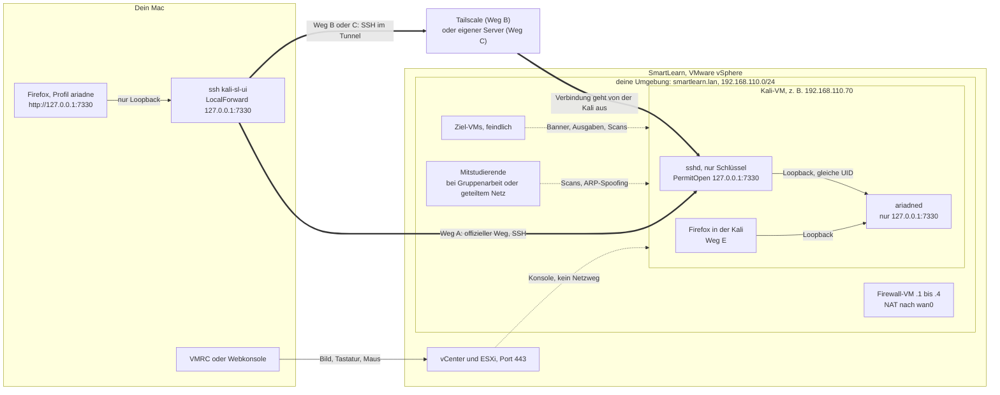
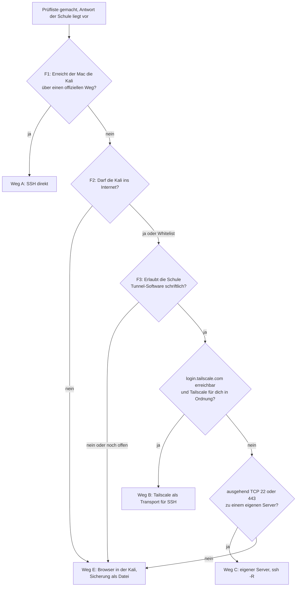

# Konzept: Ariadne vom Mac aus, Kali in SmartLearn

> Stand 2026-10-14, Vorschlag. Antwort auf deine Nachrichten vom 2026-10-14 («ich würde es cool finden wenn ich von remote (extern) auf da ariadne dashboard zugreifen kann ...» und «die kali läuft nicht auf der vm auf meinem mac sonder auf einer entfernten vm im smartlearn netz der schule»). Grundlage sind zwei Rechercheberichte (Umgebung SmartLearn, Zugangswege), [VISION](../VISION.md), die [Lösungsarchitektur](architektur.md) (7.1 bis 7.3, 8, 9), die [HTTP-API](web-api.md) (1.1, 3, 12), das [Entscheidungsprotokoll](entscheide.md), das [Konzept Terminal und Web](konzept-terminal-und-web.md) und der Code unter `src/ariadne/daemon` und `src/ariadne/web`. Entschieden ist davon nichts, bis du die Fragen in Abschnitt 9 beantwortet hast.
>
> Kennzeichnung: **gebaut** heisst im v0.1-Backend vorhanden. **geplant** heisst in Architektur oder API beschrieben, aber noch nicht gebaut. **Vorschlag** heisst neu in diesem Dokument. Wichtig vorab: Den HTTP-Teil des Daemons gibt es noch nicht (`ariadne ui` gibt nur einen Hinweis aus, die UI läuft im Mock-Modus). Netzweg, Härtung und Sicherung kannst du trotzdem schon jetzt einrichten.

## Inhalt

1. [Kurzfassung](#1-kurzfassung)
2. [Bild der Lösung](#2-bild-der-lösung)
3. [Erst prüfen: die 5-Minuten-Prüfliste](#3-erst-prüfen-die-5-minuten-prüfliste)
4. [Empfohlener Weg je Ergebnis](#4-empfohlener-weg-je-ergebnis)
5. [Sicherheitskonzept](#5-sicherheitskonzept)
6. [Datensicherung und Wiederherstellung](#6-datensicherung-und-wiederherstellung)
7. [Was Ariadne dafür bauen muss](#7-was-ariadne-dafür-bauen-muss)
8. [Welche Entscheide sich ändern](#8-welche-entscheide-sich-ändern)
9. [Fragen an dich](#9-fragen-an-dich)
10. [Quellen](#10-quellen)

## 1 Kurzfassung

Deine Kali läuft als VM in SmartLearn auf VMware vSphere, und du siehst sie über die Webkonsole oder die VMware Remote Console (VMRC); diese Konsole läuft über den Hypervisor, nicht über das Netz, darum erreicht dein Mac die Kali nach allem, was öffentlich bekannt ist, gar nicht direkt. Die Lösung ist trotzdem für alle Fälle dieselbe: Ariadne bleibt auf `127.0.0.1:7330`, und der Mac holt sich die Oberfläche über eine SSH-Portweiterleitung auf seinen eigenen `127.0.0.1:7330`, sodass Token, Host- und Origin-Prüfung, CSP und «Entsperren nur per CLI» unverändert gelten. Verschieden ist nur, wie der Mac den SSH-Dienst der Kali erreicht: über einen offiziellen Weg der Schule (Weg A), über Tailscale (Weg B) oder über einen eigenen kleinen Server (Weg C), wobei B und C ausgehende Tunnel sind und nur mit schriftlicher Erlaubnis der Schule in Frage kommen. Solange es keinen erlaubten Weg gibt, bleibt der Browser in der Kali (Weg E); das ist die sichere Grundlinie, die heute schon funktioniert. Einen eigenen Netzport von Ariadne im Lab-Netz und öffentliche Tunnel-Dienste wie ngrok oder Cloudflare schliesse ich aus, weil sie Mitstudierenden bzw. einem fremden Anbieter genau das zeigen, was Ariadne schützen soll. Weil die Schule die VM zurücksetzen und beim Archivieren löschen kann, gehört eine mit age verschlüsselte Sicherung ausserhalb der VM fest dazu, und `ariadne backup` sollte von v0.2 nach v0.1 vorrücken. Auf SmartLearn gehören nur Lab-Daten, denn wer den Hypervisor betreibt, sieht Bildschirm, Tastatureingaben und Arbeitsspeicher der VM.

## 2 Bild der Lösung



So liest du das Bild:

- **Konsole ist kein Netzweg.** Was du im VMRC-Fenster siehst, kommt vom ESXi-Host über Port 443. Dass du die Kali auf dem Mac siehst, heisst nicht, dass dein Mac sie über das Netz erreicht.
- **Ariadne lauscht nur auf Loopback.** `127.0.0.1` ist die Adresse «dieser Rechner selbst». Was dort lauscht, erreichen nur Prozesse auf derselben Maschine. Ziel-VMs und Mitstudierende sehen Port 7330 nie.
- **Der dicke Pfeil ist immer SSH.** Eine SSH-Portweiterleitung (`ssh -L`) öffnet auf dem Mac einen Port `127.0.0.1:7330`. Was dort ankommt, trägt SSH verschlüsselt zur Kali, und dort verbindet sich der sshd-Prozess deines Benutzers mit `127.0.0.1:7330`. Für Ariadne sieht das aus wie ein lokaler Browser.
- **Weg A, B und C unterscheiden sich nur in der Zufahrt zu sshd.** Das Sicherheitsmodell der Web-UI bleibt in allen drei Fällen gleich.

**Warum SSH und kein eigener Ariadne-Port.** Ich habe beides abgewogen. SSH bringt Verschlüsselung, Anmeldung per Schlüssel und Prüfung des Servers über den Hostkey fertig mit, und Ariadne muss dafür kaum etwas ändern: Der Browser auf dem Mac schickt `Host: 127.0.0.1:7330` und `Origin: http://127.0.0.1:7330`, genau wie heute verlangt (web-api.md 1.1). Ein eigener TLS-Port im Lab-Netz würde dagegen zwei Schutzschichten abbauen (Loopback-Bindung und Peer-UID), die Anmeldung vor allen Teilnehmenden im Netz öffnen und ein selbstsigniertes Zertifikat einführen, dessen Warnung man nach dem dritten Mal wegklickt. Im Lab gehört ARP-Spoofing zum Übungsstoff. Nicht ein neuer Dienst schützt hier, sondern einer, den es gar nicht gibt.

**Begriffe in einem Satz**

| Begriff | Bedeutung hier |
|---|---|
| Portweiterleitung (`ssh -L`) | ein Port auf dem Mac, dessen Verkehr SSH zu einem Port auf der Kali trägt |
| Hostkey-Fingerprint | Kennzeichen des sshd der Kali; stimmt er beim ersten Verbinden, sprichst du mit deiner Kali und nicht mit einem Angreifer dazwischen |
| ausgehender Tunnel | die Kali baut selbst eine Verbindung nach draussen auf, über die du zurück zu ihr kommst (Tailscale oder `ssh -R`) |
| age | Werkzeug zum Verschlüsseln von Dateien an öffentliche Schlüssel; Ariadne nutzt es schon für den Tresor (E71) |

## 3 Erst prüfen: die 5-Minuten-Prüfliste

Die Prüfliste beantwortet drei Fragen. Die Antworten wählen im Entscheidungsbaum (Abschnitt 4) den Weg.

- **F1:** Erreicht der Mac die Kali direkt über einen Weg, den die Schule vorsieht?
- **F2:** Darf die Kali ins Internet, und wohin?
- **F3:** Erlauben die Schulregeln Tunnel-Software (Tailscale, `ssh -R`)?

F1 und F2 misst du. F3 lässt sich nicht messen, die fragst du (Abschnitt 3.5). Drei Regeln für die Prüfung: Scanne nichts (kein nmap, kein Ping-Sweep ins Lab-Netz). Starte sshd noch nicht, solange das Standardpasswort gilt. Tippe Passphrasen und Codes nie in die Webkonsole unter Firefox, denn sie gibt dort Eingaben doppelt weiter.

### 3.1 Vorbereitung (30 Sekunden)

1. Öffne die Kali in der **VMRC** (Mac App Store, die gibb verlinkt sie) oder in der Webkonsole mit Chrome oder Safari.
2. Teste Copy/Paste: auf dem Mac `echo test` kopieren und im Kali-Terminal einfügen. Unter vSphere ist das standardmässig aus. Klappt es nicht, tippst du die Befehle ab; sie sind bewusst kurz.

### 3.2 In der Kali (etwa 3 Minuten)

```bash
# 1 Maschine und Netz: Image, Python, Adresse, Gateway
hostname; grep PRETTY /etc/os-release; python3 --version
ip -br addr; ip route

# 2 Internet: Proxy, Webzugang, KI-API, TLS-Aufbruch, Tailscale, ausgehendes TCP
env | grep -i _proxy
curl -sm8 -o /dev/null -w '%{http_code}\n' https://www.kali.org/
curl -sm8 -o /dev/null -w '%{http_code}\n' https://api.anthropic.com/v1/models
curl -svm8 -o /dev/null https://api.anthropic.com/ 2>&1 | grep -i issuer
curl -sm8 -o /dev/null -w '%{http_code}\n' https://login.tailscale.com/
nc -vz -w5 github.com 22; nc -vz -w5 github.com 443

# 3 Was lauscht, wer ist da (nur lesen, nichts senden)
sudo ss -tulpn
ip neigh
systemctl is-active ssh open-vm-tools

# 4 Platz und Schutz der Platte
free -h; nproc; df -h ~; swapon --show; lsblk -f
```

Optional, nur lesend: Ist das eine Gruppenumgebung, und wer darf deine VM sehen oder steuern?

```bash
D=$(sudo blkid -L SML_KS) && sudo mount -o ro "$D" /mnt && cat /mnt/SMARTLRN.YML; sudo umount /mnt
```

Fehlt das Label `SML_KS`, liefert das Masterset keine Konfigurationsdatei. Das ist kein Fehler.

### 3.3 Auf dem Mac (etwa 1 Minute)

```bash
KALI=192.168.110.70                  # IP aus Schritt 1 in der Kali
ifconfig | grep 'inet '              # liegt dein eigenes Netz in 192.168.110.0/24? dann ist die Messung wertlos
route -n get $KALI                   # über welche Schnittstelle und welches Gateway?
ping -c 3 $KALI
nc -vz -G 5 $KALI 22                 # Timeout, refused oder succeeded?
lsof -nP -iTCP -sTCP:ESTABLISHED | grep -i vmware   # wohin spricht die VMRC?
lsof -nP -iTCP:7330 -sTCP:LISTEN     # muss leer sein
```

**Gegenprobe, nur wenn `nc` nicht in einen Timeout läuft.** Alle SmartLearn-Umgebungen haben vermutlich denselben Adressplan. Eine Antwort von `192.168.110.70` kann also von der Kali einer anderen Person kommen oder von einem Gerät in deinem Heimnetz. Lass in der Kali `sudo timeout 30 tcpdump -n -i eth0 'tcp port 22'` laufen (Schnittstelle aus Schritt 1) und wiederhole auf dem Mac `nc -vz -G 5 $KALI 22`. Siehst du in der Kali das Paket, ist es deine. Siehst du nichts, hast du jemand anderen erreicht.

Nur wenn du für das gibb-VPN (`vpn.gibb.ch`, Check Point Mobile Access, MFA) berechtigt bist: verbinden, `netstat -rn -f inet | grep -E '^(10|192\.168)'` ansehen und die Mac-Befehle wiederholen.

### 3.4 Was die Ergebnisse bedeuten

| Messung | Ergebnis | Bedeutung | Folge |
|---|---|---|---|
| Kali `ip route` | 192.168.110.x/24, Gateway .1 bis .4 | eigene SmartLearn-Umgebung hinter einer NAT-Firewall-VM | F1 sehr wahrscheinlich nein |
| Mac `route`, `ping`, `nc` | en0 oder Heimrouter als Gateway, Timeout | kein Netzweg (so erwartet) | **F1 nein** |
| Mac `nc` | refused oder succeeded, Gegenprobe zeigt das Paket in deiner Kali | es gibt einen Netzweg zu deiner Kali | **F1 ja**, wenn der Weg offiziell ist (VPN, Freigabe der Lehrperson) |
| Mac `nc` | refused oder succeeded, Gegenprobe zeigt nichts | fremdes Gerät mit derselben Adresse | F1 nein, und nie dorthin verbinden |
| Mac `ifconfig` | eigenes Netz in 192.168.110.0/24 oder .120.0/24 | jede Messung trifft dein Heimnetz | Messung wertlos, über anderes Netz wiederholen |
| Mac `lsof … vmware` | Verbindung zu einem Host auf :443 | Konsole läuft über ESXi oder vCenter | bestätigt: Konsole ist kein Netzweg |
| `kali.org` | 200 oder 301 | HTTPS nach aussen offen | **F2 ja** |
| `kali.org` | 000 | gesperrt oder Timeout | **F2 nein**: offline betreiben, keine Cloud-KI |
| `kali.org` | 403, Proxy-Seite, oder `*_proxy` gesetzt | Whitelist oder Filter | **F2 teilweise**: nötige Ziele freischalten lassen |
| `api.anthropic.com` | 401 | API erreichbar, Schlüssel fehlt erwartungsgemäss | Claude-API technisch möglich |
| `issuer` | öffentliche CA (z. B. Google Trust Services, Let's Encrypt) | kein TLS-Aufbruch erkennbar | keine Einschränkung |
| `issuer` | OPNsense, Firewall, gibb oder Ähnliches | TLS wird aufgebrochen, die Schule liest HTTPS-Inhalte | keine API-Keys und keine Lab-Daten über HTTPS; SSH und WireGuard bleiben verschlüsselt, die Schule sieht aber, dass du tunnelst |
| `login.tailscale.com` | 200 oder 3xx | Tailscale technisch möglich | Weg B möglich (wenn F3 ja) |
| `github.com 22` oder `443` | succeeded | ausgehendes TCP offen | Weg C möglich (wenn F3 ja) |
| `ss -tulpn` | nur 127.0.0.1 und ::1 | nichts ist von aussen erreichbar | Zielzustand, auch später für 7330 |
| `ss -tulpn` | 0.0.0.0:22, [::]:5432 oder die lan0-IP | Ziel-VMs (und bei Gruppenarbeit die Gruppe) erreichen diesen Dienst | stoppen oder härten |
| `ssh` | active | sshd lauscht vermutlich auf allen Adressen, eventuell mit Passwort | sofort `passwd`, dann Abschnitt 4.2 |
| `open-vm-tools` | active | der Hypervisor kann mit Gast-Zugangsdaten Programme starten | eigenes Passwort ist Pflicht |
| `ip neigh` | nur .1 bis .4 und bekannte Ziele, MAC 00:50:56:… | nur deine Umgebung | «Mitstudierende im Netz» trifft nicht zu |
| `ip neigh` oder `SMARTLRN.YML` | fremde Nachbarn, `team` gesetzt oder mehrere `users` | geteiltes Segment oder Gruppenumgebung | Verkehr als mitgelesen behandeln; die Gruppe sieht und steuert eventuell deine Kali |
| `python3 --version` | unter 3.11 | Ariadne läuft nicht (`requires-python >=3.11`) | neueres Image verlangen |
| `free -h` | etwa 4 GB | Firefox und Karte in der VM sind eng | Weg E geht, aber knapp |
| `swapon`, `lsblk -f` | Swap ohne Verschlüsselung, kein `crypto_LUKS` | Disk und Swap liegen im Klartext auf dem Datastore der Schule | Ariadnes Verschlüsselung ist der einzige Schutz; nur Lab-Daten |

**Ergebnis festhalten** (gehört später in `ariadne remote check`, Abschnitt 7):

| Frage | Antwort | Beleg |
|---|---|---|
| F1 Mac erreicht Kali direkt, offiziell | ja / nein | `nc`, Gegenprobe, Antwort der Schule |
| F2 Kali ins Internet | ja / nein / nur Whitelist | `curl`-Codes, Proxy |
| F3 Tunnel erlaubt | ja (schriftlich) / nein / offen | Ticket-Antwort |
| Nebenbefunde | TLS-Aufbruch, Gruppenumgebung, Python, RAM, offene Dienste | |

### 3.5 Was du die Schule fragst

Am besten per Ticket unter ticket.gibb.ch, damit die Antwort schriftlich vorliegt. Die Frage nach Tunneln ist der heikelste Punkt: Eine öffentliche gibb-Regel dazu habe ich nicht gefunden, vergleichbare Schweizer Hochschulen verbieten aber die Umgehung von Sicherheitskontrollen des Netzes und Fernzugänge ohne Bewilligung. Ein selbst gebauter Tunnel aus einer isolierten Lab-VM fällt sehr wahrscheinlich darunter. Ohne schriftliches Okay behandle ich ihn als verboten.

1. Darf ich auf meiner Lab-Kali eigene Software installieren (Ariadne per pipx aus einem privaten Repo) und sshd mit Schlüsselanmeldung aktivieren?
2. Gibt es einen vorgesehenen Weg vom eigenen Gerät zur Kali (VPN, Jumphost, Portfreigabe auf der SmartLearn-Firewall, VDI)? Ist das Mobile-Access-VPN für HF-Studierende und Lab-Netze gedacht?
3. Sind ausgehende Tunnel aus der Lab-VM erlaubt, konkret Tailscale oder eine SSH-Verbindung zu einem eigenen Server?
4. Darf die Lab-VM Lab-Daten an einen Cloud-Dienst senden (Claude API)?
5. Wo dürfen Aufzeichnungen aus Labs liegen: Datei-Übertragung nach SmartLearn, gibb-OneDrive, privates Gerät (verschlüsselt)?
6. Wie lange lebt meine Kali (Quartal, Archivierungsfrist), wird sie vor Prüfungen zurückgesetzt, und gibt es Snapshots?
7. Wer kann meine VM sehen oder steuern (Lehrperson, Power-User, Hersteller-Support), und arbeite ich im Modul allein oder in einer Gruppenumgebung?

## 4 Empfohlener Weg je Ergebnis

### 4.1 Entscheidungsbaum



| Weg | Wann | Was die Schule erlauben muss | Dritte im Spiel | sshd im Lab-Netz sichtbar | Einrichtung |
|---|---|---|---|---|---|
| **A** SSH direkt | F1 ja | sshd auf der Kali, Nutzung des Wegs (VPN, Freigabe) | keine | ja, gehärtet | 1 bis 2 h |
| **B** Tailscale + SSH | F1 nein, F2 ja, F3 ja | ausgehender Overlay-Tunnel | Tailscale (Metadaten, Inhalt Ende-zu-Ende verschlüsselt) | nein, nur im Tailnet | 1 bis 2 h |
| **C** eigener Server + SSH | wie B, wenn Tailscale blockiert oder unerwünscht | ausgehende SSH-Verbindung | dein Server (sieht nur Chiffrat) | nein, sshd nur auf 127.0.0.1 | 2 bis 4 h plus Serverpflege |
| **E** Browser in der Kali | immer möglich, Pflicht solange kein anderer Weg erlaubt ist | nichts | keine | nein | 10 min |

Nie, egal was die Prüfliste ergibt:

- **D: öffentliche Tunnel-Dienste** (Cloudflare Tunnel, ngrok). Beide beenden TLS bei sich und sehen Token, aufgedeckte Credentials und Logzeilen im Klartext; Cloudflare Quick Tunnels können zudem kein SSE, die Live-Ansicht ginge also nicht. Ariadne lehnt fremde Hostnamen ohnehin mit 421 ab (web-api.md 1.1), und das soll so bleiben.
- **F: eigener TLS-Port von Ariadne auf der Lab-IP.** Angriffsfläche vor der Anmeldung für alle im Netz, MITM per ARP-Spoofing, Code-Sperre durch fremde Fehlversuche (nach 5 Fehlversuchen pro Minute werden alle Codes ungültig) und ein nmap-Fingerabdruck «hier läuft Ariadne».

**Meine Erwartung.** Nach der Recherche ist F1 bei SmartLearn sehr wahrscheinlich «nein»: Die Kali sitzt in einem privaten Netz hinter NAT, und alle Umgebungen haben denselben Adressplan. Realistisch heisst das: jetzt Weg E, und Weg B oder C erst, wenn die Schule Tunnel erlaubt. Gehen A und B beide, nimm A, weil kein Dritter beteiligt ist und die Regelfrage wegfällt.

Die Einrichtung ist für A, B und C gleich aufgebaut: Erst die gemeinsamen Bausteine (4.2), dann der Weg (4.3 bis 4.5), erst ganz am Schluss startet sshd.

### 4.2 Gemeinsame Bausteine für A, B und C

**Kali, über die Konsole.** In SmartLearn heisst dein Benutzer eventuell nicht `kali` (die Doku nennt auch `vmuser`). Die Befehle nehmen deshalb `$USER`.

```bash
passwd                                          # Standardpasswort ersetzen, vor allem anderen
sudo apt update && sudo apt install -y openssh-server age nftables   # nur mit Internet; ohne Internet siehe Abschnitt 7 (Offline-Bundle)
```

sshd-Einstellungen als eigene Datei. Die Hauptdatei von Debian bindet `sshd_config.d/*.conf` ganz oben ein, und bei sshd gilt der erste Wert. Damit gewinnt diese Datei.

```bash
sudo tee /etc/ssh/sshd_config.d/10-ariadne.conf >/dev/null <<EOF
PermitRootLogin no
PasswordAuthentication no
KbdInteractiveAuthentication no
AuthenticationMethods publickey
AllowUsers $USER
AllowTcpForwarding local
PermitOpen 127.0.0.1:7330
PermitListen none
GatewayPorts no
X11Forwarding no
AllowAgentForwarding no
AllowStreamLocalForwarding no
PermitTunnel no
MaxAuthTries 3
LoginGraceTime 20
ClientAliveInterval 30
EOF
sudo sshd -t && echo "Konfiguration ok"
```

Was das bewirkt: nur Anmeldung mit Schlüssel, kein root, nur dein Benutzer, und als einzige Weiterleitung die zu Ariadne. Selbst mit deinem Schlüssel kommt man über SSH nicht an andere Ports der Kali oder ins Lab-Netz.

**Mac, einmalig.**

```bash
ssh-keygen -t ed25519 -a 100 -f ~/.ssh/id_ed25519_kali_sl -C mac-kali-smartlearn   # mit Passphrase
ssh-add --apple-use-keychain ~/.ssh/id_ed25519_kali_sl
ssh-keygen -lf ~/.ssh/id_ed25519_kali_sl.pub                                         # Fingerprint notieren
```

Den öffentlichen Schlüssel in die Kali bringen. Am einfachsten, wenn die Kali ins Internet darf: Schlüssel in deinem GitHub-Konto hinterlegen und in der Kali `curl -fsS https://github.com/DEIN-NAME.keys` abrufen. Sonst über die Datei-Übertragung von SmartLearn, Copy/Paste (falls an) oder Abtippen.

```bash
# Kali
install -d -m 700 ~/.ssh
curl -fsS https://github.com/DEIN-NAME.keys >> ~/.ssh/authorized_keys   # oder Datei einfügen
chmod 600 ~/.ssh/authorized_keys
ssh-keygen -lf ~/.ssh/authorized_keys        # muss den Fingerprint vom Mac enthalten
ssh-keygen -lf /etc/ssh/ssh_host_ed25519_key.pub   # Hostkey-Fingerprint notieren, für den ersten Login
```

`~/.ssh/config` auf dem Mac. Der obere Block gilt nur für den Tunnel, der untere für beide Namen. `HostName` setzt du je nach Weg (4.3 bis 4.5).

```text
Host kali-sl-ui
  SessionType none
  ExitOnForwardFailure yes
  LocalForward 127.0.0.1:7330 127.0.0.1:7330

Host kali-sl kali-sl-ui
  HostName 192.168.110.70
  User kali
  IdentityFile ~/.ssh/id_ed25519_kali_sl
  IdentitiesOnly yes
  HostKeyAlias kali-smartlearn
  ForwardAgent no
  ForwardX11 no
  ServerAliveInterval 15
  ServerAliveCountMax 3
  AddKeysToAgent yes
  UseKeychain yes
```

- `User` ist dein Benutzer in der Kali (`kali`, `vmuser` oder was `whoami` dort zeigt).
- `HostKeyAlias` speichert den Hostkey unter einem festen Namen. Wechselt später die Adresse (Tailscale, eigener Server), bleibt die Prüfung dieselbe.
- `ExitOnForwardFailure` bricht ab, wenn auf dem Mac schon etwas Port 7330 belegt. Sonst würdest du mit einem fremden Programm reden.
- Nie `-g` oder `GatewayPorts` auf dem Mac: Dann wäre Port 7330 für alle im selben WLAN offen.

**Eigenes Browserprofil auf dem Mac.** Ein Profil ohne Erweiterungen, ohne Sync, ohne Verlauf und ohne Proxy, wie Architektur 7.2.5 es für die Kali verlangt.

```bash
/Applications/Firefox.app/Contents/MacOS/firefox -CreateProfile ariadne
P=$(ls -d ~/Library/Application\ Support/Firefox/Profiles/*.ariadne)
cat > "$P/user.js" <<'EOF'
user_pref("browser.privatebrowsing.autostart", true);
user_pref("browser.sessionstore.privacy_level", 2);
user_pref("browser.cache.disk.enable", false);
user_pref("signon.rememberSignons", false);
user_pref("identity.fxaccounts.enabled", false);
user_pref("network.proxy.type", 0);
user_pref("network.proxy.allow_hijacking_localhost", false);
user_pref("network.prefetch-next", false);
user_pref("network.dns.disablePrefetch", true);
user_pref("datareporting.healthreport.uploadEnabled", false);
user_pref("toolkit.telemetry.enabled", false);
user_pref("app.normandy.enabled", false);
EOF
```

Der Dauer-Privatmodus ist Absicht: Er schreibt weder Verlauf noch Sitzungswiederherstellung auf die Platte. Ob Firefox `sessionStorage` (und damit das Token) für die Wiederherstellung sichert, ist nicht eindeutig dokumentiert; mit Privatmodus und `privacy_level` 2 ist die Frage erledigt. Starten mit `open -na Firefox --args -P ariadne`.

### 4.3 Weg A: SSH direkt

**Kali.** Ein eigenes Firewall-Limit für SSH brauchst du meist nicht: OpenSSH ab 9.8 bremst auffällige Quellen schon selbst (PerSourcePenalties, `ssh -V` zeigt die Version). Kommen alle über dieselbe NAT-Adresse, sperrt das auch dich; dann in `journalctl -u ssh` nach «penalty» suchen. Ist die Quell-IP deines Wegs bekannt und nur deine (z. B. ein VPN-Pool), schränke `AllowUsers` darauf ein, z. B. `AllowUsers kali@10.20.0.0/16` (Pool nur als Beispiel).

```bash
sudo systemctl enable --now ssh
sudo sshd -T | grep -Ei '^(passwordauthentication|permitrootlogin|allowtcpforwarding|permitopen|permitlisten|x11forwarding)'
```

Erwartet: `passwordauthentication no`, `permitrootlogin no`, `allowtcpforwarding local`, `permitopen 127.0.0.1:7330`, `permitlisten none`, `x11forwarding no`.

**Mac.** `HostName` auf die Adresse, die der offizielle Weg vorgibt (Kali-IP über VPN, oder Adresse und `Port` der Freigabe). Erster Login:

```bash
ssh kali-sl true
```

SSH zeigt den Fingerprint. Nur wenn er mit dem aus der Kali übereinstimmt, mit `yes` bestätigen. Weicht er ab, abbrechen: Dann sitzt jemand dazwischen oder du bist bei einer fremden Kali.

**Tunnel testen** (sobald der HTTP-Teil gebaut ist):

```bash
ssh -f kali-sl-ui
curl -sS -o /dev/null -w '%{http_code}\n' http://127.0.0.1:7330/api/v1/status
```

401 heisst: Tunnel und Daemon sind in Ordnung, es fehlt nur das Token. 421 heisst falscher Host (du hast `localhost` oder einen anderen Port benutzt). «Connection refused» heisst: Tunnel nicht aktiv oder Backend aus. Im Browser immer `http://127.0.0.1:7330`, nie `localhost`.

**Alltag A** (mit dem Mac-Helfer aus Abschnitt 7, **Vorschlag**):

1. Mac: `ariadne-mac start` (Tunnel auf, Code über SSH holen, Firefox-Profil mit Anmeldung öffnen).
2. Am Ende: `ariadne-mac stop` (Sitzungen widerrufen, Sicherung holen, Tunnel zu).

Bis der Helfer existiert, von Hand: `ssh -f kali-sl-ui`, dann `ssh -t kali-sl '$HOME/.local/bin/ariadne ui --code'` (**geplant**) und den Code im Mac-Browser eintippen. Der Code erscheint so im Terminal des Macs, nicht auf dem Konsolenbild der Kali, und die Aufnahme sieht ihn nicht.

### 4.4 Weg B: Tailscale als Transport für SSH

Tailscale baut ein privates Netz aus WireGuard-Verbindungen (ein «Tailnet»). Die Kali verbindet sich nur ausgehend, darum klappt das durch NAT. Ich nutze Tailscale hier nur als Leitung: Darin läuft dasselbe SSH wie bei Weg A. Tailscale SSH und `tailscale serve` bleiben aus. Beide liessen tailscaled (root) die Verbindung zu Ariadne aufbauen, das scheitert an der UID-Prüfung und bräuchte Ausnahmen bei Host und Origin.

Rahmen: Der Plan «Personal» ist kostenlos, aber nur für nicht-kommerzielle Nutzung. Fürs Studium passt das, für Kundenaufträge nicht (Abschnitt 5.5). Der Koordinationsserver sieht Konto, Gerätenamen, öffentliche Adressen (auch die der Schule) und Online-Zeiten, aber keine Inhalte.

**Konto und Regeln.** Konto anlegen, auf dem Mac Tailscale installieren und eingehende Verbindungen sperren (in der App «Allow incoming connections» aus, oder `tailscale set --shields-up`). In der Admin-Konsole die Standardregel «alles erlaubt» ersetzen durch genau eine Regel. `100.x.y.z` ist die Tailscale-Adresse deines Macs.

```json
{
  "tagOwners": { "tag:kali-lab": ["autogroup:admin"] },
  "hosts":     { "mac": "100.x.y.z" },
  "grants": [
    { "src": ["mac"], "dst": ["tag:kali-lab"], "ip": ["tcp:22"] }
  ]
}
```

Die Kali bekommt keine Rechte. Sie ist die riskante Maschine (fremde Exploits, feindliche Ziele), sie soll den Mac nie erreichen.

**Kali.** sshd zusätzlich auf Tailscale-Adressen beschränken (zweite Schicht neben der Firewall-Regel):

```bash
sudo sed -i "s/^AllowUsers .*/AllowUsers $USER@100.64.0.0\/10/" /etc/ssh/sshd_config.d/10-ariadne.conf
```

Tailscale aus der offiziellen Paketquelle installieren (Skript erst ansehen, dann ausführen):

```bash
curl -fsSL https://tailscale.com/install.sh -o ts-install.sh && less ts-install.sh && sh ts-install.sh
echo 'FLAGS="--no-logs-no-support"' | sudo tee -a /etc/default/tailscaled   # keine Client-Logs an Tailscale, zu verifizieren
sudo systemctl restart tailscaled
sudo tailscale up --ssh=false --accept-dns=false --accept-routes=false --advertise-tags=tag:kali-lab --qr
tailscale netcheck
tailscale ip -4
```

`--qr` zeigt den Anmeldelink als QR-Code, den scannst du mit dem Handy. So musst du keinen langen Link abtippen. `--accept-dns=false` lässt die DNS-Einstellungen des Labs in Ruhe.

Port 22 nur über das Tailnet erlauben. Die Regel liegt in einer eigenen Tabelle und wird von einem kleinen Dienst geladen, damit sie die Regeln von Tailscale nicht überschreibt:

```bash
sudo install -d /etc/ariadne
sudo tee /etc/ariadne/ssh-filter.nft >/dev/null <<'EOF'
table inet ariadne_ssh
delete table inet ariadne_ssh
table inet ariadne_ssh {
  chain input {
    type filter hook input priority -10; policy accept;
    iifname "lo" accept
    iifname "tailscale0" tcp dport 22 accept
    tcp dport 22 drop
  }
}
EOF
sudo tee /etc/systemd/system/ariadne-ssh-filter.service >/dev/null <<'EOF'
[Unit]
Description=Ariadne: SSH nur im Tailnet
Before=ssh.service
[Service]
Type=oneshot
RemainAfterExit=yes
ExecStart=/usr/sbin/nft -f /etc/ariadne/ssh-filter.nft
ExecStop=/usr/sbin/nft delete table inet ariadne_ssh
[Install]
WantedBy=multi-user.target
EOF
sudo systemctl enable --now ariadne-ssh-filter ssh
```

Die Policy bleibt `accept`, damit Listener für Übungen (Reverse Shells) weiter funktionieren. Gesperrt wird nur Port 22 von aussen.

**Mac.** In `~/.ssh/config` `HostName` auf die `100.x`-Adresse der Kali setzen, dann der erste Login mit Fingerprint-Vergleich wie bei Weg A.

**Nach jedem VM-Reset** entsteht ein neuer Knoten: alten in der Admin-Konsole entfernen, `tailscale up` wiederholen, neuen Hostkey prüfen. Wer will, schaltet Tailnet Lock ein (`tailscale lock init`); dann muss der Mac jeden neuen Knoten signieren, und auch Tailscale selbst kann keine fremden Geräte einschleusen.

**Alltag B:** wie Weg A (`ariadne-mac start`, am Ende `ariadne-mac stop`). Tailscale auf dem Mac muss verbunden sein.

### 4.5 Weg C: eigener Server mit `ssh -R`

Die Kali baut eine SSH-Verbindung zu einem kleinen Server von dir auf (ein VPS für ein paar Franken im Monat) und öffnet dort `127.0.0.1:2222`, das zurück zu ihrem eigenen sshd führt. Der Mac springt über diesen Server (`ProxyJump`) zur Kali. SSH läuft dabei Ende-zu-Ende zwischen Mac und Kali, der Server sieht nur Chiffrat. Der grosse Vorteil gegenüber A und B: sshd auf der Kali lauscht nur auf `127.0.0.1` und ist im Lab-Netz unsichtbar, ganz ohne Firewall-Regel. Der Nachteil: Du betreibst einen öffentlichen Server und musst ihn pflegen.

**Server** (Debian, sshd nur mit Schlüssel, Patches automatisch):

```bash
sudo useradd -m -s /usr/sbin/nologin tunnel
sudo install -d -m 700 -o tunnel -g tunnel /home/tunnel/.ssh
# /home/tunnel/.ssh/authorized_keys, zwei Zeilen:
# restrict,port-forwarding,permitlisten="127.0.0.1:2222" ssh-ed25519 AAAA... kali-vm
# restrict,port-forwarding,permitopen="127.0.0.1:2222" ssh-ed25519 AAAA... mac
```

Der Schlüssel der Kali darf nur `127.0.0.1:2222` öffnen, der des Macs nur dorthin springen. Eine Shell gibt es für keinen. Ist ausgehend nur 443 offen, lässt du sshd auf dem Server zusätzlich auf Port 443 lauschen.

**Kali.** sshd nur auf Loopback, dann den Rückwärts-Tunnel als User-Dienst:

```bash
echo 'ListenAddress 127.0.0.1' | sudo tee -a /etc/ssh/sshd_config.d/10-ariadne.conf
sudo sed -i "s/^AllowUsers .*/AllowUsers $USER@127.0.0.1/" /etc/ssh/sshd_config.d/10-ariadne.conf
sudo sshd -t && sudo systemctl enable --now ssh
ssh-keygen -t ed25519 -N '' -f ~/.ssh/id_ed25519_rendezvous -C kali-vm   # ohne Passphrase, nur für den Tunnel
ssh -i ~/.ssh/id_ed25519_rendezvous tunnel@DEIN-SERVER true             # Hostkey des Servers prüfen und bestätigen
mkdir -p ~/.config/systemd/user
cat > ~/.config/systemd/user/ariadne-revtunnel.service <<'EOF'
[Unit]
Description=Ariadne: Rückwärts-Tunnel zum eigenen Server
[Service]
ExecStart=/usr/bin/ssh -N -o ExitOnForwardFailure=yes -o ServerAliveInterval=15 -o ServerAliveCountMax=3 -i %h/.ssh/id_ed25519_rendezvous -R 127.0.0.1:2222:127.0.0.1:22 tunnel@DEIN-SERVER
Restart=always
RestartSec=20
[Install]
WantedBy=default.target
EOF
systemctl --user daemon-reload && systemctl --user enable --now ariadne-revtunnel
sudo loginctl enable-linger $USER
```

Der Test `ssh ... true` meldet wegen `nologin` einen Fehler, das ist richtig so. Wichtig ist nur, dass du den Hostkey des Servers geprüft hast.

**Mac.** Einen eigenen Schlüssel für den Server erzeugen (`id_ed25519_rendezvous_mac`) und in `~/.ssh/config` ergänzen; im Block `kali-sl kali-sl-ui` ändern sich `HostName` und `Port`:

```text
Host rendezvous
  HostName DEIN-SERVER
  User tunnel
  IdentityFile ~/.ssh/id_ed25519_rendezvous_mac
  IdentitiesOnly yes

Host kali-sl kali-sl-ui
  HostName 127.0.0.1
  Port 2222
  ProxyJump rendezvous
  # Rest wie in 4.2
```

Erster Login mit Fingerprint-Vergleich wie bei Weg A. Ohne `HostKeyAlias` würde SSH hier den Hostkey unter `[127.0.0.1]:2222` ablegen.

**Alltag C:** Der Tunnel steht von selbst, sobald die Kali läuft. Auf dem Mac `ariadne-mac start` und am Ende `ariadne-mac stop`.

### 4.6 Weg E: Browser in der Kali (Grundlinie)

Das ist das heutige Design der Architektur, ohne Netzweg und ohne Regelfrage. Alle Schutzschichten sind intakt, und die Karte ist live.

- Auflösung der Kali an den Mac-Bildschirm anpassen: `xrandr` zeigt Ausgänge und Modi, dann z. B. `xrandr --output Virtual1 --mode 1920x1080`.
- VMRC auf dem Mac im Vollbild, in Xfce das Terminal links und Firefox rechts (Super+Pfeil links/rechts), die Karte auf einem eigenen Arbeitsbereich.
- Ob die VMRC unter macOS eine VM auf zwei Monitore verteilen kann, ist zu verifizieren. Das wäre der Zweitbildschirm ohne Netz.
- Mit 4 GB RAM wird es eng, wenn Burp, Firefox und die Karte gleichzeitig laufen. Eine kleinere Karte oder die Tabellenansicht hilft.

**Alltag E:**

1. In der Kali `ariadne ui` (nach dem Konzept Terminal und Web später zusammen mit `ariadne start`).
2. Firefox rechts, Terminal links.

## 5 Sicherheitskonzept

### 5.1 Schutzziele

| Schutzziel | Was konkret |
|---|---|
| Vertraulichkeit | Loot, Credentials, Rohlog, Token, Passphrase und API-Key erreichen weder Mitstudierende noch Ziele, Tunnel-Anbieter oder Erweiterungen im Mac-Browser |
| Integrität | nur du steuerst Ariadne (REC, Entscheide); keine fremde Seite und kein fremder Prozess löst Aktionen aus; die Hash-Kette bleibt prüfbar |
| Verfügbarkeit | fällt der Tunnel, nimmt die Kali weiter auf («die Shell geht nie kaputt»); die Daten überleben einen VM-Reset |
| keine neue Angriffsfläche | mit Fernzugriff ist die Kali vom Lab-Netz aus nicht angreifbarer als ohne (B und C: nichts sichtbar; A: nur gehärteter sshd) |
| Regelkonformität | kein Weg ohne Erlaubnis; die Erlaubnis liegt schriftlich vor |

### 5.2 Wer angreift

Die Angreiferklassen aus Architektur 9.1 gelten weiter. Zwei Dinge sind neu:

- **A3 auf dem Mac.** Jeder Prozess auf dem Mac erreicht den weitergeleiteten `127.0.0.1:7330`. Deshalb bleibt das Token Pflicht, auch über den Tunnel.
- **A8 Plattformbetreiber (Vorschlag).** Wer vCenter und ESXi betreibt (Power-User der Schule, SmartLearn-Support), sieht die Konsole samt Tastatureingaben, kann Snapshots mit Arbeitsspeicher ziehen, die virtuelle Disk lesen und über die VMware Tools mit Gast-Zugangsdaten Programme starten. Das ist eine Eigenschaft von vSphere, keine Aussage darüber, was die gibb tut. Gegen A8 hilft keine Verschlüsselung in der VM, nur Datensparsamkeit.

Zu den Mitstudierenden: SmartLearn isoliert laut Hersteller jede Person in einer eigenen Umgebung. Sicher im selben Netz wie deine Kali liegen die Ziel-VMs (A1). Mitstudierende sind es bei Gruppenarbeit, und vielleicht teilen sich Umgebungen das Netz `wan0`. Ich plane deshalb so, als wären sie da und würden angreifen; die Prüfliste zeigt, ob das zutrifft.

### 5.3 Bedrohungsmodell

| Bedrohung | Wirkung | Gegenmassnahme | Restrisiko |
|---|---|---|---|
| **Mitstudierende und Ziele im Lab-Netz** | | | |
| scannen das Netz und suchen Ariadne | Angriff auf Anmeldung und HTTP-Parser, Code-Sperre durch Fehlversuche | Daemon lauscht nur auf `127.0.0.1` (Regel R1), `remote check` prüft das | keins, solange R1 hält |
| Brute-Force oder Exploit gegen sshd (Weg A) | Übernahme der Kali | nur Schlüssel, kein root, `AllowUsers`, PerSourcePenalties; bei B und C ist sshd im Lab unsichtbar | Lücke in OpenSSH selbst (gering, Updates) |
| Standardpasswort `kali`/`kali` | sofortige Übernahme über SSH oder VMware Tools | `passwd` vor allem anderen, `PasswordAuthentication no` | keins |
| ARP-Spoofing beim ersten SSH-Login (Weg A) | Angreifer liest den Tunnel mit und stiehlt das Token | Hostkey-Fingerprint über die Konsole vergleichen, `HostKeyAlias`, Warnungen nie wegklicken | Unachtsamkeit beim ersten Mal |
| gleicher Adressplan in allen Umgebungen | du landest auf der Kali einer anderen Person und gibst dort Code oder Daten ein | Gegenprobe mit `tcpdump`, Fingerprint-Vergleich; dein privater Schlüssel verlässt den Mac bei der Anmeldung nie | gering |
| Gruppenmitglieder mit Recht RW auf deine VM | sehen und bedienen deine Konsole, damit auch den entsperrten Daemon | allein arbeiten, wenn möglich; `ariadne lock` bei jeder Pause; in Gruppen keine Credentials aus anderen Quellen | hoch bei Gruppenarbeit, deshalb nur Lab-Daten |
| präparierte Zieldaten (Hostnamen, Banner, Webseiten mit XSS-Strings) | Code im Browser, jetzt auf dem Mac | unverändert: Svelte escapt, `{@html}` verboten, strenge CSP, `displaySafe()`, Ziel-URLs nicht klickbar (Architektur 7.7) | Fehler im Browser selbst |
| feindliches Ziel öffnet über einen Tunnel-Server (z. B. `chisel server` ohne `--authfile`) Loopback auf der Kali | erreicht Port 7330 | Token auf jeder Route, Hinweis-Regel bei `chisel` ohne Authfile (geplant, v0.2) | wie heute, durch den Fernzugriff nicht grösser |
| **Schule und Plattform (A8)** | | | |
| sieht Konsole und Tastatur | Passphrase bei `ariadne unlock` über die Konsole, Codes, Secrets auf dem Bildschirm | bei A, B, C per `ssh -t` vom Mac entsperren (läuft im SSH-Kanal); Präsentationsmodus; nur Lab-Daten | bei Weg E geht die Passphrase über die Konsole; für Lab-Daten vertretbar |
| Snapshot mit Arbeitsspeicher, Suspend | Schlüssel des entsperrten Daemons, also die Operator-Identität und damit alle lab-Projekte, dazu der API-Key | `ariadne lock` vor Pausen und vor dem Stoppen der VM; eigener API-Key mit tiefem Limit nur für diese VM, am Semesterende widerrufen | für Lab-Daten akzeptiert |
| liest die virtuelle Disk | Klartext-Arbeitsbereich (`scans/`, `loot/` im Profil lab), Shell-History, Swap | `.vault/` bleibt Chiffrat; neutrale Projektnamen; keine Kundendaten | für Lab-Daten akzeptiert |
| TLS-Aufbruch durch die Lab-Firewall | Claude-Aufrufe und API-Key lesbar | Aussteller prüfen (3.2); bei Schul-CA Cloud-KI in diesem Projekt aus | keins, wenn geprüft |
| sieht den Tunnel im Netz | Regelverstoss wird sichtbar | Tunnel nur mit schriftlicher Erlaubnis (F3) | keins mit Erlaubnis |
| **Mac-Browser** | | | |
| Erweiterungen lesen Seiteninhalte und Token | Credentials und Loot fliessen ab | eigenes Profil ohne Erweiterungen (4.2) | Ariadne kann das Profil nicht erzwingen, nur empfehlen und starten |
| Sync (Firefox-Konto, Chrome-Sync) | Verlauf und offene Tabs landen in der Cloud | `identity.fxaccounts.enabled` false, kein Konto im Profil | keins |
| Verlauf, Cache, Sitzungswiederherstellung | Adressen mit Ziel-IPs in `?host=`, Token aus `sessionStorage` auf der Mac-Platte | Dauer-Privatmodus, `privacy_level` 2, Ariadne sendet `Cache-Control: no-store`, Code nur im Fragment und sofort entfernt | Verhalten von `sessionStorage` bei Wiederherstellung zu verifizieren; FileVault an |
| andere Prozesse auf dem Mac nutzen den Tunnel (A3) | API-Aufrufe ohne Token enden mit 401; Fehlversuche können alle Codes sperren | Token Pflicht, Code nur über den SSH-Kanal, Tunnel nur an `127.0.0.1` | Schadsoftware mit deinen Rechten auf dem Mac liest ohnehin den Browser; das liegt ausserhalb dieses Konzepts |
| fremdes Programm belegt Port 7330 auf dem Mac | gefälschte Oberfläche, Code geht an das falsche Programm | `ExitOnForwardFailure`, `lsof`-Prüfung im Helfer, Passphrase nie im Browser (E74) | gering, der Code gilt 60 s und einmal |
| fremde Webseiten in anderen Tabs (DNS-Rebinding, CSRF) | fremde Seite spricht die API an | Host exakt `127.0.0.1:7330`, `Sec-Fetch-Site`, Origin, Bearer statt Cookies | gering |
| Proxy auf dem Mac (z. B. Burp als Systemproxy) | Token und Klartext in der Burp-History | `network.proxy.type` 0, `allow_hijacking_localhost` false | keins im Profil |
| Mac im fremden WLAN | andere Geräte erreichen den Tunnel | `LocalForward 127.0.0.1:...`, nie `-g` | keins |
| **kompromittierte Kali** | | | |
| bösartiger Exploit oder PoC greift über den Fernzugriff den Mac an | Seitwärtsbewegung auf dein Privatgerät | nur `LocalForward` (Mac zu Kali), kein `RemoteForward`, kein Agent-Forwarding; Tailscale-Regel ohne Rechte für die Kali, Shields-up auf dem Mac; Schlüssel auf dem Server mit `restrict` und `permitlisten` | die Kali kann dir in der UI falsche Daten zeigen, wie heute auch |
| **Verlust der VM** | | | |
| Reset, Archivierung, neues Masterset, Herunterfahren vor Prüfungen | Installation, Tresor und Projekte sind weg | nach jeder Session verschlüsselt sichern (Abschnitt 6), Recovery-Schlüssel offline, Einrichtung als Skript | Arbeit seit der letzten Sicherung |
| Sicherung in falschen Händen (Mac-Diebstahl, Cloud-Ordner) | Projektdaten lesbar | age an den Mac-Schlüssel, Kali kennt nur öffentliche Schlüssel, FileVault, Dateinamen ohne Projektnamen | Kompromittierung des Macs |
| **Dritte** | | | |
| Tailscale (Weg B) | sieht Metadaten, könnte theoretisch Knoten einschleusen | strenge Regel, Tailnet Lock, `--no-logs-no-support`, neutrale Gerätenamen | Metadaten bei einem US-Anbieter |
| eigener Server (Weg C) wird übernommen | Angreifer sieht Metadaten, kann den Tunnel stören | SSH Ende-zu-Ende, Hostkey der Kali auf dem Mac geprüft, Server gehärtet und gepatcht | Ausfall, Metadaten |

### 5.4 Feste Regeln, die Ariadne erzwingt

Was Ariadne selbst durchsetzen kann, setzt sie durch. Was nur der Mac oder die Schule regeln kann, steht ehrlich als Empfehlung da.

| Nr. | Regel | Wie Ariadne sie erzwingt | Status |
|---|---|---|---|
| R1 | **Nie auf einem anderen Interface als Loopback lauschen.** | `ui.bind` nimmt nur `127.0.0.1` (später `::1`). Andere Werte (0.0.0.0, Lab-IP, Hostnamen) lehnt die Konfiguration ab, und der Daemon startet den HTTP-Teil dann gar nicht (fail-closed). Nach dem Start prüft er die tatsächliche Adresse des Sockets. Es gibt keinen Schalter, der das aufhebt | Bindung geplant, Sperre Vorschlag |
| R2 | **Peer prüfen.** | Jede TCP-Verbindung: Der Eigentümer des Client-Sockets (über `/proc/net/tcp` und die Socket-Inode) muss deine UID haben. Über den Tunnel ist das der sshd-Prozess deines Benutzers. Fremde UIDs lehnt der Daemon ab | geplant, für TCP zu verifizieren |
| R3 | **Host exakt `127.0.0.1:7330`.** | keine Ausnahmen für `*.ts.net`, `trycloudflare.com` oder Lab-IPs. Damit scheitern öffentliche Tunnel schon am Daemon | geplant |
| R4 | **Entsperren nur per CLI.** | keine Route, kein Formular. `ssh -t kali-sl '$HOME/.local/bin/ariadne unlock'` ist CLI und erwünscht, weil die Passphrase dann im SSH-Kanal statt über die Konsole läuft | geplant (E74) |
| R5 | **Code nie sichtbar und nie in argv.** | `ariadne ui --remote` gibt den Einmalcode nur aus, wenn stdout kein Terminal ist, also nur an den Mac-Helfer über SSH ohne `-t`. So steht der Code weder auf dem Konsolenbild noch in der Aufnahme (ein Befehl per `ssh host cmd` startet keine interaktive Shell und damit keinen Shim). `ariadne ui --code` pausiert vorher die Aufnahme des eigenen Terminals | Vorschlag |
| R6 | **Sitzungsablauf.** | Token höchstens 12 h (geplant). Neu: `ariadne lock`, `project close` und ein Daemon-Neustart machen alle Tokens ungültig, damit eine vergessene Sitzung auf dem Mac nicht weiterläuft | Vorschlag (Frage 4) |
| R7 | **Widerruf.** | `ariadne ui --revoke` widerruft alle Tokens (geplant), `DELETE /session` das eigene. Neu: `ariadne ui --sessions` zeigt jede Sitzung mit Herkunft (lokal oder über sshd), Beginn und letzter Nutzung. Der Mac-Helfer widerruft beim Beenden. Zugang ganz entziehen: Mac-Schlüssel aus `authorized_keys` löschen, bei B den Knoten entfernen | teils geplant, teils Vorschlag |
| R8 | **Nichts im Browser speichern.** | Token nur in `sessionStorage`; `Cache-Control: no-store` auf allem; kein Service Worker, kein `localStorage` und kein IndexedDB für Daten; Downloads nur auf Klick. Ein Playwright-Test prüft, dass nach der Anmeldung ausser dem Token nichts im Speicher des Browsers liegt | geplant, Test Vorschlag |
| R9 | **Eigenes Browserprofil auf dem Mac.** | nicht erzwingbar. Der Mac-Helfer startet immer das Profil `ariadne`; die UI zeigt bei einer Sitzung über sshd einmal den Hinweis «eigenes Profil ohne Erweiterungen verwenden» | Empfehlung |
| R10 | **Nur die eine Weiterleitung.** | `ariadne remote check` prüft `sshd -T`: `permitopen 127.0.0.1:7330`, `permitlisten none`, `allowtcpforwarding local`, kein Passwort, kein root | Vorschlag |

Kleine Folge für die UI: «Kopieren ohne Anzeigen» läuft über den Daemon in die Zwischenablage **der Kali** (Architektur 7.8), nicht in die des Macs. Für das Einfügen ins Kali-Terminal ist das genau richtig. Die UI sollte das Ziel aber dazuschreiben, sonst sucht man den Wert auf dem Mac.

### 5.5 Was im Kundenauftrag anders ist

Die Regeln oben sind für Lab-Daten auf einer Schul-VM gemacht. Bei einem Kundenauftrag (Profil customer, ab v0.3) ändert sich die Lage grundsätzlich:

- **Keine Kundendaten auf SmartLearn.** Die Plattform ist für alles in der VM ein Mitwisser (A8). Für Aufträge läuft die Kali auf eigener, verschlüsselter Hardware oder auf einem Jumphost, den der Kunde stellt.
- **Fernzugriff muss der Vertrag erlauben.** Rules of Engagement nennen, von wo aus gearbeitet wird. Vorschlag: Im Profil customer ist der Fernzugriff standardmässig aus (`remote.allowed = false`) und lässt sich nur mit einem Entscheid im Journal einschalten.
- **Kein Tailscale Personal** (nur nicht-kommerziell). Stattdessen direkt SSH, ein eigener Headscale-Server oder das VPN der Firma, ohne US-Dritten mit Metadaten.
- **Strengere Sitzungen:** Auto-Sperre nach 60 Minuten (Architektur 8.1), Token kürzer (z. B. 4 h), Präsentationsmodus, Secrets immer maskiert.
- **Der Mac** muss den Vorgaben der eigenen Firma genügen (verwaltet, FileVault, eigenes Profil ist Pflicht, nicht Empfehlung).
- **Nachweis:** Jede Web-Anmeldung kommt mit Herkunft (lokal oder über sshd) ins Aktivitätsprotokoll. Sicherungen tragen sich in die Registry ein, damit `purge` sie findet und im Löschnachweis nennt.
- **Cloud-KI** nur mit Freigabe und Pseudonymisierung, wie in Architektur 8.1 geplant.

## 6 Datensicherung und Wiederherstellung

Die Schule kann die VM jederzeit zurücksetzen, und beim Archivieren werden alle VMs gelöscht. Eine Sicherung ausserhalb der VM ist deshalb keine Kür, sondern Teil des Fernzugriffs.

### 6.1 Was mit muss

| Pfad auf der Kali | Warum |
|---|---|
| `~/.local/share/ariadne/operator/` | Operator-Tresor. Jedes lab-Projekt ist in `slots/operator.age` an diese Identität versiegelt. Ohne Tresor sind **alle** lab-Projekte verloren |
| `~/ariadne/<slug>/` | `.vault/` (verschlüsselt) und der Arbeitsbereich (`scans/`, `loot/`, im Profil lab Klartext) |
| `~/.config/ariadne/` | Konfiguration, Lab-Allowlist, Empfänger der Sicherung |

Nicht nötig: Runtime-Ordner, tmpfs, Logs und `~/.local/share/ariadne/shell` (legt `ariadne setup` neu an).

### 6.2 Zwei Schichten Verschlüsselung

- **Aussen: age-Hülle der Sicherung.** Verschlüsselt an zwei Empfänger: einen Mac-Schlüssel (privater Teil nur auf dem Mac) und einen Offline-Recovery-Schlüssel (Papier oder Passwortmanager). Auf der Kali liegen nur die öffentlichen Schlüssel. Eine kompromittierte VM kann alte Sicherungen deshalb nicht lesen.
- **Innen: Ariadnes eigene Verschlüsselung.** `.vault/` und der Tresor brauchen nach der Wiederherstellung deine Passphrase oder den Recovery-Code aus `ariadne init`. Den Code bewahrst du ebenfalls ausserhalb der VM auf.

Der Klartext-Arbeitsbereich ist nur durch die äussere Hülle geschützt. Klassische X25519-Schlüssel verwenden, weil das age-Paket der Kali älter sein kann als das auf dem Mac; Post-Quanten-Schlüssel erst, wenn beide Seiten sie können.

### 6.3 Einrichtung, einmalig auf dem Mac

```bash
brew install age
mkdir -p ~/.config/ariadne-backup ~/Ariadne-Backups && chmod 700 ~/.config/ariadne-backup ~/Ariadne-Backups
age-keygen -o ~/.config/ariadne-backup/mac.key
age-keygen -o ~/ariadne-recovery.key
age-keygen -y ~/.config/ariadne-backup/mac.key      # öffentliche Zeile 1
age-keygen -y ~/ariadne-recovery.key                # öffentliche Zeile 2
```

Den Inhalt von `ariadne-recovery.key` in den Passwortmanager übernehmen oder ausdrucken, dann die Datei löschen. Die zwei öffentlichen Zeilen (`age1...`) kommen in der Kali nach `~/.config/ariadne/backup-recipients.txt` (Rechte 600), per Abtippen, Datei-Übertragung oder SSH. Wer mag, schützt `mac.key` zusätzlich mit einer Passphrase oder legt ihn mit `age-plugin-se` in die Secure Enclave (Touch ID).

### 6.4 Sichern

**Mit Netzweg (A, B, C), vom Mac aus nach jeder Session.** Das Archiv entsteht auf der Kali, wird dort verschlüsselt und direkt in den SSH-Kanal geschrieben. Eine Zwischendatei gibt es nicht.

```bash
ssh kali-sl 'set -o pipefail; $HOME/.local/bin/ariadne daemon stop >&2; tar -C "$HOME" -czf - .local/share/ariadne/operator .config/ariadne ariadne | age -R "$HOME/.config/ariadne/backup-recipients.txt"' > ~/Ariadne-Backups/kali-sl-$(date -u +%Y%m%dT%H%M%SZ).tar.gz.age
age -d -i ~/.config/ariadne-backup/mac.key ~/Ariadne-Backups/DATEI.tar.gz.age | tar -tzf - | head
```

`ariadne daemon stop` schliesst das offene Projekt (Checkpoint der Datenbanken, Schlüssel verworfen, **gebaut**). Erst danach sind die SQLCipher-Dateien in einem stimmigen Zustand. Das `>&2` ist wichtig: Ohne es landet die Meldung von `daemon stop` im Datenstrom und macht die `.age`-Datei unbrauchbar. Die zweite Zeile prüft, ob die Sicherung lesbar ist und `operator/` sowie `ariadne/<slug>/.vault` enthält.

**Ohne Netzweg (E), in der Kali.** Dieselbe Pipeline in eine Datei, die du über die Datei-Übertragung von SmartLearn (falls die Lehrperson einen Abgabeblock einrichtet) oder über OneDrive (falls freigeschaltet) holst. Lehrpersonen sehen dort nur Chiffrat, Grösse und Zeitpunkt.

```bash
set -o pipefail
ariadne daemon stop
tar -C "$HOME" -czf - .local/share/ariadne/operator .config/ariadne ariadne | age -R ~/.config/ariadne/backup-recipients.txt > ~/Abgabe/sicherung-$(date -u +%Y%m%dT%H%M%SZ).age
```

Fehlt in der VM das Paket `age` und gibt es kein Internet, geht diese Notlösung nicht. Dann hilft erst `ariadne backup` (Abschnitt 7), denn Ariadne bringt mit `pyrage` schon alles mit.

### 6.5 Wiederherstellen nach einem VM-Reset

1. Neue Kali einrichten: `passwd`, Ariadne in derselben oder einer neueren Version installieren (Migrationen gehen nur vorwärts), `ariadne setup`. **Nicht** `ariadne init` ausführen, sonst entsteht ein neuer Operator-Tresor.
2. Netzweg wieder herstellen (4.2 und dein Weg). Der Hostkey ist neu: über die Konsole prüfen und auf dem Mac den alten Eintrag mit `ssh-keygen -R kali-smartlearn` entfernen.
3. Vom Mac zurückspielen; der Klartext existiert dabei nur in der Pipe:

```bash
age -d -i ~/.config/ariadne-backup/mac.key DATEI.tar.gz.age | ssh kali-sl 'tar -C "$HOME" -xpzf - && chmod -R go-rwx "$HOME/.local/share/ariadne" "$HOME/ariadne" "$HOME/.config/ariadne"'
ssh -t kali-sl '$HOME/.local/bin/ariadne unlock && $HOME/.local/bin/ariadne project open SLUG && $HOME/.local/bin/ariadne verify'
```

4. Den Kettenkopf, den `verify` zeigt, mit dem Wert vergleichen, den das Schliessen vor der Sicherung ausgegeben hat.

Ohne Netzweg: Datei über die Datei-Übertragung in die VM bringen. Entschlüsseln muss dann in der VM passieren, also muss ein privater Schlüssel hinein. Nimm dafür den Recovery-Schlüssel, lösche die Schlüsseldatei gleich danach, betrachte den Schlüssel als verbraucht und erzeuge einen neuen. Den Klartext über die Datei-Übertragung zu schicken, wäre schlechter, denn dann läge er bei der Plattform. Das ist der Grund, warum ich einen Netzweg für die Sicherung klar bevorzuge.

### 6.6 Rhythmus

- Nach jeder Session sichern. Mit dem Mac-Helfer passiert das bei `ariadne-mac stop` von selbst.
- Vor jedem Quartalsende und vor Prüfungswochen zusätzlich.
- Einmal pro Semester eine echte Wiederherstellung auf einer frischen VM testen. Eine Sicherung, die nie zurückgespielt wurde, ist eine Hoffnung.
- Die Einrichtung der Kali (Härtung, Netzweg, Empfänger) als Skript auf dem Mac pflegen, damit ein Reset 15 Minuten kostet und nicht einen Abend.

## 7 Was Ariadne dafür bauen muss

Grundsatz: Ariadne prüft und warnt, ändert aber keine Systemdienste. sshd, nftables und Tailscale richtet ein lesbares Skript ein, das du mit `sudo` bewusst startest. Das passt zu Architektur 8.6, wo `ariadne setup` nur Benutzerdateien anfasst.

| Baustein | Inhalt | Prüfungen und Tests | Version | Aufwand |
|---|---|---|---|---|
| Loopback-Pflicht und TCP-Peer-Prüfung (R1 bis R3) | Konfiguration lehnt Nicht-Loopback ab, Start fail-closed, `getsockname` nach dem Start; Peer-UID für TCP über `/proc/net/tcp` | Unit: `0.0.0.0`, Lab-IP, `::`, Hostname werden abgelehnt; Middleware: `localhost:7330`, `127.0.0.1:7331`, `kali.tail1234.ts.net`, `x.trycloudflare.com` ergeben 421; Peer-Prüfung mit simulierter fremder UID | v0.1, mit dem HTTP-Teil | 4 bis 6 h zusätzlich |
| Code-Übergabe (R5) | `ariadne ui --remote` (nur an Nicht-Terminal), `ariadne ui --code` mit Pause der Aufnahme über `pause_terminal` (**gebaut** als ctl-Befehl) | pexpect: `--remote` verweigert an einem Terminal; Code nie in `/proc/*/cmdline`; Canary: Code nicht im Journal; Code 60 s und einmal gültig | v0.1 | 6 bis 10 h |
| Sitzungen (R6, R7) | Tokens ungültig bei `lock`, `project close`, Neustart; `ariadne ui --sessions` mit Herkunft; UI-Hinweis bei Sitzung über sshd | 401 nach `lock`; Liste zeigt «sshd» bei weitergeleiteter Verbindung | v0.1 | 3 bis 5 h |
| `ariadne remote check` | prüft Bindung von 7330, `sshd -T` (R10), lauschende Dienste ausser Loopback, Passwortanmeldung, nftables-Tabelle (B), `ListenAddress` (C), Swap, open-vm-tools, Python; Ausgabe wie `doctor` (ok, warn, fail) und die Ergebnistabelle aus 3.4 | Fixtures mit Ausgaben von `sshd -T` und `ss` ergeben erwartete Warnungen | v0.1 | 5 bis 8 h |
| `ariadne backup` und `restore` | Stream mit Manifest (Version, Kettenköpfe, Hashes), mit `pyrage` an `backup.recipients`; Ausgabe auf ein Terminal verweigert; `--to-file` für die Datei-Übertragung; Eintrag in die Registry; Restore prüft Manifest und Version, legt Ordner mit 0700 an, ruft `verify` | Runde: sichern, in leeres HOME zurückspielen, `verify` ok, gleicher Kettenkopf; Canary: kein markierter Klartext in der `.age`-Datei; ältere Version wird abgelehnt; fehlende Empfänger ergeben Fehler | **v0.1, vorgezogen aus v0.2** (Architektur 8.9) | 15 bis 25 h |
| Mac-Helfer `ariadne-mac` | zsh-Skript unter `packaging/mac/`: `start` (Port-Prüfung mit `lsof`, Tunnel, Code holen, Startdatei 0600 in `$TMPDIR`, Firefox-Profil, Datei nach 10 s löschen), `stop` (widerrufen, sichern, Tunnel zu), `unlock`, `backup`, `restore` | shellcheck; Test auf Linux mit einem lokalen sshd im Container; Weiterleitung von `file://` auf `http://127.0.0.1` in Firefox unter macOS zu verifizieren | v0.1 | 4 bis 6 h |
| Einrichtungsskript für die Kali | `packaging/smartlearn/kali-setup.sh` mit `--weg a`, `b` oder `c`: sshd-Datei, Filter für B, `ListenAddress` und Tunnel-Unit für C, Empfänger der Sicherung; idempotent, zeigt jede Änderung vor dem Schreiben | Lauf im Container `kalilinux/kali-rolling`, zweimal hintereinander ohne Unterschied | v0.1 | 3 bis 5 h |
| E2E über einen echten Tunnel | sshd im Container, `ssh -L` auf denselben Port, Playwright meldet sich an, SSE läuft, nach Abbruch und Neuaufbau des Tunnels verbindet die UI mit Backoff neu und das Token gilt weiter | Marker `remote` | v0.1 | 6 bis 10 h |
| `ariadne doctor` ausbauen | erkennt VMware (`systemd-detect-virt`), unverschlüsselten Swap, open-vm-tools, warnt bei Nicht-Loopback | Fixtures | v0.2 (Teile in `remote check` schon v0.1) | 3 bis 5 h |
| Offline-Bundle | nur nötig, wenn F2 nein: Installation ohne Internet über die Datei-Übertragung | Install-Test mit `--network none` (geplant) | v0.2, **vorziehen, falls F2 nein** | wie geplant |
| Profil customer: Fernzugriff | `remote.allowed`, kürzere Tokens, Anmeldungen im Aktivitätsprotokoll | Policy-Tests | v0.3 | 4 bis 6 h |
| Doku | Architektur 7.2 «Fernzugriff», 8.9, 9.1 (A8, A3 auf dem Mac); web-api.md 3; entwicklung.md | | v0.1 | 2 bis 3 h |

**Summe für v0.1:** etwa 45 bis 75 Stunden zusätzlich, bei 20 Stunden pro Woche also zwei bis vier Wochen. Das ist ehrlich gesagt viel neben der Rest-Liste von v0.1. Wenn es eng wird, würde ich `backup` und `restore`, R1 bis R3 und `remote check` behalten, weil sie auch ohne Fernzugriff wichtig sind, und den Mac-Helfer sowie den E2E-Tunneltest auf v0.2 schieben. Von Hand geht der Tunnel ja auch.

**Reihenfolge in der Roadmap**

| Wann | Was |
|---|---|
| jetzt, ohne Code | Prüfliste, Ticket an die Schule, Weg E nutzen, Notlösung der Sicherung (6.4) |
| v0.1 (Rest) | mit dem HTTP-Teil: R1 bis R3, Code-Übergabe, Sitzungen, `remote check`, `backup`/`restore`, Einrichtungsskript, Mac-Helfer, Doku |
| v0.2 | `doctor` ausgebaut, Offline-Bundle (früher, falls F2 nein), Sicherung inkrementell, launchd-Agent für automatischen Neuaufbau des Tunnels |
| v0.3 | Fernzugriff im Profil customer, Anmeldungen im Aktivitätsprotokoll, Anleitung für Headscale oder Firmen-VPN |

**Zu verifizieren**

- Peer-UID für TCP über Loopback, wenn die Verbindung aus `sshd-session` kommt (beim Bau des HTTP-Teils).
- Ob Firefox und Chromium `sessionStorage` für die Sitzungswiederherstellung auf die Platte schreiben.
- Weiterleitung einer `file://`-Startdatei auf `http://127.0.0.1:7330/#c=` in Firefox unter macOS im Privatmodus.
- Mehrere Monitore für eine VM in der VMRC unter macOS.
- `--no-logs-no-support` im Kali-Paket von Tailscale über `/etc/default/tailscaled`.
- Ob das SmartLearn-Image `age` und `openssh-server` vorinstalliert hat und welcher Benutzer gilt.
- Welches Masterset das Modul nutzt (Kali 2025.1 mit 192.168.110.70 laut Netzplan 2025 oder ein älteres Image mit Python 3.10).

## 8 Welche Entscheide sich ändern

Alles in dieser Tabelle ist ein **Vorschlag** (Quelle «KI-Vorschlag» bzw. «Nutzer + KI»), bis du ihn bestätigst. Ins Protokoll übernehme ich erst nach deiner Antwort.

| Entscheid | heute | Vorschlag | Grund | Frage |
|---|---|---|---|---|
| E09 Zielumgebung | Kali in einer VM mit knapper Leistung | Kali als entfernte VM in SmartLearn (VMware vSphere), bedient vom Mac über Webkonsole oder VMRC; laut Netzplan 1 vCPU, 4 GB RAM, 32 GB Disk | deine Korrektur vom 2026-10-14 (Nutzer) und Recherche | |
| E60 kein Zweitbildschirm-Modus | fest | bleibt fest. Ergänzung: Ein Browser auf dem Mac über SSH-Weiterleitung ist eine normale Sitzung derselben UI und braucht keinen eigenen Modus; die UI zeigt nur die Herkunft der Sitzung | dein Wunsch ist erfüllbar, ohne E60 aufzugeben | |
| E74 Entsperren nur per CLI | vorläufig | bleibt. Ergänzung: Entsperren per `ssh -t` vom Mac ist der empfohlene Weg, weil die Passphrase dann nicht über die VMware-Konsole läuft | A8 sieht Tastatureingaben der Konsole | |
| E73 Profile lab und customer | vorläufig | Ergänzung: Auf SmartLearn nur Profil lab, nie Kundendaten; customer schaltet Fernzugriff standardmässig aus | A8 | |
| E66 Claude API als Standard | fest | bleibt, in der SmartLearn-VM aber nur, wenn die Prüfliste «API erreichbar, kein TLS-Aufbruch» zeigt und die Schule Lab-Daten in der Cloud erlaubt; eigener API-Key mit tiefem Limit für diese VM | F2, Ticket-Frage 4 | |
| E84 pipx, später Offline-Bundle | fest | Offline-Bundle nach vorne, falls F2 nein | ohne Internet keine Installation | 6 |
| Architektur 8.9 Backups (v0.2) | v0.2 | **E91:** `ariadne backup` und `restore` in v0.1, age an Empfänger ausserhalb der VM, Operator-Tresor immer mit | VM kann jederzeit verschwinden | 5, 6 |
| neu | | **E89:** Fernzugriff nur per SSH-Portweiterleitung auf denselben Port; der Daemon lauscht nur auf Loopback und erzwingt das (R1); kein eigener Netzport, keine öffentlichen Tunnel-Dienste, keine Host-Ausnahmen | ein Sicherheitsmodell für alle Wege | |
| neu | | **E90:** Zugangsweg nach dem Entscheidungsbaum in 4.1 (A, B, C, sonst E); Tunnel nur mit schriftlicher Erlaubnis der Schule | Regelkonformität | 1, 2 |
| neu | | **E92:** Tokens enden auch bei `lock`, `project close` und Daemon-Neustart; `ariadne ui --sessions` zeigt die Herkunft | vergessene Sitzungen auf dem Mac | 4 |
| neu | | **E93:** Eigenes Browserprofil auf dem Mac im Dauer-Privatmodus als Empfehlung; der Mac-Helfer startet nur dieses Profil | Erweiterungen, Sync, Verlauf | 3 |
| VISION, offener Punkt 2 «VM-Details» | Hypervisor und Ressourcen unbekannt | teilweise geklärt: vSphere/ESXi, Konsole über den Hypervisor, keine Shared Folders, Datenaustausch über Datei-Übertragung oder Netz, Ressourcen laut Netzplan; offen bleiben Masterset, Internet, Gruppenumgebung und Lebensdauer (Prüfliste, Ticket) | Recherche vom 2026-10-14 | |
| Architektur 9.1 | A1 bis A7 | A8 Plattformbetreiber neu; A3 gilt auch für Prozesse auf dem Mac | Abschnitt 5.2 | |

## 9 Fragen an dich

1. **Schule fragen.** (a) Ticket unter ticket.gibb.ch mit den Fragen aus 3.5, Antwort schriftlich ablegen. (b) mündlich in der Lektion fragen. (c) nicht fragen und bei Weg E bleiben. **Empfehlung (a)**, weil nur eine schriftliche Erlaubnis dich bei Weg B oder C schützt.
2. **Welcher Tunnel, falls erlaubt.** (a) Tailscale als Transport für SSH (Weg B). (b) eigener Server mit `ssh -R` (Weg C). (c) keiner, Weg E reicht mir. **Empfehlung (a)** fürs Studium: kein eigener Server zu pflegen, Inhalte Ende-zu-Ende verschlüsselt, Plan Personal reicht. (b) ist sauberer gegenüber Dritten und wird für Kundenaufträge ohnehin das Muster.
3. **Browser auf dem Mac.** (a) Firefox mit eigenem Profil `ariadne` im Dauer-Privatmodus, gestartet vom Mac-Helfer. (b) eigenes Chrome- oder Safari-Profil ohne Erweiterungen und ohne Sync. (c) dein normaler Browser. **Empfehlung (a)**, (c) nur nie.
4. **Sitzungsdauer.** (a) Token höchstens 12 h und ungültig bei `lock`, `project close` und Neustart. (b) 12 h wie bisher geplant, ohne Widerruf bei `lock`. (c) 4 h fest. **Empfehlung (a)**: Wer sperrt, will auch die Sitzung auf dem Mac beenden.
5. **Sicherung.** (a) nach jeder Session automatisch mit `ariadne-mac stop` auf den Mac, ohne Netzweg als Datei über die Datei-Übertragung. (b) von Hand, wenn du daran denkst. (c) keine. **Empfehlung (a).** Den Recovery-Schlüssel legst du in jedem Fall ausserhalb der VM ab.
6. **Roadmap.** (a) `backup`/`restore`, R1 bis R3, Code-Übergabe, Sitzungen, `remote check` und Mac-Helfer in v0.1 (etwa 45 bis 75 h zusätzlich). (b) nur `backup`/`restore`, R1 bis R3 und `remote check` in v0.1, Mac-Helfer und Tunnel-E2E in v0.2. (c) alles wie bisher geplant in v0.2. **Empfehlung (b)**: Die Sicherung brauchst du sofort, den Tunnel kannst du bis dahin von Hand starten.

## 10 Quellen

**Projekt, gelesen am 2026-10-14:** `VISION.md` (Plattform, offene Punkte); `docs/architektur.md` (1, 7.1 bis 7.3, 7.7, 7.8, 8.1, 8.3, 8.4, 8.5, 8.6, 8.8, 8.9, 9.1, 9.2, 11, 13); `docs/web-api.md` (1.1, 1.5, 3, 4, 12, 13); `docs/entscheide.md` (E09, E60, E66, E70, E71, E73, E74, E84); `docs/konzept-terminal-und-web.md` (`ariadne start`, `stop`). Code unter `src/ariadne/`: `daemon/core.py` (ctl-Befehle inklusive `pause_terminal`, `lock`, `project.close`, `shutdown`; Peer-Prüfung mit `SO_PEERCRED` für Unix-Sockets; noch kein HTTP-Server), `cli/main.py` (`ariadne ui` nur Hinweis, `daemon stop`), `cli/doctor.py`, `paths.py`, `project/service.py`, `crypto/vault.py`, `web/static/` (nur SPA-Build), `pyproject.toml` (`requires-python >=3.11`).

**SmartLearn und gibb** (abgerufen 2026-10-14, Datum der Seite in Klammern):

- gibb, «VMware Downloads», https://ticket.gibb.ch/support/solutions/articles/51000078385 (geändert 2026-02-26): VMRC für den Mac im App Store
- gibb, «Warum wird mein VM-Fenster immer verkleinert?», https://ticket.gibb.ch/support/solutions/articles/51000078387 (2025-02-27): Webkonsole und VMRC zeigen denselben Bildschirm
- gibb, «Warum ist der Bildschirm meiner VM schwarz?», https://ticket.gibb.ch/support/solutions/articles/51000090136 (2026-02-10): erwähnt Masterset 2026/27
- gibb, «Warum sollen Lernumgebungen zurückgegeben werden?», https://ticket.gibb.ch/support/solutions/articles/51000078384 (2025-02-27): Rückgabe nach dem Quartal, danach Archivierung
- gibb, «Zugriff auf VDI», https://ticket.gibb.ch/support/solutions/articles/51000064775 (2026-04-20): Horizon, `vd.gibb.ch`
- gibb, «Mobile Access VPN einrichten (Linux)», https://ticket.gibb.ch/support/solutions/articles/51000076773 (2025-01-15): `vpn.gibb.ch/sslvpn`, MFA, nur berechtigte Personen
- gibb, Netzplan «Lernarrangement 2025», https://cms.gibb.ch/dateien/dokumente/2025-sml-online-architektur-a4.pdf (geändert 2025-10-15): smartlearn.lan 192.168.110.0/24, Kali `kl251-vmKL` .70, Firewall-VMs .1 bis .4 mit NAT nach wan0
- gibb, Lernumgebung HF Informatik, https://gibb.ch/weiterbildung/lernumgebung-inf-hf-cyber und https://gibb.ch/weiterbildung/faq-inf-hf-cyber: smartlearn.one als Lernumgebung
- smartlearn, Systemanforderungen, https://smartlearn.one/knowledge-base/systemanforderungen/ (2026-09-08): VMRC ab Version 12, Firefox gibt in der Webkonsole Eingaben doppelt weiter
- smartlearn, Anleitung für Lernende, https://smartlearn.one/knowledge-base/anleitung-fuer-die-lernenden/: Webkonsole oder VMRC
- smartlearn, komplexes Master-Set, https://smartlearn.one/knowledge-base/virtuelle-umgebung-komplexes-master-set/ (2024-01-17): Rechte R und RW, MAC-Präfix 00:50:56, Kali in der VM-Liste
- smartlearn, Funktionen, https://smartlearn.one/funktionen (2025-04-09): isolierte Umgebungen, Kontrolle über den Internetverkehr
- smartlearn, Firewall 2025/26, https://smartlearn.one/knowledge-base/konfiguration-smartlearn-firewall-2025-26/ (2025-07-15): Modi «Alles geöffnet», «Einzelne Seiten verbieten», «Alles schliessen, einzelne Seiten erlauben»
- smartlearn, Firewall nftables, https://smartlearn.one/knowledge-base/smartlearn-firewall-nftables/ (2025-07-15): Schnittstellen sml0, wan0, lan0, DNAT-Beispiel
- smartlearn, Firewall und OneDrive, https://smartlearn.one/knowledge-base/konfiguration-smartlearn-firewall-microsoft-onedrive/ (2025-06-10): Trennung der Teilnehmenden liegt bei Autor:innen bzw. Informatikdiensten
- smartlearn, `SMARTLRN.YML`, https://smartlearn.one/knowledge-base/smartlrn-yml/ (2026-09-28): Team und Benutzer mit Zugriff
- smartlearn, Gruppenarbeiten, https://smartlearn.one/knowledge-base/gruppenarbeiten/ (2023): Gruppe teilt Netz und Maschinen
- smartlearn, Löschen und Archivieren, https://smartlearn.one/knowledge-base/loschen-vs-archivieren/ (2024): Archivieren löscht alle VMs
- smartlearn, Abgabeblöcke, https://smartlearn.one/knowledge-base/abgabebloecke/ (2024-02-05): Datei-Übertragung aus einem VM-Ordner
- smartlearn, Prüfungsbegleitung, https://smartlearn.one/knowledge-base/pruefungsbegleitung/ (2024-02-13): VMs werden vor Prüfungen heruntergefahren
- smartlearn, Beobachtungsmodus, https://smartlearn.one/ueberarbeitung-beobachtungsmodus-kontrollmechanismen/ (2024-08-30)

**VMware/Broadcom:**

- VMRC 13.0.2 Release Notes, https://techdocs.broadcom.com/us/en/vmware-cis/vsphere/vmware-remote-console/13/release-notes_vmrc/vmware-remote-console-1302-release-notes.html (2026-05-11): VMRC braucht Port 443 auf den ESXi-Hosts
- Konsole durch eine Firewall, https://techdocs.broadcom.com/us/en/vmware-cis/vsphere/vsphere/7-0/vsphere-security/securing-vsphere-networking/securing-the-network-with-firewalls/connecting-to-the-virtual-machine-console-through-a-firewall.html (2026-07-07): Konsole über vCenter und ESXi, nicht über das Gastnetz
- Copy/Paste deaktiviert, https://techdocs.broadcom.com/us/en/vmware-cis/vsphere/vsphere/8-0/vsphere-security/securing-virtual-machines-in-the-vsphere-client/virtual-machine-security-best-practices/disable-unnecessary-functions-inside-virtual-machines/disable-copy-and-paste-operations-between-guest-operating-system-and-remote-console.html (2026-05-29)
- Speicherforensik für virtualisierte Hosts, https://blogs.vmware.com/security/2021/03/memory-forensics-for-virtualized-hosts.html (2021-03-25): Snapshots enthalten den Arbeitsspeicher

**Regeln zum Vergleich** (keine gibb-Regeln):

- HfH Zürich, Richtlinie für Studierende, https://www.hfh.ch/sites/default/files/documents/9.5.1_richtlinie_internet_email_stud.pdf (2020-11-21): keine Umgehung von Sicherheitskontrollen des Netzes
- HfH Zürich, Richtlinie für Mitarbeitende, https://www.hfh.ch/sites/default/files/documents/9_2_1_richtlinien_information_ict_ma_rim.pdf (ohne Datum): Remote Access und VPN nur mit Bewilligung

**Wege und Werkzeuge** (abgerufen 2026-10-14):

- OpenSSH Release Notes, https://www.openssh.org/releasenotes.html (OpenSSH 10.6 vom 2026-10-06); PerSourcePenalties seit 9.8, https://github.com/jtesta/ssh-audit/issues/349
- `authorized_keys(5)`, https://manpages.debian.org/unstable/openssh-server/authorized_keys.5.en.html (10.4p1): `restrict`, `port-forwarding`, `permitlisten`, `permitopen`
- Tailscale: Preise, https://tailscale.com/pricing (Personal nur nicht-kommerziell); Sicherheit, https://tailscale.com/security; Verschlüsselung, https://tailscale.com/docs/concepts/tailscale-encryption.md (2026-01-07); Ports, https://tailscale.com/docs/reference/faq/firewall-ports; Tailnet Lock, https://tailscale.com/docs/features/tailnet-lock; Tailscale SSH, https://tailscale.com/docs/features/tailscale-ssh (2026-01-05); Serve, https://tailscale.com/docs/features/tailscale-serve; Zertifikate im CT-Log, https://tailscale.com/docs/how-to/set-up-https-certificates; Open Source, https://github.com/tailscale/tailscale (BSD-3-Clause)
- Headscale, https://headscale.net/stable/setup/requirements/ und https://pkg.go.dev/github.com/juanfont/headscale (v0.29.3 vom 2026-07-29)
- Cloudflare Tunnel, https://developers.cloudflare.com/tunnel/ (2026-09-11); Quick Tunnels ohne SSE, https://developers.cloudflare.com/tunnel/get-started/quick-tunnels/ (2026-09-30)
- ngrok, https://ngrok.com/docs/domains/tls-termination und https://ngrok.com/docs/pricing-limits/free-plan-limits: TLS endet in der ngrok-Cloud
- age, https://github.com/FiloSottile/age und https://formulae.brew.sh/formula/age (1.3.2); `age(1)`, https://manpages.debian.org/testing/age/age.1.en.html (2025-12): keine Mischung von Post-Quanten- und klassischen Empfängern; age-plugin-se, https://github.com/remko/age-plugin-se
- Firefox, Sitzungswiederherstellung und `browser.sessionstore.privacy_level`, https://wiki.mozilla.org/Firefox/session_restore und https://support.mozilla.org/questions/1097145 (älter; Verhalten bei `sessionStorage` nicht eindeutig, deshalb «zu verifizieren»)
