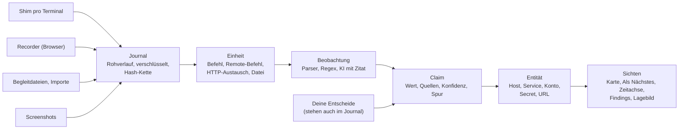

# Konzept: vom Terminal und vom Browser zur Karte

> Stand 2026-10-14, Vorschlag. Antwort auf deine Nachricht vom 2026-10-14 («irgendwie muss das ganze simpler zu bedienen sein ...»). Grundlage sind drei Rechercheberichte (Auswertung, Browser, Bedienung), [VISION](../VISION.md), die [Lösungsarchitektur](architektur.md), das [Entscheidungsprotokoll](entscheide.md), [entwicklung.md](entwicklung.md) und der Code unter `src/ariadne`. Entschieden ist davon nichts, bis du die Fragen in Abschnitt 7 beantwortet hast.
>
> Kennzeichnung: **gebaut** heisst im v0.1-Backend vorhanden und getestet. **geplant** heisst in der Architektur beschrieben, aber noch nicht gebaut. **Vorschlag** heisst neu in diesem Dokument. Alle Aussagen über den heutigen Code sind am 2026-10-14 gegen `src/ariadne` geprüft, die Zahlen zur Inbox mit den Test-Helfern nachgemessen.

## 1 Kurzfassung

**Bedienung.** Dass jedes Terminal aufgenommen wird, ist schon gebaut: Jede neue zsh- oder bash-Shell startet mit einem eigenen Shim, auch in parallelen Fenstern, Tabs und tmux-Panes. Umständlich ist der Rest. Heute braucht es nach jedem Login `ariadne unlock`, `ariadne project open` und `ariadne rec on`. Vorschlag: ein Befehl `ariadne start lame 10.10.10.3` pro Auftrag und nach jedem Neustart, mit einmal Passphrase. Solange ein Projekt aktiv ist, nehmen alle Terminals auf. Den REC-Knopf ersetzt eine Pause pro Terminal, die nach 10 Minuten von selbst endet.

**Zeitstempel.** Der Shim stempelt jede gelesene Ausgabe schon heute auf die Nanosekunde. Die Auswertung benutzt aber die Speicherzeit im Daemon und liegt damit bis etwa 250 ms daneben. Vorschlag: überall die Shim-Zeit, auch für Befehlsanfang und -ende. Realistisch ist dann etwa 1 ms Genauigkeit in der VM, und die Reihenfolge über alle Terminals stimmt. Von deinen Eingaben speichert Ariadne die lokale Befehlszeile, aber nie einzelne Tastendrücke. In Remote-Shells kommt nur der Zeitpunkt jedes Enter dazu.

**Vom Verlauf zur Datenbank und zur Karte.** Eine Kette mit festen Stufen: Rohverlauf, Einheit (ein Befehl), Beobachtung, Claim, Entität, Karte. Jeder Wert zeigt auf seine Zeile, alles lässt sich neu berechnen. Das Fundament steht. Was heute stört: Ein einziger nmap-Lauf auf Metasploitable2 (nachgestellte Testeingabe) erzeugt 86 Einträge zum Bestätigen, eine Reverse Shell wird als ein grosser Block ausgewertet, und Fundstücke wie Hashes erscheinen nicht auf der Karte. Vorschlag: Werte aus bekannten Tool-Parsern im Scope kommen ohne Klick auf die Karte, mit Rückgängig. Deinen Entscheid brauchen nur KI-Werte, echte Widersprüche und unklare Zuordnungen. Findings schlägt Ariadne mit Belegen vor, zum Finding macht sie erst dein Urteil.

**Browser.** Vorschlag: ein Aufzeichnungs-Proxy vor einem eigenen Firefox-Testprofil (`ariadne browser`). Jede Anfrage deines Browsers wird mit Antwort, Ziel-IP und Zeit gespeichert. Parser machen daraus Seiten, Formulare, Kommentare und Admin-Bereiche unter dem Webdienst auf der Karte. Ariadne schickt selbst keine einzige Anfrage. Der Proxy sitzt aber im Datenweg und baut die Verbindungen für den Browser auf; ob das für dich noch «passiv» ist, ist Frage 7.

**KI.** Sie sieht nie den ganzen Rohverlauf, sondern ein verdichtetes Lagebild mit Zeitachse und maskierten Secrets. Werte aus der KI gelten nur mit wörtlichem Zitat und brauchen immer deinen Entscheid.

Risiken (Passwörter in der Aufnahme, fremde Seiten im Testbrowser, Speicherplatz, falsche Fakten, Recht im Kundenauftrag) stehen gesammelt in Abschnitt 6.

## 2 Bedienung in drei Schritten

Das Aufnehmen selbst ist schon automatisch (**gebaut**). Die Zeile in `.zshrc` bzw. `.bashrc` startet in jeder interaktiven Shell einen Shim. Jedes Fenster, jeder Tab und jedes tmux-Pane hat einen eigenen PTY, eine eigene `terminal_id` und einen eigenen Kontextstapel. Unter-Shells werden nicht doppelt erfasst.

Umständlich ist der Alltag drumherum:

- REC steht nach jedem Start des Daemons auf aus und wird nicht gespeichert (`daemon/core.py`, `rec_on = False`). Nach jedem Login braucht es `ariadne unlock`, `ariadne project open` und `ariadne rec on`. Fehlt `rec on`, schickt der Shim nichts an den Daemon, und die Ausgabe ist verloren.
- `F12 r` schaltet REC heute für alle Terminals gleichzeitig um, nicht für eines.
- Ein Terminal ist ab dem ersten REC an sein Projekt gebunden. Nach einem Projektwechsel nimmt es erst wieder auf, wenn das alte Projekt wieder aktiv ist. Für das neue Projekt öffnest du neue Fenster.

### 2.1 Der neue Ablauf (Vorschlag)

| Schritt | Du tippst | Ariadne macht |
|---|---|---|
| 1 einmal | Installation per `pipx`, dann `ariadne setup`, danach offene Terminals einmal neu öffnen | RC-Zeile und systemd-Dienst (gebaut), neu auch Operator-Tresor mit Passphrase und Recovery-Code (heute separat `ariadne init`), `doctor`, Desktop-Kürzel für Screenshots, Firefox-Testprofil |
| 2 pro Auftrag und nach jedem Neustart der VM | `ariadne start lame 10.10.10.3`, danach nur `ariadne start` | fragt die Passphrase (per `getpass`, nie in der Web-UI, E74), legt das Projekt an oder öffnet es, schaltet die Aufnahme für alle Terminals ein, auch für schon offene, und merkt sich «lame aktiv» über Neustarts |
| 3 arbeiten | fast nichts: selten `F12 k` (Schlüsselschritt) oder `F12 r` (Pause), für Webseiten `ariadne browser`, am Ende `ariadne export` und `ariadne stop` | nimmt alles auf, füllt Karte und Zeitachse, schlägt Schlüsselschritte und Findings vor |

**Was trotzdem bei dir bleibt.** Damit die drei Schritte ehrlich sind:

- Nach jedem Neustart der VM einmal `ariadne start` mit Passphrase. Ohne das bleibt der Tresor zu, und die Terminals puffern nur im RAM (Frage 3).
- Zielseiten öffnest du im Testbrowser von Ariadne, nicht in deinem normalen Firefox. Was im normalen Browser passiert, sieht Ariadne nicht.
- Pro Lab-Abend eine Handvoll Klärungen in der Spalte «Als Nächstes»: KI-Werte, echte Widersprüche, neue Namen ausserhalb des Scopes, Kontext bei Pivots.
- Schlüsselschritte bestätigen (Ariadne schlägt sie vor) und Findings übernehmen und bewerten. Das ist Absicht: Ein Fakt ist kein Finding (Grundsatz 10).

Der Fenstertitel zeigt den Zustand:

| Titel | Bedeutung |
|---|---|
| `[REC lame] web01 root \| ...` | Projekt aktiv, alles wird gespeichert |
| `[PAUSE 9:41 lame]` | dieses Terminal pausiert, mit Countdown bis zur automatischen Fortsetzung |
| `[-- kein Projekt]` | nichts auf der Platte, nur ein kurzer Vorlauf im RAM |
| `[REC! gesperrt]` | Projekt aktiv, Tresor nach einem Neustart noch gesperrt, Puffer im RAM bis `ariadne start` |

- **REC wird zur Pause.** `F12 r` pausiert nur dieses Terminal, standardmässig für 10 Minuten. Danach nimmt es von selbst wieder auf. Die Pause erscheint als Lücke (`term.gap` mit dem neuen Grund `pause`) in Zeitachse und Export. Eine Pause ohne Ende würde den häufigsten Fehler zurückbringen: ein Fenster, in dem gerade keine Aufnahme lief.
- **Ohne Projekt** landet nichts auf der Platte. Jedes Terminal hält aber 15 Minuten Vorlauf im RAM, höchstens 8 MiB. Der Vorlauf liegt wie der heutige Ausfallpuffer des Shims (32 MiB, `mmap` mit `MADV_DONTDUMP`) nur im Arbeitsspeicher und nie in einem Coredump. Bei knappem RAM kann der Kernel ihn in den Swap auslagern; `doctor` prüft darum verschlüsselten Swap oder zram. `ariadne start` fragt: «Vorlauf vorhanden: T1 12 min (nmap 10.10.10.3). Übernehmen?» So rettest du die Minuten, bevor dir eingefallen ist, dass Ariadne laufen sollte (Frage 2).
- **Projektwechsel:** Ein offenes Terminal wechselt mit dem nächsten gültigen D-Marker ins neue Projekt, also erst, wenn sicher die lokale Kali-Shell oben steht. Terminals mit offener Remote-Stufe bleiben beim alten Projekt und fragen nach. Das ändert E28.

**Was «alle Terminals» heute nicht abdeckt.** Diese Lücken bleiben auch mit dem neuen Ablauf, bis sie gebaut sind:

- Ein Root-Terminal aus dem Kali-Menü startet als root mit `/root/.zshrc`, ohne Shim. Es wird gar nicht aufgenommen. Für Ariadne arbeitest du in normalen Terminals und mit `sudo befehl`.
- `sudo -i` oder `su` in einem aufgenommenen Terminal: Die Ausgabe wird aufgenommen, aber ohne Befehlsgrenzen, bis `ariadne setup --root` kommt (v0.2).
- Andere Shells als zsh und bash (fish, sh) starten keinen Shim, fish kommt in v0.2.
- Terminals, die schon vor `ariadne setup` offen waren, bleiben ohne Shim.
- Der äussere Shim um einen tmux-Client nimmt dessen Bildschirm heute doppelt auf (die Pause aus Architektur 3.9 ist nicht gebaut). Die Panes selbst sind sauber erfasst.
- Grafische Werkzeuge (Burp, Wireshark, BloodHound) sind keine Terminals. Für sie gibt es Importe, Screenshots und für das Web den Recorder aus Abschnitt 4.

### 2.2 Zeitstempel: was «haargenau» realistisch heisst

**Heute (gebaut):** Der Shim stempelt jedes `read()` mit Wanduhr und monotoner Uhr in Nanosekunden (`_shim/relay.py`). Der Transport bündelt bis 50 ms und behält pro Bündel die erste Zeit, der Writer legt sie als `t_shim_ns` ab. **Die Lücke:** Kein Teil der Auswertung liest `t_shim_ns`. Die C- und D-Marker tragen gar keine Shim-Zeit, ihre Zeit ist die Commit-Zeit im Journal, und der Writer schreibt nur alle 200 ms. Befehlsstart und -ende liegen dadurch bis etwa 250 ms daneben, und zwischen Terminals ist die Reihenfolge nicht sicher.

**Vorschlag:** Jedes Ereignis aus dem Shim, auch die Marker, trägt beide Uhren. Jeder OUT-Rahmen bekommt einen Zeitindex (pro `read()` Offset und Mikrosekunden, etwa 10 Byte), damit jede Ausgabezeile ihre eigene Zeit hat (Protokollversion 2, ausgehandelt im `HELLO`). Segmenter, Aktivitätsprotokoll und Zeitachse rechnen mit der Shim-Zeit, sortiert nach `(boot_id, mono_ns)`, angezeigt nach Wanduhr. Der Daemon prüft die Plausibilität und setzt sonst `time_suspect`.

Realistisch heisst das: Auflösung in Nanosekunden, Genauigkeit in der VM etwa 1 ms. Die monotone Uhr springt nie, darum stimmt die Reihenfolge über alle Terminals auch, wenn die Wanduhr springt (NTP, Zeitabgleich mit dem Host, Pause der VM, `ntpdate` auf den DC). Die absolute Uhrzeit ist nur so gut wie NTP. Beim Einschalten der Aufnahme schreibt der Daemon heute schon `clock.check` mit dem NTP-Status (gebaut); das Ereignis `system.clock_jump` für Sprünge während der Arbeit ist definiert, wird aber noch nicht erzeugt. Und gemessen wird, wann die Bytes am Terminal ankamen, nicht wann das Ziel etwas tat: `python3 exploit.py | tee log` puffert und gibt alles am Ende aus, da hilft `python3 -u` oder `stdbuf -oL`.

### 2.3 Eingaben

| Eingabe | Gespeichert? | Wie |
|---|---|---|
| lokale Befehlszeile (zsh, bash) | ja (**gebaut**) | `preexec`-Marker: getippter und alias-expandierter Text, `cwd`, Benutzer; `precmd`: Exit-Code |
| Passwort in der Befehlszeile (`mysql -pX`) | ja | Teil des Befehls. Eigene Secrets schwärzt der Redaktor vor dem Speichern (**gebaut**) |
| Passwortabfrage ohne Echo (sudo, ssh, su) | nie | Die Tasten erscheinen nicht im Output |
| rohe Tastendrücke | nie | E26 |
| Befehl in Reverse Shell, evil-winrm, `mysql>` | Text ja, Tasten nein | Der Text steht im Echo, also im Output. Neu (**Vorschlag**): Pro Enter schreibt der Shim eine Eingabemarke mit Zeit, Offset und dem Ergebnis des Echo-Vergleichs, ohne Inhalt (Abschnitt 3.5) |
| alles, was du in einer einfachen Reverse Shell ohne PTY tippst | ja | In einer nackten `nc`-Shell echot dein eigenes Terminal jede Taste. Auch ein Passwort für `sudo -S` steht dann sichtbar im Output und damit in der Aufnahme |

Ariadne schreibt also mit, was auf dem Bildschirm stand und an welcher Stelle du Enter gedrückt hast. Was du tippst, ohne dass es erscheint, sieht Ariadne nicht. Das ist Absicht: Ein Passwort ohne Echo stünde sonst im Klartext im unveränderlichen Journal, bis du es mit `ariadne redact` von Hand entfernst (Frage 4). Umgekehrt gilt: Was sichtbar ist, wird gespeichert. Eigene Passwörter schützt nur der Redaktor, und nur, wenn sie in deiner Secret-Liste stehen (`ariadne secrets add`).

### 2.4 Speicher in der langsamen VM

Gemessen (Bericht Bedienung, im Container, nicht in der Kali-VM): 60 Befehle pro Stunde ergeben 0,23 MB Journal, eine Stunde Fortschrittsbalken aber 25 MB, weil jede Journalzeile rund 600 Byte Zusatz kostet. Fasst der Writer OUT-Stücke zu einer Zeile pro Sekunde zusammen und kommen zstd und ein Speicherwächter dazu (Architektur 8.6, geplant), landet ein Lab-Abend mit drei Terminals geschätzt bei 3 bis 10 MB Journal. Der Zeitindex aus 2.2 wandert in die zusammengefasste Zeile mit, die Genauigkeit bleibt. Nicht eingerechnet sind `derived.db` mit Zeilen und Suchindex (nicht gemessen), Screenshots und die Bodies aus dem Browser. Gerade der Browser kann ein Vielfaches kosten (Abschnitt 6).

### 2.5 Beispiel: ein Lab-Abend mit Lame

Projekt `lame`, Ziel 10.10.10.3, Kali auf tun0 mit 10.10.14.5. Uhrzeiten erfunden; Bedienung und Auswertung wie vorgeschlagen, also etwa der Stand nach v0.2.

| Zeit | Du | Ariadne |
|---|---|---|
| 18:58 | VM starten, Terminal öffnen. Titel `[-- kein Projekt]`. `ariadne start lame 10.10.10.3`, Passphrase | Projekt angelegt, Titel `[REC lame]` |
| 19:02:11 | T1: `nmap -Pn -sV -sC -oA scans/lame 10.10.10.3` | liest `scans/lame.xml` von selbst. Host und vier Services stehen nach dem Scan auf der Karte, ohne Bestätigen. Rechts unter «Als Nächstes»: Versionen von vsftpd 2.3.4 und Samba recherchieren |
| 19:15:40 | neuer Tab T2: `nc -lvnp 4444` | T2 nimmt sofort auf, die Kontextregeln erkennen den Listener, Stapel `Kali › ?` |
| 19:17:03 | T3: Samba-Exploit für usermap_script (CVE-2007-2447) mit Callback auf 10.10.14.5:4444 | |
| 19:17:05 | | Callback von 10.10.10.3 in T2. Kontext wird `lame (auto)`. «Als Nächstes»: «Schlüsselschritt Foothold?» |
| 19:17:21 | T2: `id`, dann `F12 k`, `f`, Enter | Eingabemarke, Befehl «remote, bestätigt». `uid=0(root)` ergibt Zugriff root, der Faden läuft von Kali nach lame |
| 19:25 | T2: `cat /etc/shadow` | Die `$1$`-Hashes (MD5-crypt, wie auf Lame und Metasploitable2 üblich) werden Secrets am Host lame, überall maskiert |
| 19:40 | T3: `F12 r` | `[PAUSE 9:59 lame]`, Lücke in der Zeitachse, 19:50 geht es weiter |
| 20:10 | `ariadne export`, dann `ariadne stop` | Writeup-Gerüst mit drei Terminal-Spuren und Belegen auf die Millisekunde; `stop` schliesst und sperrt das Projekt |

Für Ariadne getippt hast du an diesem Abend drei Befehle, einmal die Passphrase und zwei Tastenkürzel. Kein `rec on`, kein `tee`, keine Zeitnotizen, kein Import der nmap-Datei, kein Bestätigen in der Inbox. Der Foothold kam hier über Samba, nicht über vsftpd: Die Hintertür von vsftpd 2.3.4 ist auf Lame zwar vorhanden, ihr Port 6200 ist aber von aussen nicht erreichbar.

## 3 Vom Terminal zur Karte

### 3.1 Die Kette



| Stufe | Was entsteht | Beispiel | Stand |
|---|---|---|---|
| Rohverlauf | `term.out` mit Offset und Zeit, `term.mark` C und D mit Befehl, `cwd` und Exit-Code, `file.observed`, `net.route` | die Bytes von `nmap` | gebaut |
| Einheit | Befehl von C bis D oder Segment, mit Kontext (Host, Benutzer) und Zeilen, die auf die Rohbytes zeigen | `nmap ...`, Zeilen 0 bis 13 | gebaut; in Remote-Shells ist die ganze Sitzung eine Einheit |
| Beobachtung | Subjekt, Prädikat, Wert, Zeilenbereich | tcp/21 `service.version` 2.3.4, Zeile 5 | gebaut mit 4 Parsern: `nmap.xml`, `nmap.text`, `regex.net`, `listener.callback` |
| Claim | alle Beobachtungen desselben Werts, mit Konfidenz und Zustand | «Port 21 hat 2.3.4», 2 Quellen | gebaut |
| Entität | Kennungen per Union-Find zusammengefasst | Host 10.10.10.3 mit 4 Services | gebaut für Host und Service; Konto, Secret und URL nur dünn |
| Sichten | Karte, Arbeitsliste, Zeitachse, Findings, Lagebild | grauer Host wird farbig | Karte, Inbox und Zeitachse als Daten gebaut, sichtbar über `ariadne show`; Web-API, Regeln, Findings, Lagebild und Export fehlen (`web/`, `rules/`, `ai/`, `export/` leer) |

Jede Stufe leitet nur aus der vorigen ab und schreibt nie zurück. Deine Entscheide stehen selbst im Journal. Darum kann `ariadne reparse` alles neu rechnen, und nichts von dir geht verloren.

### 3.2 Was die Kette verlässlich macht

1. **Herkunft bis zur Zeile** (gebaut): Einheit, Parser, Version, Zeilen oder XPath, Journal-Sequenz.
2. **Neu berechenbar** (gebaut): Gleiches Journal, gleiche Parser, gleicher Scope und gleiche Entscheide ergeben dieselbe Datenbank. KI-Antworten liegen als `ai.call` im Journal und werden beim Reparse nur neu geprüft, nie neu erfragt (geplant).
3. **Abhängige Belege zählen einmal** (fehlt): Text und XML desselben nmap-Laufs sind ein Zeuge, nicht zwei.
4. **Widerspruch statt Überschreiben** (gebaut, E45). Fehlt: Präzisierung («3.X - 4.X», später «3.0.20-Debian») und zeitlicher Verlauf sind keine Widersprüche.
5. **Scope pro Kennung** (gebaut, E49), aber die eigenen Adressen von Kali sind nicht ausgenommen.
6. **KI nur mit wörtlichem Zitat** (geplant, A6.3).
7. **Kontext vor Inhalt:** Ein Wert ist nur so gut wie seine Zuordnung zu Host und Benutzer. Lokal gebaut, in Remote-Shells schwach.

Ein Wort zur **Konfidenz**: Sie misst, wie sicher Ariadne einen Wert richtig gelesen hat. Ob das Ziel die Wahrheit sagt, misst sie nicht. Ein Honeypot lügt auch in sauberem nmap-XML. Dagegen helfen Herkunft, das Kennzeichen «vom Ziel» und Rückgängig, nicht eine höhere Zahl.

### 3.3 Wo es heute hakt

Gemessen mit den Golden-Eingaben und Test-Helfern, die MS2-Zahlen am 2026-10-14 in dieser Prüfung nachgemessen. Beide Eingaben sind nachgestellt, nicht echt.

| Befund | Beleg | Wirkung |
|---|---|---|
| Ein Inbox-Eintrag pro Claim | `ingest/proj_build.py`, `_inbox`; `queries.resolve_confirm` | MS2-Golden (`nmap -sV -sC -oA`, Text und XML): 144 Claims, 86 Einträge in einer Gruppe. Lame (nur Text): 21 Claims, 18 Einträge. Pro Scan ein Bestätigungsschritt. `ariadne confirm <gruppe>` nimmt heute alle Einträge der Gruppe, auch die Kali-IP; die Filter aus E88 fehlen im Backend noch |
| Der Automodus prüft nur die *erste* Beobachtung, Standard ist `enabled = false`, `parsers = ["nmap.xml"]` | `_automode`, `project/settings.py` | eigene Messung: MS2 mit Automodus an, Standardparser: 18 von 144 Claims `auto`, Inbox weiter 86. Gibt man zusätzlich `nmap.text` frei: 143 `auto`, Inbox 1 |
| Doppelzählung: Text und XML gelten als zwei unabhängige Einheiten | noisy-OR in `_claim_decisions` | Konfidenz 0.99 statt 0.95; eine Regex-Mention steigt von 0.4 auf 0.64 |
| Scheinkonflikte | `split_version` in `parsers/nmap_text.py`; Kardinalität `one` in `ontology.py` | laut Code: «distccd v1 (...)» ergibt im Text Produkt «distccd v1» ohne Version, im XML «distccd» mit Version «v1». Lame 445: «3.X - 4.X» gegen das genauere «3.0.20-Debian» |
| Kali wird Zielhost | `regex.net` plus Projektion | MS2: `ftp-syst` meldet «Connected to 192.168.56.102», das ist Kali; es entsteht ein Host im Scope |
| Remote-Shell ist eine einzige Einheit, ohne argv | Docstring `ingest/segmenter.py`, `SILENCE_NS` in `ingest/pipeline.py` | `cat /etc/passwd`, `sudo -l`, `cat config.php` landen in einem Block, der erst nach Sitzungsende oder 10 Minuten Stille geparst wird. Werkzeugparser greifen nicht |
| Loot bleibt unsichtbar, Ontologie zu schmal | `ingest/projection.py` lädt nur Mentions `ip` und `url`; `ontology.py` | Ein `$1$...`-Hash aus `/etc/shadow` erkennt `regex.net` zwar, er landet aber nur als Mention in der Datenbank und in der Volltextsuche, nicht auf Karte oder Listen. Es fehlen uid, sudo-Regeln, Fundorte von Secrets, Credential-Tests, Formulare |
| Kontext aus dem Callback nur als Vorschlag | `_ctx_items` in `ingest/proj_build.py` | Die Inbox meldet «Kontext klären» schon mit dem Callback-Host als Vorschlag. Übernehmen musst du ihn von Hand mit `F12 h` |

### 3.4 Automatisch oder Entscheid: die Drei-Spuren-Regel (Vorschlag)

| Spur | Was | Wo sichtbar |
|---|---|---|
| **automatisch** (Zustand `auto`) | Werte aus anerkannten Parsern im Scope | sofort auf Karte und in Tabellen; in der Zeitachse «nmap 14:02: 21 Werte übernommen [Rückgängig]» |
| **still** | heuristische Werte, Werte ausserhalb des Scopes, Mentions, Systemkonten, Nebenbelege | als Nebel (IPs im Scope, E43), als Zähler («+27 Systemkonten», «3 Werte ausserhalb») und in der Suche; nie zum Klären |
| **entscheiden** | KI- und OCR-Werte, echte Widersprüche, unklarer Kontext (ein Eintrag pro Kontext, nicht pro Wert), vom Ziel angebotene Credentials (A6.4.8), heuristische Werte bei wichtigen Prädikaten (Login-Ergebnis, Admin-Bereich, Secret), Merges mit unterschiedlichem Scope, Massenfunde, verdächtige Quellen | Spalte «Als Nächstes», Bereich «Klären» |

Ein Claim kommt in die Spur **automatisch**, wenn alles zutrifft. Jeder Entscheid von dir geht immer vor.

1. Mindestens *eine* Quelle (nicht nur die erste) stammt von einem Parser mit `auto_eligible` und der Vertrauensklasse `structured` oder `tool_text`.
2. Das Subjekt hat das Scope-Urteil `in`. Bei Konto, Secret oder Hinweis zählt die Host-Kennung, auf der sie beobachtet wurden. Das verleiht keiner neuen Netzkennung Scope, «Einschluss wird nie vererbt» bleibt.
3. Der Wert macht keine Kennung ausserhalb des Scopes zum Ziel und keine eigene Adresse von Kali zum Host.
4. Es gibt keinen offenen Widerspruch.
5. Keine Quelle ist verdächtig (`concealed`, `overwritten`, `marker_forged`), und die Einheit ist kein Massenfund.

Statt des heutigen Schalters `inbox` pro Prädikat gibt es eine Einstufung, ob heuristische Werte still bleiben oder zum Klären gehen. Rückgängig macht ein neuer Entscheid `d.unit.distrust {cmd_id, grund}`: Er verwirft alle Claims, die nur aus diesem Befehl stammen. Weil `auto` ein Ergebnis der Projektion ist und kein Entscheid, bleibt es beim Reparse stabil, und deine Verwerfungen auch.

Gerechnet anhand des Codes (nicht gebaut): Lame 18 → 0 Einträge, MS2 86 → 0, und der Scheinhost Kali verschwindet. Was pro Lab-Abend übrig bleibt, sind vermutlich eine Handvoll echte Klärungen.

Zusammen ergibt das diese Arbeitsteilung:

| Passiert automatisch | Braucht dich |
|---|---|
| Einheiten schneiden, parsen, Claims und Entitäten bilden | Kontext, wenn die Automatik nicht eindeutig ist |
| Parser-Werte im Scope auf die Karte | KI- und OCR-Werte, echte Widersprüche, angebotene Credentials |
| Denkanstösse und Finding-Vorschläge aus Regeln | Schlüsselschritt bestätigen (der Vorschlag kommt von selbst) |
| Belegpaket für ein Finding zusammenstellen | Finding übernehmen, Schwere setzen |
| Unsicheres als Nebel oder Zähler zeigen | Scope erweitern, Merges mit unterschiedlichem Scope |

Das ändert E42 («Vorschlag vor Automatik») und macht die Sammelbestätigung (E88) meist überflüssig (Frage 5). E45 bleibt: Echte Widersprüche löst Ariadne nie selbst auf.

### 3.5 Die übrigen Bausteine (Vorschlag)

- **Remote-Befehle schneiden.** Kommt ein Enter allein (nicht in einem Paste-Burst, nicht im Alternate Screen), schreibt der Shim `term.input_mark {stream_off, t_shim_ns, echo_match}`, ohne Tasteninhalt; der Echo-Vergleich ist in A5.13 schon geplant. Stimmt das Echo, schneidet der Segmenter dort eine Einheit `remote_cmd` heraus, Befehlstext aus der Echo-Zeile, Herkunft «remote, bestätigt», `cmd_id = <terminal>@<Offset der Marke>`. Vorläufig geparst wird nach 3 s Ruhe statt nach 10 Minuten. Ohne passendes Echo (Passwortabfrage, `stty raw -echo`) bleibt das Segment wie heute.
- **Evidenzgruppen.** Gruppenschlüssel ist die `cmd_id`; Dateien kommen über `file.observed.produced_by_cmd` (gebaut) in dieselbe Gruppe. Innerhalb einer Gruppe zählt das Maximum, noisy-OR nur zwischen Gruppen. Liegt die strukturierte Datei desselben Tools vor, gelten Textwerte als Nebenbeleg ohne eigene Konflikte.
- **Arten von Prädikaten.** `fakt` (wie heute), `zustand` (der neueste Wert gilt, ältere bleiben als Verlauf), `version` (der spezifischere Wert gewinnt, wenn er im Bereich liegt; «vsftpd» gegen «ProFTPD» bleibt ein Konflikt), `menge` (nie ein Konflikt).
- **Eigene Adressen.** Quell-IPs aus `net.route` (gebaut) und die Adressen der lokalen Interfaces werden nie Host-Entitäten. Die Adressen liest der Daemon aus `/proc/net/fib_trie` und `/proc/net/if_inet6`, also beim eigenen Kernel, ohne Befehl und ohne Paket.
- **Secrets als Claims.** crypt, NetNTLMv2, krb5, Private Keys und JWT aus Einheiten mit Zielkontext werden Secret-Claims am Kontext-Host. Wie heute ist der Claim-Schlüssel ein HMAC, der Klartext liegt nur in der verschlüsselten Tabelle `secret_value`, und alle Ansichten zeigen `••••••••`.
- **Kontext aus dem Callback.** Passt genau ein erster Callback auf eine Listener-Stufe, liegt seine IP im Scope und ist sie nicht Loopback, setzt Ariadne den Host automatisch, sichtbar als `(auto)`. `F12 h` überschreibt. Weil `d.ctx.set` schon heute rückwirkend wirkt (gebaut), lässt sich ein falscher Kontext nachträglich korrigieren. `F12 h` braucht es dann nur noch bei Pivots, NAT oder Port-Forwards über 127.0.0.1 (Frage 5). Dazu kommt der Parser `shell.context` für `id`, `whoami`, `hostname`, `ip a` und Prompts.
- **Ontologie v2.** Konten (`identity.uid`, `.groups`, `.shell`, `.privileged`, `.sudo`), Secrets (`secret.kind`, `secret.found_in`), Credential-Tests (`cred.result`), Hinweise (`hint.sudo`, `hint.suid`, `hint.cron`, `hint.exploit`, `hint.misconfig` statt `hint.finding`), URLs (Abschnitt 4.2). `VERSION = 2` löst ein Reparse-Angebot aus.

### 3.6 Wie die vielen Tools abgedeckt werden

| Schicht | Was | Umfang | Wann |
|---|---|---|---|
| 1 Kernparser | eigene Parser für Lab-Tools, wo möglich auf strukturierte Ausgabe gestützt (`ffuf -of json`, `feroxbuster --json`, `enum4linux-ng -oJ`, `searchsploit -j`, `wpscan -f json`), sonst Text (nxc, hydra, msfconsole, linpeas, `john --show`, impacket) | etwa 15 | v0.2, nach Häufigkeit (E69) |
| 2 Formparser | erkennen die Form statt des Tools: `shell.context`, `passwd`/`shadow`/`group`, `sudo.list`, `suid.list`, `kv.secrets` (`$db_pass = '...'`, `.env`, `wp-config.php`), `url.list`, `http.response` | etwa 7 | v0.2 |
| 3 Import-Brücke | faraday_plugins nur für Scanner-Berichte (Nessus, OpenVAS, Burp, ZAP) | optional | frühestens v0.3 |
| 4 KI-Extraktion | Rückfall mit wörtlichem Zitat | | v0.2 (geplant) |

Formparser brauchen eine Schwelle, zum Beispiel mindestens 3 passende Zeilen und 80 % der nicht leeren Zeilen. Mit passendem Befehl (auch aus dem Echo) gilt `tool_text`, sonst `heuristic`, und der Wert bleibt still.

**Warum faraday_plugins nicht für das Terminal:** Das Paket (GPL-3.0, 1.29.0) löst standardmässig Hostnamen per DNS auf (`hostname_resolution=True`, amap ruft `getaddrinfo` sogar direkt auf), was E10 und E49 verletzt. Dazu kommen `lxml` mit `recover=True`, keine Zeilenbelege und Konsolen-Plugins, die den Befehl selbst ausführen wollen. Von den Lab-Tools deckt es nur hydra, nikto, wpscan, whatweb, dirb und nuclei ab. Für Berichtsdateien ginge es nur in einem eigenen Worker ohne Netz, mit `hostname_resolution=False`, nie automatisch.

**KI-Extraktion.** Im Profil lab läuft sie automatisch nur, wenn die Einheit Zielkontext hat, kein Parser sie vollständig verstanden hat (Parser melden dafür `covered_lines`), sie ein Signal enthält (Mention oder Wörter wie user, pass, key, token, admin, root) und Budget frei ist. Vorher ersetzt Ariadne schon erkannte Ziel-Secrets durch Platzhalter `<<S1>>` und packt die Daten in eine Hülle mit Nonce. Der Pseudo-Parser `llm.extract` prüft die Antwort im Worker: Zitat wörtlich in der Einheit, Wert wörtlich im Zitat, Typ stimmt. Ergebnis: Vertrauen `ai`, Konfidenz 0.5, Spur «entscheiden» (Frage 6). Das Zitat beweist nur, dass der Wert in der Ausgabe steht, nicht, dass die KI ihn dem richtigen Konto oder Host zugeordnet hat. Darum entscheidest du. Modell bleibt `claude-opus-5-5` mit Effort `low` (E66). Kosten: Opus 5.5 kostet 4 USD pro Million Eingabe- und 20 USD pro Million Ausgabe-Tokens, das Denken zählt als Ausgabe. Eine Einheit mit 2000 bis 4000 Tokens Eingabe kostet damit grob 1 bis 3 Rappen. Vor dem Bau mit `usage` an echten Einheiten messen.

**Parser-Fabrik.** `ariadne fixture export <cmd_id>` macht aus einer echten Einheit einen anonymisierten Golden-Fall, gegen den du mit Claude Code den Parser schreibst; das löst nebenbei O07. Eine Kennzahl «Parser-Abdeckung» meldet etwa: «Für kerbrute hast du dreimal KI-Funde bestätigt, ein Parser lohnt sich.»

### 3.7 Wie Findings entstehen

Fünf Begriffe, damit nichts verschwimmt:

- **Fakt:** «Port 21: vsftpd 2.3.4».
- **Hinweis:** «sudo erlaubt find ohne Passwort».
- **Hypothese:** «vsftpd 2.3.4 enthält die Backdoor CVE-2011-2523».
- **Finding-Vorschlag:** ein Urteil mit Assets, Belegen, Auswirkung und Massnahme, als Entwurf.
- **Finding:** Den Vorschlag hast du übernommen und bewertet (Grundsatz 10).

Vorschläge kommen aus drei Quellen. Erstens aus **Regeln**, offline und mit Golden-Tests:

| Regel | Bedingung im Graphen | Vorschlag |
|---|---|---|
| R-SECRET-IN-CONFIG | Secret mit `secret.found_in` in einer Konfigurationsdatei, gelesen von einem nicht privilegierten Konto | Klartext-Credentials in Konfigurationsdatei (CWE-260, T1552.001) |
| R-SUDO-GTFO | `identity.sudo` mit `nopasswd`, Programm steht in einer mitgelieferten GTFOBins-Liste | sudo-Fehlkonfiguration (CWE-269, T1548.003) |
| R-WEB-KOMMENTAR | Kommentar im HTML mit Pfad oder Credential-Muster | sensible Informationen im Quelltext (CWE-615) |
| R-UPLOAD-RCE | Upload-Formular, Abruf der Datei, Callback innerhalb von 10 s | unbeschränkter Datei-Upload mit Codeausführung (CWE-434, T1505.003) |
| R-VULN-VERSION | Produkt und Version passen zu `hint.exploit` | zuerst nur Hypothese; Vorschlag erst, wenn ein Zugang über diesen Service belegt ist |

Zweitens aus der **KI** auf Knopfdruck: Aus Lagebild und Belegen entstehen Textentwürfe für Titel, Beschreibung, Auswirkung und Massnahme, die nur IDs aus dem Lagebild verwenden dürfen. Drittens von **dir**: «Als Finding» in der Belegansicht.

Zu jedem Vorschlag stellt Ariadne das **Belegpaket aus der Zeitachse** zusammen: Einheiten und Zeilen der beteiligten Claims, den Schlüsselschritt im selben Kontext, die Nachweis-Ausgabe danach (etwa `id` mit `uid=0`) und Screenshots aus diesem Zeitraum. Fehlt der Nachweis, bleibt der Status «unbelegt», und ein Denkanstoss sagt, was fehlt. Die Schwere schlägt Ariadne vor, setzen tust du sie. Der Lebenszyklus (Vorschlag, Entwurf, belegt, bewertet, im Bericht) besteht aus Entscheiden `d.finding.*`, die nur auf natürliche Schlüssel zeigen und so jeden Reparse überstehen. Vorschläge erscheinen im Reiter **Findings** mit Zähler, nicht beim Klären.

### 3.8 Die Zeitachse als Kontext für die KI

Die KI sieht den Rohverlauf nie als Ganzes. Rohtext bekommt nur die Extraktion, und zwar immer nur eine Einheit. Denkanstösse und Finding-Texte sehen das **Lagebild** (A6.3): den Zustand der Karte plus eine verdichtete Zeitachse, deterministisch aus der Projektion gebaut.

- Pro Befehl eine Zeile: ID, Zeit, Terminal, Kontext, Befehl (typisiert kodiert, höchstens 120 Zeichen), Exit-Code und Ergebnis aus der Projektion («→ 1 Host, 4 Services»). Nie Rohausgabe.
- Die letzten 15 Einträge voll, ältere pro Phase und Terminal zusammengefasst («gobuster ×6 → 41 URLs»). Parallele Terminals erscheinen nach Ereigniszeit verschränkt.
- Budget unter 8k Tokens bei 10 Hosts, davon 600 bis 1200 für die Zeitachse.
- Ziel-Secrets nur als `wert=***`. Produkt, Version und Namen nur durch einen Allowlist-Encoder (`[A-Za-z0-9 ._+-]{1,40}`), sonst `<gekürzt>`. Das schützt etwa gegen Anweisungen im GECOS-Feld.
- Die Antwort darf nur IDs aus dem Lagebild verwenden, sonst wird sie verworfen und als Injection-Verdacht gezählt.

Ein Ausschnitt steht in Beispiel B.

### 3.9 Beispiel A: nmap auf Lame bis zur Karte

Projekt `lame`, Scope 10.10.10.3, Kali tun0 10.10.14.5, Terminal T1.

1. **14:02:11.204** C-Marker mit `nmap -Pn -sV -oA scans/lame 10.10.10.3`, Offset 18432. Der Mark-Hook fragt `ip route get 10.10.10.3` und bekommt Quell-IP 10.10.14.5 (kein Paket ans Ziel). `companions()` meldet `scans/lame.xml`, `.nmap` und `.gnmap`. (gebaut)
2. **14:02:25.318** D-Marker, Exit 0. Die Einheit `T1@18432` ist fertig. Der Daemon liest `scans/lame.xml` sicher ein (`file.observed`, `produced_by_cmd = T1@18432`), daraus wird eine Datei-Einheit. (gebaut)
3. **Parser im Worker:** `nmap.text` liefert die Werte für 21 Claims, darunter vsftpd 2.3.4 auf tcp/21 (Zeile 5), OpenSSH 4.7p1 Debian 8ubuntu1 auf tcp/22, Samba smbd 3.X - 4.X auf tcp/139 und tcp/445. `nmap.xml` liefert dieselben mit XPath. (gebaut)
4. **Claim** tcp/21 `service.version` «2.3.4» mit zwei Quellen. Heute 0.99 (zwei Einheiten, noisy-OR), mit Evidenzgruppen 0.95, weil beide zu `T1@18432` gehören.
5. **Spur:** Heute sind alle Claims Kandidaten; für die Textausgabe allein gemessen 18 Einträge in einer Gruppe, also eine Sammelbestätigung. Mit der Drei-Spuren-Regel werden alle `auto`, und die Zeitachse zeigt «nmap 14:02: 21 Werte übernommen [Rückgängig]».
6. **Karte:** Der Host tritt aus dem Nebel und wird entsättigt («Versionen bekannt»), mit vier Services. Unter «Als Nächstes» stehen Denkanstösse aus Regeln (geplant): Versionsrecherche für vsftpd 2.3.4 mit der Vorlage `searchsploit vsftpd 2.3.4`, anonymer Zugriff auf FTP und SMB, Full-Port-Scan, weil nur die Top-1000-Ports gescannt wurden. Ariadne führt nichts davon aus.
7. **14:06** `nmap -Pn -sC -sV -p 139,445 10.10.10.3` liefert für tcp/445 «3.0.20-Debian». Heute ein Konflikt mit «3.X - 4.X», mit der Prädikat-Art `version` eine Präzisierung: Die Karte zeigt 3.0.20-Debian, der alte Wert steht im Verlauf, und die Versionsrecherche nennt Samba 3.0.20 (CVE-2007-2447).
8. **Später** findet `-p-` tcp/3632 mit distccd. Heute entstünde laut Code ein Scheinkonflikt zwischen Text und XML, mit Evidenzgruppen ist die XML der Hauptbeleg.
9. **Zeile im Lagebild:** `T41 14:02:11 T1 kali nmap -Pn -sV -oA scans/lame 10.10.10.3 exit=0 -> 1 Host, 4 Services`

### 3.10 Beispiel B: Reverse Shell bis zum Finding-Vorschlag

Projekt `portal`, Scope `10.20.30.0/24` und `*.firma.lab`, Kali 10.10.14.5. Der Foothold kommt über den Upload aus Beispiel 4.6.

1. **14:31:02.118** T2: `nc -lvnp 4444`. Die Kontextregeln legen eine Stufe `revshell` mit Host «unbekannt» an. (gebaut)
2. **14:31:40.902** `connect to [10.10.14.5] from (UNKNOWN) [10.20.30.15] 51732`. `listener.callback` erkennt den ersten Treffer. (gebaut) Heute folgt «Kontext klären» und `F12 h`. Mit dem Vorschlag setzt Ariadne den Host selbst, Titel `[REC portal] 10.20.30.15 (auto)`, dazu der Vorschlag «Schlüsselschritt Foothold?».
3. **14:32:05.377** `cat /etc/passwd`, Enter. Eingabemarke, Echo stimmt, Einheit `remote_cmd`. Der Formparser `passwd` (31 von 31 Zeilen passen, Befehl passt) liefert für jedes Konto uid und Shell, zum Beispiel `portaladm:x:1000:1000:Portal Admin,,,:/home/portaladm:/bin/bash`.
4. **14:32:41.020** `sudo -l` meldet `(root) NOPASSWD: /usr/bin/find` für www-data. `sudo.list` liefert `identity.sudo` (runas root, nopasswd, cmd `/usr/bin/find`).
5. **14:33:12.554** `cat config.php` zeigt in Zeile 4 `$db_pass = 'Portal!2024';`. `kv.secrets` liefert ein Secret (nur als HMAC gespeichert) mit `secret.found_in config.php`, das Konto `portal_app` für MySQL auf 10.20.30.15 und den Hinweis «MySQL nur lokal» aus `db_host = 'localhost'`.
6. **Heute** wird aus diesen drei Befehlen kein Fakt: Sie liegen in einem Segment, das erst nach dem Ende von `nc` oder 10 Minuten Stille geparst wird, und `regex.net` findet weder Passwort noch Konto noch sudo-Regel. **Mit dem Vorschlag** laufen alle Werte über die Spur «automatisch». Der Host trägt Zugriff user und den Zähler «3 Login-Konten, +28 Systemkonten», auf der Credential-Ebene steht `portal_app/***` an MySQL als «ungetestet», dazu das Prüfziel `PZ-CRED-REUSE`. Ariadne testet nichts selbst.
7. **Finding-Vorschläge** im Reiter Findings: «Datenbank-Passwort im Klartext in config.php, lesbar für www-data» (R-SECRET-IN-CONFIG, Vorschlag Mittel) und «www-data darf /usr/bin/find als root ohne Passwort ausführen» (R-SUDO-GTFO, Vorschlag Hoch, Status «unbelegt»). Führst du `sudo find . -exec /bin/sh \; -quit` und `id` aus, erkennt `shell.context` `uid=0(root)`. Daraus werden Zugriff root, der Vorschlag «Schlüsselschritt privesc?» und ein belegter zweiter Vorschlag.
8. **Lagebild** für die KI, ohne Rohtext:

```text
H1 [10.20.30.15 portal01] access=user(www-data)
I1 www-data@H1 sudo: (root) NOPASSWD find [Beleg T58]
C1 portal_app@H1-mysql typ=passwort wert=*** gefunden_in=config.php getestet=nein [Beleg T59]
T56 14:31:40 T2 H1 Callback -> Kontext H1 (auto)
T57 14:32:05 T2 H1 www-data cat /etc/passwd -> 31 Konten (3 mit Shell)
T58 14:32:41 T2 H1 www-data sudo -l -> 1 sudo-Regel
T59 14:33:12 T2 H1 www-data cat config.php -> 1 Secret (maskiert)
OFFEN: PZ-PRIVESC-SUDO(I1), PZ-CRED-REUSE(C1)
```

## 4 Was im Browser passiert

Heute gibt es für Web nur URL-Mentions aus `regex.net` und zwei ungenutzte Prädikate (`url.status`, `url.title`). Es fehlen eine Quelle, ein Einheitstyp, Parser und Prädikate (**gebaut** ist also fast nichts). Geplant waren Burp-XML und HAR in v0.2, der Browser-Verlauf in v0.3, Webshots über einen Scope-Proxy in v0.3 und eine Firefox-Erweiterung in v0.4+.

### 4.1 Empfehlung: ein Flugschreiber für den Browser (Vorschlag)

Im Terminal sitzt der Shim zwischen Terminal und Shell. Im Browser übernimmt diese Rolle ein **Aufzeichnungs-Proxy** zwischen einem eigenen Firefox-Profil und dem Ziel. Er leitet nur weiter, was der Browser schickt, und schreibt beide Richtungen mit. Für Web ist der Weg zu verlässlichen Fakten sogar kürzer als im Terminal: HTTP ist schon strukturiert, jede Anfrage hat exakte Grenzen, und das Ziel steht in jeder Anfrage. Die Parser lesen Status, Header und HTML und müssen nichts erraten.

`ariadne browser [URL]` richtet beim ersten Aufruf alles ein, danach öffnet es nur noch den Browser:

1. **Profil pro Projekt** unter `~/ariadne/<slug>/.browser/` (0700), gelöscht mit dem Projekt.
2. **CA pro Projekt,** per `certutil` nur in dieses Profil importiert. Nie in den Systemspeicher, nie über `policies.json`, nie ins UI-Profil (A7.2.5). `doctor` prüft das.
3. **`user.js`:** Proxy fest auf `127.0.0.1:<projektport>`, auch für localhost, damit Seiten hinter `ssh -L` mitlaufen. Aus sind DoH (sonst gehen Zielnamen an einen DoH-Anbieter), HTTP/3, WebRTC, Prefetch, Suchvorschläge in der Adressleiste, Safe Browsing, Telemetrie, Passwortspeicher und Festplatten-Cache. Ein farbiger Fensterrahmen zeigt «Ariadne-Testbrowser: lame».
4. **Recorder:** `mitmdump` aus dem Kali-Paket mit einem kleinen Ariadne-Addon, das nur die Standardbibliothek und die stabilen Hooks (`client_connected`, `request`, `response`, `error`) nutzt. Er läuft als eigener Prozess ohne Ariadne-Schlüssel, wie der Shim, und startet mit dem Projekt. Nur der Port des aktiven Projekts lauscht. Ein eigener Prozess ist auch nötig, weil mitmproxy ab 12.2.2 Python 3.12 verlangt, Ariadne aber 3.11 bis 3.13 unterstützt.
5. **Aufnahme wie im Terminal:** an, solange das Projekt aktiv ist. In der Pause leitet der Recorder weiter, und der Daemon zählt nur die Lücke.
6. **Rückfall:** `ariadne import` für HAR (DevTools, ZAP, mitmproxy) und Burp-XML («Save items» geht auch in der Community-Version).

Die Wege im Vergleich:

| Weg | Was er sieht | Urteil |
|---|---|---|
| DevTools-HAR, Burp- oder ZAP-Export | was du exportierst; bei HAR keine Ziel-IP | Rückfall, v0.2 |
| Aufzeichnungs-Proxy | jede Anfrage des Testbrowsers mit Bodies, Ziel-IP, TLS-Daten und vier Zeitstempeln | **Kern, v0.2** |
| Firefox-Erweiterung mit Native Messaging | gerenderter DOM, Hash-Routen, Navigation mit Zeitpunkt, Tab-Screenshot ohne Zusatzanfrage | **v0.3**, ergänzt den Proxy |
| WebDriver BiDi | alles, aber über einen offenen Steuerport | verworfen: Ariadne hielte einen Fernsteuerkanal |
| Screenshot mit OCR | RDP, VNC, Web-Konsolen in fremden Fenstern | wie geplant, OCR v0.2 |

Warum nicht gleich die Erweiterung: Sie braucht eine Signatur (ob `xpinstall.signatures.required=false` auf ESR reicht, ist laut Quellen unklar), bringt eigenen Code in den Browser und sieht nicht, welche IP wirklich verbunden war. Der Proxy ist ausgereift und passt ins Muster «aufnehmen, ohne zu handeln». Mit Burp arbeitest du in v0.3 optional so: Browser, dann Burp, dann Recorder, dann Ziel. So landen auch Anfragen aus Repeater und Intruder im Protokoll.

### 4.2 Was erfasst und was extrahiert wird

**Rohereignisse** (neu in `events.py`): `web.exchange` mit `exchange_id` (UUIDv7, natürlicher Schlüssel wie `cmd_id`), Methode, URL, Status, Content-Type, Ziel-IP und Port, SNI, Zeitpunkte in Nanosekunden (Anfrage und Antwort je Start und Ende), `Sec-Fetch-*`, Scope-Urteil und Redaktionen. Anfrage und Antwort stehen im Body, ab 1 MiB als age-Blob. Dazu `web.offscope` (nur Host, Minute, Anzahl), `web.gap` und ab v0.3 `web.nav` und `web.dom`.

**Vor dem Journal:**

- Der eine `ScopeMatcher` prüft Host der URL und verbundene IP. `in` wird gespeichert. Name unbekannt, IP `in`: gespeichert, und Ariadne fragt «Name portal.firma.lab in den Scope?». Fremde Domains werden nur gezählt, ihr Pfad, Header und Body erreichen nie die Platte, eigene Konten und Google-Suchen also auch nicht.
- Der Redaktor läuft über Anfragezeile, Header und dekodierte Bodies, neu auch in der Base64-Variante für Basic-Auth. `Cookie`, `Authorization` und Passwortfelder sind Belege der Testsitzung: nicht geschwärzt, aber in UI, Export und KI-Payload maskiert. Bilder, Fonts und Videos nur als Hash und Grösse.

**Einheit:** neuer `UnitKind` `http`, eine pro Austausch mit Textantwort oder interessanten Kopfzeilen (Redirect, 401, Set-Cookie). Minifiziertes JavaScript wird an Token-Grenzen umbrochen, sonst schneidet die 16-KiB-Grenze pro Zeile Endpunkte ab. Importe zerlegt ein Expander in virtuelle `http`-Einheiten. Provenienz: `{"t":"http","exchange":"<id>","part":"res.body","lines":[a,b]}`.

**Parser** (alle im Worker ohne Schlüssel, HTML nur mit `html.parser` aus der Standardbibliothek, Regex über re2, XML über `safe_xml`):

| Parser | Vertrauen | liefert |
|---|---|---|
| `http.meta` | structured | Status, Redirect, URL zu Service über die verbundene IP, `host.name` aus der Verbindung, Cookie-Namen und Flags (nie den Wert), Login aus `WWW-Authenticate`, Server-Header, `X-Powered-By` |
| `html.basic` | structured, Freitext heuristic | Titel, Formulare mit Feldern (auch versteckte und Passwortfelder), Links, Parameter, Kommentare, `meta generator`, Versionen im Footer |
| `web.fingerprint` | tool_text | bekannte Produkte (Tomcat Manager, phpMyAdmin, Jenkins, WordPress, Grafana, DVWA), Version nur, wenn sie wörtlich dasteht |
| `web.admin`, `js.endpoints` | heuristic | Admin-Bereiche mit Grund; API-Pfade aus JavaScript, nur relativ oder im Scope |
| `http.login` | heuristic | Credential-Test aus Formular-POST oder Basic-Header, Ergebnis aus 302-Ziel, neuem Session-Cookie und Folgeseite |
| `html.table`, `web.files` | gemischt | Benutzerlisten; `robots.txt`, `sitemap.xml`, Verzeichnislisting, `.git/HEAD`, Stacktraces |
| `regex.net` (gebaut) | Mentions | IPs, E-Mails, Hashes, JWT, Keys, CVEs |

In der Drei-Spuren-Regel heisst das: Status, Titel, Formulare und Server-Header kommen still in den Web-Baum oder automatisch auf die Karte. Zum Klären gehen ein Login-Ergebnis, vom Ziel angebotene Credentials und ein neuer Name ohne Scope. Neue Login-Formulare oder Admin-Bereiche lösen Denkanstösse aus (`PZ-AUTH-DEFAULT` mit Lockout-Hinweis), keine Klärung. Neu nötig: `url.status` und `url.title` mit Kardinalität `many`, denn dieselbe Seite liefert ohne Anmeldung 302 und mit Anmeldung 200. Ein Admin-Login in einer Web-App wird `access.app` am Service, der Host bleibt ungefärbt: Ein Web-Login ist keine Shell.

### 4.3 Der Web-Baum auf der Karte

Die Pfade der `url:`-Kennungen hängen unter Service und vHost:

- besucht: durchgezogen; nur bekannt aus Link, JavaScript, `robots.txt` oder gobuster: Nebel
- 401, 403 oder Login: Schloss; gültige Zugangsdaten: Schlüssel
- 404 ausgeblendet, statische Ressourcen zusammengefasst («+42 Ressourcen»)

Terminal-Werkzeuge wie gobuster, ffuf und `curl -i` speisen denselben Baum, weil sie dieselben Kennungen erzeugen. Nach E86 und E87 steht am Service nur ein Hinweis («Web: 1 Login, 1 Admin»). Den Baum zeigt die rechte Spalte, wenn du den Service auswählst.

### 4.4 Grenzen

- **Single-Page-Apps:** Hash-Routen (`#/admin/users`) und gerenderter DOM erreichen den Proxy nie. Die JSON-Antworten sieht er vollständig, aber ohne Seitenwechsel. Das löst erst die Erweiterung in v0.3.
- **Am Proxy vorbei** laufen QUIC und WebRTC. Das Profil schaltet sie ab, `doctor` prüft es. Thick Clients und Apps mit Zertifikat-Pinning deckt der Weg nicht ab.
- **Fingerabdruck:** Das Ziel sieht die TLS-Signatur von mitmproxy statt der von Firefox. Eine WAF kann den Testverkehr darum anders behandeln.
- **Profil im Klartext:** Cookies und Verlauf liegen bis zum verschlüsselten Arbeitsbereich (v0.3) im Klartext. Für lab akzeptabel, für Kundendaten nicht.
- **Recorder im Datenweg:** Stürzt er ab, zeigt der Testbrowser Fehlerseiten, bis der Daemon ihn neu startet. Eine sichtbare Störung ist mir lieber als eine stille Lücke.
- **Login-Erkennung:** Manche Apps antworten auch bei falschem Passwort mit 302. Darum heisst das Ergebnis zuerst «vermutlich» und wird erst durch die Folgeseite oder durch dich bestätigt.
- **Screenshots** hängen in v0.2 nur über Zeit und Fenstertitel an der Seite (Desktop-Kürzel, denn `F12` öffnet im Browser die DevTools). Exakt über die `exchange_id` geht es erst mit der Erweiterung.
- **Aufwand** laut Bericht Browser: grob 80 bis 110 Stunden für einen Minimal-Schnitt (Recorder, `web.exchange`, `http.meta`, `html.basic`, `ariadne show web`), der ganze v0.2-Teil etwa ein halbes v0.1.

### 4.5 Sicherheit

- **Nur passiv.** Der Recorder leitet ausschliesslich weiter, was der Browser schickt. Er crawlt nicht, lädt keine Favicons, prüft keine Pfade und verändert nichts (`anticache` und `anticomp` aus); `connection_strategy=lazy` verbindet erst, wenn der Browser etwas will. Weil der Tab-Screenshot ab v0.3 keine Anfrage erzeugt, braucht es die Webshots nicht mehr, und E10 hat keine Ausnahme mehr.
- **Scope vor dem Journal** wie oben. Im Kundenprofil sperrt der Recorder fremde Ziele ganz. Die Ports von Ariadne (7330) und Ollama (11434) sind für das Testprofil immer gesperrt.
- **Wer den Proxy benutzen darf:** Das Addon prüft bei `client_connected` über `/proc`, ob die Verbindung vom Firefox mit genau diesem Profil kommt, damit weder ein anderer lokaler Prozess noch ein Tunnel vom Ziel ihn nutzt. Das ist noch zu verifizieren.
- **Feindliche Inhalte:** Die Web-UI rendert nie HTML vom Ziel (kein iframe, kein `{@html}`). Quelltext erscheint als escapter Text mit Zeilennummern. `javascript:`- und `data:`-URLs nur als Text, SVG nie als Bild. HAR wird gestreamt gelesen. Burp-XML braucht in `parsers/safe.py` eine enge Ausnahme: ein internes DTD-Subset nur mit `<!ELEMENT>` und `<!ATTLIST>`, nie `<!ENTITY>`.
- **Recht** (Laienhinweis): Ohne Erlaubnis kann das unter Art. 143bis StGB fallen. Benutzerlisten aus Admin-Bereichen sind Personendaten nach DSG; im Kundenprofil werden E-Mail-Spalten im Export maskiert.

### 4.6 Beispiel: Firmenportal mit Admin-Seite

Projekt `portal`, Scope `*.firma.lab` und `10.20.30.0/24`, ein früheres nmap hat 10.20.30.15 mit 22/ssh und 80/http (Apache 2.4.41) geliefert. Zeiten UTC.

| Zeit | Du | Ariadne |
|---|---|---|
| 14:18:30 | `ariadne browser http://portal.firma.lab/` | `web.open`, Testbrowser mit Rahmen «portal» |
| 14:20:03.410 | Startseite | `ex-01` GET / 200 an 10.20.30.15:80, neun Ressourcen, `fonts.googleapis.com` nur als Zähler. `http.meta`: Titel «Firma Portal», Server `Apache/2.4.41 (Ubuntu)` passt zu nmap, `host.name portal.firma.lab` an 10.20.30.15. `html.basic`: Kommentar in Zeile 41 `<!-- TODO: /admin-old abschalten! Zugang Helpdesk: helpdesk / Helpdesk2019 -->` ergibt `/admin-old` als Nebel und einen Credential-Kandidaten «vom Ziel angeboten» zum Klären. `js.endpoints` findet `/api/v1/users/me` (Nebel) |
| 14:20:41.552 | Klick auf `/admin-old` | `ex-11` 301, `ex-12` 200 «AcmeAdmin Anmeldung»: Formular POST `login.php` mit `username`, `password` und verstecktem `csrf_token`. Footer Zeile 88 «AcmeAdmin 2.3.1» ergibt Produkt und Version der App. Im Baum wird `/admin-old/` fest, mit Schloss und Admin-Kennzeichen. Denkanstösse: Standard-Zugang prüfen, Version recherchieren |
| 14:22:17.882 | Anmeldung mit helpdesk und Helpdesk2019 | `ex-14` POST, 302 nach `users.php`, `Set-Cookie: ACMESESSID` ohne HttpOnly. Body verschlüsselt, Passwort überall maskiert. `http.login`: Credential-Test «vermutlich erfolgreich». Das Secret hat denselben HMAC wie der Kandidat aus dem Kommentar, beide fallen zusammen |
| 14:22:18.050 | | `ex-15` `users.php` 200 «Benutzerverwaltung», «Angemeldet als helpdesk (Administrator)». Die Folgeseite stützt die Anmeldung; unter «Klären» steht «Anmeldung erfolgreich: helpdesk @ AcmeAdmin», ein Tastendruck bestätigt. Danach `access.app admin`, Schlüssel am Service 80. `html.table`: Zähler «23 Portal-Benutzer». Denkanstoss `PZ-CRED-REUSE` für SSH mit Lockout-Hinweis |
| 14:22:30 | Screenshot per Desktop-Kürzel | hängt an `users.php` |
| 14:30:12 | Upload von `shell.php` über `/admin-old/upload.php` | Antwort «gespeichert: /uploads/shell.php» |
| 14:31:39.802 | Abruf von `/uploads/shell.php` (keine Antwort) | 1,1 s später kommt in T2 der Callback (Beispiel B). Die gemeinsame Zeitachse verbindet beides: Vorschlag «Schlüsselschritt Foothold über Datei-Upload» mit beiden Belegen und der Artefakt-Eintrag «/uploads/shell.php entfernen» für die Cleanup-Liste |

Daraus entstehen zwei Finding-Vorschläge, angelegt erst durch deinen Entscheid:

- «Zugangsdaten im HTML-Quelltext und vergessenes Admin-Panel», Schwere-Vorschlag Hoch. Belege: `ex-01` Zeile 41, `ex-12` Zeile 88, `ex-14` (Passwort maskiert), Screenshot `users.php`. Referenzen: OWASP WSTG-INFO-05 und WSTG-CONF-05, CWE-615, ATT&CK T1078.
- «Unbeschränkter Datei-Upload führt zu Codeausführung» (R-UPLOAD-RCE, CWE-434, T1505.003). Belege: Formular, Upload, Abruf, Callback in T2.

Die Web-Ebene zeigt danach: http:80 → `/`, `/admin-old/` (Schlüssel helpdesk), `users.php`, `upload.php`, `/uploads/shell.php` (Artefakt), dazu `/api/v1/...` als Nebel.

## 5 Was das für Roadmap und Architektur heisst

### 5.1 Betroffene Entscheide

| Entscheid | heute | Vorschlag | Frage |
|---|---|---|---|
| E22 REC-Knopf, VISION Grundsatz 4 | REC global an oder aus, nach Neustart aus | Aufnahme an, solange ein Projekt aktiv ist; REC wird Pause mit Ablauf | 1 |
| E28 Bindung beim ersten REC | gebundene Terminals pausieren nach einem Wechsel für immer | Rebind an der Kali-Grenze | 1 |
| E26 nur Output | bleibt | Eingabemarke ohne Inhalt passt dazu und kommt für Remote-Shells; im Web gelten Formular-Bodies als Aktivität und werden gespeichert | 3, 8 |
| E42 Vorschlag vor Automatik, VISION Grundsatz 5 | alles über die Inbox, Automodus pro Projekt | Drei-Spuren-Regel als Standard im Profil lab | 4 |
| E88 Sammelbestätigung | für jede Gruppe | bleibt für die Spur «entscheiden», wird selten gebraucht | |
| E45 Widersprüche nie auflösen | bleibt | Präzisierung und zeitlicher Verlauf gelten nicht als Widerspruch, der Verlauf bleibt sichtbar | 4 |
| E23 Kontext per Hotkey | automatisch nur Session-Start und Rückkehr nach Kali | dazu der Host aus dem ersten Callback im Scope | 5 |
| E10 und E11, VISION Grundsatz 1 | Webshot als einzige Ausnahme (v0.3) | Webshots zurückstellen, E10 ohne Ausnahme; Recorder leitet nur weiter | 7 |
| E33 weitere Quellen | Burp und HAR v0.2, Browser-Verlauf v0.3, Erweiterung v0.4+ | Recorder v0.2 ersetzt den Browser-Verlauf, Erweiterung v0.3 | 7 |
| E66 Modell | `claude-opus-5-5` | bleibt; `claude-haiku-5-5` nur als Schalter pro Funktion | |

### 5.2 Änderungen an der Architektur

- **3.6, 3.7, 3.9:** REC als Pause, Rebind, `ariadne start/stop/pause`; Shim-Zeit statt Empfangszeit («Massgeblich ist die Empfangszeit im Daemon» fällt), Protokoll v2; Multiplexer-Pause bauen.
- **4.4, 4.5:** Webshots zurückstellen, Recorder als Quelle; «Bodies nie dekomprimiert» wird «nur im Recorder oder Worker, mit festen Grenzen».
- **5.3:** neue Ereignisse `term.input_mark` und `web.*`, Entscheid `d.unit.distrust`, Origins `webrec` und `extension`.
- **5.4 bis 5.8:** Einheiten `remote_cmd` und `http`, vorläufiges Parsen nach 3 s, `covered_lines`, Spur statt `inbox`-Schalter, Evidenzgruppen, Automatik über «mindestens eine Quelle», Arten von Prädikaten, eigene Adressen nie als Host.
- **Ontologie v2**, enge DTD-Ausnahme für Burp in `parsers/safe.py`, Zusammenfassen pro Sekunde im Writer (8.6).

### 5.3 Einordnung in die Versionen

| Version | Was dazukommt oder sich verschiebt |
|---|---|
| **v0.1** (Rest) | Wie geplant: Web-API und UI-Anbindung, Regeln, KI-Denkanstoss, Export, Screenshots, Watcher. Neu, weil klein und für den Alltag entscheidend: Shim-Zeit an jedem Ereignis und Sortierung nach monotoner Uhr; `ariadne start`, `stop`, `pause` mit gespeichertem Zustand und Rebind; Multiplexer-Pause; Drei-Spuren-Regel mit Evidenzgruppen, eigenen Adressen, Prädikat-Arten und `d.unit.distrust` (Golden-Ziel: MS2 86 → 0, Lame 18 → 0); Zusammenfassen pro Sekunde. Ich würde mit der Projektion anfangen, weil sie den Nutzen der fertigen Teile sofort zeigt |
| **v0.2** | Eingabemarken, `remote_cmd`, Kontext aus dem Callback, `shell.context`; Ontologie v2, Formparser, Secrets als Claims; Kernparser nach Häufigkeit mit `ariadne fixture export` und Parser-Abdeckung; KI-Extraktion mit Belegprüfung; Finding-Vorschläge aus Regeln im Reiter Findings; Lagebild mit verdichteter Zeitachse; Zeitindex (Protokoll v2), RAM-Vorlauf, zstd, Speicherwächter; Browser zuerst als Minimal-Schnitt, dann Login-Erkennung, HAR- und Burp-Import, Web-Baum in der UI; `setup --root` |
| **v0.3** | Firefox-Erweiterung (`web.nav`, `web.dom`, Tab-Screenshot), Burp in der Kette als Option, Caido-Import, faraday_plugins als optionale Brücke, Findings mit CVSS, Testprofil im verschlüsselten Arbeitsbereich, Scope-Sperre im Recorder für customer. Die Webshots entfallen |

Ehrlich gesagt wird v0.2 damit deutlich grösser. Wenn es eng wird, würde ich den Browser auf den Minimal-Schnitt plus Importe begrenzen und den Rest nach v0.3 schieben, nicht die Kette.

### 5.4 Wo die Berichte auseinandergingen

| Punkt | Berichte | Mein Entscheid und warum |
|---|---|---|
| Reicht der Automodus? | Bedienung: «im Automodus für nmap.xml entfällt das Bestätigen»; Auswertung: greift kaum | Auswertung hat recht. Nachgemessen: Mit dem Standard (`nmap.xml`) werden 18 von 144 MS2-Claims `auto`, die Inbox bleibt bei 86. Der Fehler sitzt in der Regel «erste Beobachtung», darum die Drei-Spuren-Regel statt einer längeren Parserliste |
| Browser zuerst über was? | Auswertung: HAR, dann Erweiterung; Browser: Recorder-Proxy in v0.2; Bedienung: Import v0.2, Verlauf v0.3, Erweiterung v0.4 | Recorder-Proxy. Er liefert exakte Grenzen, Ziel-IP und Bodies ohne Signatur und ohne Code im Browser; der Verlauf zeigt deutlich weniger |
| Bleibt `F12 h` Pflicht? | Bedienung: ja, ein falscher Kontext vergiftet die Karte; Auswertung: automatisch aus dem Callback | automatisch, wenn eindeutig, sichtbar als `(auto)`. Das Risiko ist kleiner, weil `d.ctx.set` rückwirkend korrigiert und Pivots, NAT und Loopback ausgenommen sind |
| Wozu die Eingabemarke? | Bedienung: nur Flag fürs Aktivitätsprotokoll; Auswertung: auch zum Schneiden | beides mit einem Ereignis |
| Was geht im Web in die Inbox? | Browser: Login, Admin, Version, vHost, Kommentar; Auswertung: nur KI, Widersprüche, Kontext | Drei-Spuren-Regel plus Einstufung wichtiger heuristischer Prädikate; Login-Formulare und Admin-Bereiche werden Denkanstösse statt Klärungen |

## 6 Fragen an dich

1. **Aufnahme-Modell.** (a) Aufnahme an, solange ein Projekt aktiv ist; `F12 r` pausiert ein Terminal 10 Minuten; offene Terminals wechseln an der Kali-Grenze ins neue Projekt; ein Projekt endet mit `ariadne stop` oder nach 12 Stunden ohne Terminal-Ausgabe. (b) wie (a), aber das Projekt endet nur mit `ariadne stop`. (c) wie heute mit REC-Knopf. **Empfehlung (a).** Ersetzt E22, ändert E28.
2. **Ohne aktives Projekt.** (a) RAM-Vorlauf von 15 Minuten pro Terminal, den `ariadne start` übernehmen kann, nie auf der Platte. (b) nichts, nur Hinweis im Titel. (c) verschlüsseltes Sammelbecken auf der Platte, später zuordnen. **Empfehlung (a)**, weil (c) Privates und Fremdes dauerhaft speichert und die Projekttrennung aufweicht.
3. **Eingaben im Terminal.** (a) keine Tastendrücke, aber pro Enter eine Eingabemarke mit Zeit, Offset und Echo-Vergleich, ohne Inhalt; damit bekommen Remote-Befehle eigene Einheiten und Zeitstempel. (b) zusätzlich den getippten Text speichern; Passwörter ohne Echo landen dann im unveränderlichen Journal, das widerspricht E26. (c) nichts, Remote-Sitzungen bleiben ein Block. **Empfehlung (a).**
4. **Drei-Spuren-Regel.** (a) Standard im Profil lab: Parser-Werte im Scope kommen automatisch auf die Karte, Rückgängig pro Befehl, Präzisierung und Verlauf sind kein Widerspruch. (b) Automatik nur für ausdrücklich freigegebene Parser; das geht heute schon über `[automode]`, mit `nmap.xml` und `nmap.text` sinkt die MS2-Inbox von 86 auf 1. (c) wie bisher alles über die Inbox. **Empfehlung (a).** Ändert E42.
5. **Kontext einer Reverse Shell.** (a) automatisch aus dem ersten Callback im Scope, sichtbar als `(auto)`, `F12 h` überschreibt auch rückwirkend. (b) nur als Vorschlag, mit `F12 y` zu bestätigen. (c) wie heute von Hand. **Empfehlung (a).**
6. **KI-Extraktion.** (a) im Profil lab automatisch für Einheiten mit Zielkontext, ohne Parser-Treffer und mit Signal, bekannte Ziel-Secrets vorher als Platzhalter; im Profil customer nur auf Klick und lokal. (b) nur auf Klick. (c) für alle Einheiten ohne Parser-Treffer. **Empfehlung (a).** Bedenke: Noch nicht erkannte Ziel-Secrets gehen dabei in die Cloud, genau dafür ruft man die KI ja auf.
7. **Browser.** (a) Recorder-Proxy (`ariadne browser`, mitmdump aus dem Kali-Paket) in v0.2, HAR- und Burp-Import als Rückfall, Firefox-Erweiterung in v0.3, Webshots (E11) zurückstellen. (b) nur Importe in v0.2, Erweiterung in v0.3. (c) Roadmap wie bisher. **Empfehlung (a).** Dazu eine Grundsatzfrage: Zählt für dich ein Proxy als «passiv», der nur weiterleitet, was dein Browser schickt? Ich meine ja, weil Ariadne keine einzige Anfrage selbst erzeugt. Falls du in Labs mit Burp arbeitest, kommt Burp in v0.3 vor den Recorder.
8. **Formulareingaben im Browser.** (a) Anfrage-Bodies verschlüsselt speichern, eigene Secrets geschwärzt, Passwörter für das Ziel als maskierte Secrets. (b) nur Feldnamen und Längen. (c) gar nicht. **Empfehlung (a)**, sonst gibt es keinen Beleg für eine Anmeldung. Das ist eine bewusste Ergänzung zu E26.

## 7 Quellen

**Projekt, gelesen am 2026-10-14:** `VISION.md`; `docs/architektur.md` (3, 4.3 bis 4.5, 5.2 bis 5.13, 6.1 bis 6.4, 7.2, 7.5, 8.6, 9); `docs/entscheide.md` (E10, E11, E22, E23, E26, E28, E33, E42, E43, E45, E49, E66, E86 bis E88); `docs/entwicklung.md` (bekannte Grenzen).

**Code, gelesen am 2026-10-14** (unter `src/ariadne/`): `ingest/proj_build.py` (`_claim_decisions`, `_automode`, `_inbox`), `ingest/projection.py`, `ingest/pipeline.py`, `ingest/segmenter.py`, `project/settings.py`, `parsers/nmap_text.py`, `parsers/listener_callback.py`, `parsers/api.py`, `parsers/safe.py`, `ontology.py`, `events.py`, `_shim/relay.py`, `_shim/transport.py`, `_shim/markers.py`, `daemon/writer.py`, `daemon/core.py`, `store/journal.py`.

**Messungen, 2026-10-14** (Skripte im Scratchpad der Recherche-Session, nicht im Repo, Eingaben nachgestellt): `count_inbox.py` (MS2-Golden: 144 Claims, 86 Inbox-Einträge in einer Gruppe, 85 mit hoher Konfidenz, Kali-IP 192.168.56.102 als Host mit 0.64); `lame.py` (Lame nur Text: 21 Claims, 18 Einträge); `automode_ms2.py` (MS2 mit Automodus: `nmap.xml` allein 18 von 144 `auto`, mit `nmap.text` 143); `bench/journal_size.py` (Journalgrösse und CPU, Container mit 4 Kernen).

**Auswertung und Parser:**

- faraday_plugins: https://pypi.org/project/faraday-plugins/ (1.29.0 vom 23.07.2026, GPL-3.0), https://docs.faradaysec.com/Basic-plugin-development/ (Stand 04.09.2026), https://docs.faradaysec.com/Plugin-List-v4/; eigene Prüfung des Wheels 1.29.0 am 14.10.2026 (entpackt, nicht ausgeführt)
- Dradis CE: https://dradis.com/ce/ (GPLv2, Plugins in Ruby, August 2026)
- Reconmap: https://github.com/reconmap/reconmap (Apache-2.0, Doku vom 24.07.2026)
- Ghostwriter: https://www.ghostwriter.wiki/features/operation-logs/setting-up-automated-logging (BSD-3, Oplog)
- SysReptor: https://docs.sysreptor.com/cli/tools/burp (CLI-Importer abgekündigt)
- LangExtract: https://github.com/google/langextract (1.6.0 vom 02.07.2026, Treffer auf Zeichen-Offsets)
- Claude API, Citations: https://platform.claude.com/docs/en/build-with-claude/citations.md (laut Bericht nicht mit `output_config.format` kombinierbar; Preise und Caching laut claude-api-Referenz, Stand 06.10.2026)

**Browser** (abgerufen 2026-10-14):

- mitmproxy: https://docs.mitmproxy.org/stable/api/events.html, https://docs.mitmproxy.org/stable/concepts/certificates/, https://mitmproxy.org/posts/har-support/ (HAR seit 10.1, Sep 2023), https://github.com/mitmproxy/mitmproxy (MIT); Versionen über https://www.piwheels.org/project/mitmproxy/ (12.2.3 vom 12.05.2026, `requires-python >=3.12` ab 12.2.2); Kali-Paket 12.2.1 und CVE-2026-40606 über https://tracker.debian.org/pkg/mitmproxy
- Burp «Save items»: https://forum.portswigger.net/thread/saving-burp-items-in-xml-format-leads-to-base64-encoded-request-and-response-header-73ba6c3c
- ZAP: https://www.zaproxy.org/docs/desktop/addons/import-export/; Caido: https://docs.caido.io/features/logging/exports.html
- MDN: https://developer.mozilla.org/en-US/docs/Mozilla/Add-ons/WebExtensions/Native_messaging, https://developer.mozilla.org/en-US/docs/Mozilla/Add-ons/WebExtensions/Native_manifests, https://developer.mozilla.org/en-US/docs/Mozilla/Add-ons/WebExtensions/API/tabs/captureVisibleTab, https://developer.mozilla.org/en-US/docs/Mozilla/Add-ons/WebExtensions/API/webRequest/filterResponseData
- Firefox: https://firefox-source-docs.mozilla.org/devtools-user/network_monitor/toolbar/index.html; MV2 bleibt: https://www.osnews.com/story/141805/ (Februar 2025); Pinning: https://bugzilla.mozilla.org/show_bug.cgi?id=1168603; WebDriver BiDi: https://fxdx.dev/firefox-webdriver-newsletter-143/; Signaturpflicht widersprüchlich: https://www.ghacks.net/?p=114389, https://github.com/zen-browser/desktop/issues/138

**Bedienung und Aufnahme** (abgerufen 2026-10-14):

- `script(1)`: https://man7.org/linux/man-pages/man1/script.1.html (Warnung zu `--log-in`)
- asciinema: https://docs.asciinema.org/manual/asciicast/v3/ (Revisionen 10.09.2025 und 20.10.2025), https://github.com/asciinema/asciinema/blob/develop/CHANGELOG.md
- tlog / RHEL Session Recording: https://docs.redhat.com/en/documentation/red_hat_enterprise_linux/8/html-single/recording_sessions/index, https://scribery.github.io/tlog
- ttyrec: https://github.com/ovh/ovh-ttyrec; tmux-logging: https://github.com/tmux-plugins/tmux-logging; Atuin: https://sources.debian.org/src/atuin/18.8.0-1.3/README.md
- PentLog: https://github.com/aancw/pentlog; RedLog: https://github.com/guan4tou2/REDLOG/wiki/Home (laut Suche August 2026 bearbeitet)
