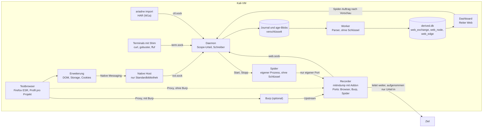

# Plan: Web und Browser

Stand 2026-10-19. Das ist ein Vorschlag zur Bestätigung, gebaut ist noch nichts davon. Grundlage sind die Entscheide E135 bis E138 von heute. Dazu kommen die weiter gültigen Entscheide E10, E13, E33, E42, E49, E72, E97, E98, E99, E117, E126 bis E133 im [Entscheidungsprotokoll](entscheide.md), Abschnitt 4 im [Konzept Terminal und Web](konzept-terminal-und-web.md) und die [Lösungsarchitektur](architektur.md). Neue Entscheide stehen in Abschnitt 7 als Vorschläge ab E139. Sie gelten erst, wenn du sie bestätigst.

## Auf einen Blick

Für Web ist im Repo fast nichts gebaut. Es gibt keine `web.*`-Ereignisse, keinen Einheitstyp `http`, keine Web-Parser, keinen Recorder und keine Web-Ansicht. Gut nutzbar sind die strenge URL-Normalisierung, der `ScopeMatcher` mit URL-Regeln, die URL-Mentions aus `regex.net`, die Zielerkennung aus argv für curl, gobuster und ffuf, die Regel R-WEB-INHALT, `ariadne import` und der Blob-Speicher mit Dedupe. Achtung beim Bau: `src/ariadne/web/` ist der Server des Dashboards. Recorder, Extraktion und Spider kommen in eigene Pakete (2.1).

| Etappe | Was du danach kannst | Aufwand (grob) | braucht |
|---|---|---|---|
| **W0** Probe in der Kali | wissen, ob Firefox ESR 153, mitmdump unter Python 3.14 und eine unsignierte Erweiterung in deiner VM laufen, was Firefox von sich aus ins Netz schickt und was das an CPU und RAM kostet | 5 bis 8 h, du 30 min | nichts |
| **W1a** HAR-Schnellweg | im normalen Firefox surfen, HAR speichern, `ariadne import`. Danach Liste, Pfadbaum und Rohtext (HTML, Header, Cookies) im Terminal, ohne Proxy und ohne CA | 15 bis 20 h | nichts |
| **W1b** Testbrowser und Recorder | `ariadne browser` öffnen, im Lab surfen. Jede Anfrage liegt verschlüsselt im Journal, dieselben Ansichten wie W1a | 35 bis 45 h | W1a, W0 |
| **W2** Burp in der Kette | Burp wie gewohnt nutzen, auch Repeater und Intruder. Ariadne zeichnet alles mit | 10 bis 16 h | W1b |
| **W3** Struktur und Auswertung | Baum mit besuchten und nur verlinkten Seiten, Formulare, Kommentare, Cookies mit Flags, Technologien. Am Dienst auf der Karte steht ein Web-Hinweis | 50 bis 70 h | W1a |
| **W4** Web-Werkzeuge aus dem Terminal | gobuster, ffuf, feroxbuster, curl, whatweb und nikto füllen denselben Baum | 18 bis 28 h | W3 |
| **W5** Dashboard: Reiter Web | Baum links, Details rechts, Quelltext mit Zeilennummern, alles als Text | 40 bis 60 h | W3, Design-Runde |
| **W6** Firefox-Erweiterung | DOM nach JavaScript, localStorage, sessionStorage, alle Cookies samt HttpOnly, SPA-Routen | 38 bis 55 h | W1b, W0 |
| **W7** Spider | Struktur einer Website auf Knopfdruck abrufen, mit Vorschau, Formularwahl und Stopp | 60 bis 85 h | W1b, W3, W5 |
| **W8** Graph, Denkanstösse, Bericht | Graph für einen gewählten Bereich, Web-Denkanstösse, Web-Teil im Bericht | 25 bis 40 h | W5, W7 |
| **W9** Importe und Robustheit | grosse HAR gestreamt, Burp-XML, grosse Downloads vollständig, WebSocket, Puffer bei Sperre | 20 bis 32 h | W3 |

Summe: etwa 315 bis 460 Stunden. Bei 20 Stunden pro Woche sind das 4 bis 5,5 Monate. Der erste Test in der Kali ist W0 nach wenigen Tagen, dann W1a nach etwa einer Woche. W1a braucht weder mitmproxy noch eine CA und zeigt dir den Baum aus echten DVWA-Daten, während W0 die offenen Technikfragen klärt. W1b folgt nach etwa zwei weiteren Wochen. Ehrlich gesagt ist schon W0 bis W7 (gut 270 bis 390 h) mehr als das ganze v0.1 (150 bis 250 h). Abschnitt 3.11 zeigt, was sich zur Not kürzen lässt.

*Stand nach Kritik (2026-10-19):* Gegenüber dem ersten Entwurf sind die Aufwände höher geschätzt, W1 ist in einen HAR-Schnellweg (W1a) und den Recorder (W1b) geteilt, und mehrere Sicherheitslücken sind geschlossen: Wortgrenzen und Aktionsparameter in der Sperrliste, Verwaltungsoberflächen, Prüfung der aufgelösten Adresse, Zertifikatsprüfung bei öffentlichen Zielen, Hintergrundverkehr von Firefox und Burp, Rechte der Erweiterung. Neue Vorschläge E154 bis E157 und Fragen 15 bis 19 stehen in Abschnitt 7.

## 1 Ziel

Du öffnest mit `ariadne browser` einen eigenen Testbrowser pro Projekt, und Ariadne zeichnet jede Anfrage an Ziele im Scope vollständig auf: HTML-Quelltext, Header, Cookies mit Flags, dazu über eine Erweiterung den DOM nach JavaScript, localStorage und sessionStorage. Ariadne zeigt die Unterseiten einer Website als Baum wie die Site map in Burp und als Graph aus Seiten, Links und Weiterleitungen, immer nur als Text und nie als gerenderte Webseite. Auf deinen ausdrücklichen Auftrag ruft ein Spider eine Website selbst ab, mit Vorschau, festen Grenzen und Stopp, und Burp bleibt mit Repeater und Intruder in der Kette nutzbar.

## 2 Architektur

### 2.1 Bausteine

| Baustein | Aufgabe | Technik | läuft als |
|---|---|---|---|
| **Testbrowser** | Firefox ESR mit eigenem Profil pro Projekt. Proxy fest auf den Recorder, CA nur in diesem Profil, farbiger Rahmen «Ariadne-Testbrowser: ms2» | `user.js`, `userChrome.css`, `certutil`, keine `policies.json` | `firefox-esr --profile … --no-remote`, nur auf dem Kali-Desktop (Webkonsole) |
| **Erweiterung** | DOM-Schnappschuss, Storage, Cookies, Navigation (E136) | WebExtension MV2, im Profil abgelegt, unsigniert auf ESR | im Testbrowser |
| **Native Host** | leitet Nachrichten der Erweiterung an den Daemon weiter | Python nur mit Standardbibliothek, ohne Schlüssel | von Firefox gestartet |
| **Recorder** | leitet Verkehr weiter und schreibt mit, setzt Scope und Spider-Grenzen durch | `/usr/bin/mitmdump` aus dem Kali-Paket mit Ariadne-Addon (nur Standardbibliothek und mitmproxy-API) | Kindprozess des Daemons, ohne Ariadne-Schlüssel, aber mit dem CA-Schlüssel |
| **Burp** | bleibt dein Werkzeug (E137) | Upstream-Proxy auf einen eigenen Recorder-Port | wie bisher |
| **Spider** | ruft auf Auftrag Seiten ab (E135) | `http.client` aus der Standardbibliothek, nur über seinen Recorder-Port | eigener Prozess ohne Schlüssel |
| **Daemon** | Scope-Urteil, schreibt Ereignisse ins Journal, führt Recorder und Spider | neue `DaemonExtension` `webrec` und `spider`, Sockets `web.sock` und `ext.sock` | wie heute |
| **Auswertung** | Einheiten `http`, Web-Parser, Struktur-Tabellen, HAR-Zerlegung | Worker im Stapelbetrieb, `derived.db` | wie heute |
| **Dashboard** | Reiter Web mit Baum, Details und Graph | Svelte 5, Cytoscape (schon da) | wie heute |

**Ablage im Repo** (Vorschlag, damit nichts mit dem Dashboard-Server in `src/ariadne/web/` vermischt wird):

| Pfad | Inhalt |
|---|---|
| `src/ariadne/webrec/` | Recorder-Erweiterung `webrec`, Profil, CA, Protokoll von `web.sock`, Speicherwächter-Anbindung, Testserver |
| `src/ariadne/webrec/mitm/ariadne_addon.py` | das mitmproxy-Addon, **allein in seinem Ordner**. mitmproxy setzt beim Laden den Ordner des Skripts vorn in `sys.path`. Eine Nachbardatei wie `profile.py` oder `http.py` würde sonst Module der Standardbibliothek überdecken |
| `src/ariadne/parsers/web_extract.py` | reine Funktionen für Links, Formulare, Kommentare, robots und Sitemaps. Parser und Spider nutzen sie beide |
| `src/ariadne/parsers/http_meta.py` usw. | die Web-Parser aus W3 |
| `src/ariadne/spider/` | Spider-Prozess (`python -I -m ariadne.spider`) |
| `src/ariadne/browserext/` | Quelltext der Erweiterung und Native Host `ariadne-bridge` |

### 2.2 Skizze

### 2.3 Datenfluss

1. Der Testbrowser schickt jede Anfrage an seinen Port im Recorder, mit Burp zuerst an Burp und von dort weiter.
2. Der Recorder prüft, wer verbindet (Peer-Prüfung über `/proc`), und fragt den Daemon nach dem Scope-Urteil für Host und Adresse. Den Namen löst das Addon selbst auf (erlaubt nach E49, nur für Namen, die der Browser oder der Spider anfragt), prüft die Adresse und nagelt sie für die Verbindung fest (`server_connect`). So kann eine zweite DNS-Antwort zwischen Prüfung und Verbindung nicht auf eine andere Adresse umlenken. Das Urteil wird pro Host zwischengespeichert und bei jeder Scope-Änderung verworfen. Bei `in` entschlüsselt er und schreibt mit. Fremde Ziele reicht er bei TLS unentschlüsselt durch und zählt sie nur.
3. Das Addon schickt jeden Austausch über `web.sock` an den Daemon. Rahmen sind höchstens 1 MiB gross, grössere Bodies kommen in Stücken. Die Zeiten nimmt das Addon in seinen Hooks selbst mit `time.time_ns()` und `time.monotonic_ns()`, wie der Shim (E96). Die Float-Zeitstempel von mitmproxy dienen nur zum Vergleich.
4. Der Daemon prüft das Urteil noch einmal auf URL-Ebene (Ausschlüsse wie `/logout`) und schreibt `web.exchange` ins Journal. Bodies stehen so im Journal, wie sie übertragen wurden (also oft komprimiert), mit `Content-Encoding`. Bis 64 KiB stehen sie im Ereignis, grössere gehen als age-Blob mit Dedupe. Dekodiert wird erst im Worker, mit Grenzen (6.1). `get_content()` von mitmproxy dekodiert ohne Grenze und ist im Addon tabu: Eine Dekompressionsbombe soll nicht den Prozess treffen, der im Datenweg sitzt und den CA-Schlüssel hält.
5. Die Pipeline trägt jeden Austausch sofort in die Tabelle `web_exchange` ein (ohne Worker). Für Textantworten entsteht eine Einheit `http`, die ein Worker im Stapel mit den Web-Parsern liest.
6. Die Parser füllen die Struktur-Tabellen `web_node`, `web_edge`, `web_form` und `web_cookie` schrittweise. Nur wenige Werte mit Kartenwirkung werden Claims (Produkt, Version, Login, Admin). Die volle Projektion muss also nicht tausende URLs neu rechnen.
7. Erweiterung und Spider speisen denselben Weg: Die Erweiterung schickt über den Native Host an `ext.sock`, der Spider erzeugt Verkehr über seinen Recorder-Port.
8. Importe (W1a, W9) gehen den bestehenden Weg von `ariadne import`: Die Datei wird als `file.observed` mit Blob gespeichert. Ein Worker zerlegt sie in Austausche mit Provenienz «Datei, Eintrag N». Die Pipeline trägt sie mit Quelle «Import» in `web_exchange` ein, nach demselben Scope-Tor 3.

### 2.4 Was wo gespeichert wird

| Daten | Ort | Form |
|---|---|---|
| Anfrage und Antwort: Köpfe, Zeiten, Ziel-IP, TLS-Daten, Herkunft (Browser, Burp, Spider) | Journal, `web.exchange` | verschlüsselt, vollständig (E97) |
| Bodies bis 64 KiB | im Ereignis | wie übertragen, mit `Content-Encoding`; dekodiert wird im Worker |
| Bodies über 64 KiB | age-Blob, gleicher Inhalt nur einmal | wie oben |
| Bilder, Fonts, Video, Audio | nur Hash, Grösse, Typ (Vorschlag E148) | E128 liefert Bilder aus dem Ziel ohnehin nicht aus |
| DOM-Schnappschüsse | age-Blob, Ereignis `web.dom` | höchstens 5 MiB pro Schnappschuss |
| Storage und Cookies aus der Erweiterung | Journal, `web.storage` und `web.cookies` | vollständig |
| Spider-Läufe | Entscheide `d.spider.start`, `d.spider.forms` und `d.spider.stop`, Ereignis `web.spider` | mit Parametern und Zusammenfassung |
| fremde Ziele | Journal, `web.offscope` | nur Host, Minute, Anzahl |
| Index, Baum, Kanten, Formulare, Cookies | `derived.db` | lässt sich aus dem Journal neu bauen (`ariadne reparse`) |
| Testprofil mit Cookies und Verlauf | `~/.local/share/ariadne/browser/<project_id>/` (0700, Vorschlag E144) | Klartext bis zum verschlüsselten Arbeitsbereich (v0.3), nicht in der Sicherung. Nach `restore` legt `ariadne browser` ein neues Profil an und holt die CA aus dem Tresor |
| CA-Schlüssel | Tresor des Projekts (age), zur Laufzeit in einem eigenen `confdir` von mitmdump unter `Paths.runtime_dir` (0600) | nie dauerhaft im Klartext. `runtime_dir` fällt ohne `XDG_RUNTIME_DIR` auf `~/.local/state/ariadne/run` zurück, also auf die Platte. Darum prüft der Recorder per `statfs`, dass der Ordner tmpfs ist, und startet sonst nicht |

### 2.5 Scope-Prüfung: fünf Tore

1. **Spider vor jeder Anfrage:** nur der Origin der Start-URL (Vorschlag E139), Sperrliste, Urteil `in`.
2. **Recorder pro Verbindung:** Urteil für Host und die tatsächlich aufgelöste Adresse vom Daemon. Fremde Ziele bei TLS durchreichen, bei Klartext-HTTP weiterleiten, aber vor dem Journal verwerfen. Auf dem Spider-Port bekommen fremde Ziele eine synthetische 403, ohne dass das Ziel kontaktiert wird. Dort gilt zusätzlich: Ist der Name `in`, die Adresse aber `out`, ausgeschlossen oder eine Sonderadresse (Loopback, Link-Local samt 169.254.169.254, eigene Adressen der Kali), wird nicht verbunden. Immer gesperrt, auf allen Ports: Ariadne (7330), Ollama (11434), die eigenen Listener des Recorders (sonst Schleife) und der eingetragene Burp-Port.
3. **Daemon vor dem Journal:** Urteil auf URL-Ebene mit Präfix-Regeln und Ausschlüssen. Gleiches Tor für DOM und Storage aus der Erweiterung und für Importe. Name ohne Urteil, Adresse `in`: aufnehmen und den Namen unter «Klären» zur Aufnahme in den Scope anbieten, einmal pro Name (wie E130, nie automatisch).
4. **Auswertung:** Werte ausserhalb des Scopes landen höchstens als Zähler, nie als Claim (wie heute).
5. **Ausgänge:** Redaktor, E99-Masken, Cloud-Regeln (E126).

Ein offener Scope (E131) macht Tor 2 bis 4 durchlässig. Darum hat der Spider in Tor 1 eine eigene, engere Grenze. Folge für den Recorder: Bei offenem Scope entschlüsselt er alles, was der Testbrowser schickt, auch deine Suche nach einem Exploit und den Hintergrundverkehr von Firefox. Dagegen helfen zwei Dinge: Recherche bleibt im normalen Browser, und eine feste Liste von Hintergrunddiensten (Mozilla, PortSwigger) wird nie entschlüsselt (Vorschlag E155).

### 2.6 Ports und Prozesse

Der Recorder ist **ein** mitmdump-Prozess mit mehreren Listenern (`--mode regular@PORT`, mehrfach), alle nur auf `127.0.0.1`. Jeder Flow trägt seinen Modus (`proxy_mode`). So ordnet das Addon Browser, Burp und Spider ohne Markierungs-Header zu.

| Port | wer darf | Zweck |
|---|---|---|
| Browser-Port | Firefox mit genau diesem Profil | Testbrowser ohne Burp |
| Burp-Port | Java-Prozess von Burp, gleiche UID | Burp als Upstream (W2) |
| Spider-Port | Spider-Prozess dieses Laufs | lauscht immer, nimmt aber nur während eines Laufs und nur vom Spider-Prozess an (W7). Das ist einfacher als Listener zur Laufzeit zu öffnen und zu schliessen, was in mitmproxy ungeprüft ist |

Die Ports sind pro Projekt fest, zufällig gewählt und stehen im Zustand des Projekts. Es lauscht nur der Recorder des aktiven Projekts. Er startet beim ersten `ariadne browser` (nicht schon bei `ariadne start`, das spart RAM, wenn du kein Web brauchst) und endet mit dem Projekt. Läuft beim nächsten `ariadne start` noch ein Testbrowser dieses Projekts, startet der Recorder gleich mit, sonst zeigt der offene Browser bis zum nächsten `ariadne browser` nur Fehlerseiten.

**Port-Squatting:** Ein anderer lokaler Prozess könnte einen Recorder-Port belegen, bevor der Recorder startet, und so den Verkehr des Testbrowsers samt Sitzungs-Cookies abgreifen. Darum prüft `ariadne browser` vor dem Start von Firefox über `/proc/net/tcp`, dass der lauschende Socket unserem mitmdump gehört, und bricht sonst ab. Stirbt der Recorder bei offenem Browser, bleibt eine kurze Lücke, bis der Daemon ihn neu startet (Rest in 8.1).

### 2.7 Zwänge der VM und die Antwort darauf

| Zwang | Antwort im Plan |
|---|---|
| 1 vCPU, 4 GB RAM, darauf Firefox, mitmdump, Burp, Daemon, Worker | W0 misst. mitmdump braucht laut Messung im Container etwa 75 bis 85 MB RAM und rund 12 ms CPU pro Anfrage ohne Keep-alive, in der VM vermutlich das Zwei- bis Vierfache. Burp braucht eine RAM-Grenze (`-Xmx`), siehe Anleitung in W2 |
| ein Worker-Prozess pro Einheit | `http`-Einheiten im Stapel: bis 50 Einheiten oder 8 MiB pro Prozessstart. Medien werden keine Einheit |
| volle Projektion nach jedem Durchgang | Struktur in eigenen, schrittweise gefüllten Tabellen. Claims nur für Werte mit Kartenwirkung. Für reine Web-Durchgänge eine längere Entprellung (2 s statt 0,5 s) |
| kein Speicherwächter (Architektur 8.6 beschreibt ihn mit 2 GiB, gebaut ist er nicht; `status` meldet `disk_low` fest als falsch) | **ein** Wächter im Daemon für alle Quellen schon in W1b, nicht ein eigener für Web. Web gibt zuerst nach, damit die Terminals länger aufnehmen: unter 3 GiB frei nur noch Köpfe von Web, unter 2 GiB Web pausiert und Terminals nur Metadaten (Architektur 8.6). Schwellen in der Konfiguration |
| mitmproxy puffert Bodies im RAM | `stream_large_bodies=16m` ab W1b, vollständiges Streaming in den Blob in W9 |
| 1 vCPU für alles | Peer-Prüfung über `/proc` kostet pro neuer Verbindung einen Lauf über die Socket-Tabellen. W0 misst das. Ergebnis pro Verbindung zwischenspeichern, nicht pro Anfrage |

## 3 Etappen

Jede Etappe endet mit einem Praxistest in der Kali gegen Metasploitable2 (hier `192.168.56.101`). Dort laufen DVWA (`/dvwa/`, admin/password), Mutillidae (`/mutillidae/`), phpMyAdmin (`/phpMyAdmin/`), TWiki (`/twiki/`) und Tomcat auf 8180. Metasploitable2 hat kein HTTPS. Für HTTPS braucht es ein anderes Lab-Ziel oder den Testserver aus dem Paket (W1b). Die DVWA auf Metasploitable2 ist eine alte Version (1.0.x). Sie hat soweit bekannt kein CSRF-Token im Login. Die Abnahmen verlangen darum keines.

Vor dem ersten Spider-Test (W7) gilt: Du weisst, wie du DVWA und Mutillidae zurücksetzt (DVWA «Create / Reset Database», Mutillidae «Reset DB»), und ob andere die Metasploitable2 mitbenutzen (Frage 15).

### 3.1 W0: Probe in der Kali

**Warum zuerst:** Vier Annahmen sind ungeprüft und bestimmen den Bau: läuft das Kali-Paket mitmproxy 12.2.3 unter deinem Python 3.14, lädt Firefox ESR 153 eine unsignierte Erweiterung aus dem Profil, geht Native Messaging, und wie viel CPU und RAM bleiben mit Burp übrig. Dazu kommen drei kleinere Fragen, die sonst erst im Bau auffallen: Ist `XDG_RUNTIME_DIR` in deiner Sitzung tmpfs, von welchem Prozess kommen die Verbindungen von Firefox (Hauptprozess oder Socket-Prozess), und was schickt Firefox ohne Klick von sich aus ins Netz.

**Umfang:** `ariadne doctor web --probe URL` (im Paket, bleibt später als Prüfung nützlich):

- Versionen von firefox-esr, mitmproxy samt Python von mitmdump, `certutil` (libnss3-tools) und `openssl`. Dazu: `DISPLAY` vorhanden, `XDG_RUNTIME_DIR` gesetzt und tmpfs, freier Platz.
- Wegwerf-Profil in tmpfs mit `user.js`, Test-CA per `certutil`, Mini-Erweiterung MV2 als Sideload mit `xpinstall.signatures.required=false` und `extensions.autoDisableScopes=0`, Native Host, der nur «ok» und die Grösse des DOM meldet.
- mitmdump mit einem Mini-Addon, das nur zählt, mit `connection_strategy=lazy` und einem eigenen `confdir` in tmpfs. Die Probe prüft danach, dass kein `~/.mitmproxy` entstanden ist (mitmproxy erzeugt sonst still eine eigene CA mit zehn Jahren Laufzeit).
- Erste Minute ohne Klick: Hosts, die Firefox von sich aus anfragt, nur als Namen und Zahl (Grundlage für die Liste in E155 und für `user.js`).
- Firefox öffnet die URL, du klickst zwei Minuten und schliesst Firefox.
- Ergebnis: Zahl der Flows (HTTP und HTTPS), CPU-Zeit pro Anfrage, Zeit der Peer-Prüfung pro Verbindung und welcher Prozess verbunden hat, RAM von mitmdump und Firefox, freier RAM, Erweiterung geladen ja oder nein, Native Messaging ja oder nein, DOM-Grösse, Verbindung zum Ziel vor der ersten Anfrage ja oder nein, Hintergrund-Hosts.
- Die Probe speichert keine Inhalte, nur Zahlen und Hostnamen. Sie räumt auf und berührt dein normales Firefox-Profil nicht.

**Abnahme in der Kali:**

1. `ariadne doctor web` ohne Probe: alle Pakete gefunden, Versionen notieren.
2. `ariadne doctor web --probe http://192.168.56.101/dvwa/`, in DVWA anmelden, zwei Minuten klicken, Firefox schliessen.
3. Dasselbe mit laufendem Burp (ohne Kette), freien RAM notieren.
4. Ausgabe komplett kopieren und schicken.

**Tests:** Probe gegen einen lokalen Testserver im Container, soweit Firefox verfügbar ist. **Aufwand:** 5 bis 8 h, für dich etwa 30 Minuten. **Abhängigkeiten:** keine, W1a startet parallel.

**Folgen:** Lädt ESR die unsignierte Erweiterung nicht, gilt der Rückfall «unlisted» bei AMO (Frage 8). Läuft mitmdump nicht unter 3.14, braucht der Recorder ein eigenes venv mit mitmproxy aus PyPI, mit gepinnten Hashes (Architektur 9.2, Punkt 12; zusätzlich etwa 4 bis 6 h). Ist `XDG_RUNTIME_DIR` kein tmpfs, muss das vor W1b gelöst sein (Anleitung in der Installation).

### 3.2 W1: erste Aufnahme, in zwei Teilen

W1 ist geteilt, damit du früh etwas in der Hand hast. W1a nutzt den vorhandenen Weg `ariadne import` und braucht weder mitmproxy noch CA noch Peer-Prüfung. Es baut aber schon das, was W1b ohnehin braucht: den Index `web_exchange`, die Ansichten `list`, `tree` und `show`, die Masken nach E99 und die Ausgabe über `termsafe`. Das Ereignis `web.exchange` kommt erst mit dem Recorder in W1b. W1a ist auch der Rückfall nach E33, falls W0 bei mitmproxy oder Firefox ein Problem zeigt.

#### W1a: HAR-Schnellweg (Vorschlag E157)

**Umfang:**

- `ariadne import <datei.har>` wie heute (`file.observed`, Blob). `safeopen.sniff` erkennt HAR.
- Worker-Parser `har.basic`: nur `json` aus der Standardbibliothek, Datei höchstens 32 MiB (grössere ab W9 gestreamt), höchstens 5000 Einträge. Er liefert eine neue Ergebnisart «Austausch», die der Kern wie alle Worker-Ergebnisse gegen ein Schema prüft (Architektur 9.3): Austausche mit Methode, URL, Status, Köpfen, Cookies, `serverIPAddress` und Verweis auf den Body im Eintrag. Bodies bleiben in der HAR-Datei (Blob); `web show` holt sie über den Worker.
- Pipeline trägt die Austausche mit Quelle «Import» und Provenienz «Datei, Eintrag N» in `web_exchange` ein, nach Tor 3. Fremde Einträge nur als Zähler. Loopback als `serverIPAddress` heisst «Ziel-IP unbekannt».
- **Index** `web_exchange` in `derived.db`, schrittweise gefüllt über einen neuen Zweig in `Pipeline._route`.
- **CLI:** `ariadne web list` (letzte Austausche, Filter nach Host, Status und Quelle), `ariadne web tree [origin]` (Pfadbaum mit Status und Anzahl, nur aus besuchten URLs), `ariadne web show <id> [--teil anfrage|antwort|kopf] [--zeigen]`.
  - Ausgabe immer über `termsafe` (Steuer-, Bidi- und Nullbreiten-Zeichen sichtbar), nie roh ins Terminal. Feindliches HTML könnte sonst Escape-Sequenzen ins Terminal schreiben.
  - Neue ctl-Operationen `web.list`, `web.tree`, `web.show` antworten über `redact_for_exit` (Architektur 8.5).
  - Verdeckt bis `--zeigen` (E99, E104): Werte von Cookie, Set-Cookie, Authorization, Proxy-Authorization, Passwortfeldern im Body und Query-Parametern mit Secret-Namen (password, pass, pwd, token, key, secret, session, auth, code), auch im Baum und in der Liste.
- **Eigene Ausgaben:** Die Ausgabe von `ariadne web …` im Terminal ist keine Zielausgabe. Der Worker parst sie nicht noch einmal (sonst doppelte Mentions aus demselben HTML), und sie geht nie automatisch an die KI (E98).
- **Doku:** kurzer Abschnitt im [Praxistest](praxistest.md): HAR in Firefox speichern (DevTools, Netzwerk, «Alle als HAR speichern»).

**Was du danach kannst:** Im Firefox der Kali mit offenen DevTools durch DVWA klicken, HAR speichern, importieren und den Baum im Terminal ansehen. Der Weg ist umständlicher als der Testbrowser, zeigt aber nach etwa einer Woche, ob Baum, Masken und Rohtext für dich passen.

**Abnahme in der Kali:**

1. Firefox (normal), DevTools, Netzwerk, «Logs nicht leeren» an. DVWA öffnen, mit admin/password anmelden, drei Seiten besuchen.
2. «Alle als HAR speichern», dann `ariadne import ~/Downloads/<datei>.har`.
3. `ariadne web tree 192.168.56.101:80`: Pfade unter `/dvwa/` mit Status, Quelle «Import».
4. `ariadne web show <id des Logins>`: POST-Body mit `username` und verdecktem `password`. Mit `--zeigen` erscheinen die Werte.
5. Fremde Hosts aus der HAR (etwa Firefox-Dienste) erscheinen nur als Zahl.

**Tests:** HAR aus Firefox und Chromium (Golden), kaputte und feindliche HAR (Tiefe, Grösse, Steuerzeichen), Scope-Tor, Masken, `termsafe` mit Escape-Sequenzen im Body.

**Aufwand:** 15 bis 20 h. **Abhängigkeiten:** keine.

#### W1b: Testbrowser und Recorder

**Umfang:**

- `ariadne browser [URL]` richtet beim ersten Aufruf das Profil ein. Es läuft nur auf dem Kali-Desktop. Aus einer SSH-Sitzung ohne `DISPLAY` meldet es den Grund.
  - `user.js`: fester Proxy (auch für localhost, `network.proxy.no_proxies_on` leer, `allow_hijacking_localhost`), `network.proxy.failover_direct=false`, DoH aus (`network.trr.mode=5`), HTTP/3, WebRTC, Suchvorschläge, Safe Browsing, Telemetrie, Studien, Passwortspeicher und Festplatten-Cache aus.
  - Keine eigenen DNS-Abfragen und keine Vorab-Verbindungen von Firefox: DNS-Prefetch, Link-Prefetch, spekulative Verbindungen, Predictor und die Einzelwort-Auflösung in der Adressleiste aus.
  - Hintergrunddienste aus, soweit es Prefs gibt: Captive-Portal- und Verbindungsprüfung, Push, Add-on-Updates und Empfehlungen, Plugin-Downloads (GMP), Sync und Firefox-Konto, Pocket und Inhalte der neuen Seite, Standort und Region. Was W0 trotzdem findet, kommt auf die Liste von E155.
  - Dazu ein farbiger Rahmen über `userChrome.css`.
  - Danach prüft es den Recorder-Port (2.6), startet den Recorder, falls er nicht läuft, und Firefox mit `--profile … --no-remote`.
- **CA pro Projekt** von Ariadne mit `openssl` erzeugt: CN «Ariadne-Testbrowser <slug>», ein Jahr gültig, `CA:TRUE`, `keyCertSign`. Der Schlüssel liegt verschlüsselt im Tresor des Projekts und zur Laufzeit nur im `confdir` von mitmdump in tmpfs (2.4). Import nur per `certutil -d sql:<profil>`. Beim Start meldet das Addon den Fingerabdruck der CA, die mitmdump tatsächlich nutzt. Passt er nicht zur Projekt-CA, stoppt der Recorder.
- **Recorder** als `DaemonExtension` `webrec`: `/usr/bin/mitmdump` mit `--mode regular@<browser-port>`, eigenem `confdir`, `connection_strategy=lazy`, `anticache` und `anticomp` aus, `http3` aus, `stream_large_bodies=16m`. Zertifikate des Ziels nach Vorschlag E151: bei privaten und Lab-Adressen weiterleiten und Prüfergebnis speichern, bei öffentlichen Adressen weiter prüfen. Neustart bei Absturz (gedrosselt), Ende mit dem Projekt.
- **Addon** nur mit Standardbibliothek, allein in seinem Ordner (2.1), mit den Hooks `client_connected`, `tls_clienthello`, `server_connect`, `requestheaders`, `responseheaders`, `response` und `error`.
  - Peer-Prüfung über `/proc`: nur Firefox mit diesem Profil. Kommt die Verbindung aus einem Kindprozess (etwa dem Socket-Prozess), wird die Elternkette bis zum Hauptprozess mit `--profile` geprüft. Ergebnis pro Verbindung zwischenspeichern.
  - Scope-Frage an den Daemon mit Cache. Namen auflösen, Adresse prüfen und festnageln (2.3). Fremde TLS-Ziele und die Hintergrunddienste aus E155 mit `ignore_connection` durchreichen.
  - Bodies wie übertragen weitergeben, nicht dekodieren (2.3). Über 16 MiB nur Anfang (64 KiB), Hash und Grösse, mit Vermerk; dafür liest das Addon den Strom mit (`flow.response.stream`).
- **`web.sock`** im Muster von `term.sock`: `SO_PEERCRED`, gleiche UID, Prozess ist mitmdump mit unserem Addon. Rahmen höchstens 1 MiB.
- **Ereignisse** in `events.py`: `web.exchange` (`exchange_id` per `ids.uuid7`, Zeiten in Nanosekunden ohne Floats), `web.offscope`, `web.gap` (Pause, Sperre, Platte, Recorder weg). Neue Origins `webrec`, `extension` und `spider`.
- **Sperre und Pause:** Bei `ariadne lock` leitet der Recorder weiter und schreibt nur eine Lücke, nichts im RAM. Ein Puffer wie im Terminal kommt erst in W9. `ariadne web pause` pausiert die Aufnahme für 10 Minuten wie `F12 r` im Terminal. Aus dem Dashboard gilt das Budget nach E117.
- **Speicherwächter** für alle Quellen im Daemon (2.7), Meldung in `ariadne status` und im Dashboard (`disk_low`).
- **doctor:** Profil vorhanden, CA nur im Testprofil und nicht im Systemspeicher, kein `~/.mitmproxy` mit fremder CA, Proxy-Prefs gesetzt, `runtime_dir` ist tmpfs, mitmdump-Version.
- **Testserver** im Paket (`python -m ariadne.webrec.testserver`, nur 127.0.0.1; HTTP und HTTPS selbstsigniert, gzip und br, Weiterleitungen, grosse Bodies, Escape-Sequenzen). So ist er auch da, wenn du ohne Repo-Ordner installiert hast.
- **Doku:** Anleitung «Testbrowser» in [Installation](installation.md), auch für den Fall ohne tmpfs, und ein neuer Abschnitt im [Praxistest](praxistest.md). Die widersprüchlichen Stellen aus Abschnitt 7.2 sind dann schon nachgeführt.

**Was du danach kannst:** Testbrowser öffnen, DVWA und Mutillidae durchklicken. Jede Anfrage liegt vollständig und verschlüsselt im Journal. Im Terminal siehst du, was du besucht hast, als Liste und als Baum, und jeden Austausch als Rohtext. Der Umweg über HAR entfällt.

**Abnahme in der Kali:**

1. `ariadne start ms2` (wie gehabt), dann im Terminal auf dem Kali-Desktop `ariadne browser http://192.168.56.101/`. Firefox öffnet mit Rahmen «Ariadne-Testbrowser: ms2».
2. DVWA öffnen, mit admin/password anmelden, drei Seiten besuchen. Mutillidae öffnen.
3. `ariadne web tree 192.168.56.101:80`: Pfade unter `/dvwa/` und `/mutillidae/` mit Status, Quelle «Browser».
4. `ariadne web show <id des Logins>`: POST-Body mit `username` und verdecktem `password`, `Set-Cookie: PHPSESSID=••••••••`. Mit `--zeigen` erscheinen die Werte.
5. Nur bei geschlossenem Scope: Im Testbrowser eine öffentliche Seite öffnen, z. B. `https://www.debian.org/`. Das Schloss-Symbol zeigt das echte Zertifikat und nicht «Ariadne». `ariadne web list --fremd` zeigt nur Host und Zahl. Bei offenem Scope (E131) wird die Seite aufgenommen; das ist so gewollt und steht in der Anleitung.
6. HTTPS: in einem eigenen Testprojekt (`ariadne start webtest --target 127.0.0.1`) den Testserver starten und aufrufen. Der Austausch ist da, mit TLS-Daten. Auf der Karte erscheint kein Host (eigene Adresse, E42), im Baum schon.
7. `ariadne stop`: Firefox zeigt eine Proxy-Fehlerseite (erwartet). `ariadne start ms2` bei noch offenem Testbrowser: Er funktioniert wieder, ohne `ariadne browser`. `ariadne verify` ist in Ordnung, `ariadne backup` enthält kein Testprofil.
8. Während des Tests `top` beobachten: CPU von mitmdump, Firefox und Daemon notieren.

**Tests:** Addon gegen einen lokalen Testserver mit echtem mitmdump (nur ab Python 3.12, sonst übersprungen). Fälle: HTTP, HTTPS, gzip und br, Weiterleitungen, Bodies über 16 MiB, fremde Ziele (Durchreichen, nichts im Journal), Hintergrunddienste bei offenem Scope (Durchreichen), Peer-Prüfung (fremder Prozess wird abgewiesen, Kindprozess von Firefox angenommen), Port schon belegt (Abbruch), Name wechselt die Adresse zwischen Prüfung und Verbindung (nur die geprüfte Adresse wird verbunden), Scope-Wechsel während des Laufs, Recorder-Absturz, Sperre, volle Platte (simuliert), kein `~/.mitmproxy`, Hash-Kette, Falle `NO_PROXY`, Canary (ein Wert aus dem Body erscheint in keinem Log und in keiner Ausgabe unverdeckt).

**Aufwand:** 35 bis 45 h.

**Abhängigkeiten:** W1a, Ergebnisse aus W0 zu mitmdump, Python, tmpfs und Peer-Prüfung.

### 3.3 W2: Burp in der Kette

**Umfang:**

- Zweiter Listener `regular@<burp-port>`. Peer-Prüfung: Java-Prozess derselben UID mit Burp in der Kommandozeile. Zusätzlich Basic-Auth, falls mitmproxy sie pro Modus erlaubt (zu prüfen).
- Standard ist **Variante B** (Vorschlag E147): Testbrowser, Burp, Recorder, Ziel. `ariadne browser --burp [PORT]` stellt den Proxy im Testprofil auf Burp (Standard `127.0.0.1:8080`) und zeigt die Einstellung für Burp an: Settings, Network, Connections, Upstream proxy servers, Destination host `*`, Proxy `127.0.0.1:<burp-port>`. Die CA von Burp kommt ins Testprofil, die Projekt-CA als Datei für «Custom CA» in Burp, falls Burp Upstream-TLS prüft.
- **Variante A** als Rückfall (`--burp-hinter`): Testbrowser, Recorder, Burp, Ziel über `upstream:http://127.0.0.1:8080` mit `ssl_verify_upstream_trusted_ca`. Ob die Upstream-Angabe pro Listener geht, ist zu prüfen. Nachteile: Ziel-IP unbekannt, Repeater und Intruder fehlen.
- `web.exchange` trägt die Herkunft `browser`, `burp` oder `spider`.
- **Mengenbremse** (Vorschlag E147): Alles kommt ins Journal (E97). Pro Endpunkt (Methode, Pfad, sortierte Parameternamen) werden aber nur die ersten 20 Austausche pro Minute zu Einheiten. Der Rest erscheint als Zähler, im Baum als «50 Austausche, 30 nur gezählt». Das ist etwas anderes als «Varianten» (verschiedene Query-Werte, 5.1).
- **Hintergrundverkehr von Burp** (Updates, BApp Store, Collaborator) läuft mit der Upstream-Regel `*` auch durch den Recorder. Er steht auf der Liste von E155 und wird nie entschlüsselt.
- Anleitung mit RAM-Grenze für Burp (z. B. `-Xmx1g`, Wert nach W0) und mit der Tabelle «Wer sieht was» (6.8).

**Was du danach kannst:** Burp wie gewohnt mit Proxy, Repeater und Intruder. Ariadne sieht alles, auch die Anfragen aus Repeater und Intruder, mit echter Ziel-IP.

**Abnahme in der Kali:**

1. Burp Community starten, Upstream-Regel wie angezeigt eintragen.
2. `ariadne browser --burp`, DVWA-Login in Burp abfangen und weiterlassen.
3. Eine Anfrage im Repeater zweimal senden: `ariadne web list` zeigt beide mit Herkunft «burp».
4. Intruder mit 50 Anfragen gegen DVWA «Brute Force» (`/dvwa/vulnerabilities/brute/`, Stufe low): 50 Austausche im Journal, der Knoten zeigt «50 Austausche, 30 nur gezählt». Die Werte des Parameters `password` sind in Liste und Baum verdeckt.
5. Freien RAM mit Burp, Firefox und Recorder notieren.

**Tests:** Peer-Prüfung (Java nur am Burp-Port, Firefox nur am Browser-Port), Kette mit einem Fake-Upstream, Mengenbremse, Burp-Hintergrundverkehr wird durchgereicht. **Aufwand:** 10 bis 16 h. Die ungeprüften Punkte (Upstream-TLS in Burp, `proxyauth` und `upstream:` pro Listener) können je ein paar Stunden kosten. **Abhängigkeiten:** W1b.

### 3.4 W3: Struktur und Auswertung

**Umfang:**

- **Einheit `http`:** `UnitKind`, CHECK im Schema (`schema_units.py`; `derived.db` wird dafür neu gebaut), `units._KINDS`, Provenienz `{"t":"http","exchange":"<id>","part":"res.body","lines":[a,b]}`. Belegansicht und Export lernen sie kennen. Auch Austausche aus einer HAR (W1a) werden `http`-Einheiten, über einen Expander mit Provenienz «Datei, Eintrag N»; für Burp-XML folgt er in W9.
- **Vorbereitung im Worker:** zuerst dekodieren (gzip und deflate über `zlib` mit `max_length`, zstd und br nur mit Bibliotheken, die eine Ausgabegrenze kennen, sonst roh mit Vermerk; höchstens 64 MiB Ergebnis, Verhältnis höchstens 1:100). Dann Zeichensatz aus Content-Type und `meta charset`, Rückfall UTF-8 mit Ersatzzeichen. Minifiziertes JavaScript und CSS an Token-Grenzen umbrechen, damit die 16-KiB-Grenze pro Zeile (`parsers/safe.py`, `MAX_LINE`) keine Endpunkte abschneidet.
- **Stapel im Worker:** bis 50 `http`-Einheiten oder 8 MiB pro Prozessstart.
- **Gemeinsame Extraktion** `ariadne/parsers/web_extract.py` (nicht unter `ariadne/web/`, das ist der Dashboard-Server): reine Funktionen ohne Schlüssel. Parser und Spider nutzen sie beide, damit es nur eine Wahrheit gibt. Fuzzing mit `hypothesis` (Architektur 9.3).
- **Volltextsuche:** FTS5 nur für Dokumente (HTML, JSON, XML, Text) bis 1 MiB. JavaScript und CSS kommen nicht in den Volltext, nur ihre Funde (Endpunkte, Kommentare). Das spart Platz und CPU in `derived.db`; in W3 messen.
- **Parser** (Golden-Tests unter `tests/golden/<parser>/`):
  - `http.meta`: Status, Weiterleitung, Server, `X-Powered-By`, `WWW-Authenticate`, Cookie-Namen und Flags (nie den Wert), `host.name` aus der Verbindung, URL zu Service über die verbundene IP.
  - `html.basic`: Titel, Links, Formulare mit Feldern (auch versteckte und Passwortfelder), Kommentare, `meta generator`, Skripte und Stylesheets.
  - `web.files`: `robots.txt`, `sitemap.xml`, Verzeichnislisting, `.git/HEAD`, Stacktraces. Eine `robots.txt` ausserhalb der Wurzel (Mutillidae hat eine im Unterordner, mit Pfaden wie `./passwords/`) gilt relativ zu ihrem Ordner, mit Vermerk.
  - `js.endpoints`: Pfade aus JavaScript mit re2 nach dem Muster von LinkFinder, nur relativ oder im Scope.
  - `web.fingerprint`: kleine eigene Liste (Apache, nginx, IIS, PHP, Tomcat, phpMyAdmin, WordPress, DVWA, Mutillidae, TWiki, Jenkins, Grafana). Eine Version nur, wenn sie wörtlich dasteht.
- **Struktur-Tabellen** in `derived.db` (Vorschlag E149): `web_node` (Origin und Pfad, Art, Status, Quellen, besucht ja oder nein, Titel, Kennzeichen Login, Admin, Formular, Upload, Kommentar), `web_edge` (Link, Weiterleitung, Formular, Skript, Stylesheet, iframe, JS-Fund), `web_form`, `web_cookie`. Sie werden schrittweise gefüllt, `ariadne reparse` baut sie neu.
- **Eine Normalisierung:** `identity.normalize_identifier` nutzt für `url:` künftig `normalize_url`. Sonst entstehen doppelte Knoten und falsche Urteile.
- **Karte:** Claims nur für Werte mit Kartenwirkung: Produkt und Version am Service, Login- und Admin-Bereiche als Hinweis. `url.status` und `url.title` bekommen die Kardinalität `many` (Ontologie v3). Am Service steht ein Hinweis «Web: 23 Seiten, 1 Login, 1 Admin».
- **Regel R-WEB-INHALT:** gilt auch als erledigt nach mindestens drei besuchten Seiten im Testbrowser, einem Import oder einem Spider-Lauf.
- **Redaktor:** neue Varianten Base64 (Basic-Auth) und HTML-Entities.
- **E99-Masken:** Werte von Cookie, Set-Cookie, Authorization, Passwortfeldern, Query-Parametern und URL-Fragmenten mit Secret-Namen (etwa `#access_token=`) und erkannten Tokens.
- **KI:** Das automatische Lesen nach E98 gilt nicht für `http`-Einheiten. HTML enthält fast immer Signalwörter wie «password» oder «user» und würde sonst bei jeder Seite einen Cloud-Aufruf auslösen. Web-Inhalte gehen nur über das Lagebild (6.6) oder auf Klick an die KI.
- **Rückgängig** (Vorschlag E156): Entscheid `d.web.distrust` für einen Austausch, einen Host oder einen Import (ab W7 auch einen Spider-Lauf), analog zu `d.unit.distrust`. Die Daten bleiben im Journal, Baum und Karte lassen sie weg, Reparse beachtet es. Klartext dauerhaft entfernen geht weiter nur mit `ariadne redact`; der muss geteilte Blobs erkennen (6.4).
- **CLI:** `ariadne web tree` zeigt jetzt auch Nebel (gefunden, nicht besucht), Schloss (401, 403, Login), Formular und Kommentar. Neu sind `ariadne web forms`, `ariadne web cookies`, `ariadne web comments` und `ariadne web distrust`.

**Was du danach kannst:** Nach dem Durchklicken zeigt der Baum auch verlinkte, noch nicht besuchte Seiten. Du siehst alle Formulare mit Feldern, die Kommentare im Quelltext und die Cookies mit Flags. Auf der Karte trägt der Dienst 80 einen Web-Hinweis und das Produkt.

**Abnahme in der Kali** (mit Testbrowser nach W1b, sonst mit HAR aus W1a):

1. DVWA, Mutillidae und phpMyAdmin je kurz besuchen.
2. `ariadne web tree 192.168.56.101:80`: besuchte Seiten fest, verlinkte als Nebel, `/dvwa/login.php` mit Login-Kennzeichen.
3. `ariadne web forms`: DVWA-Login mit `username` und `password` (Typ password). Versteckte Felder erscheinen, falls die Version welche hat.
4. `ariadne web cookies`: `PHPSESSID` ohne HttpOnly, gekennzeichnet.
5. `/mutillidae/robots.txt` aufrufen: die Disallow-Pfade erscheinen als Nebel unter `/mutillidae/`.
6. `ariadne reparse` ergibt denselben Baum.
7. `ariadne web distrust --host <ein Host>`: Der Host verschwindet aus dem Baum, `ariadne reparse` ändert daran nichts.
8. Notieren, wie viele Sekunden die Auswertung hinter dem Surfen herhinkt.

**Tests:** Golden pro Parser mit nachgestellten MS2-Seiten. Feindliches Korpus: Zeichensatz-Tricks, Dekompressionsbomben (gzip, br, zstd), Zeilen mit Megabytes, Bidi- und Steuerzeichen, endlose Weiterleitungen. Reparse-Gleichheit. Canary über alle neuen Ausgänge (Architektur 9.2, Punkt 12). Leistung: 500 Austausche auf einem Kern.

**Aufwand:** 50 bis 70 h. **Abhängigkeiten:** W1a. W3 kann also schon laufen, wenn W0 ein Problem mit mitmproxy zeigt.

### 3.5 W4: Web-Werkzeuge aus dem Terminal

**Warum:** Diese Werkzeuge laufen im Lab ohnehin. Ihre Ausgaben sind eine billige Quelle für die Struktur und brauchen keinen Browser. Heute wird keines davon geparst.

**Umfang:**

| Parser | liest | liefert |
|---|---|---|
| `gobuster.dir` | Text und `-o` | Pfade mit Status und Grösse, als Nebel mit Quelle gobuster |
| `ffuf.json` | `-o x.json -of json` | Pfade, Status, Wörter, Längen |
| `feroxbuster` | `--json` und Text | Pfade, Status, Tiefe |
| `http.response` | `curl -i`, `curl -v` im Terminal | Status, Header, Titel am Pfad |
| `whatweb` | Text und `--log-json` | Technologien und Versionen |
| `nikto` | Text (Zeilen mit «+») | Funde als Hinweise am Pfad; JSON ist ungeprüft |

Dazu `companions()` für die Ausgabedateien (`-o`), damit die Dateien mit dem Befehl verknüpft werden. Alle schreiben in dieselben Struktur-Tabellen wie W3. Die Versionen der Werkzeuge in Kali werden in den Golden-Tests notiert.

**Was du danach kannst:** gobuster oder ffuf gegen das Ziel laufen lassen. Die Pfade erscheinen im Baum, auch wenn du sie nie im Browser geöffnet hast.

**Abnahme in der Kali:**

1. `gobuster dir -u http://192.168.56.101/ -w /usr/share/wordlists/dirb/common.txt`, danach `ariadne web tree`: Pfade wie `/phpinfo.php` und `/twiki/` mit Status als Nebel.
2. `ffuf -u http://192.168.56.101/FUZZ -w /usr/share/wordlists/dirb/common.txt -o ffuf.json -of json`: dieselben Pfade, Quelle ffuf.
3. `whatweb http://192.168.56.101/`: Technologien am Dienst.
4. `nikto -h http://192.168.56.101/`: Funde als Hinweise.
5. `curl -i http://192.168.56.101/dvwa/`: Status und Header am Pfad.

**Tests:** Golden pro Werkzeug, feindliche Ausgaben, Begleitdateien. **Aufwand:** 18 bis 28 h. **Abhängigkeiten:** Struktur-Tabellen aus W3. Kann parallel zu W5 laufen.

### 3.6 W5: Dashboard, Reiter Web

**Vorab:** eine kurze Design-Runde wie für v0.1 (4 bis 6 h). Sie klärt Lage, Tastatur und das Budget nach E87, auch ob zwölf Unterreiter (5.2) zu viele sind; mein Vorschlag wäre sechs sichtbar und der Rest unter «Mehr». Vorschlag E150: ein fünfter Reiter «Web» mit Taste `5`.

**Umfang:**

- **API**, neuer Abschnitt 21 in [web-api.md](web-api.md) (Typen, Routen, SSE, Fehlercodes):
  - `GET /web/tree` (schrittweise laden, Seiten zu 200 Knoten)
  - `GET /web/node/{id}`, `GET /web/exchanges?node=`
  - `GET /web/exchange/{id}/{teil}` (Text mit Zeilen, seitenweise)
  - `GET /web/forms`, `GET /web/cookies`, `POST /web/pause` (Budget nach E117), `POST /web/distrust`
  - SSE `web` nur mit Kennungen
  - alles über `Api.respond` mit Redaktor und `deep_visible`, neue ctl-Operationen in `ALLOWED_OPS`
- **Reiter Web** (Abschnitt 5): Baum links, Details rechts, Suche und Filter.
- **Karte:** Klick auf den Web-Hinweis am Service öffnet den Reiter gefiltert.
- **Zeitachse:** Seitenaufrufe (Dokumente, nicht jede Ressource) als gebündelte Einträge, neuer Typ in `timeline.TYPES`.
- **Belegansicht:** Austausche mit Zeilennummern, «Als Finding» wie heute.

**Was du danach kannst:** Die Website-Struktur auf dem Mac im Dashboard ansehen, wie die Site map in Burp, mit Quelltext und Cookies. Alles erscheint als Text, nichts wird gerendert.

**Abnahme (Dashboard auf dem Mac):**

1. Taste `5`: Baum mit `192.168.56.101:80`, aufklappen bis `/dvwa/login.php`.
2. Reiter «Quelltext»: HTML mit Zeilennummern, Suche nach `password`.
3. Reiter «Cookies»: `PHPSESSID` verdeckt, Flags sichtbar, Klick zeigt den Wert.
4. In DVWA (XSS stored) einen Eintrag `` speichern und die Seite neu laden. Im Dashboard erscheint das Skript nur als Text, es öffnet sich kein Dialog. Danach im Gästebuch aufräumen («Clear Guestbook»), falls andere die Metasploitable2 mitbenutzen.
5. Aus einer Kommentarzeile «Als Finding» anlegen.

**Tests:** Playwright (CSP, kein `innerHTML`, feindliches Korpus, Tastatur), API-Tests, Canary über SSE und API, Leistung mit 5000 Knoten.

**Aufwand:** 40 bis 60 h inklusive Design-Runde. Baum mit schrittweisem Laden, zwölf Unterreiter und Tastaturbedienung sind mehr als ein weiterer Reiter; der Bau von v0.1 hat gezeigt, dass die UI-Arbeit eher länger dauert. **Abhängigkeiten:** W3.

### 3.7 W6: Firefox-Erweiterung

**Umfang:**

- **WebExtension MV2** mit fester Add-on-ID. Sie liegt als XPI im Profilordner und läuft unsigniert auf ESR (Vorschlag E146). Berechtigungen: `cookies`, `webNavigation`, `nativeMessaging`, `<all_urls>`. Sie lädt keinen Code nach, hat kein `eval` und keinen eigenen Netzverkehr. Kein `externally_connectable`, kein `runtime.onMessageExternal`, keine `web_accessible_resources` und kein Lauschen auf `postMessage` der Seite: Zielseiten sollen die Erweiterung weder ansprechen noch erkennen können.
- **Erst fragen, dann lesen:** Das Hintergrundskript fragt über den Native Host pro Origin nach dem Scope-Urteil (Cache, bei Scope-Änderung verworfen). Nur bei `in` liest das Content Script DOM und Storage, und nur dann holt das Hintergrundskript Cookies. So verlassen Seiten ausserhalb des Scopes den Browser gar nicht erst. Tor 3 im Daemon prüft trotzdem noch einmal.
- **Content Script**, nur lesend:
  - DOM-Schnappschuss mit Shadow DOM (`openOrClosedShadowRoot`, `getHTML`)
  - entprellt: 1,5 s Ruhe, höchstens ein Schnappschuss pro 5 s und Tab, höchstens 5 MiB
  - gleiche Schnappschüsse nur einmal (Hash)
  - localStorage und sessionStorage pro Origin
- **Hintergrundskript:**
  - `cookies.getAll({url: <origin>, partitionKey: {}})` nur für Origins mit Urteil `in`, samt HttpOnly und Flags. Kein `getAll` über alle Domains
  - `cookies.onChanged`, gefiltert auf dieselben Origins
  - `webNavigation` für SPA-Routen (`onHistoryStateUpdated`, `onReferenceFragmentUpdated`), Fragmente mit Secret-Namen verdeckt (E99)
- **Native Host** `ariadne-bridge`: nur Standardbibliothek, ohne Schlüssel. Er prüft per `/proc`, ob der Elternprozess Firefox mit dem Projektprofil ist und ob argv die Add-on-ID nennt. Er leitet an `ext.sock` weiter (SO_PEERCRED, Stücke zu höchstens 1 MiB). Das Manifest liegt unter `~/.mozilla/native-messaging-hosts/` mit `allowed_extensions` nur für unsere ID.
- **Daemon:** Scope-Urteil vor dem Journal, ausserhalb nur Zähler. Neue Ereignisse `web.dom`, `web.storage`, `web.cookies` und `web.nav`.
- **Auswertung:** `html.basic` liest auch den DOM. Neue Links und Formulare nach JavaScript bekommen die Quelle «DOM». Der Unterschied «HTML wie geladen» zu «DOM nach JavaScript» erscheint als Zahl neuer Links, Formulare und Skripte.
- **UI und CLI:** Unterreiter DOM und Storage, Cookies mit Quelle (Header oder Erweiterung). `ariadne web dom <url>` und `ariadne web storage`.
- `ariadne browser` installiert oder aktualisiert XPI und Manifest. `doctor` prüft beides.

**Was du danach kannst:** Bei Seiten, die erst JavaScript aufbaut, siehst du den fertigen DOM, Tokens im localStorage, sessionStorage und alle Cookies samt HttpOnly. Hash-Routen wie `#/admin` erscheinen im Baum.

**Abnahme in der Kali:**

1. `about:addons` im Testbrowser zeigt «Ariadne-Testbrowser». Im normalen Firefox fehlt sie.
2. DVWA-Seite öffnen. Im Reiter DOM erscheint der Schnappschuss.
3. In den DevTools (Konsole) `localStorage.setItem('ariadne','test')`: Nach höchstens 5 s steht der Eintrag im Reiter Storage.
4. `document.cookie='probe=1'`: Das Cookie erscheint mit `httpOnly=false`, `PHPSESSID` mit seinen Flags.
5. Falls ein SPA-Ziel im Lab läuft (etwa Juice Shop): Hash-Routen erscheinen im Baum mit Quelle «Navigation».

**Tests:** Unit-Tests für das Erweiterungs-JS, `web-ext lint`, Protokolltests für den Native Host, Daemon-Seite mit einem Fake-Host, feindliche DOMs (Grösse, Shadow DOM, Bidi), Seite ausserhalb des Scopes (kein Schnappschuss, keine Cookies), Seite versucht die Erweiterung per `postMessage` anzusprechen. Firefox selbst nur in der Abnahme in der Kali oder mit Playwright-Firefox, soweit das geht (ungeprüft).

**Aufwand:** 38 bis 55 h. **Abhängigkeiten:** W1b, Ergebnis aus W0 zur Signatur, W5 für die Anzeige im Dashboard (CLI geht vorher).

### 3.8 W7: Spider

**Umfang:** alles aus Abschnitt 4.

- Spider-Prozess ohne Schlüssel (`python -I -m ariadne.spider`) mit Frontier, Extraktion über `parsers/web_extract.py`, `robots.txt` und `sitemap.xml`, Formularphase, Sperrliste, Grenzen und Stopp-Bedingungen. Cookie-Werte und Laufkennung bekommt er über eine Pipe, nie über argv oder Umgebung (beides ist in `/proc` lesbar). Er vertraut für TLS nur der Projekt-CA. Wo der Kernel es kann (Landlock ab 6.7), darf er nur zum Spider-Port verbinden.
- Recorder-Port für den Spider: Scope samt aufgelöster Adresse, Tempo (Token-Bucket), Laufkennung und Stopp werden dort zusätzlich durchgesetzt.
- Entscheide `d.spider.start`, `d.spider.forms` (Phase 2, 4.5) und `d.spider.stop`, Ereignis `web.spider` mit Zusammenfassung. Das Aktivitätsprotokoll bekommt eine neue Herkunft «von Ariadne gesendet» (`terminal_id` darf dafür leer sein). `d.web.distrust` nimmt auch einen ganzen Lauf.
- **CLI:** `ariadne spider plan <URL>` (Vorschau), `ariadne spider start <URL> [--tiefe] [--anfragen] [--formulare]`, `ariadne spider stop`, `ariadne spider status`.
- **Dashboard:** Knopf «Struktur abrufen» an einem Knoten, Vorschau-Dialog, Fortschritt. Ein Stopp-Badge steht in der Kopfzeile, solange ein Lauf läuft.
- **Fallen-Testserver** im Paket: Passwortwechsel per GET-Formular wie DVWA CSRF, «Reset DB»-Link wie Mutillidae, Schalter per Query (`?do=toggle-security`), Logout mit neutralem Namen, Lösch-Links, Gästebuch mit «Clear»-Knopf, Admin-Konsole mit Lösch-Links per GET, Wiki mit Bearbeiten-Sperre, Kalender ohne Ende, Parameter ohne Ende, Weiterleitungsschleife, Weiterleitung auf einen fremden Host und auf 127.0.0.1, Sitzung, die bei jeder Anfrage erneuert wird.
- Doku: E10, E49 und E131 im Wortlaut nachführen (Abschnitt 7.2).

**Was du danach kannst:** Den Spider pro Start-URL auf Knopfdruck starten, im Dashboard oder im Terminal. Vorher siehst du eine Vorschau mit Grenzen, Cookies, ersten Zielen, ausgelassenen Treffern und Formularen zum Ankreuzen. Du kannst jederzeit stoppen.

**Abnahme in der Kali:**

1. Im Testbrowser in DVWA anmelden (Stufe low). Vorher prüfen, wie DVWA zurückgesetzt wird (Abschnitt 3, Einleitung).
2. `ariadne spider plan http://192.168.56.101/dvwa/`: Die Vorschau sendet nichts ans Ziel. Sie zeigt Grenzen, Cookie-Namen (`PHPSESSID`, `security`) mit verdeckten Werten und die erste Ebene aus der Seite, die der Testbrowser schon geladen hat. Als ausgelassen stehen dort `logout.php`, `setup.php`, `security.php`, der Menüpunkt CSRF und, falls vorhanden, die Schalter für PHPIDS.
3. Im Dashboard am Knoten `/dvwa/` «Struktur abrufen», starten und nach 30 s stoppen. `ariadne web list --herkunft spider` zeigt nach dem Stopp keine neuen Anfragen mehr.
4. Neuer Lauf bis zum Ende. Danach: Du bist in DVWA noch angemeldet, das Passwort ist noch `password`, die Datenbank wurde nicht zurückgesetzt, Sicherheitsstufe und PHPIDS sind unverändert.
5. Mutillidae mit Formularphase: zwei harmlose Formulare ankreuzen. «Reset DB» und «Toggle Security» erscheinen nur als ausgelassen.
6. Start-URL ausserhalb des Scopes: Abweisung vor der ersten Anfrage. Start-URL mit Namen ohne Urteil, aber Adresse im Scope: Die Vorschau bietet an, den Namen in den Scope zu nehmen, und startet nicht.
7. phpMyAdmin oder Tomcat Manager als Start-URL: Der Spider ruft nur die Startseite ab (Verwaltungsoberfläche, 4.4). Tomcat Manager bleibt beim Schloss, weil der Spider keine Authorization-Header übernimmt.
8. Zeitachse und Aktivitätsprotokoll zeigen den Lauf mit Parametern. Die Anfragen tragen die Herkunft «von Ariadne gesendet».
9. Not-Aus: während eines Laufs `ariadne lock`. Der Lauf endet sofort.

**Tests:** Fallen-Server, Tempo gemessen, Grenzen, Stopp-Zeit, Recorder setzt durch, auch wenn der Client sich falsch verhält (zu schnell, fremder Host ergibt synthetische 403, Name im Scope mit Adresse ausserhalb oder auf Loopback wird nicht verbunden), Sperrliste mit Wortgrenzen (`dropdown.js` wird geladen, `?action=drop` nicht), keine DNS-Abfrage im Spider-Prozess (`getaddrinfo` überwacht), Falle `NO_PROXY`, Stopp nach Sitzungsverlust und bei erneuerter Sitzung, Vorschau ohne Netzverkehr, Start aus dem Dashboard gegen eine öffentliche Adresse wird abgewiesen.

**Aufwand:** 60 bis 85 h. **Abhängigkeiten:** W1b, W3, W5 für den Start im Dashboard. W6 ist nicht nötig, weil der Recorder die Cookies des Browsers sieht.

### 3.9 W8: Graph, Denkanstösse, Bericht

**Umfang:**

- **Graph** für einen gewählten Bereich (Abschnitt 5.3). Cytoscape ist schon da, das eingebaute Layout `breadthfirst` reicht. `cytoscape-dagre` nur, wenn es nicht reicht.
- **Web-Denkanstösse** (Abschnitt 5.5) mit Vorlagen nach E68.
- **Web-Zeile im Lagebild der KI**, nur aus einer Allowlist kodiert (Abschnitt 6.6).
- **Web-Teil im Bericht** (Abschnitt 5.6).

**Abnahme in der Kali:**

1. Knoten `/dvwa/` wählen, Graph öffnen: Weiterleitungskette `index.php` zu `login.php` zu `index.php` nach der Anmeldung.
2. Denkanstoss «Kommentar ansehen» zu einem HTML-Kommentar in Mutillidae.
3. `ariadne export cys`: Der Web-Teil hat verdeckte Cookies und die Spider-Läufe im Aktivitätsprotokoll.

**Tests:** Graph mit 300 Knoten, Regeln mit MS2-Fixture, Export golden. **Aufwand:** 25 bis 40 h. **Abhängigkeiten:** W5, W7.

### 3.10 W9: Importe und Robustheit

**Umfang:**

- **HAR über 32 MiB** gestreamt mit `ijson` 3.5.x gepinnt (Frage 13). Der einfache HAR-Import kommt schon in W1a. Chromium-HARs ohne Cookies ergeben eine Warnung.
- **Burp-XML-Import:** enge Doctype-Ausnahme in `parsers/safe.py` (internes Subset nur aus `<!ELEMENT>`, `<!ATTLIST>` und Kommentaren, `forbid_dtd` bleibt), `iterparse` mit Grenze pro Item, Base64-Bodies.
- **Expander** in virtuelle `http`-Einheiten auch für Burp-XML (für HAR schon in W3). `safeopen.sniff` erkennt Burp-XML.
- **Streaming** grosser Bodies über 16 MiB in den Blob (E97 dann vollständig). `pyrage` hat laut Architektur 8.4 `encrypt_io`; ob das wirklich in Stücken arbeitet, ist zu prüfen. Heute schreibt der Blob-Speicher ganze `bytes` (Grenze 256 MiB).
- **WebSocket:** Nachrichten einzeln als `web.ws` speichern, ohne Auswertung.
- **Puffer bei Sperre** wie im Terminal: höchstens 32 MiB im RAM, nach `unlock` ins Journal.
- Leistungsschliff.

**Abnahme:** grosse HAR aus den DevTools und «Save items» aus Burp mit `ariadne import` übernehmen. Danach erscheinen die Pfade im Baum mit Quelle «Import». Download einer 100-MB-Datei im Testbrowser: vollständig im Blob, RAM von mitmdump bleibt unter 200 MB.

**Aufwand:** 20 bis 32 h. **Abhängigkeiten:** W3.

### 3.11 Einordnung und wenn es eng wird

W0 bis W7 gehören zu v0.2 (E33, E135 bis E138). Werkzeug-Parser für ffuf, gobuster und feroxbuster stehen in der Roadmap ohnehin für v0.2. Wird es eng, schlage ich diese Reihenfolge beim Kürzen vor:

1. W9 nach v0.3 schieben. Der HAR-Rückfall nach E33 bleibt mit W1a erhalten, nur grosse HAR und Burp-XML fehlen dann.
2. W8 halbieren: Graph und Bericht bleiben, Denkanstösse nur drei (Kommentar, Login, Upload).
3. W4 auf gobuster, ffuf und `curl -i` begrenzen.

Nicht kürzen würde ich die Peer-Prüfung, die Scope-Tore samt Prüfung der aufgelösten Adresse, den Speicherwächter und die Leitplanken des Spiders.

Zur Reihenfolge: W1a und W3 hängen nicht an mitmproxy. Zeigt W0 ein Problem, kann W3 vor W1b kommen. Zur Reihenfolge W6 vor W7: Für die Erweiterung sind weniger Entscheide offen, und W0 klärt ihre grösste Unsicherheit. Der Spider braucht zuerst deine Antworten in Abschnitt 7.3. Willst du ihn früher, kann W7 direkt nach W3 kommen, zuerst nur im Terminal mit Vorschau als Text. Der Start im Dashboard folgt dann mit W5.

## 4 Leitplanken des Spiders

Der Spider ist die einzige Ausnahme von E10. Alles hier ist ein Vorschlag zur Bestätigung (E139 bis E143, E152, E154, E156). Die Standardwerte sind bewusst langsam: Die Ziele in SmartLearn sind womöglich geteilt (Frage 15), die VM ist schwach, und die bekannten Spider (ZAP, katana, gospider) sind für solche Ziele deutlich zu aggressiv.

### 4.1 Grundregeln

- **Nur auf Auftrag:** pro Start-URL, im Dashboard oder im Terminal, nach einer Vorschau. Nie automatisch, nie durch eine Regel, nie durch die KI. Ein Denkanstoss darf höchstens den Vorschau-Dialog öffnen.
- **Die Vorschau sendet nichts.** Sie nutzt nur, was der Recorder schon gesehen hat: die letzte Antwort auf die Start-URL, die Cookies und den User-Agent des Testbrowsers. Darum muss der Origin vorher im Testbrowser geöffnet worden sein. Sonst gäbe es auch keine Sitzungs-Cookies (E135).
- **Nur über den Recorder:** Der Spider spricht ausschliesslich mit seinem Recorder-Port. Er liest keine Proxy-Umgebungsvariablen (gemessen: `urllib` umgeht den Proxy bei `NO_PROXY` still). Er löst nie selbst DNS auf. Läuft der Recorder nicht, bricht er ab und verbindet nie direkt.
- **Doppelt durchgesetzt:** Scope, Tempo, Laufkennung und Stopp prüft der Spider selbst und der Recorder noch einmal. Der Recorder prüft dabei die aufgelöste Adresse, nicht nur den Namen (2.5).
- **Grenze:** nur der Origin der Start-URL (Schema, Host, Port). Weitere Hosts nur, wenn sie ausdrücklich im Scope stehen und du sie in der Vorschau ankreuzt. Bei offenem Scope (E131) gilt immer nur der Start-Origin. Eine Weiterleitung auf einen anderen Origin wird nicht verfolgt, das Ziel erscheint als Nebel. Ausnahme: die Weiterleitung von `http` auf `https` beim selben Host (Port 80 auf 443), wenn auch dieser Origin `in` ist. Sie steht in der Vorschau. Ohne sie bliebe der Spider bei vielen Zielen schon nach der ersten Antwort stehen.
- **Öffentliche Adressen:** Liegt die Adresse der Start-URL nicht in einem privaten Netz und nicht unter einer Lab-Endung (E132), startet der Lauf nur im Terminal und nur, wenn die Adresse ausdrücklich im Scope steht, nicht bloss über den offenen Scope. So kann ein gestohlenes Dashboard-Token deine Kali nicht gegen fremde Websites schicken (E141).
- **Nur Cookies, keine Authorization-Header:** E135 nennt die Sitzungs-Cookies. Basic- und Bearer-Header übernimmt der Spider nicht. Bereiche mit Basic-Auth (etwa der Tomcat Manager) bleiben beim Schloss.
- **Kein Scanner:** keine Angriffs-Payloads, kein Fuzzing, keine Wortlisten, keine eigenen Anmeldungen.
- **Ohne JavaScript:** Der Spider führt kein JavaScript aus. Was erst JavaScript aufbaut, kommt über die Erweiterung, wenn du die Seite im Testbrowser öffnest.

### 4.2 Standardwerte

| Grenze | Standard | höchstens | Bemerkung |
|---|---|---|---|
| Anfragen pro Sekunde | 2 | 5 | Token-Bucket im Recorder |
| gleichzeitige Verbindungen | 1 | 2 | Keep-alive |
| Tiefe ab Start-URL | 4 | 8 | Link-Schritte |
| Anfragen pro Lauf | 300 | 2000 | |
| Dauer pro Lauf | 10 min | 60 min | |
| Formular-Absendungen pro Lauf | 10 | 30 | jede Formular-Signatur höchstens einmal |
| Kinder pro Knoten | 50 | 200 | wie `maxChildren` bei ZAP, der Rest ist Nebel |
| Werte pro Pfad und Parameternamen | 5 | 20 | gegen Kalender und Endlos-Parameter |
| Antwortgrösse zum Auswerten | 2,5 MiB | 10 MiB | gespeichert wird nach E97 |
| Weiterleitungen in Folge | 5 | 10 | |
| URL-Länge | 2048 Zeichen | 2048 | |
| bekannte, offene URLs | 5000 | 5000 | danach nur noch Nebel |
| Zeitlimit Verbindung und Antwort | 10 s und 30 s | | |
| Läufe gleichzeitig | 1 | 1 | pro Projekt |

Im Dashboard gelten nur die Standardwerte. Höhere Werte bis zum Höchstwert setzt du im Terminal (Vorschlag E141).

### 4.3 Was der Spider abruft

| Quelle | abgerufen | Bemerkung |
|---|---|---|
| Links (`a`, `area`, `iframe`, `frame`), `base href`, `meta refresh`, Header `Location`, `Refresh`, `Link` | ja, GET | `rel=nofollow` wird ignoriert |
| `script src`, `link href` (Stylesheets) | ja, GET | E135 |
| `robots.txt` und `sitemap.xml` samt Sitemap-Index | ja, am Anfang | Sitemaps höchstens 5 MiB; ein `Crawl-delay`, der langsamer ist als das eigene Tempo, gilt |
| Pfade aus `Disallow` | ja, Sperrliste gilt, in der Vorschau abwählbar | Frage 4 |
| Pfade aus JavaScript (`js.endpoints`) | nein, nur Nebel; abrufbar per Haken | oft API-Endpunkte mit Wirkung |
| Pfade aus HTML-Kommentaren | nein, nur Nebel | |
| Bilder, Fonts, Video, Audio | nein | nach Dateiendung, sonst Abbruch nach den Kopfzeilen |
| Formulare | nur angekreuzte, Abschnitt 4.5 | |

Als Kopfzeilen nimmt der Spider den User-Agent und die Accept-Zeilen der letzten Anfrage des Testbrowsers an diesen Origin, ohne eigenen Markierungs-Header. Wer die Anfragen geschickt hat, steht im Journal.

### 4.4 Sperrliste

Die Sperrliste prüft Pfad, Query (Name und Wert), Linktext, Button-Text, `title` und den Wert von Submit-Knöpfen. Gross- und Kleinschreibung spielt keine Rolle, die Wörter gelten auf Deutsch und Englisch. Ein Treffer heisst: nicht abrufen, in der Vorschau als «ausgelassen» mit Grund zeigen, im Baum als Nebel.

**Wie verglichen wird:** nach ganzen Wörtern, nicht nach Teilstrings. Der Text wird an Satzzeichen, `/`, `_`, `-`, `.` und an CamelCase-Grenzen zerlegt, dazu einfache Wortformen (delete, deleted, deleting; löschen, gelöscht). Sonst sperrt «del» auch `model.php`, «order» auch `border.css`, «stop» auch `desktop`, «import» auch `important` und «change» auch `changelog`, und der Spider liesse die halbe Website aus. Teilstrings nur für lange, eindeutige Wörter (logout, signout, setup, unsubscribe, shutdown, undeploy, passwd, truncate).

**Statische Dateien** (`.js`, `.css`, `.map`, Schriften, nur aus `script src` und `link href`) prüft nur die Gruppe «bekannte Lab-Fallen». Eine Datei `dropdown-delete.js` abzurufen ändert nichts am Ziel.

| Gruppe | Wörter und Muster |
|---|---|
| Abmelden | logout, log-out, signout, sign-out, logoff, abmelden, ausloggen |
| Löschen | delete, del, remove, destroy, drop, purge, truncate, wipe, erase, clear, empty, flush, löschen, entfernen, leeren |
| Zurücksetzen und Einrichten | reset, setup, set-up-database, install, reinstall, upgrade, restore, import, create database |
| Schalten | toggle, enable, disable, activate, switch, umschalten, aktivieren, deaktivieren |
| Bearbeiten | edit, save, rename, move, attach, upload, bearbeiten, speichern |
| Konten | unsubscribe, deactivate, suspend, ban, block, revoke, abbestellen |
| Dienste | shutdown, restart, reboot, kill, stop, undeploy, reload, expire |
| Passwörter | password, passwd, change, forgot, recover |
| Mails | send, mail, invite, contact, feedback, newsletter, subscribe, senden |
| Zahlungen | checkout, pay, order, transfer, purchase |
| Freigaben | approve, reject, confirm |
| Aktionsparameter | Query-Parameter, die nach Aktion aussehen, sperren **unabhängig vom Wert**: `do`, `action`, `act`, `op`, `cmd`, `command`, `task`, `func`, `function`, `toggle`, `sql_query`. In der Vorschau einzeln freigebbar. Mutillidae schaltet so mit `?do=toggle-security` die Sicherheitsstufe deiner Sitzung um |
| bekannte Lab-Fallen | DVWA `setup.php`, `security.php`, `vulnerabilities/csrf/`, `phpids=` (schaltet PHPIDS, zu prüfen); Mutillidae `set-up-database.php`, `do=toggle-*`; phpMyAdmin `sql.php`, `db_operations.php`, `tbl_operations.php`, `server_processes.php`; Tomcat Manager `/manager/html/stop`, `/undeploy`, `/reload`, `/expire`; TWiki `/bin/edit`, `/bin/save`, `/bin/rename`, `/bin/manage`, `/bin/attach`, `/bin/upload`, `/bin/register`, `/bin/passwd` (schon `edit` setzt eine Bearbeiten-Sperre, die andere sehen) |

**Verwaltungsoberflächen** (phpMyAdmin, Tomcat Manager, Webmin, Jenkins und ähnliche aus `web.fingerprint` oder am Pfad erkannt): Der Spider ruft nur ihre Startseite ab und folgt dort keinen Links. In solchen Oberflächen löscht oft schon ein GET-Link eine Tabelle oder beendet einen Prozess. Freigabe nur im Terminal, pro Lauf.

Die Liste ist erweiterbar (`spider.toml` im Projekt) und kann nicht abgeschaltet werden. Viele Links und Formulare sind nicht sprechend benannt, darum gilt zusätzlich die Formularregel in 4.5. Ehrlich gesagt bleibt ein Rest: Ein Link `/x.php?id=5` kann serverseitig alles tun. Darum Tempo, Grenzen, Stopp und Rückgängig in den Daten (E156).

### 4.5 Formulare

Der Spider arbeitet in zwei Phasen. Phase 1 folgt nur Links mit GET. Danach zeigt eine zweite Vorschau alle gefundenen Formulare als Liste, jedes mit Methode, Ziel, Feldern und Klasse. Gesendet wird nur, was angekreuzt ist. Phase 2 ist ein eigener Entscheid (`d.spider.forms`) mit der Liste der gewählten Formulare. Ohne deinen Haken endet der Lauf nach Phase 1.

| Klasse | Formulare | in der Vorschau |
|---|---|---|
| **A senden** | GET-Formulare ohne Treffer in der Sperrliste und ohne heikle Felder, z. B. Suche, Filter, Sortierung, Nachschlagen. POST nur, wenn das Formular klar eine Suche ist (ein Textfeld wie `q`, `search`, `s`, `filter`, dazu höchstens Auswahlfelder und versteckte Felder) | vorausgewählt |
| **B nachfragen** | alle übrigen POST-Formulare; Formulare mit Textarea, E-Mail- oder Telefonfeld; Formulare, die Inhalte erzeugen (Kommentar, Gästebuch, Blog, Nachricht); Treffer in den Gruppen Mails, Konten, Schalten oder Bearbeiten | nicht vorausgewählt, Haken mit Warnung |
| **C nie** | Passwortfeld (auch bei GET, siehe DVWA CSRF), Datei-Upload, CAPTCHA, Felder für Zahlungen (Betrag, IBAN, Kartennummer, CVV), Treffer in Abmelden, Löschen, Zurücksetzen, Dienste, Passwörter, Zahlungen; Formulare in Verwaltungsoberflächen; Ziel ausserhalb des Start-Origins | sichtbar, nicht ankreuzbar |

Heikle Felder heisst: Passwort, Datei, Textarea, E-Mail, Telefon und Zahlungsfelder. Ein POST-Formular unbekannten Zwecks ist nach HTTP-Regeln eine Änderung am Server und darum mindestens Klasse B.

Login-Formulare fallen wegen des Passwortfelds in Klasse C. Ein Fehlversuch mit Platzhaltern bringt wenig und kann Sperren oder fail2ban gegen die Kali auslösen. Im Dashboard sind nur Formulare der Klasse A wählbar, Klasse B nur im Terminal (`--formulare`).

**Platzhalter:**

| Feld | Wert |
|---|---|
| Text, Suche, Textarea | `ariadne` |
| E-Mail | `ariadne@example.invalid` (RFC 2606, keine Zustellung) |
| URL | `https://example.invalid/` |
| Zahl, Bereich | `min` des Felds, sonst `1` |
| Datum | heute (ISO) |
| Telefon | `000` |
| Select, Radio | erste nicht leere Option |
| Checkbox | aus, ausser sie ist Pflicht |
| versteckte Felder | unverändert (z. B. CSRF-Token der Seite) |
| mehrere Submit-Knöpfe | der erste ohne Treffer in der Sperrliste, sonst Formular auslassen |

### 4.6 Sitzung und Cookies

- **Startwert:** die Cookies aus der letzten Anfrage des Testbrowsers an genau diesen Origin, so wie der Recorder sie gesehen hat (also das, was der Server akzeptiert). Mit W6 kommen die Cookies der Erweiterung dazu, ebenfalls nur für diesen Origin. Keine Cookies anderer Domains (etwa eines SSO-Anbieters), keine Authorization-Header (4.1). Die Vorschau zeigt nur die Namen, die Werte sind verdeckt (E99). Die Werte gehen über eine Pipe an den Spider (W7).
- Der Spider arbeitet auf einer Kopie und schreibt nie ins Profil zurück. Die Sitzung auf dem Server ist aber geteilt: Ein Logout durch den Spider beendet auch deine Browsersitzung. Darum steht Abmelden ganz oben in der Sperrliste. Weitere Folgen der geteilten Sitzung: Zustand in der Sitzung (Sicherheitsstufe, Warenkorb, Assistenten mit mehreren Schritten) kann sich ändern, und bei Apps mit wechselndem CSRF-Token schlägt ein im Browser offenes Formular nach dem Lauf einmal fehl (Seite neu laden).
- **Sitzung verloren** heisst: Weiterleitung auf eine Login-Seite, neues `Set-Cookie` für ein Sitzungs-Cookie oder 401 bzw. 403 auf einer Seite, die vorher 200 lieferte. Als Sitzungs-Cookie gelten bekannte Namen (`PHPSESSID`, `JSESSIONID`, `ASP.NET_SessionId`, `connect.sid` und ähnliche) und alle Cookies mit HttpOnly. Dann stoppt der Lauf. Erneuert die App die Sitzung bei jeder Anfrage, stoppt er ebenfalls, mit dem Hinweis «Die App erneuert die Sitzung; weiterlaufen würde dich abmelden». Der Spider meldet sich nie selbst an.

### 4.7 Was passiert, wenn

| Lage | Reaktion |
|---|---|
| Login-Seite erreicht | Seite aufnehmen, Formular nicht senden (Klasse C), von dort nicht weiter |
| CAPTCHA erkannt | Formular Klasse C, Seite aufnehmen |
| Sitzung verloren (4.6) | Lauf stoppt, Meldung «Sitzung verloren bei …» |
| 429 oder 503 | Pause nach `Retry-After` (höchstens 120 s), beim dritten Mal Stopp |
| 5xx gehäuft | Stopp nach 3 in Folge oder 10 im Lauf |
| Antwortzeit steigt auf das Fünffache des Anfangswerts | Stopp, Ziel könnte überlastet sein |
| 3 Zeitüberschreitungen in Folge | Stopp |
| 401 und 403 ohne Sitzungsverlust | aufnehmen, Schloss im Baum, nicht weiter |
| Spider-Falle (Kalender, Endlos-Parameter) | Grenzen aus 4.2, Rest als Nebel mit «+N» |
| Weiterleitung auf anderen Origin | nicht folgen, Ziel als Nebel (Ausnahme `http` auf `https`, 4.1) |
| Name im Scope, aufgelöste Adresse nicht (oder Loopback, Link-Local, eigene Adresse) | nicht verbinden, Meldung in der Zusammenfassung |
| Verwaltungsoberfläche erkannt | nur ihre Startseite, keine Links von dort (4.4) |
| Scope ändert sich während des Laufs | Lauf stoppt, ein neuer Start nimmt den neuen Scope |
| `ariadne lock`, `stop`, Projektwechsel | Lauf stoppt sofort |
| Daemon weg | Spider stoppt (Totmann: Herzschlag alle 5 s), der Spider-Port im Recorder nimmt nichts mehr an |
| Platte knapp (Speicherwächter, 2.7) | Lauf stoppt |

### 4.8 Vorschau, Start und Not-Aus

**Die Vorschau zeigt:** Start-URL mit Scope-Urteil und Adresse, Grenze (Origin), Grenzen aus 4.2, Cookie-Namen, die erste Ebene der Ziele, ausgelassene Treffer mit Grund, die Disallow-Pfade und, für Phase 2, die Formulare mit Klasse. `ariadne spider plan` zeigt dasselbe als Text. Die Vorschau sendet nichts ans Ziel (4.1). Fehlt eine aufgezeichnete Antwort auf die Start-URL, sagt sie das und bittet, die Seite zuerst im Testbrowser zu öffnen.

**Start aus dem Dashboard** (Vorschlag E141, analog zu E117 gegen gestohlene Tokens):

- nur mit Standardgrenzen und Formularen der Klasse A
- nur für private Adressen und Lab-Endungen (4.1)
- höchstens 3 Läufe pro Stunde und Sitzung
- die Herkunft der Sitzung (Mac oder Kali) steht im Entscheid

Höhere Grenzen, Klasse B, öffentliche Adressen und freigegebene Verwaltungsoberflächen gehen nur im Terminal.

**Not-Aus:**

- Knopf «Stopp» im Badge der Kopfzeile, solange ein Lauf läuft
- `ariadne spider stop`
- `ariadne lock` und `ariadne stop`

Der Stopp wirkt doppelt: Der Client bricht ab, und der Recorder beendet alle Flows des Laufs (`flow.kill()`) und nimmt auf dem Spider-Port nichts mehr an. Ziel ist, dass nach dem Stopp keine Anfrage mehr das Ziel erreicht. Gemessen wird das in W7.

### 4.9 Profil customer (ab v0.3)

Vorschlag E152: Im Profil customer läuft der Spider nur aus dem Terminal, nur im Zeitfenster des Auftrags, nur mit GET und HEAD, ohne Formulare, mit höchstens 1 Anfrage pro Sekunde und mit getippter Bestätigung. Der Recorder sperrt fremde Ziele dort ganz (Konzept 4.5).

### 4.10 Protokoll

Jeder Lauf ist ein Entscheid `d.spider.start` mit Start-URL, Adresse, Grenzen, Cookie-Namen, Herkunft der Sitzung und Laufkennung. Dazu kommen `d.spider.forms` mit den gewählten Formularen (Phase 2), `d.spider.stop` (wenn du stoppst) und das Ereignis `web.spider` mit Zusammenfassung (Anfragen, Statusverteilung, ausgelassen, Stoppgrund). Jede Anfrage ist ein `web.exchange` mit Herkunft `spider` und Laufkennung. Im Aktivitätsprotokoll stehen die Anfragen als «von Ariadne gesendet», getrennt von deinem Verkehr. Das gehört in den Bericht.

## 5 Darstellung

### 5.1 Baum (E138, wie die Site map in Burp)

- **Gliederung:** Host oder IP, dann Dienst (Port, Schema), dann vHost (Origin), dann Pfadsegmente und Dateien. Query-Varianten sind unter dem Pfad zusammengefasst («3 Varianten»).
- **Zustand pro Knoten:**
  - besucht: normal
  - nur bekannt aus Link, JavaScript, robots, Werkzeug oder Spider-Vorschau: Nebel (gedämpft)
  - Schloss bei 401, 403 oder Login
  - Schlüssel bei bestätigtem Zugang
  - 404 ausgeblendet (per Filter einblendbar)
- **Kennzeichen** nur als Symbol mit Text: Formular, Upload, Kommentar, Admin, Login. Farbe nur nach E87 (Handlungsbedarf).
- **Quelle** pro Knoten: Browser, Burp, Spider, DOM, Werkzeug (gobuster usw.), Import.
- **Filter:** besucht, Nebel, Status, Quelle, Inhaltstyp. Dazu eine Suche über Pfade.
- Statische Ressourcen sind zusammengefasst («+42 Ressourcen»).

### 5.2 Details rechts

| Unterreiter | Inhalt |
|---|---|
| Übersicht | URL, Status, Titel, Grösse, Typ, Quellen, erster und letzter Besuch, Anzahl Austausche, Kennzeichen |
| Anfrage | Rohtext mit Anfragezeile, Headern und Body, Werte verdeckt nach E99 |
| Antwort | Statuszeile, Header, Body-Kopf, TLS-Daten und Zertifikat mit Prüfergebnis |
| Quelltext | Body als Text mit Zeilennummern (LogView mit VirtualList), Suche, Steuerzeichen sichtbar, Umbruch-Markierung |
| DOM | Schnappschuss nach JavaScript als Text mit Zeilennummern, Zeitpunkt, Zahl neuer Links und Formulare gegenüber dem geladenen HTML (W6) |
| Cookies | Name, Wert verdeckt, Domain, Pfad, Secure, HttpOnly, SameSite, Ablauf, Partition, Quelle (Header oder Erweiterung), erstes Setzen |
| Storage | localStorage und sessionStorage pro Origin, Werte verdeckt, wenn der Schlüssel nach Secret aussieht (W6) |
| Formulare | Methode, Ziel, Felder mit Typ, versteckte Felder, Klasse nach 4.5 |
| Kommentare | HTML-Kommentare und Kommentare mit Signalwörtern in JS und CSS, mit Zeile |
| Skripte | eingebundene Skripte und Stylesheets, gefundene Endpunkte |
| Technologien | Server, Sprache, Produkt, Version, jeweils mit Beleg |
| Verlauf | alle Austausche zu dieser URL mit Zeit, Methode, Status, Herkunft |

Jede Zeile lässt sich als Beleg öffnen und «Als Finding» übernehmen. URLs sind nie klickbar, nur kopierbar («Kopieren · Mac»), Secrets nur «in die Kali» (E111).

### 5.3 Graph (E138)

- Er gilt für einen gewählten Bereich: Knoten im Baum wählen, dann «Als Graph». Gezeigt wird höchstens der Teilbaum mit 300 Knoten, grössere Bereiche zuerst zusammengefasst.
- **Knoten:** Seiten. Nebel gedämpft, Login, Admin und Formular als Symbol.
- **Kanten nach Art:** Link durchgezogen, Weiterleitung mit Pfeil und Status, Formular gestrichelt, Skript gepunktet, Sprung auf einen anderen Origin als Stummel.
- **Labels:** nur der Pfad, gekürzt auf 40 Zeichen, über `displaySafe`.
- **Layout:** `breadthfirst` aus Cytoscape (keine neue Abhängigkeit). Zoom und Fokus wie auf der Karte.
- **Zweck:** Abläufe sehen, etwa Login, Weiterleitungen nach Anmeldung oder wohin ein Formular führt.

### 5.4 Karte, Zeitachse, Belege

- **Karte:** am Webdienst ein Hinweis «Web: 23 Seiten, 1 Login, 1 Admin» (E86, E87). Klick öffnet den Reiter Web gefiltert. Es kommen keine Pfade auf die Karte.
- **Zeitachse:** Seitenaufrufe (Dokumente) gebündelt pro Minute und Origin, Spider-Läufe als eigener Eintrag.
- **Belegansicht:** Austausche mit Zeilennummern wie Terminal-Belege.

### 5.5 Neue Denkanstösse für Web (Beispiele)

| Regel | Auslöser | Text (Beispiel) | Vorlage oder Aktion |
|---|---|---|---|
| R-WEB-KOMMENTAR | HTML-Kommentar mit Signalwort (pass, todo, admin, key, user) | «Kommentar in /index.php Zeile 41 ansehen» | Beleg öffnen |
| R-WEB-LOGIN (Prüfziel `PZ-CRED-DEFAULT`, wie R-STANDARD-CREDS; kein neues Prüfziel) | Login-Formular | «Gibt es auf /dvwa/login.php Standardkonten?» als Frage, mit Lockout-Hinweis | nur Profil lab |
| R-WEB-ADMIN | Admin-Bereich (`/admin`, `/manager/html`, phpMyAdmin) | «Admin-Bereich /phpMyAdmin/ prüfen» | Beleg, Version |
| R-UPLOAD-RCE | Formular mit Datei-Upload | «Upload auf /dvwa/vulnerabilities/upload/ prüfen: Typ, Ablage, Ausführung» | Beleg |
| R-WEB-COOKIE-FLAGS | Sitzungs-Cookie ohne HttpOnly oder Secure | «PHPSESSID ohne HttpOnly» als Finding-Hinweis | «Als Finding» |
| R-WEB-ROBOTS | Disallow-Pfade nicht besucht | «4 Pfade aus robots.txt noch offen» | im Testbrowser öffnen oder Spider-Vorschau |
| R-WEB-LISTING | Verzeichnislisting | «Verzeichnislisting auf /dav/» | Beleg |
| R-WEB-GIT | `/.git/HEAD` erreichbar | «Git-Verzeichnis offen» | Vorlage `git-dumper` |
| R-WEB-PARAM | Parameter wie `page=`, `file=`, `id=` | «Parameter page auf /mutillidae/index.php: Datei-Einbindung prüfen» (Lernmodus) | Beleg |
| R-WEB-TOKEN | JWT oder Key im localStorage (W6) | «Token im localStorage von …» | Beleg |
| R-WEB-STRUKTUR | Webdienst mit wenigen besuchten Seiten | «Struktur von http://…:80 vervollständigen?» | öffnet nur die Spider-Vorschau |
| R-VERSION-RECHERCHE (E119) | Produkt mit Version aus `web.fingerprint` | wird in den bestehenden Eintrag pro Host eingereiht | `searchsploit` |

R-WEB-INHALT gilt als erledigt nach Werkzeugen (wie heute), nach drei besuchten Seiten im Testbrowser, nach einem Import mit Seiten dieses Dienstes oder nach einem Spider-Lauf.

### 5.6 Bericht

Der Export bekommt einen Teil «Web» pro Dienst:

- Baum als eingerückte Liste: besuchte Seiten bis Tiefe 4, höchstens 200 Zeilen, Nebel nur gezählt
- Formulare mit Feldern, Passwörter verdeckt
- Cookies mit Flags, Werte verdeckt
- Technologien mit Beleg
- die Spider-Läufe im Aktivitätsprotokoll als «von Ariadne gesendet»

Belege sind Auszüge mit Zeilennummern über `mdsafe`. Klartext von Credentials gibt es weiter nur nach E127. Wie bisher keine Mermaid-Grafik, der Graph erscheint als Liste der Weiterleitungsketten.

## 6 Sicherheit

### 6.1 Feindliche Inhalte: nie rendern

- Kein iframe, kein `{@html}`, kein `innerHTML`; ESLint verbietet es schon heute. Quelltext und DOM erscheinen als Text mit Zeilennummern, über `TargetText` und `displaySafe`. Steuer-, Bidi- und Nullbreiten-Zeichen sind sichtbar.
- Bilder, SVG und Favicons aus dem Ziel werden nie ausgeliefert (E128). `javascript:`- und `data:`-URLs nur als Text. Kein Link ist klickbar.
- **Dekodieren mit Grenzen, nur im Worker:** höchstens 64 MiB Ergebnis, Verhältnis höchstens 1:100. Bei Verstoss bleibt der Rohbody mit Vermerk. Zeichensatz-Tricks fallen auf UTF-8 mit Ersatzzeichen zurück. Recorder, Daemon und Spider dekodieren nie ohne Grenze (der Spider braucht für Links nur die ersten 2,5 MiB, mit derselben Grenze).
- Alles Parsen geschieht im Worker ohne Schlüssel: HTML nur mit `html.parser`, Regex nur über re2, XML nur über `safe_xml_parse`, JSON (HAR) nur mit Grössen- und Tiefengrenze.
- **Terminal:** `ariadne web` und `ariadne spider` geben Zieltext nur über `termsafe` aus. Rohe Bytes nur mit ausdrücklichem `--datei` in eine Datei, nie ins Terminal.
- Linktexte, Titel und Pfade gelten als feindlich. Im Graph sind sie gekürzt, im Lagebild der KI kodiert (6.6).

### 6.2 Erweiterung und Datenweg

Für den Weg zum Daemon nehme ich Native Messaging und **kein Loopback-HTTP mit Token**. Gründe:

1. Ein Port auf Loopback ist für jeden lokalen Prozess offen.
2. Das Token steckt in der Erweiterung und damit lesbar im Profil.
3. Zielseiten im Testbrowser können Loopback-Ports ansprechen.
4. Mit `allow_hijacking_localhost` liefe der Verkehr der Erweiterung durch den Recorder, das Token stünde im Journal.
5. Konzept 4.5 sperrt 7330 für das Testprofil.

Native Messaging läuft über stdio. Der Native Host hat keine Schlüssel und spricht nur `ext.sock` an (SO_PEERCRED). Er prüft per `/proc`, ob sein Elternprozess Firefox mit dem Projektprofil ist. Das Manifest gilt für alle Firefox-Profile des Nutzers. Der Schutz beruht deshalb auf der Add-on-ID, der Prüfung über `/proc` und dem Scope-Urteil im Daemon.

Die Erweiterung liest nur. Sie verändert keinen DOM, führt kein Seiten-JavaScript aus (Xray), lädt keinen Code nach und baut keine Netzverbindung auf. Eingabewerte, die du in Felder tippst, stehen nicht im `outerHTML`. Was du absendest, sieht der Recorder ohnehin.

**Datensparsamkeit:** Die Erweiterung fragt zuerst nach dem Scope-Urteil des Origins und liest DOM, Storage und Cookies nur bei `in` (W6). Ohne diese Regel würde jede Seite im Testbrowser, auch eine private, serialisiert und bis in den Daemon geschickt, bevor Tor 3 sie verwirft. Zielseiten können die Erweiterung nicht ansprechen: kein `externally_connectable`, keine `web_accessible_resources`, kein Lauschen auf `postMessage`.

### 6.3 Recorder und CA-Schlüssel

- **Recorder:**
  - lauscht nur auf `127.0.0.1`, mit Peer-Prüfung pro Port
  - `block_global` bleibt an
  - kein `mitmweb`, kein Web-Interface
  - Addon-Datei nur für den Nutzer schreibbar
  - keine Ariadne-Schlüssel im Prozess
  - sperrt 7330, 11434, die eigenen Listener und den Burp-Port als Ziel (2.5)
  - prüft die aufgelöste Adresse und verbindet nur zu ihr (2.3)
- **CA:**
  - pro Projekt, ein Jahr gültig
  - Schlüssel verschlüsselt im Tresor, zur Laufzeit nur im eigenen `confdir` von mitmdump in tmpfs (0600). Der Recorder startet nicht, wenn `runtime_dir` kein tmpfs ist (2.4)
  - mitmdump bekommt immer ein ausdrückliches `confdir`. Fehlt dort die CA, erzeugt mitmproxy still eine eigene mit zehn Jahren Laufzeit. Darum vergleicht das Addon beim Start den Fingerabdruck, und `doctor` warnt bei einem `~/.mitmproxy`
  - nur per `certutil` ins Testprofil, nie in den Systemspeicher, nie über `policies.json`, nie ins Profil des Dashboards
  - `doctor` prüft das
  - `purge` löscht CA und Profil; beim Beenden des Recorders wird das `confdir` geleert
  - Name Constraints auf die Scope-Einträge sind ein späterer Ausbau (bei offenem Scope unmöglich, Verhalten von NSS ungeprüft)
- **Ungültige Zertifikate des Ziels** (Vorschlag E151, eingeschränkt): Der Testbrowser sieht sie nicht, weil er dem Recorder vertraut. Bei privaten Adressen und Lab-Endungen leitet der Recorder trotzdem weiter, speichert Zertifikat und Prüfergebnis, und die Details zeigen «Zertifikat des Ziels ungültig: selbstsigniert». Bei öffentlichen Adressen prüft er weiter und zeigt bei einem Fehler eine Fehlerseite statt weiterzuleiten. Sonst hätte der Testbrowser bei offenem Scope gar keine Zertifikatsprüfung mehr, und ein Angreifer im Netz könnte jede öffentliche Seite unbemerkt abfangen. Freigabe pro Host nur im Terminal.
- **Port-Squatting** (2.6): `ariadne browser` prüft, wem der Recorder-Port gehört, bevor Firefox startet.
- Der TLS-Fingerabdruck des Recorders weicht von Firefox ab. Eine WAF kann anders reagieren (bekannte Grenze).

### 6.4 Speicher und Journalgrösse

- **Bodies:**
  - wie übertragen (oft komprimiert, das spart Platz), bis 64 KiB im Ereignis, darüber als Blob mit Dedupe
  - Medien nur als Hash (Vorschlag E148)
  - über 16 MiB bis W9 nur Anfang und Hash
- **Schätzung** für einen Lab-Abend mit DVWA und Mutillidae: 1000 bis 3000 Austausche, 20 bis 80 MB ohne Medien. Ein Spider-Lauf mit 300 Anfragen bringt grob 10 bis 30 MB. Ein langer Intruder-Lauf kann mehrere 100 MB bringen, weil sich Antworten oft nur in Kleinigkeiten unterscheiden und Dedupe dann nicht greift. In W1b wird gemessen; `ariadne status` zeigt das Wachstum von heute und den freien Platz.
- **Speicherwächter** ab W1b, einer für alle Quellen (2.7). FTS5 indexiert nur Dokumente bis 1 MiB, kein JavaScript und kein CSS (W3).
- **Sicherung:** Das Testprofil liegt ausserhalb des Projektordners und ist nicht in der Sicherung. Laufende Schreibzugriffe von Firefox können die Sicherung also nicht abbrechen. Grössere Blobs machen die Sicherung über Tailscale länger, Medien als Hash helfen.
- **`ariadne redact` und Dedupe:** Teilen sich mehrere Ereignisse einen Blob, bleibt der Klartext im Blob, solange ein Ereignis darauf zeigt. `redact` muss geteilte Blobs erkennen und alle Verweise nennen. Das gehört in W3.

### 6.5 Secrets: vollständig speichern, verdeckt zeigen

- **E97 gilt:** Der Recorder speichert alles vollständig, nichts geschwärzt, auch Ziel-Passwörter. Schutz bieten die Verschlüsselung (E71) und die Ausgänge (E72).
- **E99 gilt** in UI und CLI für Werte von Cookie, Set-Cookie, Authorization, Proxy-Authorization, Passwortfeldern in Formular-Bodies, Query-Parametern und URL-Fragmenten mit Secret-Namen, erkannten Tokens (JWT, Keys) und Storage-Einträgen mit Secret-Namen. Das gilt auch für Baum, Liste, Zeitachse und Graph, nicht nur für die Rohansicht. Ein Klick zeigt einen Wert einzeln. Kopieren geht nur «in die Kali».
- **Redaktor:** neue Varianten Base64 und HTML-Entities, damit eigene Secrets in Basic-Auth oder kodierten Feldern an den Ausgängen ersetzt werden. Jede neue ctl-Operation `web.*` und `spider.*` antwortet über `redact_for_exit`, jede neue API-Route über `Api.respond` (E72, Architektur 8.5: ein vergessener Ausgang ist das grösste Risiko).
- **Export:** verdeckt, Klartext nur nach E127.

### 6.6 Cloud-KI

E126 gilt unverändert. Ins Lagebild kommt pro Webdienst höchstens eine verdichtete Zeile aus einer Allowlist: Zahl der Seiten, Status-Verteilung, Kennzeichen (Login, Admin, Upload, Kommentar mit Signalwort), Produkt und Version. Titel und Pfade gehen nur über den Encoder (E13), gekürzt und als Zieltext markiert. Nie gehen Bodies, DOM, Cookies, Storage oder Formularwerte an die KI. Die KI kann keinen Spider starten.

Das automatische Lesen unbekannter Ausgaben nach E98 gilt nicht für `http`-Einheiten und nicht für die Terminal-Ausgabe von `ariadne web` (W1a, W3). Web-Inhalt geht nur auf Klick an die KI, mit derselben Prüfung wie heute.

### 6.7 Dashboard-Sitzungen

Ein gestohlenes Token (E92) könnte Spider-Läufe auslösen. Dagegen helfen die Grenzen aus 4.8: nur Standardwerte, nur Klasse A, nur private Adressen und Lab-Endungen, höchstens 3 Läufe pro Stunde, Herkunft im Entscheid. `web.pause` aus dem Dashboard hat das Budget nach E117. Neue ctl-Operationen (`spider.plan`, `spider.start`, `spider.forms`, `spider.stop`, `web.pause`, `web.distrust`) kommen ausdrücklich in `ALLOWED_OPS`. Lesende Web-Routen geben Secrets nur verdeckt heraus.

### 6.8 Burp in der Kette: wer sieht was

| Variante | Burp sieht | Recorder sieht | Ziel sieht |
|---|---|---|---|
| B (Standard): Testbrowser, Burp, Recorder, Ziel | alles im Klartext, auch Seiten ausserhalb des Scopes, die du im Testbrowser öffnest. Burp Community hält das nur im RAM, Burp Pro speichert Projektdateien unverschlüsselt | Anfragen von Burp, im Scope entschlüsselt; fremde Ziele und Hintergrunddienste (E155) nur als Name | TLS-Fingerabdruck von mitmproxy, echte Quell-IP der Kali |
| A (`--burp-hinter`): Testbrowser, Recorder, Burp, Ziel | wie B | nur, was der Testbrowser schickt; kein Repeater, kein Intruder, keine Ziel-IP | TLS-Fingerabdruck von Burp |

In beiden Varianten vertraut der Testbrowser zwei CAs (Ariadne und Burp). Der Schlüssel der Burp-CA liegt in den Einstellungen von Burp, nicht im Tresor von Ariadne. Wer den Testbrowser nur für Lab-Ziele nutzt, hat damit kein neues Risiko.

## 7 Entscheide und Fragen

### 7.1 Vorschläge für neue Entscheide

Alle mit Datum 2026-10-19, Quelle «KI-Vorschlag», Status offen, bis du sie bestätigst.

| ID | Entscheid (Vorschlag) | Begründung | Bezug |
|---|---|---|---|
| E139 | Der Spider bleibt beim Origin der Start-URL. Weitere Hosts nur, wenn sie ausdrücklich im Scope stehen und in der Vorschau angekreuzt sind; bei offenem Scope nur der Start-Origin. Ausnahme: Weiterleitung von `http` auf `https` beim selben Host, wenn beide `in` sind | ein offener Scope liesse den Spider sonst ins Internet | E131, E135 |
| E140 | Spider-Grenzen nach Abschnitt 4.2 (2 Anfragen/s, 1 Verbindung, Tiefe 4, 300 Anfragen, 10 min, 10 Formulare) mit festen Höchstwerten | geteilte Lab-Ziele, schwache VM | E135, E09 |
| E141 | Start aus dem Dashboard nur mit Standardgrenzen, Formularen der Klasse A und für private Adressen oder Lab-Endungen, höchstens 3 Läufe pro Stunde; mehr nur im Terminal. Öffentliche Adressen nur im Terminal und nur, wenn sie ausdrücklich im Scope stehen | gestohlene Tokens wie bei E117; die Kali soll nicht gegen fremde Websites geschickt werden können | E92, E117, E131, E132 |
| E142 | Formulare in drei Klassen (senden, nachfragen, nie) mit Platzhaltern nach 4.5. Klasse A nur GET-Formulare und klare Suchformulare; jedes andere POST-Formular mindestens B; Login-, Upload-, CAPTCHA- und Zahlungsformulare nie; jede Signatur höchstens einmal pro Lauf; Phase 2 ist ein eigener Entscheid | Belege aus DVWA und Mutillidae: Passwortwechsel per GET, Datenbank-Reset, Gästebuch mit «Clear» | E135 |
| E143 | Der Spider spricht nur mit seinem Recorder-Port, liest keine Proxy-Umgebung und löst nie DNS auf. E49 bekommt die Ergänzung: Der Recorder löst Namen auch für Spider-Anfragen auf, nur bei Urteil `in`, prüft die aufgelöste Adresse und verbindet nur zu ihr | ein Weg, ein Scope-Tor, ein Journal; gemessene Falle mit `NO_PROXY`; kein Umlenken per DNS | E49, E135 |
| E144 | Testprofil unter `~/.local/share/ariadne/browser/<project_id>/` (0700), nicht im Projektordner, nicht in der Sicherung, gelöscht mit `purge` | Klartext-Cookies nicht in jede Sicherung, keine abgebrochenen Sicherungen | E31, E91 |
| E145 | CA pro Projekt von Ariadne erzeugt (ein Jahr), Schlüssel im Tresor, zur Laufzeit nur im eigenen `confdir` in tmpfs (sonst startet der Recorder nicht), nur per `certutil` ins Testprofil | kürzere Laufzeit als die mitmproxy-CA (10 Jahre), kein Schlüssel dauerhaft im Klartext | E33 |
| E146 | Erweiterung als MV2, unsigniert auf firefox-esr über `xpinstall.signatures.required=false` im Testprofil, abgelegt im Profilordner; keine `policies.json`. Datenweg über Native Messaging, kein Loopback-HTTP. Rückfall «unlisted» bei AMO nur nach Rückfrage | in der Build-Konfiguration von Firefox belegt; `policies.json` wirkt für die ganze Installation | E136 |
| E147 | Burp-Kette Standard: Testbrowser, Burp, Recorder, Ziel, mit eigenem Recorder-Port für Burp. Alles kommt ins Journal, ausgewertet werden pro Endpunkt nur die ersten 20 Austausche pro Minute | Repeater und Intruder im Journal, echte Ziel-IP bekannt; Intruder darf die Auswertung nicht lahmlegen | E137, E97 |
| E148 | Bilder, Fonts, Video und Audio nur als Hash, Grösse und Typ; alle anderen Bodies vollständig und so, wie sie übertragen wurden. Das schränkt E97 für Medien ein; bis W9 gilt dasselbe für Bodies über 16 MiB (nur Anfang und Hash) | Platz und Sicherungsdauer; Bilder aus dem Ziel werden nach E128 ohnehin nicht ausgeliefert | E97, E128 |
| E149 | Website-Struktur in eigenen, schrittweise gefüllten Tabellen in `derived.db`; auf die Karte nur Produkt, Version, Login, Admin und ein Hinweis pro Dienst | die volle Projektion ist für etwa 50 Hosts gebaut, nicht für tausende URLs | E86, E87, E138 |
| E150 | Dashboard: fünfter Reiter «Web» (Taste `5`) mit Baum links, Details rechts und Umschalter auf den Graph; vorher eine Design-Runde | Baum und Details brauchen Fläche; die Karte bleibt ruhig | E87, E138 |
| E151 | Der Recorder akzeptiert ungültige Zertifikate des Ziels bei privaten Adressen und Lab-Endungen, speichert aber Zertifikat und Prüfergebnis; die Details zeigen es. Bei öffentlichen Adressen prüft er weiter, Freigabe pro Host nur im Terminal | Labs nutzen selbstsignierte Zertifikate; der Testbrowser sieht sie hinter dem Recorder nicht; bei offenem Scope hätte er sonst gar keine Zertifikatsprüfung mehr | E33, E131 |
| E152 | Profil customer (v0.3): Spider nur im Terminal, im Zeitfenster, nur GET und HEAD, keine Formulare, 1 Anfrage/s, getippte Bestätigung | Kundenziele, Haftung | E135, A 8.1 |
| E153 | Der Recorder startet beim ersten `ariadne browser` und läuft bis zum Projektende, nicht schon bei `ariadne start`; läuft noch ein Testbrowser des Projekts, startet er mit `ariadne start` | spart RAM, wenn kein Web gebraucht wird | E09 |
| E154 | Sperrliste nach 4.4: Vergleich nach ganzen Wörtern; Aktionsparameter (`do`, `action`, `op`, `cmd` und ähnliche) unabhängig vom Wert gesperrt; Verwaltungsoberflächen nur bis zur Startseite; der Spider übernimmt nur Cookies dieses Origins, keine Authorization-Header; die Vorschau sendet nichts | Teilstrings sperren zu viel, Wortlisten allein zu wenig (Mutillidae `?do=toggle-security`, phpMyAdmin, TWiki `edit`); E135 nennt nur Cookies | E135, E142 |
| E155 | Der Recorder entschlüsselt die Hintergrunddienste von Firefox und Burp nie, auch bei offenem Scope (feste Liste, aus W0 ergänzt: Mozilla- und PortSwigger-Domains). Sie werden durchgereicht und nur gezählt | bei offenem Scope stünden sonst Telemetrie, Updates und Collaborator im Journal und als Hosts im Baum | E131, E97 |
| E156 | Rückgängig für Web: Entscheid `d.web.distrust` für einen Austausch, einen Host, einen Import oder einen Spider-Lauf. Daten bleiben im Journal, Baum, Karte und Bericht lassen sie weg | wie `d.unit.distrust` (E42, E110); was der Spider am Ziel ausgelöst hat, lässt sich nicht rückgängig machen, die Auswertung schon | E42, E110, E135 |
| E157 | HAR-Schnellweg (W1a) vor dem Recorder: `ariadne import` für HAR bis 32 MiB, mit `web_exchange`, `web list`, `web tree` und `web show` | erster Test nach etwa einer Woche, unabhängig von mitmproxy und Firefox ESR; Rückfall nach E33 bleibt auch bei Kürzungen | E33 |

### 7.2 In der Doku nachzuführen

Diese Stellen widersprechen E135 bis E138. Ich führe sie gleich nach deiner Bestätigung nach, noch vor W1a (etwa 2 h), damit keine Bau-Session nach alten Zusagen baut:

- [Architektur](architektur.md) 7: «sendet nie selbst etwas an Ziele»; 7.4: «Es gibt keinen Ausführen-Knopf»; 9.2 Prinzip 5: E10 «ohne Ausnahme» und «keine eigenen Requests»; 9.1 A2: «Webshot-Browser»; 4.4: Webshots (mit E11 aufgehoben); 8.6: Speicherwächter mit Web-Schwellen ergänzen (2.7); 11: Erweiterung erst v0.4.
- [Design v0.1](ui/design-v01/README.md) Zeile 7 und [Dashboard-Funktionen](ui/dashboard-funktionen.md) Zeilen 20, 131 und 494: «führt nie Befehle gegen Ziele aus», «kein Ausführen-Knopf», «Kein Ausführen-Knopf, nirgends». Der Knopf «Struktur abrufen» ist die eine benannte Ausnahme (E135, E141).
- [Konzept Terminal und Web](konzept-terminal-und-web.md) 4.5: «Er crawlt nicht»; 4.2: Cookie und Authorization «maskiert» gegen E97, Bodies «ab 1 MiB als age-Blob» (hier 64 KiB); 4.1: «bei HAR keine Ziel-IP» (der HAR-Export von Firefox hat `serverIPAddress`), Profil unter `~/ariadne/<slug>/.browser/` (E144) und Recorder «startet mit dem Projekt» (E153).
- E131 begründet den offenen Scope mit «Ariadne schickt den Zielen nichts». Vorschlag: Ergänzung «ausser dem Spider auf Auftrag, der beim Start-Origin bleibt (E139)».
- E49: Ergänzung nach E143.
- E97: Hinweis auf E148, falls du ihn bestätigst.

### 7.3 Fragen an dich

Jede Frage hat eine Empfehlung. «Ja» heisst, du übernimmst sie.

1. **Grenze des Spiders:** nur der Start-Origin, weitere Hosts nur angekreuzt, `http` auf `https` beim selben Host erlaubt (E139)? *Empfehlung: ja.*
2. **Formulare:** drei Klassen, Klasse A nur GET und klare Suchformulare, jedes andere POST-Formular nur mit deinem Haken, Login-, Upload-, CAPTCHA- und Zahlungsformulare nie, höchstens 10 pro Lauf (E142)? *Empfehlung: ja.* Login-Formulare mit Platzhaltern bringen kaum etwas, riskieren aber Sperren. POST bleibt damit möglich, wie in E135 verlangt, aber nie ohne Haken.
3. **Standardgrenzen** aus 4.2 (E140)? *Empfehlung: ja, nach W7 anhand der Messung nachjustieren.*
4. **robots.txt:** Disallow-Pfade abrufen (mit Sperrliste, in der Vorschau abwählbar) oder nur als Nebel zeigen? *Empfehlung: im Profil lab abrufen, in customer nicht.*
5. **Start aus dem Dashboard** mit den Grenzen aus E141, also auch nur für private Adressen und Lab-Endungen? *Empfehlung: ja.*
6. **Burp-Kette:** Variante B als Standard, Mengenbremse für Intruder (E147)? *Empfehlung: ja.*
7. **Profilort** ausserhalb des Projektordners (E144)? *Empfehlung: ja.*
8. **Erweiterung:** unsigniert auf ESR. Und wenn W0 zeigt, dass Kali die Signatur erzwingt: «unlisted» bei AMO (Mozilla-Konto, Code geht an Mozilla)? *Empfehlung: unsigniert; AMO nur, wenn nötig, und dann nach Rückfrage.*
9. **Medien** nur als Hash (E148)? Das weicht für Bilder, Fonts, Video und Audio von deinem E97 «alles vollständig» ab. *Empfehlung: ja.*
10. **Fünfter Reiter «Web»** mit Design-Runde (E150)? *Empfehlung: ja.*
11. **Reihenfolge:** Erweiterung (W6) vor Spider (W7)? *Empfehlung: ja.* Der Spider braucht zuerst die Antworten 1 bis 5 und 16.
12. **Ungültige Zertifikate** der Ziele bei privaten Adressen und Lab-Endungen annehmen und anzeigen, bei öffentlichen weiter prüfen (E151)? *Empfehlung: ja.*
13. **Grosse HAR (W9):** `ijson` 3.5.x gepinnt als neue Abhängigkeit oder ein eigener Splitter? *Empfehlung: ijson, erst in W9.* Bis 32 MiB reicht `json` aus der Standardbibliothek (W1a).
14. **W0:** Wann passt dir die Probe (etwa 30 Minuten in der Kali, zweimal Firefox öffnen, einmal mit Burp)?
15. **Metasploitable2 in SmartLearn:** Ist das deine eigene VM, oder nutzen andere Studierende sie mit? Kannst du sie selbst zurücksetzen (Snapshot)? *Davon hängt ab, wie vorsichtig der Spider in deinem Lab sein muss.* Bei einer geteilten VM empfehle ich Formularphase nur nach Absprache.
16. **Sperrliste nach E154:** ganze Wörter, Aktionsparameter immer gesperrt, Verwaltungsoberflächen nur Startseite, keine Authorization-Header? *Empfehlung: ja.* Folge: Der Spider findet in phpMyAdmin und im Tomcat Manager fast nichts. Dort arbeitest du ohnehin von Hand.
17. **Hintergrunddienste** von Firefox und Burp nie entschlüsseln, auch bei offenem Scope (E155)? *Empfehlung: ja.*
18. **HAR-Schnellweg zuerst** (W1a, E157)? Du surfst dafür im normalen Firefox mit DevTools und importierst die HAR. *Empfehlung: ja.* Du hast nach etwa einer Woche den Baum aus echten Daten, und der Bau bleibt nicht an mitmproxy hängen.
19. **Testbrowser auf dem Mac** statt in der Webkonsole: Firefox auf dem Mac, Verkehr über den SSH-Tunnel in den Recorder der Kali. Das wäre bequemer, braucht aber eine zweite Weiterleitung (Ausnahme von E94) und eine andere Peer-Prüfung, weil die Verbindung dann von `sshd` kommt. *Empfehlung: nicht in diesem Plan. Nach W1b entscheiden, falls der Testbrowser in der Webkonsole zu träge ist.*

## 8 Risiken und was bewusst nicht kommt

### 8.1 Risiken

| Risiko | Gegenmittel | Rest |
|---|---|---|
| Der Spider zerstört Lab-Daten oder ändert Zugänge, obwohl es eine Sperrliste gibt | Sperrliste mit Wortgrenzen und Aktionsparametern, Formularklassen, Login nie, Lab-Fallen-Liste, Verwaltungsoberflächen nur Startseite, Fallen-Testserver, Stopp | Links ohne sprechenden Namen (`?id=5`); bei einer geteilten Metasploitable2 trifft es auch andere (Frage 15) |
| Geteilte Sitzung: Der Spider meldet dich ab oder ändert Zustand in deiner Sitzung | Abmelden in der Sperrliste, Schalter gesperrt, Stopp bei Sitzungsverlust und bei erneuerter Sitzung | Logout-Links mit neutralem Namen; wechselnde CSRF-Tokens lassen ein offenes Formular einmal scheitern |
| Offener Scope lässt den Spider ins Internet | Grenze Start-Origin (E139), Tor im Recorder, öffentliche Adressen nur im Terminal und nur ausdrücklich im Scope (E141) | keiner, solange beide Tore halten |
| Name im Scope zeigt per DNS auf eine fremde Adresse oder auf Loopback | Recorder prüft die aufgelöste Adresse und verbindet nur zu ihr (E143) | keiner bekannt |
| Gestohlenes Dashboard-Token schickt den Spider gegen fremde Websites | E141: nur private Adressen und Lab-Endungen aus dem Dashboard, Klasse A, 3 Läufe pro Stunde | Läufe gegen Lab-Ziele im Rahmen der Standardgrenzen |
| Port-Squatting am Recorder-Port | Prüfung des Port-Eigentümers vor dem Start von Firefox (2.6) | kurzer Moment nach einem Absturz des Recorders |
| Offener Scope: der Recorder entschlüsselt alles aus dem Testbrowser | Hintergrunddienste nie (E155), Recherche im normalen Browser, Anleitung | was du selbst im Testbrowser öffnest |
| Proxy-Umgebung leitet am Recorder vorbei | Spider liest keine Umgebung, eigener Client, Test der Falle | keiner bekannt |
| 1 vCPU und 4 GB reichen nicht für Firefox, Burp, Recorder und Auswertung | W0 misst, Stapel im Worker, eigene Tabellen, langsamer Spider, Burp mit `-Xmx` | mit Burp kann es eng werden; dann Burp nur bei Bedarf |
| Intruder hinter dem Recorder flutet Journal und Auswertung | Mengenbremse (E147), Speicherwächter | Platz bei sehr langen Intruder-Läufen |
| Platte voll mitten im Test | ein Speicherwächter für alle Quellen ab W1b, Web gibt zuerst nach | sehr schnelles Füllen zwischen zwei Prüfungen |
| Recorder im Datenweg stürzt ab | Neustart durch den Daemon, `web.gap`, sichtbare Fehlerseite | kurze Lücke |
| Firefox ESR 153 ist erst seit heute in Kali, Prefs und Sideload sind ungeprüft | W0 vor dem Bau der Erweiterung | Änderungen mit späteren ESR-Updates |
| Kali erzwingt Signaturen (`MOZ_REQUIRE_SIGNING`) | W0 prüft, Rückfall AMO | Mozilla-Konto nötig |
| MV3-Hostrechte bei Sideload nicht erteilt | MV2 | MV2 wird in Firefox irgendwann auslaufen |
| mitmproxy aus Kali läuft nicht unter Python 3.14 | W0 prüft, Rückfall eigenes venv mit mitmproxy | zusätzliche Abhängigkeit |
| Feindliche Inhalte (HTML, JS, SVG, Bomben, Escape-Sequenzen, Prompt-Injection) | nie rendern, Dekodieren nur im Worker, Worker ohne Schlüssel, Grenzen, `termsafe` im Terminal, Encoder, Allowlist im Lagebild, kein automatisches Lesen nach E98 | neue Tricks; feindliches Korpus pflegen |
| CA-Schlüssel landet auf der Platte | `confdir` nur in tmpfs, sonst kein Start; Fingerabdruck-Vergleich gegen eine still erzeugte mitmproxy-CA | Prozesse mit deiner UID können den Speicher von mitmdump lesen (A4) |
| Erweiterung schickt private Seiten in den Daemon | erst Scope-Urteil, dann lesen; Cookies nur pro Origin | bei offenem Scope ist alles `in` |
| Klartext-Cookies im Testprofil | Ort ausserhalb des Projekts, 0700, nicht in der Sicherung | bis v0.3 Klartext auf der Platte |
| Native-Messaging-Manifest gilt für alle Profile | Add-on-ID, `/proc`-Prüfung, Scope im Daemon | eine Erweiterung mit gleicher ID in einem anderen Profil |
| Geteilte Blobs bei `ariadne redact` | Verweise zählen und nennen (W3) | Klartext bleibt, solange ein Verweis lebt |
| Der Aufwand (315 bis 460 h) sprengt v0.2 | Kürzungsplan in 3.11, W1a als früher Nutzen | W8 und W9 rutschen nach v0.3 |

### 8.2 Ungeprüfte Annahmen

Ehrlich gesagt beruhen einige Teile auf Quellen und Messungen im Container, nicht auf deiner VM:

- Das Kali-Paket mitmproxy 12.2.3 läuft unter Python 3.14 (W0).
- Firefox ESR 153 lädt eine unsignierte XPI aus dem Profil mit `autoDisableScopes=0`, ohne Dialog (W0). Ob eine ersetzte XPI beim Start erkannt wird, ist offen.
- Die Pref-Namen in `user.js` stammen aus Erfahrung und sind auf ESR 153 einzeln zu prüfen. Das gilt auch für den farbigen Rahmen über `userChrome.css`.
- Content Scripts lesen localStorage und sessionStorage zuverlässig. MDN nennt das nicht ausdrücklich.
- `proxyauth` und `upstream:` pro Listener in mitmproxy sind ungeprüft.
- Die CPU-Werte stammen aus einem Container mit 4 Kernen. Für die VM ist der Faktor 2 bis 4 geschätzt.
- Ob Burp Upstream-TLS standardmässig prüft, ist nicht ausdrücklich belegt.
- Bei `connection_strategy=lazy` handelt Firefox eventuell HTTP/2 mit dem Recorder aus, und mitmproxy übersetzt. Randfälle dazu sind ungeprüft.
- Bei `lazy` kennt der Recorder in `tls_clienthello` nur den Namen (SNI), noch nicht die Adresse. Der Plan löst das, indem das Addon den Namen dort selbst auflöst und die Adresse in `server_connect` festnagelt. Dass mitmproxy das Ändern der Zieladresse in `server_connect` so zulässt, ist zu prüfen (W1b).
- mitmproxy setzt beim Laden eines Skripts dessen Ordner vorn in `sys.path` (darum das Addon allein im Ordner). Aus dem Quelltext bekannt, für 12.2.3 zu bestätigen.
- Ob die Verbindungen von Firefox ESR 153 aus dem Hauptprozess oder einem Socket-Prozess kommen, misst W0.
- Ob ein Python-Binding für br eine Ausgabegrenze beim Dekodieren kennt, ist offen. Bis dahin bleibt br im Worker roh mit Vermerk; zstd geht unter Python 3.14 mit der Standardbibliothek (`compression.zstd`).
- Die Angaben zur alten DVWA auf Metasploitable2 (kein CSRF-Token, Schalter für PHPIDS per Query) und zur `robots.txt` von Mutillidae stammen aus Erinnerung und Quellen, nicht aus deiner VM. Der Fallen-Testserver bildet sie nach; W7 prüft am echten Ziel.
- Ob `pyrage` streamend verschlüsseln kann (für W9), ist zu prüfen.
- Die Speicherschätzungen in 6.4 sind grob.

### 8.3 Was bewusst nicht kommt

- **Kein Scanner:** keine Payloads, kein Fuzzing, keine Wortlisten, keine Schwachstellenprüfungen durch Ariadne. Dafür bleiben Burp, ffuf und Co.
- **Keine Anmeldung durch den Spider**, keine Login-Makros, keine Abläufe über mehrere Schritte.
- **Kein JavaScript im Spider** und kein Headless-Browser. SPA-Inhalte kommen nur über die Erweiterung, wenn du die Seite selbst öffnest.
- **Kein WebDriver BiDi** und kein anderer Fernsteuerkanal in den Browser.
- **Kein Rendern von Zielinhalten**, auch nicht in einer Sandbox, und keine Bilder aus dem Ziel bis zur Neukodierung (E128).
- **Keine Tab-Screenshots** über die Erweiterung in diesem Plan. Sie folgen später zusammen mit der Neukodierung von Bildern. Bis dahin gelten die Screenshots per Hotkey.
- **Keine Burp-Erweiterung** (Montoya), kein Caido- oder ZAP-Import.
- **Keine Auswertung von WebSocket-Nachrichten**, nur Speichern (W9). Kein HTTP/3 und kein QUIC.
- **Keine IndexedDB, kein Cache Storage, keine Konsole** aus den Entwicklerwerkzeugen.
- **Kein Testbrowser auf dem Mac** in diesem Plan. Der Testbrowser läuft in der Kali (Webkonsole), das Dashboard auf dem Mac. Ob das später kommt, ist Frage 19.
- **Keine Thick Clients** und keine Apps mit Zertifikat-Pinning.
- **Kein Spider im Profil customer** vor v0.3.
